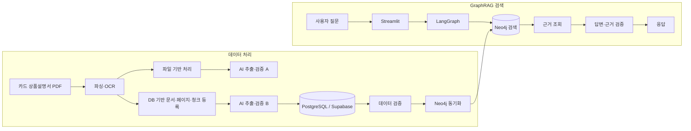

# 하나·우리카드 혜택 GraphRAG

**근거까지 답하는 카드 혜택 검색·비교 시스템**

하나카드·우리카드 상품설명서의 혜택, 이용 조건, 한도, 제외 규정과 원문 근거를 구조화하고, GraphRAG 검색으로 카드 혜택 질문에 근거를 연결해 답하는 팀 프로젝트입니다.

> 현재 구현은 파일 기반과 PostgreSQL 기반 처리 경로가 함께 존재합니다. 코드가 존재하는 것과 실제 운영 데이터 처리·검증이 완료된 것은 구분해 표시합니다.

## 프로젝트 배경 및 목표

카드 상품설명서는 혜택마다 실적 조건, 적용 한도, 기간, 제외 규정이 얽혀 있어 키워드 일치만으로는 정확한 답을 고르기 어렵습니다. 원문 위치와 조건 간 관계를 보존하고, 검색 결과와 답변을 근거에 대조할 수 있는 흐름을 만드는 것이 목표입니다.

## 핵심 기능 및 상태

| 기능 | 구현 범위 | 상태 메모 |
|---|---|---|
| PDF 파싱·OCR | 파일/DB 처리 경로에서 텍스트·페이지를 구성하고 OCR 경로 제공 | 지원 코드 존재. 카드별 처리 완료 여부는 자료별로 확인 필요 |
| 문서·페이지·청크 | PostgreSQL 문서 등록·조회·검증 | 구현됨. 실제 등록 현황은 데이터별 상태 확인 필요 |
| AI 혜택 추출 | LLM 응답 스키마, 후보 추출·정규화 | 구현됨. 외부 LLM 실행은 API 설정·비용이 필요 |
| 원문 근거·검증 | 추출 항목의 문서 근거와 데이터 검증 경로 | 구현 및 검증 도구 존재. 모든 항목의 승인 완료를 뜻하지 않음 |
| PostgreSQL → Neo4j | 스냅샷 변환, 적재 미리보기, 검증 | dry-run/검증 코드 존재. 실제 운영 적재는 별도 확인 필요 |
| GraphRAG 질의 | Neo4j 검색, LangGraph 질의 단계, 근거 확인 | Streamlit 앱 구현. 배포 및 실데이터 응답은 아래 상태 참고 |
| 카드 혜택 검색·비교 | 카드·혜택·조건을 검색 맥락으로 제공 | 앱 기능 존재. 범위별 검증 상태는 검증 문서 참조 |
| 답변 검증 | 근거 ID·수치 점검 및 경고 경로 | 구현됨. 모든 질문 유형의 정답률이 검증된 것은 아님 |
| Streamlit 화면 | 카드 GraphRAG 앱 | 진입점 `db_pipeline_origin_search/streamlit_app.py` |

## 시스템 아키텍처



파일 기반 경로와 DB 기반 경로는 각각 독립적으로 입력 문서를 처리하는 구현입니다. DB 기반 경로는 PostgreSQL 저장 자료에서 Neo4j 변환·동기화로 이어집니다. 파일 기반 추출 결과가 DB 파이프라인의 입력이라고 가정하지 않습니다.

## 기술 스택

| 영역 | 기술 |
|---|---|
| 언어·UI | Python 3.12+, Streamlit |
| 관계형 저장소 | PostgreSQL, Supabase, psycopg, SQLAlchemy |
| 그래프 | Neo4j, Cypher |
| 검색·에이전트 | LangChain, LangGraph, pgvector |
| PDF·OCR | PyMuPDF, pypdf, 선택 OCR 의존성 |
| LLM | OpenAI 호환 LLM API (`langchain-openai`) |
| 의존성·협업 | uv, Git, GitHub |

## 폴더 구조

```text
src/card_benefit/
├── payment_card/
│   ├── file_pipeline/                 # 파일 기반 처리 경로
│   ├── db_pipeline/                   # PostgreSQL 문서·추출·Neo4j 적재 경로
│   ├── db_pipeline_origin_search/     # GraphRAG 검색 및 Streamlit 진입점
│   ├── file_pipeline_origin_search/   # 파일 경로 검색 관련 구현
│   └── tests/                         # 카드 프로젝트 테스트
├── docs/                              # 아키텍처·검증·설계 문서
├── sql/                               # 스키마·검증 SQL 및 SQL 관련 자료
└── data/                              # 프로젝트 데이터·인덱스
```

`src/recipe/`는 기존 레시피 GraphRAG 참고 구현이며 카드 혜택 시스템과 별도입니다.

## 실행 방법

저장소 루트에서 Python 3.12 이상과 uv를 준비합니다.

```powershell
uv sync --locked
```

DB 및 외부 서비스 없이 실행 가능한 테스트는 다음과 같습니다.

```powershell
uv run python run_offline_tests.py
```

Streamlit 앱은 `src/card_benefit/payment_card/db_pipeline_origin_search/requirements.txt`의 배포용 의존성을 사용합니다. 개발 환경이 `uv sync`로 준비되어 있다면 다음 명령으로 앱을 열 수 있습니다.

```powershell
uv run streamlit run src/card_benefit/payment_card/db_pipeline_origin_search/streamlit_app.py
```

실제 검색에는 Neo4j 연결 설정이 필요하며, LLM 답변 경로는 해당 API 설정과 비용이 발생할 수 있습니다. 환경변수 이름과 안전한 설정 절차는 해당 디렉터리 README를 확인하세요. 문서 등록·Neo4j 적재 명령은 원격 저장소를 변경할 수 있으므로 기본 실행 예제로 포함하지 않았습니다.

## Streamlit 시연

[배포 앱 열기](https://mle-02-p2-team3-bwwnpmzpjxd4ahu39tazko.streamlit.app/)

현재 작업 환경에서 배포 앱의 접속 및 정상 응답을 확인하지 못했습니다. 링크는 프로젝트에서 제공된 주소이며, 실시간 동작 상태를 보증하지 않습니다.

## 진행 현황

- **구현 확인:** 파일 기반 및 DB 기반 문서 처리 코드, PostgreSQL/Neo4j 매핑·검증 도구, LangGraph 검색 앱 코드가 저장소에 있습니다.
- **검증 필요:** 카드별 문서 등록, AI 추출, 승인 상태, Neo4j 반영 및 배포 앱의 실시간 질의는 각 자료·환경별 상태 문서를 확인해야 합니다. 코드 존재만으로 전체 데이터 완료를 뜻하지 않습니다.
- **후속 개선:** 카드별 데이터 커버리지와 추출 품질을 지속 대조하고, 공통 혜택 및 조건의 원문 근거를 검증하며, 질문 유형별 답변 품질을 평가합니다.

## 팀 역할

프로젝트 문서의 담당 구분은 파일 기반 처리와 DB 기반 처리로 나뉩니다. 파일 기반 경로는 `file_pipeline/`, PostgreSQL 중심 등록·추출·검증 및 그래프 동기화는 `db_pipeline/`을 중심으로 관리합니다. 검색 앱은 `db_pipeline_origin_search/`에 있습니다. 최신 담당자 이름과 세부 범위는 [개발 역할 문서](src/card_benefit/docs/development_roles.md)를 참고하세요.

## 관련 문서

- [카드 혜택 프로젝트 안내](src/card_benefit/README.md)
- [아키텍처](src/card_benefit/docs/architecture.md)
- [디렉터리 구조](src/card_benefit/docs/directory_structure.md)
- [DB 파이프라인 상태](src/card_benefit/payment_card/db_pipeline/PROJECT_STATUS.md)
- [DB 파이프라인 안내](src/card_benefit/payment_card/db_pipeline/README.md)
- [GraphRAG 검색 앱 안내](src/card_benefit/payment_card/db_pipeline_origin_search/README.md)
- [PDF 구조화 검증](src/card_benefit/docs/card_pdf_structuring_validation.md)
- [소스 분석 위키](src/card_benefit/docs/source_wiki/README.md)
- [공통 테스트 시작 안내](docs/TEAM_START_HERE.md)

---

기존 `src/recipe/` 기반 참고 구현과 간단한 공통 구조 안내는 계속 유지되며, 카드 혜택 프로젝트의 상세 설계·코드 설명은 위 링크의 문서에서 확인할 수 있습니다.
