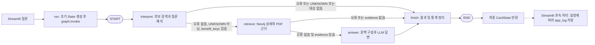

# LangGraph 실행 구조: 16장 교체 시안

기준: 원격 main과 일치하는 커밋 `375018b13026a6ca085a1934d1c5dc7389876b3c` (2026-11-09 확인). 18장 PPTX는 작업 공간에서 발견하지 못해 기존 17장 파일은 변경하지 않았다.

| 노드 / 라우팅 | 주요 입력 | 처리 및 반환하는 변경 State | 다음 경로 |
|---|---|---|---|
| 초기화 | question | 질문 정리, error·warnings·llm_calls·path 초기화 후 invoke | START → interpret |
| interpret | question | Neo4j 카탈로그, 임베딩·키워드 후보 및 RRF, Interpret LLM, ID 검증. intent, search_parameters, catalog, candidate_search, llm_calls, path 등을 반환 | after_interpret |
| after_interpret | error, intent, benefit_keys | 오류 또는 UNKNOWN이면 종료. 그 외 benefit_keys 존재 여부 확인 | retrieve 또는 finish |
| retrieve | search_parameters, intent, question | 선택 키·섹션으로 Cypher 상세 및 PDF 근거 조회·병합, 미확정 조건 분류. retrieved_data, evidence, retrieval_trace, open_conditions, path 등 반환 | after_retrieve |
| after_retrieve | error, evidence | 오류가 없고 evidence가 있으면 진행 | answer 또는 finish |
| answer | question, intent, search_parameters, retrieved_data, evidence, open_conditions | 문맥 구성, 구조화 LLM 호출. context, evidence, answer, llm_calls, path 등 반환. 실패 시 error 반환 | finish |
| finish | answer, error, path, llm_calls 등 | 답변이 없으면 안내 답변 생성, 경로·호출·토큰·비용을 로그에 집계. answer 또는 warnings, path 반환 | END → 최종 State |

노드는 변경 필드만 반환한다. LangGraph는 이를 공유 State에 병합하며 `path`, `llm_calls`, `warnings` 등은 `operator.add` 리듀서로 누적한다. Answer LLM 출력은 구조화 파싱 후 내용 그대로 보존된다. 현재 실행 경로에는 별도 답변 검증 노드나 재생성 루프가 없다. 실행 후 Streamlit의 선택적 PostgreSQL app_log 저장은 그래프 밖이다. 임베더가 설정된 경우 질문 임베딩을 수행하며 키워드 점수와 RRF 결합은 Python에서 처리한다.

조건부 화살표는 각각 `after_interpret`, `after_retrieve`에 해당하며 별도 그래프 노드가 아니다. SVG에서 카드 내부의 각 줄도 독립 노드가 아니다. 슬라이드 하단의 필드는 대표적인 공유 State이며 answer의 context와 오류 등도 실제 State에 포함된다.

## 발표 멘트 (약 1분)

사용자가 Streamlit에서 질문하면 초기 상태를 만들어 LangGraph를 실행합니다. 첫 번째 interpret 노드는 Neo4j의 혜택 목록을 확인하고, 질문 임베딩과 키워드 검색 결과를 RRF로 결합합니다. 그 후보를 바탕으로 LLM이 질문 의도와 혜택을 선택하고, 실제 목록에 있는 ID인지 확인합니다. 오류가 있거나 조회할 대상이 없으면 바로 마무리합니다. 대상이 있으면 retrieve에서 혜택의 규칙과 조건, 한도와 연결된 PDF 근거를 조회합니다. 이때도 오류가 있거나 근거가 없으면 답변 생성 없이 마무리합니다. 근거가 있으면 answer가 검색 결과를 문맥으로 만들어 구조화된 답변을 생성하고 finish로 전달합니다. 이 과정에서 각 노드는 바뀐 값만 반환하고 LangGraph가 공유 State에 합칩니다. 따라서 실행 경로와 검색 결과가 다음 단계에 전달되고, 조건에 따라 실제 경로가 달라집니다.

## 소스 위치

- `card_graphrag.py`: CardState 273행, `_build` 1246행, `_initial_state` 1264행, `run` 1283행, `interpret` 1361행, `after_interpret` 1559행, `retrieve` 1565행, `after_retrieve` 1625행, `answer` 1629행, `finish` 1789행.
- `neo4j_hybrid_search.py`: `search` 98행과 `catalog_rows` 182행. `neo4j_search.py`: 상세 Cypher 및 조회 구현.
- `streamlit_app.py`: 실행 334행, app_log 후속 저장 355–356행. 저장 구현은 `execution_log.py`의 `persist_app_logs`.
