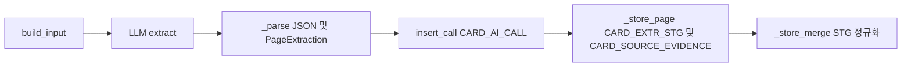

# CARD_AI_CALL 테이블 명세

## 범위와 확인 상태

`db_pipeline.card_ai_call`은 AI 호출 이력이다. 본 문서는 [V7 DDL 설계 파일](../../sql/db_pipeline_schemaV7_draft.sql#L799), 현재 [extraction_service.py](../../payment_card/db_pipeline/extraction_service.py#L876), [SQL mapper](../../payment_card/db_pipeline/extraction_repository.sql#L108), 연결된 PostgreSQL의 읽기 전용 메타데이터와 저장 행을 구분해 사용한다. 실제 서버에는 복합 PK `(card_ai_run_id, card_doc_id, page_no, card_doc_chunk_id, call_seq)`가 있다. 상위 실행·문서·페이지·청크와 staging은 논리적으로 연결되지만 이 테이블의 물리 FK 및 이 테이블을 참조하는 물리 FK는 조회 결과 없다.

한 행은 한 추출 실행에서 특정 문서 페이지의 특정 청크에 대한 한 번의 호출 시도다. 재시도하면 같은 청크의 `call_seq`가 증가한다. `ExtractionService._process_chunk`가 호출하고 `ExtractionRepository.insert_call`이 저장한다. `select_run_calls`는 성공 실행 재사용 완전성 검사에서 읽는다.

## 컬럼 명세

표의 타입·NULL·기본값은 V7 DDL과 실제 `information_schema` 조회에서 일치했다. `필수`는 NOT NULL, `선택`은 NULL 허용이다. 실제 행 예시는 아래 추적 절에 기록했다.

| 컬럼 | 타입 / NULL / 기본값 | 키·업무 의미·생성 경로 |
|---|---|---|
| `card_ai_run_id` | varchar(20), 필수 | PK; 실행 ID. `run`의 `insert_run` 결과 |
| `card_doc_id` | varchar(20), 필수 | PK; 문서 ID. 청크 입력에서 복사 |
| `page_no` | smallint, 필수 | PK; PDF 페이지 번호. 청크 입력에서 복사 |
| `card_doc_chunk_id` | varchar(20), 필수 | PK; 입력 청크 ID |
| `call_seq` | smallint, 필수, 1 | PK; 청크별 시도 순번, 양수 CHECK |
| `call_input_sha256` | varchar(64), 필수 | prompt, 입력 텍스트 및 존재 시 PNG 바이트를 순서대로 SHA-256. `build_input` 생성 |
| `call_status` | varchar(20), 필수 | `FAILED`, `PARSE_ERROR`, `SUCCEEDED` 등 호출 처리 상태. `SUCCEEDED`는 JSON NOT NULL CHECK |
| `call_resp_raw` | text, 선택 | LLM 어댑터의 `response.raw_text`. API 응답 텍스트 자체이며 전체 HTTP 응답 객체는 아님 |
| `call_resp_json` | jsonb, 선택 | JSON 파싱·Pydantic 검증·페이지 일치 후 `model_dump(mode="json")` 결과 |
| `call_error_msg` | text, 선택 | 예외 유형 이름 또는 페이지 번호 불일치 설명. 호출 오류 원문 전체는 저장하지 않음 |
| `call_input_token_cnt` | integer, 선택 | API 사용량의 입력 토큰. 사용량이 없으면 NULL |
| `call_output_token_cnt` | integer, 선택 | API 사용량의 출력 토큰. 사용량이 없으면 NULL |
| `call_latency_ms` | integer, 선택 | `_call_llm`에서 경과 시간을 밀리초 정수로 계산 |
| `call_req_date` | timestamptz, 필수, now() | mapper에서 명시하지 않아 DB 기본값. 정확한 API 시작 시각이 아니라 INSERT 시점 기본값 |
| `create_date` | timestamptz, 필수, now() | 생성 시각 DB 기본값 |
| `create_user_id` | varchar(50), 필수 | repository의 `SYSTEM_USER_ID` |
| `update_date` | timestamptz, 필수, now() | 생성 시 기본값 |
| `update_user_id` | varchar(50), 필수 | repository의 `SYSTEM_USER_ID` |

## 원본 응답과 JSON

`TerraClient.extract`는 OpenAI Responses API의 `output_text`와 토큰 사용량을 `LlmResponse`로 전달한다. `_call_llm`은 그 텍스트를 `call_resp_raw`에 넣고 `_parse`에 전달한다. `_parse`는 `json.loads` → `PageExtraction.model_validate` → `page_no` 일치를 확인하고 성공할 때만 `model_dump(mode="json")`를 `call_resp_json`에 넣는다. JSONB는 파싱된 구조이며 원본 문자열의 공백·키 순서·직렬화 표현이 보존된다는 보장은 없다. 실제 성공 행의 JSONB 최상위 필드는 `page_no`, `page_role`, `product`, `benefits`, `card_conditions`, `unresolved`였다 ([extraction_schema.py](../../payment_card/db_pipeline/extraction_schema.py#L158)).

실제 Visa 호출의 raw 텍스트를 JSONB로 해석해 저장 JSONB와 비교했더니 **동일하지 않았다**. raw에는 `product`가 없고 저장 JSON에는 있으며, `benefits`도 값이 다르다. 코드상 Pydantic 모델 검증과 기본값이 포함된 직렬화가 이루어진다. 각 중첩 차이의 전체 원인은 확인하지 않았다. 응답 본문은 노출하지 않았다.

| 상황 | 상태 | raw | json | 오류 |
|---|---|---|---|---|
| API 응답과 형식·페이지 검증 성공 | `SUCCEEDED` | 응답 텍스트 | Pydantic 변환 결과 | NULL |
| API 호출 예외 | `FAILED` | NULL | NULL | 예외 클래스명 |
| JSON 또는 스키마 오류, 페이지 불일치 | `PARSE_ERROR` | 수신 텍스트 | NULL | 오류 클래스명 또는 페이지 불일치 |

형식 성공은 **업무 검증 성공이 아니다**. 이후 `check_benefit`/`check_condition`이 인용 위치와 수치·연결을 검증한다. `_store_item`은 각 혜택 또는 조건의 Pydantic 객체를 `card_extr_stg.stg_raw_item`으로 저장하고 `card_source_evidence`를 생성한다. 모든 대상 처리 성공 후 `merge_pages`의 결과는 대표 staging 행의 `stg_sql_check_cd`와 중복 행의 상위 ID(`stg_parent_card_extr_stg_id`)로만 남는다. 따라서 호출 JSON은 페이지 전체 응답, staging raw는 항목별 응답이다. 문서 통합·계약 형태(정제본)는 저장하지 않고 등록할 때 `normalize_stored_run`이 staging raw에서 다시 만든다(2026-11-03 `stg_normalized_item` 컬럼 제거).

## 저장 순서와 실패 경계

호출 기록은 페이지 항목 저장 전에 별도로 저장한다. 페이지 항목·근거는 페이지 처리 트랜잭션, 문서 병합은 별도 트랜잭션이다. 따라서 호출 성공이 staging 저장 성공이나 문서 병합 성공을 보장하지 않는다 ([extraction_service.py](../../payment_card/db_pipeline/extraction_service.py#L850)).

## 실제 서버 제약과 인덱스

실제 `pg_constraint`에는 PK 외 별도 UNIQUE나 FK가 없고, CHECK 두 개가 있다: `call_seq > 0`, `call_status = 'SUCCEEDED'`이면 `call_resp_json IS NOT NULL`. PK 및 CHECK는 확인한 V7 DDL과 일치한다. `pg_indexes`는 다음 세 개다.

| 이름 | 실제 정의 |
|---|---|
| `card_ai_call_pkey` | 복합 PK의 UNIQUE btree 인덱스 |
| `ix_card_ai_call_chunk_key` | `(card_doc_chunk_id)` btree |
| `ix_card_ai_call_doc_chunk_key` | `(card_doc_id, page_no, card_doc_chunk_id)` btree |

위 세 인덱스는 현재 V7 DDL의 PK 및 `CREATE INDEX` 정의와 일치한다. 확인한 컬럼·기본값·NULL·PK·CHECK·인덱스에서는 차이를 발견하지 못했다. 이 비교는 해당 테이블 범위이며 마이그레이션 이력 전체를 검증한 것은 아니다.

## 실제 호출 추적과 추가 확인

이전 작업에서 읽기 전용으로 확인한 사례: 문서 `20261103_000009`, 실행 `20261103_000012`의 1페이지 호출은 `PARSE_ERROR`, `JSONDecodeError`, 입력 6,268·출력 8,000 토큰이었다. 해당 실행은 `PARTIAL`로 문서 병합을 하지 않았다. 당시 확인한 값은 호출 이력과 실행 상태까지이며, 해당 행의 복합 PK 전체와 raw/json 실제 내용, 그 호출의 staging·근거 건수는 **확인 필요**다. 따라서 완전한 호출 한 건의 관련 테이블 추적은 아직 완료되지 않았다.

실제 조회 사례는 Visa 공통 문서의 호출이다. 키는 `card_ai_run_id=20261102_000003`, `card_doc_id=20261102_000004`, `page_no=1`, `card_doc_chunk_id=20261102_000020`, `call_seq=1`이며 상태는 `SUCCEEDED`다. raw 길이는 924자, JSONB의 `benefits`는 1건, `card_conditions`는 0건이다. 입력·출력 토큰은 둘 다 NULL, `call_latency_ms=0`, `call_req_date=2026-11-02 08:44:16.538489+00`, 생성·수정 사용자는 `SYSTEM`이다. 토큰 NULL이나 0ms가 실제 무료 호출 또는 실시간 측정의 정확성을 뜻하지는 않는다.

위 호출의 복합 키로 연결한 `card_extr_stg`는 `20261102_000017` 한 건이다. `BENEFIT`, `PENDING_REVIEW`, `LINK_REVIEW`이고 정규화 JSON이 존재한다. 이 staging의 `card_source_evidence`는 `20261102_000063`, `20261102_000064`, `20261102_000065` 세 건이며 모두 `PENDING`이다. 각 근거의 승계 키로 `card_evidence_link`를 연결하면 각각 1건씩, 총 3건이다. 따라서 이 사례는 호출 형식 성공 이후에도 업무 검토와 근거 승인이 남아 있다. 개인정보나 응답 원문 전문은 기록하지 않았다.

실제 추출 기능이 동시에 실행 중이므로 통계와 최신 행은 변할 수 있다. 이 사례 외 모든 실패 유형의 실제 raw/json 저장값을 전수 확인하지는 않았으며 위 실패 표는 소스 분기 기준이다.
