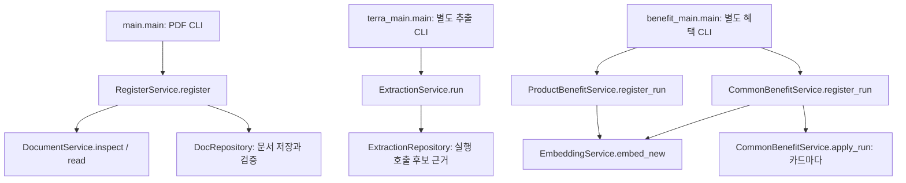
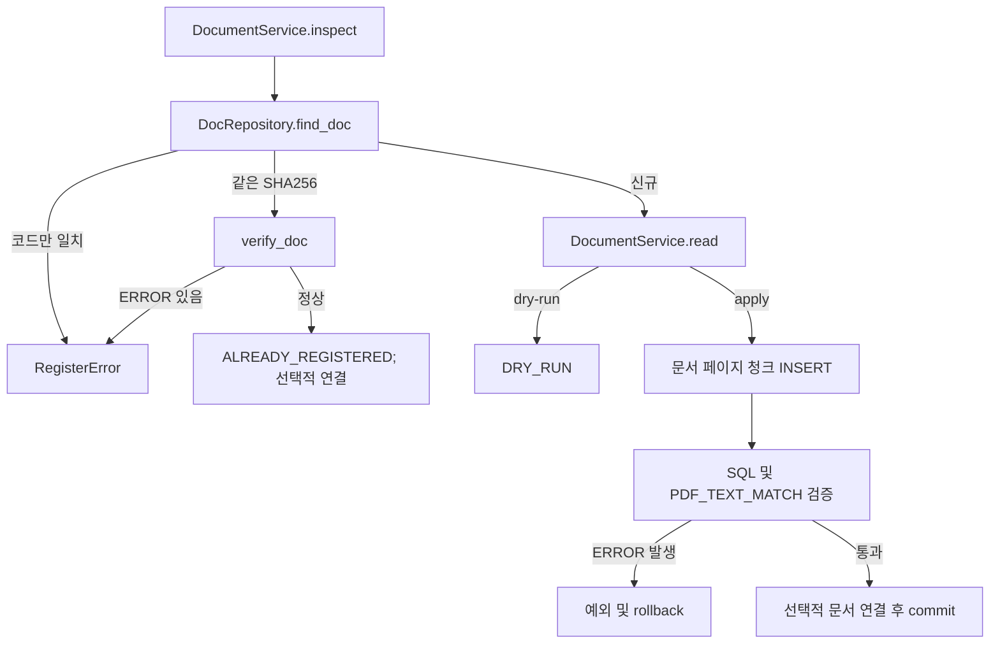
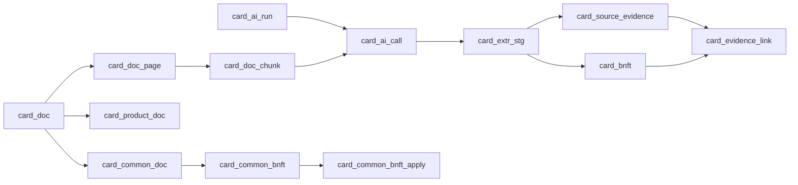

# 하나카드 데이터 등록 및 검증 로직 상세

## 목차

1. [분석 기준과 범위](#1-분석-기준과-범위)
2. [전체 구조와 진입점](#2-전체-구조와-진입점)
3. [PDF 검증과 문서 저장](#3-pdf-검증과-문서-저장)
4. [AI 추출과 스테이징](#4-ai-추출과-스테이징)
5. [카드별 혜택 등록](#5-카드별-혜택-등록)
6. [공통 혜택 등록과 카드 적용](#6-공통-혜택-등록과-카드-적용)
7. [근거와 저장 순서](#7-근거와-저장-순서)
8. [임베딩](#8-임베딩)
9. [트랜잭션과 실패 처리](#9-트랜잭션과-실패-처리)
10. [구현 상태와 확인 필요 사항](#10-구현-상태와-확인-필요-사항)

## 1. 분석 기준과 범위

- 기준 커밋: `a05466926f8d503be79797b835b65b3b1f2aed85`. 분석 시작 시 `git status --short`에 변경 항목이 없었다. 전역 ignore 접근 경고는 발생했다.
- 아래 경로는 저장소 루트 기준이다. 코드 위치는 분석 시점의 줄 번호다. Python과 SQL mapper를 읽었으며 등록 프로그램, DB 변경, 유료 API 호출은 수행하지 않았다. 따라서 아래는 **소스상 동작**이지 실제 DB 실행 결과가 아니다.
- 대상은 `payment_card/db_pipeline`의 문서 등록, 추출, 상품·공통 혜택 반영 및 임베딩 경로다. 기존 DDL 또는 제안 문서가 실제 서버에 적용되었는지는 확인하지 않았다. SQL에서 사용하는 컬럼과 테이블은 실제 DB 구조를 증명하지 않는다.

## 2. 전체 구조와 진입점

화살표는 실제 호출 또는 CLI에서의 단계 선택을 뜻한다. PDF CLI가 자동으로 추출과 혜택 등록을 실행하는 것은 아니다. `CommonBenefitService.register_document_and_apply`는 서비스 조합 경로로 등록 → 추출 → 공통 등록 → 기존 카드 적용을 호출하지만, 각 단계는 별도 작업 단위다. `path_a`는 기존 성공 실행을 찾아 새 카드에 적용하고, `path_b`는 기존 활성 카드에 지정 실행을 적용한다 ([common_benefit_service.py:185](../payment_card/db_pipeline/common_benefit_service.py#L185)).

| 진입점 | 인자와 실제 동작 | 근거 |
|---|---|---|
| `main.main` | `--pdf` 필수. `--apply` 없으면 등록하지 않으나 DB에서 중복을 조회한다. `--card-id`에는 `--basis`, `--common-cd`에는 `--common-nm` 필요. 두 연결은 동시 지정 불가. `--ocr` 선택 가능 | [main.py:32](../payment_card/db_pipeline/main.py#L32), [main.py:86](../payment_card/db_pipeline/main.py#L86) |
| `terra_main.main` | 페이지, 문서, 입력 토큰 추정, 이전 비용 필요. 기본 dry-run은 DB/API 없음; `--preflight`는 읽기 전용 검증; `--execute`는 단일 페이지 추출 및 저장 | [terra_main.py:19](../payment_card/db_pipeline/terra_main.py#L19), [terra_main.py:91](../payment_card/db_pipeline/terra_main.py#L91) |
| `benefit_main.main` | `product`, `common`, `brand-compare`. `--apply` 없으면 DB에 접속하지 않음. product에는 run ID와 카드 하나; common은 run ID, 검토자가 지정한 `stg_id=identity`, 선택적 카드 ID 사용 | [benefit_main.py:30](../payment_card/db_pipeline/benefit_main.py#L30) |
| `embedding_main.main` | 검색 텍스트/벡터를 별도로 점검·동기화하는 CLI | [embedding_main.py:29](../payment_card/db_pipeline/embedding_main.py#L29) |

## 3. PDF 검증과 문서 저장

`RegisterService.register` ([register_service.py:67](../payment_card/db_pipeline/register_service.py#L67))는 먼저 `DocumentService.inspect`로 파일 정체성을 확인하고 `DocRepository.find_doc`으로 SHA-256 또는 `doc_cd` 일치를 조회한다. 동일 해시는 `ALREADY_REGISTERED`로 재사용하고 저장 구조를 검증한다. 기본 `inspect`는 페이지를 읽지 않으므로 이 재사용 경로는 PDF 페이지 텍스트와 DB의 재추출 비교를 생략한다. `--apply`와 연결 인자가 있으면 기존 문서에 연결은 별도 트랜잭션에서 시도한다. 해시가 다르고 코드가 같은 행이 있으면 충돌 오류다. 새 문서의 dry-run은 파싱만 하고 쓰지 않는다. 신규 apply는 `read` 후 다시 해시를 비교하고 `_insert`를 호출한다.

### 입력 및 저장 검증

| ID | 검증 조건 | 실패 시 처리 | 근거 |
|---|---|---|---|
| D1 | resolved 경로가 `DATA_ROOT` 안의 파일이고 manifest의 경로가 일치하며 문서구분이 `공식 원본`으로 시작, 문서종류에 상품설명서 또는 브랜드서비스안내 포함 | `ValueError`, 저장 전 중단 | [document_service.py:196](../payment_card/db_pipeline/document_service.py#L196) |
| D2 | `%PDF-` 헤더, manifest의 SHA256·바이트 크기 일치, 파일명에서 디자인코드·날짜 추출 가능 | `ValueError` | [document_service.py:133](../payment_card/db_pipeline/document_service.py#L133) |
| D3 | 암호화 PDF 거부, reader의 차단 상태 페이지 거부; manifest 페이지 수와 실제 수 일치; 파싱 중 파일 해시 변동 금지 | `ValueError`, 문서 저장 안 함 | [document_service.py:176](../payment_card/db_pipeline/document_service.py#L176), [document_service.py:218](../payment_card/db_pipeline/document_service.py#L218) |
| D4 | 상품 연결은 `PRODUCT_GUIDE`, 공통 연결은 `BRAND_SERVICE`; 상품 ID 존재. 공통 코드는 이름·브랜드·등급 일치 | `RegisterError`; 신규 저장 트랜잭션 안의 연결 실패는 전체 rollback | [register_service.py:67](../payment_card/db_pipeline/register_service.py#L67), [common_benefit_service.py:154](../payment_card/db_pipeline/common_benefit_service.py#L154) |
| D5 | 저장 문서의 페이지 수·최대 페이지 번호, 글자 수, 페이지 SHA256, 청크 고아·위치·순번·중복 위치·비공백 누락, OCR 검토 중 청크 상태, 코드값을 SQL 검사 | `ERROR` 건수가 0이 아니면 예외/rollback. 빈 페이지·동일 청크 텍스트·제외 청크·전체 integrity gate는 `WARN`으로 보고만 함 | [document_repository.sql:201](../payment_card/db_pipeline/document_repository.sql#L201) |
| D6 | `_verify`는 다시 추출한 페이지별 SHA256과 DB 해시를 비교하고 DB에만 있는 페이지도 오류로 계산 | `PDF_TEXT_MATCH` ERROR이면 rollback | [register_service.py:159](../payment_card/db_pipeline/register_service.py#L159) |

`_read_pages`는 NUL을 `�`로 바꾸고 페이지 텍스트 SHA256을 계산한다. 텍스트/시각 요소에 따라 `TEXT`, `MIXED`, `IMAGE`, `UNKNOWN`을 정한다. `_split_pages`는 비어 있지 않은 페이지 전체를 1개 청크로 만들고 문서 전체 순번과 1부터 시작하는 위치를 부여한다. 검토 대상 페이지의 청크는 `EXCLUDED`, 나머지는 `RAW`다. 심의 표기가 없으면 추정하지 않고 null이다 ([document_service.py:218](../payment_card/db_pipeline/document_service.py#L218), [document_service.py:260](../payment_card/db_pipeline/document_service.py#L260)).

저장 순서는 `card_doc` → `card_doc_page` → `card_doc_chunk` → 구조 검증 → 선택적 `card_product_doc` 또는 `card_common` / `card_common_doc`다. 상품 문서 연결은 `PENDING`, `(card_id, card_doc_id)` 충돌 시 `DO NOTHING`이므로 기존 근거 문구를 갱신하지 않는다 ([document_repository.sql:309](../payment_card/db_pipeline/document_repository.sql#L309)). 문서 등록은 상품 자체를 만들지 않는다. `register_card` 서비스는 별도로 상품 코드를 넣고 조회해 이름·발급사·종류·브랜드 옵션까지 일치하는지 확인한다 ([common_benefit_service.py:140](../payment_card/db_pipeline/common_benefit_service.py#L140)).

## 4. AI 추출과 스테이징

`ExtractionService.run` ([extraction_service.py:679](../payment_card/db_pipeline/extraction_service.py#L679))은 카드 지정 시 존재 여부, 문서 존재, 카드 없는 추출의 `BRAND_SERVICE` 제한, AI 입력 청크 존재, 지정 페이지가 대상의 부분집합인지, 로컬 PDF 해시를 확인한다. mapper는 활성 문서와 사용 가능한 청크를 조회하며 제외 페이지를 별도로 찾는다 ([extraction_repository.sql:32](../payment_card/db_pipeline/extraction_repository.sql#L32)). 입력은 페이지 전체 텍스트와 PDF 페이지 PNG이며 prompt·텍스트·이미지의 입력 해시를 만든다. 이미지는 DB에 저장하지 않는다.

실행 순서는 `card_ai_run` INSERT → 페이지별 LLM 호출 → `card_ai_call` INSERT → 성공 페이지별 트랜잭션에서 `card_extr_stg`와 `card_source_evidence` INSERT → 모든 페이지가 성공한 경우 병합 트랜잭션에서 스테이징 UPDATE → 실행 상태 UPDATE다. 호출 실패/파싱 실패는 호출 이력을 남기고 다음 페이지를 처리한다. JSON/Pydantic 실패 또는 응답 `page_no` 불일치는 `PARSE_ERROR`. 페이지 저장의 `psycopg.Error`는 그 페이지만 실패 처리한다. 실패 페이지가 있으면 문서 병합을 하지 않는다. 병합 성공이고 차단·생략 페이지가 없어야 `SUCCEEDED`; 성공 페이지가 있으나 완전하지 않으면 `PARTIAL`, 성공 페이지가 없으면 `FAILED`다. 예외가 밖으로 전파될 때 실행을 `FAILED`로 마감한다 ([extraction_service.py:765](../payment_card/db_pipeline/extraction_service.py#L765)).

공통 문서의 전체 실행이고 차단 페이지가 없으며 모델 재사용 설정이 있을 때만 fingerprint를 비교한다. 이전 성공 호출의 청크 집합, 응답 스키마·페이지, 후보 raw JSON·인용·병합 상태가 모두 완전해야 재사용한다. 부분 페이지 실행은 재사용하지 않는다 ([extraction_service.py:727](../payment_card/db_pipeline/extraction_service.py#L727)).

| ID | 검증 | 실패 분기 | 근거 |
|---|---|---|---|
| E1 | 인용을 원문에서 정확 검색, 실패 시 공백만 제거하여 검색; 반환 위치는 원문 기준 1부터 시작, 끝 포함 | 위치 없음으로 기록; 후보 자체는 스테이징될 수 있음 | [extraction_service.py:153](../payment_card/db_pipeline/extraction_service.py#L153) |
| E2 | `check_values`: 근거 없음 → `NO_EVIDENCE`; 위치 확인된 인용 없음 → `QUOTE_NOT_FOUND`; raw 표기가 인용에 없음 → `VALUE_NOT_IN_QUOTE`; 예상 숫자가 raw에서 파싱되지 않음 → `VALUE_PARSE_DIFF`; 숫자가 인용에 없음 → `VALUE_NOT_IN_QUOTE` | 검증 코드를 후보에 반영하여 후속 검토; 곧바로 전체 추출을 롤백하지 않음 | [extraction_service.py:230](../payment_card/db_pipeline/extraction_service.py#L230) |
| E3 | `link_check`: 모든 근거가 `SAME_TEXT`이고, 대상명 지정 시 인용에 적어도 하나 포함되어야 `TEXT_CONFIRMED` | 그 외 `NEEDS_REVIEW` | [extraction_service.py:270](../payment_card/db_pipeline/extraction_service.py#L270) |
| E4 | 규칙의 비율·원화 값, 최소 거래 금액, 조건·한도 등을 각 원문 인용과 대조 | 개별 값 검증 결과와 이슈 기록; 병합 시 충돌·미확정 등과 함께 SQL 검사 코드 결정 | [extraction_service.py:284](../payment_card/db_pipeline/extraction_service.py#L284), [extraction_service.py:437](../payment_card/db_pipeline/extraction_service.py#L437) |

`_store_item`은 위치가 확인된 첫 인용을 대표 근거로 쓰고 각 인용을 별도 `card_source_evidence` 행으로 저장한다. 위치를 찾지 못해도 null 위치로 기록될 수 있다. 병합은 대표 행에 정규화 JSON을 쓰고 나머지는 대표 ID를 참조하며 `MERGED_DUP` 또는 충돌 시 `MERGE_CONFLICT`를 쓴다 ([extraction_service.py:898](../payment_card/db_pipeline/extraction_service.py#L898), [extraction_service.py:954](../payment_card/db_pipeline/extraction_service.py#L954)).

## 5. 카드별 혜택 등록

`benefit_main` → `ProductBenefitService.register_run` → `CommonBenefitRepository` → `common_benefit_repository.sql`이다. 실행은 카드 행을 `FOR UPDATE`로 잠그고, 기존 integrity 오류 집합을 기록한 다음 후보별 `_register`를 호출한다. mapper는 상품 문서 연결이 있고 문서가 활성이고 연결이 `REJECTED`가 아닌 정규화 `BENEFIT` 행을 선택한다. **이 product 후보 SQL에는 run 상태가 `SUCCEEDED`여야 한다는 조건이 없다** ([common_benefit_repository.sql:134](../payment_card/db_pipeline/common_benefit_repository.sql#L134)).

| ID | 실제 순서와 조건 | 결과 | 근거 |
|---|---|---|---|
| P1 | `(card_id, bnft_cd)` 조회가 먼저. 기존 행이 있으면 내용 비교 없이 | `UNCHANGED`, 기존 행 수정 안 함. 이 판단은 후보 제외 상태 검사보다 먼저다 | [product_benefit_service.py:54](../payment_card/db_pipeline/product_benefit_service.py#L54) |
| P2 | `REJECTED`/`RETIRED` | `EXCLUDED`, 해당 후보 건너뜀 | 동일 |
| P3 | `stg_sql_check_cd`가 `OK` 또는 `LINK_REVIEW`가 아니거나 공통 후보, `relation_list` 존재, 규칙 없음 또는 하나라도 `DRAFT` 아님 | `REVIEW`, 해당 후보 미등록 | 동일 |
| P4 | 근거의 start/end 및 source 존재, 공백 제거 후 source와 quote 일치. raw의 RULE 키는 rule 목록에 있어야 하고 모든 인용이 위치 확인 근거에 대응. 혜택 자체 근거 1건 이상 및 모든 rule 키의 근거 필요 | 부족하면 `REVIEW`. 중복 링크는 제거 | [product_benefit_service.py:93](../payment_card/db_pipeline/product_benefit_service.py#L93) |
| P5 | INSERT 결과 없음은 동시 등록 충돌. 전체 처리 전후 integrity 오류의 `(gate_cd, issue_key)` 다중집합에 신규 항목이 생김 | 예외; 해당 카드 실행 트랜잭션 전체 rollback | [product_benefit_service.py:33](../payment_card/db_pipeline/product_benefit_service.py#L33) |

통과하면 `card_bnft`에 `LOCAL`, `PRODUCT`, `PENDING_REVIEW`, `bnft_cond_expr`, `rule_list`, 빈 `relation_list`, 규칙·한도 원문을 넣고 혜택 및 규칙의 `card_evidence_link`를 삽입한다. 규칙은 별도 행 INSERT가 아니라 JSON `rule_list`에 저장하며 `pool_refs`를 제거한다. 성공이 곧 승인이라는 뜻은 아니다 ([common_benefit_repository.sql:124](../payment_card/db_pipeline/common_benefit_repository.sql#L124)).

## 6. 공통 혜택 등록과 카드 적용

공통 후보 SQL은 `SUCCEEDED` 추출, 활성 `BRAND_SERVICE`, `card_id IS NULL`, 정규화된 BENEFIT만 선택한다 ([common_benefit_repository.sql:66](../payment_card/db_pipeline/common_benefit_repository.sql#L66)). `register_run`은 공통 혜택을 먼저 등록하고, CLI는 지정된 각 카드에 `apply_run`을 별도로 호출한다. 따라서 공통 등록과 모든 카드 적용을 하나의 원자적 트랜잭션으로 묶지 않는다.

| ID | 실제 조건 | 실패 또는 중복 시 처리 | 근거 |
|---|---|---|---|
| C1 | 후보 상태가 제외가 아니고 SQL 검사 `OK`/`LINK_REVIEW`, `value_check_cd=OK`, source_refs 정확히 1개, 관계 목록 없음 | `EXCLUDED` 또는 `REVIEW`, 후보만 건너뜀 | [common_benefit_service.py:247](../payment_card/db_pipeline/common_benefit_service.py#L247) |
| C2 | 문서에 연결된 공통서비스 정확히 1개; 후보 브랜드·등급이 기입된 경우 공통서비스와 일치; 선택서비스 번호, 기간, 검토자 identity로 코드 구성 가능 | 불명확하거나 충돌하면 `REVIEW` | [common_benefit_service.py:300](../payment_card/db_pipeline/common_benefit_service.py#L300), [common_benefit_service.py:23](../payment_card/db_pipeline/common_benefit_service.py#L23) |
| C3 | 근거는 위치가 있고 상태 `PENDING`/`APPROVED`, 원문과 인용이 공백 무시 일치. 인용이 대상 하나에 유일하게 대응하고 혜택, 모든 규칙, 각 한도에 근거 필요 | 모호하거나 누락되면 `REVIEW` | [common_benefit_service.py:259](../payment_card/db_pipeline/common_benefit_service.py#L259) |
| C4 | 공통 ID와 코드가 같으면 이름·유형·서비스 유형·규칙·한도·기간 비교. 동일하면 `UNCHANGED`; 다르면 같은 계열 이전 버전의 후보와 현재 행이 일치하는 경우에만 갱신 | 이전 출처 비교가 안전하지 않으면 `CHANGE_REVIEW`; 동시 INSERT 충돌은 예외/rollback. 갱신 시 검색 텍스트와 임베딩을 null로 비움 | [common_benefit_service.py:352](../payment_card/db_pipeline/common_benefit_service.py#L352), [common_benefit_repository.sql:180](../payment_card/db_pipeline/common_benefit_repository.sql#L180) |
| C5 | 카드가 ACTIVE; 대상·제외 카드, 브랜드·등급 및 선택서비스가 위치 확인된 `APPLICABILITY` 인용으로 뒷받침; 일치하는 활성 브랜드 옵션 정확히 1개 | 제외 카드/비활성은 `EXCLUDED`, 나머지 불확실성은 `REVIEW` | [common_benefit_service.py:377](../payment_card/db_pipeline/common_benefit_service.py#L377) |
| C6 | 대상 카드 목록이 없으면 선택서비스가 아니어야 하고 등급 전체 공통 제공 문구와 상품설명서의 카드 브랜드·등급 근거 필요. 제공 기간이 있으면 그 적용 근거도 필요 | 부족 시 `REVIEW` | [common_benefit_service.py:410](../payment_card/db_pipeline/common_benefit_service.py#L410) |
| C7 | 공통 혜택이 먼저 존재해야 함. `(card_common_id, card_common_bnft_id, card_id)` 적용 행 충돌은 무시 | `INSERTED` 또는 `UNCHANGED`; 같은 코드의 기존 카드별 혜택이 있으면 비교 필요 메시지, 자동 삭제·병합 안 함 | [common_benefit_service.py:437](../payment_card/db_pipeline/common_benefit_service.py#L437) |

공통 등록은 `card_common_bnft`에 공통 내용과 기간을 저장하고 카드 적용은 `card_common_bnft_apply`만 기록한다. 공통 후보의 근거 ID는 판단 결과에 반환되지만 이 경로에서 `card_evidence_link`를 삽입하지 않는다. 조회 mapper는 공통 문서와 staging을 거쳐 근거를 찾는다 ([embedding_repository.sql:187](../payment_card/db_pipeline/embedding_repository.sql#L187)).

## 7. 근거와 저장 순서

그림은 단계별 논리적 연결이며 모든 화살표가 DB 외래 키 또는 같은 트랜잭션이라는 뜻은 아니다. 실제 SQL은 [document_repository.sql](../payment_card/db_pipeline/document_repository.sql), [extraction_repository.sql](../payment_card/db_pipeline/extraction_repository.sql), [common_benefit_repository.sql](../payment_card/db_pipeline/common_benefit_repository.sql)에 있다.

| 단계 | 읽기 | 쓰기와 핵심 컬럼 |
|---|---|---|
| PDF 등록 | `card_doc`, `common_cd`, `v_card_integrity_issue` | `card_doc`의 해시·파일·문서 메타데이터; `card_doc_page`의 텍스트·해시; `card_doc_chunk`의 텍스트·범위·상태; 선택적 연결 테이블 |
| 추출 | `card_doc`, `card_doc_page`, `card_doc_chunk`, 기존 실행 | `card_ai_run`, `card_ai_call`, `card_extr_stg`의 raw/normalized JSON과 검사 코드, `card_source_evidence`의 quote·위치·stg 참조 |
| 카드별 반영 | `card_product`, staging, 근거, 문서 연결, integrity view | `card_bnft`의 `bnft_cond_expr`, `rule_list` 등; `card_evidence_link`의 subject, rule key, evidence ID |
| 공통 반영 | `card_common_doc`, staging, 근거, 상품과 옵션, 공통코드 | `card_common_bnft`, `card_common_bnft_apply`; 필요 시 `card_common`, `card_common_doc` |
| 임베딩 | 두 혜택 테이블과 공통 코드 | 해당 혜택의 `bnft_search_txt`, `bnft_embedding`; 임베딩 `card_ai_run` |

## 8. 임베딩

혜택 등록 커밋 후 `embed_new`가 신규 카드별 ID 또는 신규·갱신 공통 ID를 동기화한다. `--no-embed`는 이를 생략한다. `sync`는 검색 텍스트를 재생성하고 변경되었거나 벡터가 없거나 force일 때 대상에 넣는다. 동일 텍스트와 벡터가 있으면 건너뛴다. 이전 모델과 현재 모델이 다르면 force 없이 오류다. 배치 API 호출은 기본 3회까지 재시도하고, 저장 시 텍스트가 그 사이 변경되면 `TEXT_CHANGED`로 실패 처리한다. `embed_new`는 예외를 잡아 로그를 남기고 등록을 되돌리지 않는다. 따라서 혜택 저장 성공과 임베딩 성공은 별개다 ([embedding_service.py:141](../payment_card/db_pipeline/embedding_service.py#L141), [embedding_repository.sql:35](../payment_card/db_pipeline/embedding_repository.sql#L35)).

## 9. 트랜잭션과 실패 처리

`PostgresDbSession.transaction`은 블록 내 SQL에 같은 연결을 사용하고 정상 종료 시 commit, `BaseException` 발생 시 rollback 후 전파한다. 블록 밖 SQL은 연결 컨텍스트의 호출 단위 commit이다 ([postgres_db_session.py:423](../../common/postgres_db_session.py#L423), [database_manager.py:208](../../common/database_manager.py#L208)).

| 단위 | 범위와 실패 영향 |
|---|---|
| 신규 PDF | 문서·페이지·청크·검증·선택적 연결이 하나. 검증 ERROR 또는 연결 오류는 전체 rollback |
| 기존 PDF 연결 | 기존 문서 검증 후 연결만 별도 트랜잭션. 기존 저장 문서를 되돌리지 않음 |
| 추출 | 실행/호출 이력은 별도 저장, 페이지별 후보·근거는 페이지별 트랜잭션, 병합은 별도 트랜잭션. 병합 실패도 이미 저장한 페이지와 호출 이력을 지우지 않음 |
| 카드별 혜택 | 한 카드·run의 후보 및 근거 링크 전체가 한 트랜잭션. 후보별 REVIEW는 예외가 아니므로 다른 후보 진행. 신규 정합성 위반은 전체 rollback |
| 공통 혜택 | 한 run 등록과 각 카드 적용이 각각 별도 트랜잭션. `Counter` 차이로 기존 오류가 아닌 신규 오류만 막음. 공통 서비스는 일반 integrity와 공통 전용 integrity 검사 둘 다 사용 |
| 임베딩 | 등록 커밋 뒤 실행; 실패는 등록 rollback을 유발하지 않음 |

문서 `verify_doc`의 `INTEGRITY_GATE`는 WARN인 반면 혜택 반영은 신규 integrity 오류를 예외로 취급한다. 두 검증을 동일한 강제 차단으로 해석하면 안 된다. CLI는 입력/등록 오류와 DB 오류에 서로 다른 종료 코드를 사용한다. `terra_main`의 preflight는 예산·원문/청크·요청 형식을 검사하지만 실제 API 권한이나 서버의 스키마 수용까지 입증하지 않는다.

## 10. 구현 상태와 확인 필요 사항

| 항목 | 상태 및 근거 |
|---|---|
| PDF 등록, 페이지/청크 검증 | 구현. 다만 같은 해시 재사용 시 기본 경로는 페이지 재파싱을 하지 않는다. |
| AI 추출 | 구현. 명시적 별도 실행 및 API 설정이 필요하며 부분 추출은 `PARTIAL`이 될 수 있다. |
| 후보 승인 | 자동 승인 미구현. 카드별 등록은 `PENDING_REVIEW`; REVIEW와 CHANGE_REVIEW는 사람이 확인할 사항이다. |
| 공통 identity | 수동 입력. 추출 항목 ID와 업무 식별자를 CLI에 제공해야 하며 후보의 동일성을 자동 확정하지 않는다. |
| 원본 파일 Storage | 별도 `storage_main`/`DocumentStorage` 경로가 존재한다. PDF 등록이나 추출이 자동 업로드하는 것으로 확인되지 않았다. 추출은 로컬 해시 확인을 사용한다. |
| Neo4j 적재 | 별도 `neo4j_load_draft.py`, `neo4j_validate.py`가 존재한다. 위 등록 CLI의 자동 후속 단계로 확인되지 않았다. |
| 실제 DB와 DDL | 확인 필요. DB 접속·스키마 조회를 수행하지 않았다. mapper 이름/DDL 파일의 존재만으로 운영 스키마 적용이나 데이터 정합성을 확정할 수 없다. 특히 `card_source_evidence` PK 승계 제안의 실제 적용 여부도 확인 필요다. |
| product run 상태 | product 후보 SQL은 common 후보와 달리 `SUCCEEDED` 필터가 없다. 의도 및 부분 추출 후보 반영 가능성은 확인 필요이며 코드는 변경하지 않았다. |
| 실제 사례 | 이 문서의 중복·성공·실패 설명은 코드 분기 사례다. 특정 PDF나 카드의 실제 등록 결과를 실행하여 검증하지 않았다. |
