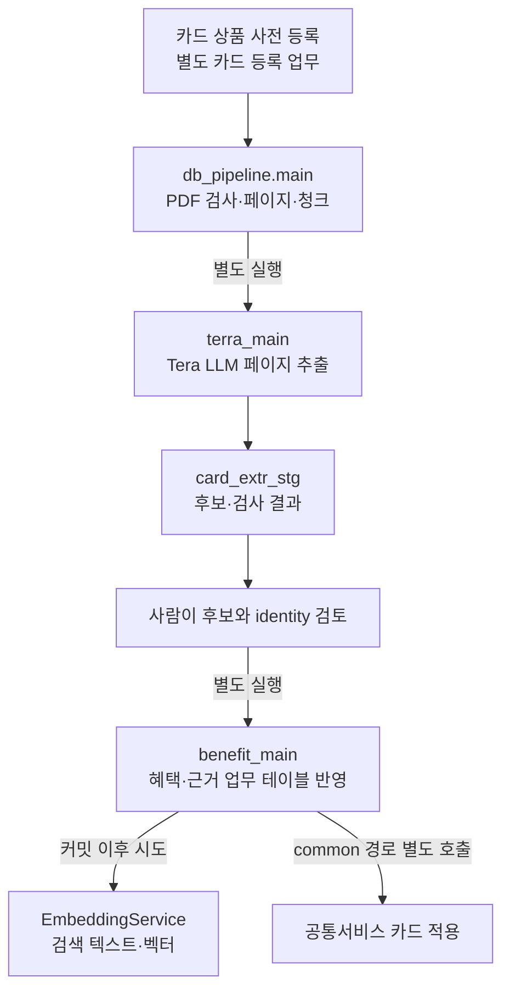
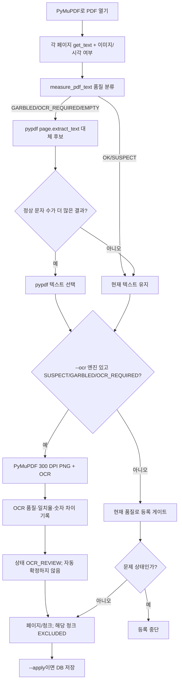
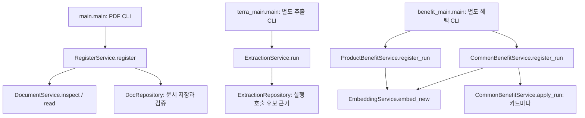
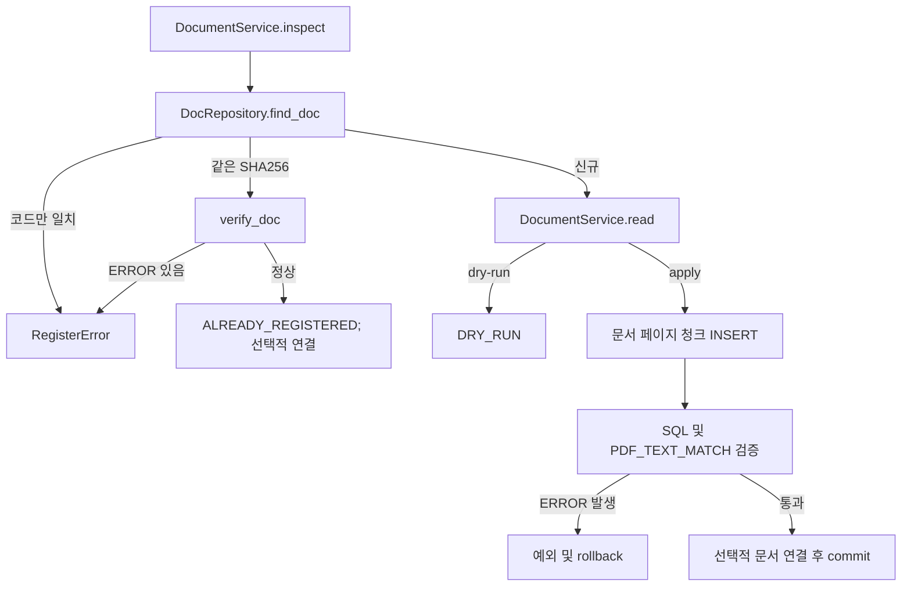
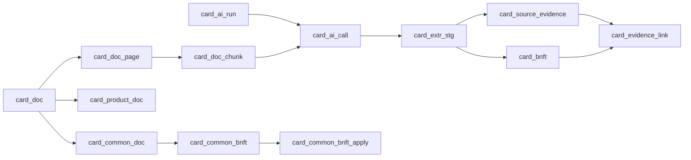

# 하나카드 데이터 등록 및 검증 로직 상세

## 목차

1. [한눈에 보는 실행 구조](#한눈에-보는-실행-구조)
2. [Python 코드를 Java 흐름으로 읽기](#python-코드를-java-흐름으로-읽기)
3. [OCR: 라이브러리부터 등록 판정까지](#ocr-라이브러리부터-등록-판정까지)
4. [하나카드와 우리카드 입력 경로](#하나카드와-우리카드-입력-경로)
5. [정상 페이지와 OCR 검토 페이지 사례](#정상-페이지와-ocr-검토-페이지-사례)
6. [테이블별 저장 단계](#테이블별-저장-단계)
7. [분석 기준과 범위](#1-분석-기준과-범위)
8. [전체 구조와 진입점](#2-전체-구조와-진입점)
9. [PDF 검증과 문서 저장](#3-pdf-검증과-문서-저장)
10. [AI 추출과 스테이징](#4-ai-추출과-스테이징)
11. [카드별 혜택 등록](#5-카드별-혜택-등록)
12. [공통 혜택 등록과 카드 적용](#6-공통-혜택-등록과-카드-적용)
13. [근거와 저장 순서](#7-근거와-저장-순서)
14. [임베딩](#8-임베딩)
15. [트랜잭션과 실패 처리](#9-트랜잭션과-실패-처리)
16. [구현 상태와 확인 필요 사항](#10-구현-상태와-확인-필요-사항)

## 한눈에 보는 실행 구조

이 파이프라인은 한 번 실행하면 끝나는 단일 배치가 아니다. 문서 등록, AI 추출, 후보 검토·업무 등록, 임베딩은 서로 다른 명령과 트랜잭션으로 나뉜다. `main.py`는 PDF를 읽고 PostgreSQL 문서 행을 만드는 역할까지만 한다. 다음 단계는 운영자가 별도 CLI로 실행한다.



흐름에서 문서가 `ACTIVE`여도 혜택 추출이 완료된 것은 아니다. `card_ai_run=SUCCEEDED`여도 혜택이 카드에 등록되거나 승인된 것은 아니다. OCR 결과를 문서에 저장했어도 그 페이지의 원문 검증이 끝난 것은 아니다.

### PDF 한 건의 메서드 호출 순서

```mermaid
sequenceDiagram
  participant CLI as main.py
  participant RS as RegisterService
  participant DS as DocumentService
  participant DR as DocRepository / SQL mapper
  CLI->>CLI: parse_args(), --ocr가 있으면 create_ocr_engine()
  CLI->>RS: register(pdf, apply, product_link/common_link)
  RS->>DS: inspect(pdf)
  DS-->>RS: ParsedDocument (파일 정체성·doc_cd, pages/chunks 비어 있음)
  RS->>DR: find_doc(SHA-256, doc_cd)
  alt 기존 동일 파일
    RS->>DR: verify_doc(), count 조회
  else 신규 파일
    RS->>DS: read(pdf)
    DS->>DS: DocumentReader → 페이지 품질 → page/chunk 구성
    alt apply=False
      RS-->>CLI: DRY_RUN (DB 변경 없음)
    else apply=True
      RS->>DR: _insert() transaction: 문서→페이지→청크→검증→선택 연결
      DR-->>RS: 검증 결과; 성공 commit, 예외 rollback
    end
  end
```

`inspect()`는 PDF의 해시와 메타데이터를 확인하지만 페이지 텍스트를 만들지 않는다. 그래서 신규 `--apply`도 먼저 중복 조회를 한 다음에야 `read()`를 호출한다. 같은 파일이 이미 있으면 다시 파싱하지 않고 DB에 저장된 구조를 검증한다. 새 파일은 파싱 전후 해시를 비교해 읽는 사이 PDF가 바뀐 경우 등록을 중단한다. 코드 위치: [`main()`](../../payment_card/db_pipeline/main.py#L138), [`RegisterService.register()`](../../payment_card/db_pipeline/register_service.py#L67), [`DocumentService.inspect()`](../../payment_card/db_pipeline/document_service.py#L186), [`DocumentService.read()`](../../payment_card/db_pipeline/document_service.py#L280), [`DocRepository`](../../payment_card/db_pipeline/document_repository.py#L30).

### 단계별 실행 계약

| 단계 | 실행 주체와 입력 | 처리·반환 | DB 읽기/쓰기와 다음 단계 |
|---|---|---|---|
| 카드 상품 등록 | 카드 등록 업무/별도 도구. 문서 CLI의 역할 아님 | 카드 번호·상품·브랜드 정보를 `card_product`에 준비 | 문서 연결 전 대상 카드가 조회되어야 함. 이 문서의 PDF 등록은 상품 행을 만들지 않음 |
| PDF 검사·정체성 | `main.parse_args` → `DocumentService.inspect(pdf)` | PDF 시그니처·경로·크기·SHA-256 및 메타데이터. 반환은 `ParsedDocument` | DB 읽기 전 단계지만 `RegisterService`가 이후 `card_doc` 중복 조회 |
| PDF 텍스트/OCR·페이지/청크 | `DocumentService.read` → `DocumentReader.set_pdf_doc_list` → `_read_pages`, `_split_pages` | 페이지별 텍스트·품질와 `DocPage` / `DocChunk`. 문제 페이지는 거부되거나 검토 상태로 남음 | 아직 DB 저장 없음. 모든 차단 조건을 통과해야 신규 저장으로 진입 |
| 문서 등록 | `RegisterService._insert` → `DocRepository`와 `document_repository.sql` | `RegisterResult(REGISTERED)` 또는 `DRY_RUN`/`ALREADY_REGISTERED` | 읽기: 중복·상품·공통 코드·정합성. 쓰기: `card_doc`, `card_doc_page`, `card_doc_chunk`, 선택적 연결. 성공 뒤에도 LLM은 자동 실행되지 않음 |
| LLM 혜택 추출 | 별도 `terra_main` → `ExtractionService.run`; 문서/페이지/카드, 예산 정보 | Tera 요청 입력은 페이지 텍스트와 PDF 페이지 PNG. 페이지별 추출·검사 결과, 실행 상태 | 읽기: 문서/페이지/청크·기존 사용량. 쓰기: `card_ai_run`, `card_ai_call`, `card_extr_stg`, `card_source_evidence`. `--execute`는 실제 유료 호출이며 별도 실행 |
| 추출 후보·근거 저장 | `ExtractionService` 내부 페이지 단위 저장 후 병합 | 값/인용/규칙의 검사 코드와 병합 상태 | page별 트랜잭션과 merge 트랜잭션. 일부 실패면 `PARTIAL`/`FAILED`; 혜택 업무 테이블 등록은 자동 아님 |
| 혜택·조건 검증/등록 | 별도 `benefit_main product|common --apply` → 서비스 | 후보마다 등록·보류·제외 결과 | 읽기: 상품/문서 연결, staging, source evidence, 기존 혜택과 정합성. 쓰기: 상품 `card_product_item` 계열(조회 별칭 `card_bnft`), `card_evidence_link`; 공통 `card_common_bnft`, 카드 적용 `card_common_bnft_apply`. 사람이 검토할 후보는 `REVIEW` 등으로 보류 |
| 임베딩 | 혜택 등록 커밋 후 `embed_new` 시도 또는 별도 `embedding_main` | 검색 문장과 벡터 생성/갱신 상태 | 읽기·쓰기: 상품/공통 혜택의 검색 텍스트·벡터와 `card_ai_run`. 실패해도 이미 커밋된 혜택 등록은 롤백되지 않음 |

단계 이름과 DB 객체는 프로젝트 mapper에서 사용하는 명칭이다. 운영 DB에 해당 DDL이 적용됐다는 뜻은 아니다. 실제 스키마 상태는 이 작업에서 접속해 확인하지 않았다.

## Python 코드를 Java 흐름으로 읽기

- `@dataclass(frozen=True)`인 `ParsedDocument`, `DocPage`, `DocChunk`, `ExternalDocumentSource`는 Java `record`나 불변 DTO에 가깝다. Python에서는 `ParsedDocument(...)`처럼 생성하며 `read()`는 DB 행이 아니라 이 객체를 반환한다. `dataclasses.replace(identity, pages=...)`는 불변 객체의 일부 필드를 바꾼 새 DTO를 만든다.
- `DocumentService`, `RegisterService`, `ExtractionService`는 Java Service와 같은 책임 분리를 가진다. `DocRepository`와 `ExtractionRepository`는 DAO/Repository에 해당한다. `document_repository.sql`의 `-- name: insert_doc` 같은 이름 붙은 쿼리는 MyBatis mapper statement처럼 Python Repository에서 이름으로 호출한다.
- Python도 `service = RegisterService(session, document_service)`로 인스턴스를 만들고 `service.register(...)`로 호출한다. 객체는 생성자에서 의존 객체를 보관한다. 예컨대 `RegisterService`가 `DocumentService`와 `DocRepository`를 사용한다.
- `with session.transaction():`은 Java의 try-with-resources와 `@Transactional`이 제공하는 경계에 가깝다. 정상적으로 블록을 빠져나오면 commit, 예외가 빠져나오면 rollback 후 예외를 다시 던진다. 오류를 잡아 무시하면 바깥 트랜잭션 입장에서는 정상 종료가 될 수 있으므로, 실제 경계는 어떤 예외를 어디서 잡는지도 함께 읽어야 한다.
- `try/except`는 Java `try/catch`와 유사하다. `main()`은 `ValueError`/`RegisterError`와 `psycopg.Error`를 나눠 종료 코드를 반환하고, `finally`에서 커넥션 풀을 닫는다. `raise`는 예외를 발생시키며 `raise ... from error`는 원인 예외를 연결한다.
- Python `tuple`, `list`, `dict`는 각각 불변 순서 묶음, 가변 목록, 키-값 구조다. `pages`는 `tuple[DocPage, ...]`, `read_quality`는 품질 필드를 담는 dict다. 타입 힌트는 IDE와 개발자에게 계약을 보여 주지만 그 자체로 Java처럼 런타임 검증을 모두 수행하지는 않는다.

## OCR: 라이브러리부터 등록 판정까지

### PDF 텍스트 추출과 OCR은 다른 작업

PDF에는 글자가 문자 데이터로 들어 있는 경우와 페이지 이미지로만 들어 있는 경우가 있다. 일반 텍스트 추출은 이미 존재하는 문자 레이어를 읽고, OCR은 페이지를 이미지로 렌더링한 뒤 이미지의 모양을 글자로 추정한다. 따라서 글자 레이어가 잘 읽히는 PDF에는 OCR이 호출되지 않는다. OCR은 불량 페이지를 보완할 수 있지만 숫자·단위 인식을 보증하지 않는다. 반면 혜택 LLM 추출은 읽힌 텍스트와 페이지 이미지를 모델에 보내 혜택 후보 JSON을 만드는 별도 작업이다.

| 도구 | 실제 코드에서의 역할과 메서드 | 의존·특징 |
|---|---|---|
| PyMuPDF (`pymupdf`, MuPDF Python 바인딩) | [`_read_mupdf_pages()`](../../../common/document_reader.py#L266)의 `pymupdf.open(path)`, `page.get_text()`, `page.get_image_info()`, `page.get_pixmap()`. 주 텍스트 레이어 추출, 시각 요소 판정, OCR용 페이지 PNG 렌더링을 한다. | 기본 프로젝트 의존성 `pymupdf>=1.28.2`. 텍스트와 이미지가 함께 있는 PDF도 처리 가능. 글꼴 매핑이 없거나 이미지 속 글자는 정상 추출됐다고 단정할 수 없음. |
| pypdf (`pypdf.PdfReader`) | [`set_pdf_reader()`](../../../common/document_reader.py#L138)로 PDF를 열고 `page.extract_text()`로 페이지별 대체 텍스트를 얻는다. | 기본 의존성 `pypdf[image]>=6.19.0`. PyMuPDF와 다른 PDF 파서이며 OCR 엔진이 아니다. 빈 텍스트/깨짐 페이지에 제한적으로 호출하고 정상 글자 수가 더 많을 때만 교체한다. ToUnicode가 없는 Identity-H 폰트의 한글 추출이 깨질 수 있어 항상 우선하지 않는다. |
| Windows OCR | [`WindowsOcrEngine`](../../../common/ocr_engines.py#L48)의 `OcrEngine.try_create_from_language(Language("ko"))`, 이미지 디코딩 `BitmapDecoder.create_async`, `engine.recognize_async(bitmap)`. | Windows Runtime의 `Windows.Media.Ocr`를 Python `winrt` 패키지로 호출한다. Windows 및 한국어 OCR 언어 팩 필요. OS 제공 기능을 쓰므로 별도 RapidOCR 모델 파일은 필요 없지만 다른 OS에서는 사용할 수 없다. 엔진 생성 시 한국어 언어 팩이 없으면 오류다. |
| RapidOCR | [`RapidOcrEngine`](../../../common/ocr_engines.py#L82)의 `RapidOCR(params=...)`, `self.engine(image)`. | 선택 의존성 `rapidocr>=3.10.0`, `onnxruntime>=1.31.1`. 한국어 PP-OCRv5 mobile recognition과 mobile detection ONNX 모델 경로 및 방향 분류 모델 파일을 `RAPIDOCR_MODEL_DIR`로 제공해야 한다. 모델은 자동 다운로드하지 않는다. OS 독립적이지만 모델 배치·업데이트 관리가 필요하다. |
| cross | [`CrossCheckOcrEngine.read_image()`](../../../common/ocr_engines.py#L106)는 Windows OCR과 RapidOCR을 같은 PNG에 각각 실행한다. | 주 결과 텍스트는 첫 번째 엔진(WindowsOCR)을 채택한다. 두 결과에서 단위가 붙은 숫자(예: `%`, `원`, `회`)를 뽑아 상대 결과의 공백 제거 텍스트에 없는 숫자를 `disputed_numbers`로 기록한다. 문장 품질이나 의미를 합의 투표하는 기능은 아니다. 두 엔진 모두 실행 가능해야 한다. |

`pyproject.toml`의 `ocr` 선택 그룹에 `onnxruntime`, `rapidocr`, Windows 한정 `winrt-runtime` 및 Windows Foundation/Globalization/Graphics/Media OCR/Storage Streams 패키지가 선언돼 있다. 따라서 기본 설치만으로 OCR 엔진이 항상 준비되는 것은 아니다. RapidOCR 모델 파일 세 개는 코드에서 파일명을 고정하며 환경 변수로 지정한 로컬 폴더에서 찾는다: `ch_PP-OCRv5_det_mobile.onnx`, `ch_ppocr_mobile_v2.0_cls_mobile.onnx`, `korean_PP-OCRv5_rec_mobile.onnx`. Windows는 Windows 10/11의 OCR 언어 기능과 한국어 언어 팩을 준비해야 한다. 실제 이 PC의 언어 팩·모델 폴더 설치 여부는 점검하지 않았다.

### 실제 호출 순서와 문턱값



상태 판정은 [`measure_pdf_text()`](../../../common/document_reader.py#L57), OCR 채택 판정은 [`_ocr_is_better()`](../../../common/document_reader.py#L251), 등록 차단 및 청크 상태는 [`DocumentService._read_pages()`](../../payment_card/db_pipeline/document_service.py#L338), [`_split_pages()`](../../payment_card/db_pipeline/document_service.py#L396)에서 확인할 수 있다.

품질 검사에서 공백이 아닌 글자 수를 `char_count`, 대체문자 `�`·제어문자 등과 예상 밖 문자권 글자를 `suspect_count`로 센다. `suspect_count / char_count > 0.1`이면 `GARBLED`, 0보다 크고 그 이하이면 `SUSPECT`, 의심 문자가 없으면 `OK`다. 텍스트가 비었지만 이미지나 시각적 도형이 있으면 `OCR_REQUIRED`, 아무 내용도 없으면 `EMPTY`다. 이 기준은 문자 단위 휴리스틱이며 글의 의미나 표의 행·열 정합성 검사와 다르다.

| 상태 | 의미와 판정 | OCR 재시도 | PDF 등록/청크 | 후속 AI 추출·사람 조치 |
|---|---|---|---|---|
| `OK` | 의심 문자 없음. 단, 표 구조나 그림 속 글자까지 완전하다는 뜻은 아님 | 하지 않음 | 등록 허용. 비어 있지 않은 페이지는 `RAW` 청크 | 청크가 정상이고 문서/연결 조건을 만족하면 추출 후보. 중요한 표·숫자는 업무상 확인 필요 |
| `SUSPECT` | 의심 문자가 일부 있고 비율은 10% 이하 | `--ocr` 지정 시에만. 매우 적은 오탐(의심 비율 5% 미만)은 OCR을 호출해도 원문 레이어를 채택 | OCR 없으면 하나카드 경로는 등록 차단. OCR을 시도한 페이지는 결과에 상관없이 `OCR_REVIEW`; 청크는 `EXCLUDED` | 자동 추출 입력에서 제외. 사람이 확인하고 현재 코드에서 지원되는 검토 승인 절차가 연결돼야 재사용 가능 |
| `GARBLED` | 의심 문자 비율이 10% 초과 | `--ocr` 지정 시에만 | OCR 없이 등록 차단. OCR 성공 시 `OCR_REVIEW`, `EXCLUDED`로 저장 가능 | AI 입력 제외, 사람이 OCR 텍스트와 원문을 대조해야 함 |
| `OCR_REQUIRED` | 텍스트 레이어는 비었지만 이미지/도형 등 보이는 내용이 있음 | `--ocr` 지정 시에만 | OCR 없거나 실패/빈 결과면 차단. OCR 결과가 있으면 `OCR_REVIEW`, `EXCLUDED`로 저장 가능 | AI 입력 제외. 인식 결과를 사람이 확인해야 함 |
| `OCR_REVIEW` | OCR을 실행한 기록 상태. 원래 상태는 `source_status`에 저장 | 같은 등록 실행 안에서 자동 재시도하지 않음 | 저장 허용. OCR 실행 페이지의 청크는 `EXCLUDED`; `page_note`에 엔진, 원래 상태, 교체 여부, 일치율, 이견 숫자 저장 | 현재 `terra_main.preflight`와 `ExtractionService` 대상 조회에서 입력 거부/제외. 사람 검토가 선행돼야 함 |
| `EMPTY` | 텍스트도 시각 내용도 탐지되지 않은 빈 페이지 | 현재 OCR 대상 상태에 포함하지 않아 재시도하지 않음 | `BLOCKING_PAGE_STATUS`에 포함되지 않아 문서 저장은 허용. 공백 페이지는 청크가 생기지 않음 | 입력할 청크가 없음. 페이지 자체는 빈 페이지인지 확인할 수 있음 |

하나카드 경로의 `BLOCKING_PAGE_STATUS`는 `SUSPECT`, `GARBLED`, `OCR_REQUIRED`다. `EMPTY`는 차단 집합에 없다. 우리카드는 외부 발급사 문자 정규화 후 품질을 다시 계산하고 같은 차단 집합으로 검사한다. 어떤 발급사든 OCR을 실행한 페이지 상태는 `OCR_REVIEW`라서 차단 집합에 걸리지 않지만, 저장된 OCR 결과를 검증 완료로 취급하지 않는다.

`ocr_agreement`는 SUSPECT 원문에서 의심 글자가 포함된 어절을 제외한 나머지 어절 중 OCR 결과(공백 제거)에 포함된 비율이다. 0~1의 비율이며 대조할 정상 어절이 없으면 `None`이다. `SUSPECT` 텍스트를 OCR 결과로 바꾸려면 (1) 의심 문자 비율이 5% 이상, (2) OCR의 정상 글자 수가 원문 이상, (3) agreement가 0.8 이상이어야 한다. GARBLED/OCR_REQUIRED는 이 비교 조건 없이 OCR 텍스트를 채택한다. 그래도 페이지는 항상 `OCR_REVIEW`다.

`ocr_replaced`는 페이지 원문을 OCR 텍스트로 교체했는지 나타낸다. `ocr_disputed_numbers`는 OCR 엔진 간 불일치 숫자와, 원문에서 의심 문자를 제거한 신뢰 어절에 있던 숫자 표기 중 OCR 텍스트에 없는 값을 합친 정렬 목록이다. 숫자는 금액·비율·횟수 등 `NUMERIC_PATTERN`에 맞는 단위형 표기만 비교한다. `cross`에서는 Windows 결과가 기본 텍스트이며 RapidOCR과 다른 숫자를 표시한다. 이런 정보는 사람 검토를 돕는 감사 메타데이터이지 정답 판정값이 아니다.

### OCR과 LLM 추출의 경계

OCR은 `PDF 페이지 이미지 → 글자열`을 얻는 전처리다. LLM 추출은 이후 별도 `terra_main --execute`가 사용 가능한 문서 페이지의 텍스트와 해당 PDF 페이지 이미지를 Tera API에 보내 혜택 후보를 구조화하는 단계다. OCR 엔진은 로컬 Windows/RapidOCR이고, Tera는 외부 유료 API다. OCR을 해도 API가 자동 호출되지 않는다. OCR_REVIEW 청크는 `EXCLUDED`이며 추출 쿼리와 preflight가 이를 거부하므로 사람 확인 전에는 LLM 입력에 넣지 않는다. 현재 저장소에는 `DocRepository.approve_review_page` SQL/메서드는 있지만 이를 호출하는 Python 승인 CLI/화면은 찾지 못했다. 따라서 OCR 검토 페이지 승인 작업이 운영에서 어떻게 실행되는지는 확인되지 않았다.

## 하나카드와 우리카드 입력 경로

| 항목 | 하나카드 | 우리카드 등 `external_source` |
|---|---|---|
| 파일 목록/식별 | `data/raw/hana_all/manifest.csv`에서 상대 경로의 공식 원본 상품설명서/브랜드서비스안내 행 확인 | manifest가 없는 명시적 단일 입력. `--data-root`, 발급사·코드 prefix·family·제목을 CLI로 받음 |
| 파일 정합성 | manifest의 SHA-256·바이트 크기 일치, 파일명 `_디자인코드_YYYYMMDD.pdf` | `%PDF-`, 파일 끝 `_YYMMDD.pdf`, 페이지 1개 이상 검사. 외부 출처 메타데이터를 manifest로 검증하지 않음 |
| 문서 ID | `HANA_{디자인코드}_{YYYYMMDD}`, family `HANA_{디자인코드}` | `{doc_code_prefix}_{YYMMDD}_{PDF SHA-256 앞 12자리}`. 디자인코드를 임의로 만들지 않음 |
| 텍스트/품질 | PyMuPDF → 필요 시 pypdf → 선택 OCR. 의심 상태가 남으면 등록 차단 | 같은 공통 Reader. OCR 뒤 PUA 장식 글리프와 알려진 레이아웃 제어문자를 정규화하고 품질을 재평가한 뒤 차단 |
| 특수문자 | NUL은 PostgreSQL 저장 전에 `�`로 치환. 일반 추출 품질 차단 적용 | NUL 치환 외 PUA(Cat Co) 장식 글리프는 `•`, U+0003/U+0007은 같은 한 글자 공백으로 변환. 탭/개행/CR과 다른 의심 문자는 보존해 품질 게이트가 계속 판정 |
| 중복 | 전체 파일 SHA-256 또는 `doc_cd` 조회 | 같은 규칙. 체크섬이 포함된 `doc_cd`와 전체 SHA-256을 사용 |

CLI가 `--issuer-cd`를 받으면 `ExternalDocumentSource`를 만들어 manifest-less 경로로 분기한다. 우리카드 변경의 핵심은 코드 U+0007(“indent to here”)과 U+0003(“end nested style”)이 InDesign PDF 추출에서 레이아웃 표식으로 나타나는 사례를 외부 발급사 경로에서만 공백으로 바꾸는 것이다. 이전처럼 이런 문자를 의심 문자로 세면 짧은 페이지는 `SUSPECT`, 다수 페이지는 `GARBLED`로 분류되어 실제 문자가 멀쩡해도 등록이 막힐 수 있다. 변환은 문자 수와 이후 원문 위치를 유지하도록 한 글자 공백을 쓴다. PUA 문자는 장식 글리프라는 가정 아래 bullet로 바꾸지만, 그 외 제어문자·대체문자 `�`는 숨기지 않는다. 변경과 테스트는 최신 미커밋 `document_service.py`, `test_db_pipeline.py`에서 읽어 확인했으며 파일 수정은 하지 않았다. 테스트 코드가 있다는 사실은 특정 우리카드 PDF 전체가 실제로 성공 등록되었다는 증거가 아니다.

## 정상 페이지와 OCR 검토 페이지 사례

**정상 PDF 페이지(코드 경로 예시):** `main --pdf ... --apply`에서 `DocumentService.inspect()`가 manifest/외부 메타데이터와 파일 해시를 확인한다. 중복이 아니면 `read()`가 `DocumentReader.set_pdf_reader()`로 pypdf reader를 준비하고 `set_pdf_doc_list()`가 PyMuPDF `get_text()`를 수행한다. 품질 `OK`이면 pypdf 대체와 OCR은 호출하지 않는다. `DocPage`의 `extractor_nm=PyMuPDF`, `status=OK`가 되고, `PAGE_V1` 기준 비공백 텍스트가 있는 페이지마다 전체 텍스트 청크 하나(`RAW`)를 만든다. `--apply`일 때만 `card_doc`, 페이지, 청크를 등록하고 SQL 검증 후 commit한다. 이것은 코드 흐름 설명이며 이 작업에서 특정 정상 PDF를 실행하지 않았다.

**이미지 PDF 또는 손상 텍스트 페이지:** `--ocr windows|rapidocr|cross`를 지정해야 해당 엔진이 만들어진다. 페이지에 추출 텍스트가 없고 시각 이미지가 있으면 PyMuPDF가 `OCR_REQUIRED`로 분류하고, pypdf fallback도 정상 글자를 더 주지 못하면 300 DPI PNG를 OCR한다. 결과가 있으면 텍스트를 채택하든 원문을 유지하든 품질 상태는 `OCR_REVIEW`다. `DocPage.note`에는 엔진, source status, `replaced`, agreement, 숫자 차이가 기록된다. `DocumentService._split_pages()`는 페이지 청크를 `EXCLUDED`로 만든다. `--apply` 문서 저장은 가능하지만 추출 CLI는 해당 페이지를 입력으로 받지 않는다. 사람 검토가 필요하다. OCR 오류 또는 빈 결과면 원 상태가 남아 `OCR_REQUIRED`로 등록이 막힌다.

아래는 소스 형태를 설명하기 위한 예시 모양이며 실제 실행 출력이 아니다.

```text
DocPage(page_no=3, text="월 5천원 ...", extractor_nm="WindowsOCR",
        read_quality={"status": "OCR_REVIEW", "source_status": "OCR_REQUIRED",
                      "ocr_replaced": True, "ocr_agreement": None,
                      "ocr_disputed_numbers": ["5%"]})
DocChunk(page_no=3, ..., status="EXCLUDED", text="월 5천원 ...")
```

이 사례는 OCR 엔진이 실제 문자·숫자를 제대로 판독했는지를 여기서 보증하지 않는다. 테스트는 `FakeOCR`로 호출 조건, PNG 전달, 품질 상태와 비교 기준을 검증하며, RapidOCR 모델 정확도나 Windows 언어 팩의 실제 동작은 해당 테스트만으로 확인하지 않는다.

## 테이블별 저장 단계

| 테이블/객체 | 역할 | 단계와 쓰기 시점 |
|---|---|---|
| `card_product` | 카드 상품 마스터 | 사전 카드 등록 업무. PDF 등록 Service는 생성하지 않고 연결 대상 존재만 확인 |
| `card_doc` | 파일·문서 식별, 출처, 종류, 상태 | 신규 PDF `_insert`; 같은 SHA-256이면 재사용 |
| `card_doc_page` | 페이지 번호·원문·추출기·품질 메모·해시 | 문서 등록 transaction에서 페이지별 INSERT. OCR이면 `page_note`가 `OCR_REVIEW ...` |
| `card_doc_chunk` | AI 입력/근거 위치 단위 텍스트와 상태·범위 | 문서 등록 transaction에서 페이지별 INSERT. OCR_REVIEW 청크는 `EXCLUDED` |
| `card_product_doc` | 문서와 카드 연결 및 승인 상태/적용 근거 | `--card-id --basis --apply` 연결 시 INSERT, 기본 대기 상태. 신규 상품 생성 아님 |
| `card_common`, `card_common_doc` | 공통서비스 정체성과 원문 문서 연결 | 공통 문서 링크 요청 시 서비스 존재·속성을 확인하고 없으면 생성, 문서 관계 INSERT |
| `card_ai_run` | 추출/임베딩 실행 이력·상태 | 별도 추출 또는 임베딩 실행에서 생성/마감 |
| `card_ai_call` | 페이지별 모델 호출·요청/응답 상태와 사용량 | Tera 페이지 호출별 이력. 실패 호출도 진단을 위해 남길 수 있음 |
| `card_extr_stg` | 모델 후보, raw/정규화 자료 및 검사·병합 상태 | 추출 페이지 저장 후 INSERT, 문서 병합 시 대표/중복/충돌 상태 UPDATE |
| `card_source_evidence` | 후보와 연결되는 원문 quote 및 페이지/청크 위치 | 추출 후보 저장 시 INSERT. 위치를 못 찾아도 검토를 위해 위치 null일 수 있음 |
| `card_bnft` *(상품 SQL은 `card_product_item` 계열을 사용)* | 카드별 확정 후보의 업무 테이블 표현 | `benefit_main product --apply` 검증 통과 시 등록. 결과의 `PENDING_REVIEW`는 최종 승인 아님 |
| `card_evidence_link` | 등록 혜택/규칙과 원문 evidence 연결 | 카드별 혜택 등록 transaction에서 INSERT. 원문 근거가 없으면 연결 생략/후보 보류 |
| `card_common_bnft` | 브랜드/공통 서비스 혜택 정의 | `benefit_main common --apply` 및 사람 제공 identity를 사용해 등록/비교 |
| `card_common_bnft_apply` | 공통 혜택이 적용되는 카드 관계 | common 등록 이후 `--card-id`별 `apply_run` transaction에서 INSERT |

상태는 별도 관문이다. (1) 문서 등록은 `card_doc/page/chunk` 저장, (2) AI 추출 완료는 실행 상태와 staging 후보, (3) 혜택 업무 등록은 상품/공통 혜택 행 생성, (4) 승인/검토 완료는 별도의 사람 검토 상태다. `REGISTERED`, `SUCCEEDED`, 혜택 INSERT 성공은 서로 최종 승인과 동의어가 아니다. 공통 경로의 `card_evidence_link` 동작은 상품 경로와 다를 수 있으므로 관련 SQL을 확인해야 하며, DB에 실제 컬럼·제약이 배포되었는지는 이 문서 작성 시점에 확인되지 않았다.

## 1. 분석 기준과 범위

- 기준 커밋: `a05466926f8d503be79797b835b65b3b1f2aed85`. 분석 시작 시 `git status --short`에 변경 항목이 없었다. 전역 ignore 접근 경고는 발생했다.
- 아래 경로는 저장소 루트 기준이다. 코드 위치는 분석 시점의 줄 번호다. Python과 SQL mapper를 읽었으며 등록 프로그램, DB 변경, 유료 API 호출은 수행하지 않았다. 따라서 아래는 **소스상 동작**이지 실제 DB 실행 결과가 아니다.
- 대상은 `payment_card/db_pipeline`의 문서 등록, 추출, 상품·공통 혜택 반영 및 임베딩 경로다. 기존 DDL 또는 제안 문서가 실제 서버에 적용되었는지는 확인하지 않았다. SQL에서 사용하는 컬럼과 테이블은 실제 DB 구조를 증명하지 않는다.

## 2. 전체 구조와 진입점



화살표는 실제 호출 또는 CLI에서의 단계 선택을 뜻한다. PDF CLI가 자동으로 추출과 혜택 등록을 실행하는 것은 아니다. `CommonBenefitService.register_document_and_apply`는 서비스 조합 경로로 등록 → 추출 → 공통 등록 → 기존 카드 적용을 호출하지만, 각 단계는 별도 작업 단위다. `path_a`는 기존 성공 실행을 찾아 새 카드에 적용하고, `path_b`는 기존 활성 카드에 지정 실행을 적용한다 ([common_benefit_service.py:185](../../payment_card/db_pipeline/common_benefit_service.py#L185)).

| 진입점 | 인자와 실제 동작 | 근거 |
|---|---|---|
| `main.main` | `--pdf` 필수. `--apply` 없으면 등록하지 않으나 DB에서 중복을 조회한다. `--card-id`에는 `--basis`, `--common-cd`에는 `--common-nm` 필요. 두 연결은 동시 지정 불가. `--ocr` 선택 가능 | [parse_args](../../payment_card/db_pipeline/main.py#L50), [main](../../payment_card/db_pipeline/main.py#L125) |
| `terra_main.main` | 페이지, 문서, 입력 토큰 추정, 이전 비용 필요. 기본 dry-run은 DB/API 없음; `--preflight`는 읽기 전용 검증; `--execute`는 단일 페이지 추출 및 저장 | [terra_main.py:19](../../payment_card/db_pipeline/terra_main.py#L19), [terra_main.py:91](../../payment_card/db_pipeline/terra_main.py#L91) |
| `benefit_main.main` | `product`, `common`, `brand-compare`. `--apply` 없으면 DB에 접속하지 않음. product에는 run ID와 카드 하나; common은 run ID, 검토자가 지정한 `stg_id=identity`, 선택적 카드 ID 사용 | [benefit_main.py:30](../../payment_card/db_pipeline/benefit_main.py#L30) |
| `embedding_main.main` | 검색 텍스트/벡터를 별도로 점검·동기화하는 CLI | [embedding_main.py:29](../../payment_card/db_pipeline/embedding_main.py#L29) |

## 3. PDF 검증과 문서 저장

`RegisterService.register` ([register_service.py:67](../../payment_card/db_pipeline/register_service.py#L67))는 먼저 `DocumentService.inspect`로 파일 정체성을 확인하고 `DocRepository.find_doc`으로 SHA-256 또는 `doc_cd` 일치를 조회한다. 동일 해시는 `ALREADY_REGISTERED`로 재사용하고 저장 구조를 검증한다. 기본 `inspect`는 페이지를 읽지 않으므로 이 재사용 경로는 PDF 페이지 텍스트와 DB의 재추출 비교를 생략한다. `--apply`와 연결 인자가 있으면 기존 문서에 연결은 별도 트랜잭션에서 시도한다. 해시가 다르고 코드가 같은 행이 있으면 충돌 오류다. 새 문서의 dry-run은 파싱만 하고 쓰지 않는다. 신규 apply는 `read` 후 다시 해시를 비교하고 `_insert`를 호출한다.



### 입력 및 저장 검증

| ID | 검증 조건 | 실패 시 처리 | 근거 |
|---|---|---|---|
| D1 | 공통: resolved 경로가 설정된 data root 아래의 파일이어야 한다. 하나카드: manifest 경로가 일치하고 `공식 원본` 문서구분 및 대상 문서종류여야 한다. external source(예: 우리카드): manifest 검사는 하지 않고 CLI의 issuer/prefix/family/title 메타데이터와 별도 PDF 식별 규칙을 적용 | `ValueError`, 저장 전 중단 | [document_service.py:185](../../payment_card/db_pipeline/document_service.py#L185), [외부 문서 검사](../../payment_card/db_pipeline/document_service.py#L245) |
| D2 | `%PDF-` 헤더, manifest의 SHA256·바이트 크기 일치, 파일명에서 디자인코드·날짜 추출 가능 | `ValueError` | [document_service.py:133](../../payment_card/db_pipeline/document_service.py#L133) |
| D3 | 암호화 PDF 거부, reader의 차단 상태 페이지 거부; manifest 페이지 수와 실제 수 일치; 파싱 중 파일 해시 변동 금지 | `ValueError`, 문서 저장 안 함 | [document_service.py:176](../../payment_card/db_pipeline/document_service.py#L176), [document_service.py:218](../../payment_card/db_pipeline/document_service.py#L218) |
| D4 | 상품 연결은 `PRODUCT_GUIDE`, 공통 연결은 `BRAND_SERVICE`; 상품 ID 존재. 공통 코드는 이름·브랜드·등급 일치 | `RegisterError`; 신규 저장 트랜잭션 안의 연결 실패는 전체 rollback | [register_service.py:67](../../payment_card/db_pipeline/register_service.py#L67), [common_benefit_service.py:154](../../payment_card/db_pipeline/common_benefit_service.py#L154) |
| D5 | 저장 문서의 페이지 수·최대 페이지 번호, 글자 수, 페이지 SHA256, 청크 고아·위치·순번·중복 위치·비공백 누락, OCR 검토 중 청크 상태, 코드값을 SQL 검사 | `ERROR` 건수가 0이 아니면 예외/rollback. 빈 페이지·동일 청크 텍스트·제외 청크·전체 integrity gate는 `WARN`으로 보고만 함 | [document_repository.sql:201](../../payment_card/db_pipeline/document_repository.sql#L201) |
| D6 | `_verify`는 다시 추출한 페이지별 SHA256과 DB 해시를 비교하고 DB에만 있는 페이지도 오류로 계산 | `PDF_TEXT_MATCH` ERROR이면 rollback | [register_service.py:159](../../payment_card/db_pipeline/register_service.py#L159) |

`_read_pages`는 NUL을 `�`로 바꾸고 페이지 텍스트 SHA256을 계산한다. external source에서는 사설영역 장식 글리프와 알려진 U+0003/U+0007 레이아웃 표식을 같은 길이의 bullet/공백으로 정규화한 뒤 품질을 다시 계산한다. 텍스트/시각 요소에 따라 `TEXT`, `MIXED`, `IMAGE`, `UNKNOWN`을 정한다. `_split_pages`는 비어 있지 않은 페이지 전체를 1개 청크로 만들고 문서 전체 순번과 1부터 시작하는 위치를 부여한다. `OCR_REVIEW` 페이지의 청크는 `EXCLUDED`, 나머지는 `RAW`다. 즉 OCR 처리한 PDF 페이지는 문서 등록될 수 있어도 AI 입력에서 제외된다. 심의 표기가 없으면 추정하지 않고 null이다 ([document_service.py:340](../../payment_card/db_pipeline/document_service.py#L340), [`external_glyph`](../../payment_card/db_pipeline/document_service.py#L149), [`_split_pages`](../../payment_card/db_pipeline/document_service.py#L397)).

저장 순서는 `card_doc` → `card_doc_page` → `card_doc_chunk` → 구조 검증 → 선택적 `card_product_doc` 또는 `card_common` / `card_common_doc`다. 상품 문서 연결은 `PENDING`, `(card_id, card_doc_id)` 충돌 시 `DO NOTHING`이므로 기존 근거 문구를 갱신하지 않는다 ([document_repository.sql:309](../../payment_card/db_pipeline/document_repository.sql#L309)). 문서 등록은 상품 자체를 만들지 않는다. `register_card` 서비스는 별도로 상품 코드를 넣고 조회해 이름·발급사·종류·브랜드 옵션까지 일치하는지 확인한다 ([common_benefit_service.py:140](../../payment_card/db_pipeline/common_benefit_service.py#L140)).

## 4. AI 추출과 스테이징

`ExtractionService.run` ([extraction_service.py:679](../../payment_card/db_pipeline/extraction_service.py#L679))은 카드 지정 시 존재 여부, 문서 존재, 카드 없는 추출의 `BRAND_SERVICE` 제한, AI 입력 청크 존재, 지정 페이지가 대상의 부분집합인지, 로컬 PDF 해시를 확인한다. mapper는 활성 문서와 사용 가능한 청크를 조회하며 제외 페이지를 별도로 찾는다 ([extraction_repository.sql:32](../../payment_card/db_pipeline/extraction_repository.sql#L32)). 입력은 페이지 전체 텍스트와 PDF 페이지 PNG이며 prompt·텍스트·이미지의 입력 해시를 만든다. 이미지는 DB에 저장하지 않는다.

실행 순서는 `card_ai_run` INSERT → 페이지별 LLM 호출 → `card_ai_call` INSERT → 성공 페이지별 트랜잭션에서 `card_extr_stg`와 `card_source_evidence` INSERT → 모든 페이지가 성공한 경우 병합 트랜잭션에서 스테이징 UPDATE → 실행 상태 UPDATE다. 호출 실패/파싱 실패는 호출 이력을 남기고 다음 페이지를 처리한다. JSON/Pydantic 실패 또는 응답 `page_no` 불일치는 `PARSE_ERROR`. 페이지 저장의 `psycopg.Error`는 그 페이지만 실패 처리한다. 실패 페이지가 있으면 문서 병합을 하지 않는다. 병합 성공이고 차단·생략 페이지가 없어야 `SUCCEEDED`; 성공 페이지가 있으나 완전하지 않으면 `PARTIAL`, 성공 페이지가 없으면 `FAILED`다. 예외가 밖으로 전파될 때 실행을 `FAILED`로 마감한다 ([extraction_service.py:765](../../payment_card/db_pipeline/extraction_service.py#L765)).

공통 문서의 전체 실행이고 차단 페이지가 없으며 모델 재사용 설정이 있을 때만 fingerprint를 비교한다. 이전 성공 호출의 청크 집합, 응답 스키마·페이지, 후보 raw JSON·인용·병합 상태가 모두 완전해야 재사용한다. 부분 페이지 실행은 재사용하지 않는다 ([extraction_service.py:727](../../payment_card/db_pipeline/extraction_service.py#L727)).

| ID | 검증 | 실패 분기 | 근거 |
|---|---|---|---|
| E1 | 인용을 원문에서 정확 검색, 실패 시 공백만 제거하여 검색; 반환 위치는 원문 기준 1부터 시작, 끝 포함 | 위치 없음으로 기록; 후보 자체는 스테이징될 수 있음 | [extraction_service.py:153](../../payment_card/db_pipeline/extraction_service.py#L153) |
| E2 | `check_values`: 근거 없음 → `NO_EVIDENCE`; 위치 확인된 인용 없음 → `QUOTE_NOT_FOUND`; raw 표기가 인용에 없음 → `VALUE_NOT_IN_QUOTE`; 예상 숫자가 raw에서 파싱되지 않음 → `VALUE_PARSE_DIFF`; 숫자가 인용에 없음 → `VALUE_NOT_IN_QUOTE` | 검증 코드를 후보에 반영하여 후속 검토; 곧바로 전체 추출을 롤백하지 않음 | [extraction_service.py:230](../../payment_card/db_pipeline/extraction_service.py#L230) |
| E3 | `link_check`: 모든 근거가 `SAME_TEXT`이고, 대상명 지정 시 인용에 적어도 하나 포함되어야 `TEXT_CONFIRMED` | 그 외 `NEEDS_REVIEW` | [extraction_service.py:270](../../payment_card/db_pipeline/extraction_service.py#L270) |
| E4 | 규칙의 비율·원화 값, 최소 거래 금액, 조건·한도 등을 각 원문 인용과 대조 | 개별 값 검증 결과와 이슈 기록; 병합 시 충돌·미확정 등과 함께 SQL 검사 코드 결정 | [extraction_service.py:284](../../payment_card/db_pipeline/extraction_service.py#L284), [extraction_service.py:437](../../payment_card/db_pipeline/extraction_service.py#L437) |

`_store_item`은 위치가 확인된 첫 인용을 대표 근거로 쓰고 각 인용을 별도 `card_source_evidence` 행으로 저장한다. 위치를 찾지 못해도 null 위치로 기록될 수 있다. 병합은 대표 행에 정규화 JSON을 쓰고 나머지는 대표 ID를 참조하며 `MERGED_DUP` 또는 충돌 시 `MERGE_CONFLICT`를 쓴다 ([extraction_service.py:898](../../payment_card/db_pipeline/extraction_service.py#L898), [extraction_service.py:954](../../payment_card/db_pipeline/extraction_service.py#L954)).

## 5. 카드별 혜택 등록

`benefit_main` → `ProductBenefitService.register_run` → `CommonBenefitRepository` → `common_benefit_repository.sql`이다. 실행은 카드 행을 `FOR UPDATE`로 잠그고, 기존 integrity 오류 집합을 기록한 다음 후보별 `_register`를 호출한다. mapper는 상품 문서 연결이 있고 문서가 활성이고 연결이 `REJECTED`가 아닌 정규화 `BENEFIT` 행을 선택한다. **이 product 후보 SQL에는 run 상태가 `SUCCEEDED`여야 한다는 조건이 없다** ([common_benefit_repository.sql:134](../../payment_card/db_pipeline/common_benefit_repository.sql#L134)).

| ID | 실제 순서와 조건 | 결과 | 근거 |
|---|---|---|---|
| P1 | `(card_id, bnft_cd)` 조회가 먼저. 기존 행이 있으면 내용 비교 없이 | `UNCHANGED`, 기존 행 수정 안 함. 이 판단은 후보 제외 상태 검사보다 먼저다 | [product_benefit_service.py:54](../../payment_card/db_pipeline/product_benefit_service.py#L54) |
| P2 | `REJECTED`/`RETIRED` | `EXCLUDED`, 해당 후보 건너뜀 | 동일 |
| P3 | `stg_sql_check_cd`가 `OK` 또는 `LINK_REVIEW`가 아니거나 공통 후보, `relation_list` 존재, 규칙 없음 또는 하나라도 `DRAFT` 아님 | `REVIEW`, 해당 후보 미등록 | 동일 |
| P4 | 근거의 start/end 및 source 존재, 공백 제거 후 source와 quote 일치. raw의 RULE 키는 rule 목록에 있어야 하고 모든 인용이 위치 확인 근거에 대응. 혜택 자체 근거 1건 이상 및 모든 rule 키의 근거 필요 | 부족하면 `REVIEW`. 중복 링크는 제거 | [product_benefit_service.py:93](../../payment_card/db_pipeline/product_benefit_service.py#L93) |
| P5 | INSERT 결과 없음은 동시 등록 충돌. 전체 처리 전후 integrity 오류의 `(gate_cd, issue_key)` 다중집합에 신규 항목이 생김 | 예외; 해당 카드 실행 트랜잭션 전체 rollback | [product_benefit_service.py:33](../../payment_card/db_pipeline/product_benefit_service.py#L33) |

통과하면 `card_bnft`에 `LOCAL`, `PRODUCT`, `PENDING_REVIEW`, `bnft_cond_expr`, `rule_list`, 빈 `relation_list`, 규칙·한도 원문을 넣고 혜택 및 규칙의 `card_evidence_link`를 삽입한다. 연결 행은 원문 근거의 PK 네 컬럼(`card_doc_id`, `page_no`, `card_doc_chunk_id`, `evidence_id`)을 승계하며, 앞의 세 값은 SQL이 `card_source_evidence`에서 `evidence_id`로 읽어 넣는다. 원문 근거가 없으면 연결하지 않고, 자연키가 같으면 `ON CONFLICT`로 건너뛴다. 연결 식별자는 `evidence_link_id`다. 규칙은 별도 행 INSERT가 아니라 JSON `rule_list`에 저장하며 `pool_refs`를 제거한다. 성공이 곧 승인이라는 뜻은 아니다 ([common_benefit_repository.sql:124](../../payment_card/db_pipeline/common_benefit_repository.sql#L124)).

## 6. 공통 혜택 등록과 카드 적용

공통 후보 SQL은 `SUCCEEDED` 추출, 활성 `BRAND_SERVICE`, `card_id IS NULL`, 정규화된 BENEFIT만 선택한다 ([common_benefit_repository.sql:66](../../payment_card/db_pipeline/common_benefit_repository.sql#L66)). `register_run`은 공통 혜택을 먼저 등록하고, CLI는 지정된 각 카드에 `apply_run`을 별도로 호출한다. 따라서 공통 등록과 모든 카드 적용을 하나의 원자적 트랜잭션으로 묶지 않는다.

| ID | 실제 조건 | 실패 또는 중복 시 처리 | 근거 |
|---|---|---|---|
| C1 | 후보 상태가 제외가 아니고 SQL 검사 `OK`/`LINK_REVIEW`, `value_check_cd=OK`, source_refs 정확히 1개, 관계 목록 없음 | `EXCLUDED` 또는 `REVIEW`, 후보만 건너뜀 | [common_benefit_service.py:247](../../payment_card/db_pipeline/common_benefit_service.py#L247) |
| C2 | 문서에 연결된 공통서비스 정확히 1개; 후보 브랜드·등급이 기입된 경우 공통서비스와 일치; 선택서비스 번호, 기간, 검토자 identity로 코드 구성 가능 | 불명확하거나 충돌하면 `REVIEW` | [common_benefit_service.py:300](../../payment_card/db_pipeline/common_benefit_service.py#L300), [common_benefit_service.py:23](../../payment_card/db_pipeline/common_benefit_service.py#L23) |
| C3 | 근거는 위치가 있고 상태 `PENDING`/`APPROVED`, 원문과 인용이 공백 무시 일치. 인용이 대상 하나에 유일하게 대응하고 혜택, 모든 규칙, 각 한도에 근거 필요 | 모호하거나 누락되면 `REVIEW` | [common_benefit_service.py:259](../../payment_card/db_pipeline/common_benefit_service.py#L259) |
| C4 | 공통 ID와 코드가 같으면 이름·유형·서비스 유형·규칙·한도·기간 비교. 동일하면 `UNCHANGED`; 다르면 같은 계열 이전 버전의 후보와 현재 행이 일치하는 경우에만 갱신 | 이전 출처 비교가 안전하지 않으면 `CHANGE_REVIEW`; 동시 INSERT 충돌은 예외/rollback. 갱신 시 검색 텍스트와 임베딩을 null로 비움 | [common_benefit_service.py:352](../../payment_card/db_pipeline/common_benefit_service.py#L352), [common_benefit_repository.sql:180](../../payment_card/db_pipeline/common_benefit_repository.sql#L180) |
| C5 | 카드가 ACTIVE; 대상·제외 카드, 브랜드·등급 및 선택서비스가 위치 확인된 `APPLICABILITY` 인용으로 뒷받침; 일치하는 활성 브랜드 옵션 정확히 1개 | 제외 카드/비활성은 `EXCLUDED`, 나머지 불확실성은 `REVIEW` | [common_benefit_service.py:377](../../payment_card/db_pipeline/common_benefit_service.py#L377) |
| C6 | 대상 카드 목록이 없으면 선택서비스가 아니어야 하고 등급 전체 공통 제공 문구와 상품설명서의 카드 브랜드·등급 근거 필요. 제공 기간이 있으면 그 적용 근거도 필요 | 부족 시 `REVIEW` | [common_benefit_service.py:410](../../payment_card/db_pipeline/common_benefit_service.py#L410) |
| C7 | 공통 혜택이 먼저 존재해야 함. `(card_common_id, card_common_bnft_id, card_id)` 적용 행 충돌은 무시 | `INSERTED` 또는 `UNCHANGED`; 같은 코드의 기존 카드별 혜택이 있으면 비교 필요 메시지, 자동 삭제·병합 안 함 | [common_benefit_service.py:437](../../payment_card/db_pipeline/common_benefit_service.py#L437) |

공통 등록은 `card_common_bnft`에 공통 내용과 기간을 저장하고 카드 적용은 `card_common_bnft_apply`만 기록한다. 공통 후보의 근거 ID는 판단 결과에 반환되지만 이 경로에서 `card_evidence_link`를 삽입하지 않는다. 조회 mapper는 공통 문서와 staging을 거쳐 근거를 찾는다 ([embedding_repository.sql:187](../../payment_card/db_pipeline/embedding_repository.sql#L187)).

## 7. 근거와 저장 순서



그림은 단계별 논리적 연결이며 모든 화살표가 DB 외래 키 또는 같은 트랜잭션이라는 뜻은 아니다. 실제 SQL은 [document_repository.sql](../../payment_card/db_pipeline/document_repository.sql), [extraction_repository.sql](../../payment_card/db_pipeline/extraction_repository.sql), [common_benefit_repository.sql](../../payment_card/db_pipeline/common_benefit_repository.sql)에 있다.

| 단계 | 읽기 | 쓰기와 핵심 컬럼 |
|---|---|---|
| PDF 등록 | `card_doc`, `common_cd`, `v_card_integrity_issue` | `card_doc`의 해시·파일·문서 메타데이터; `card_doc_page`의 텍스트·해시; `card_doc_chunk`의 텍스트·범위·상태; 선택적 연결 테이블 |
| 추출 | `card_doc`, `card_doc_page`, `card_doc_chunk`, 기존 실행 | `card_ai_run`, `card_ai_call`, `card_extr_stg`의 raw/normalized JSON과 검사 코드, `card_source_evidence`의 quote·위치·stg 참조 |
| 카드별 반영 | `card_product`, staging, 근거, 문서 연결, integrity view | `card_bnft`의 `bnft_cond_expr`, `rule_list` 등; `card_evidence_link`의 subject, rule key, evidence ID |
| 공통 반영 | `card_common_doc`, staging, 근거, 상품과 옵션, 공통코드 | `card_common_bnft`, `card_common_bnft_apply`; 필요 시 `card_common`, `card_common_doc` |
| 임베딩 | 두 혜택 테이블과 공통 코드 | 해당 혜택의 `bnft_search_txt`, `bnft_embedding`; 임베딩 `card_ai_run` |

## 8. 임베딩

혜택 등록 커밋 후 `embed_new`가 신규 카드별 ID 또는 신규·갱신 공통 ID를 동기화한다. `--no-embed`는 이를 생략한다. `sync`는 검색 텍스트를 재생성하고 변경되었거나 벡터가 없거나 force일 때 대상에 넣는다. 동일 텍스트와 벡터가 있으면 건너뛴다. 이전 모델과 현재 모델이 다르면 force 없이 오류다. 배치 API 호출은 기본 3회까지 재시도하고, 저장 시 텍스트가 그 사이 변경되면 `TEXT_CHANGED`로 실패 처리한다. `embed_new`는 예외를 잡아 로그를 남기고 등록을 되돌리지 않는다. 따라서 혜택 저장 성공과 임베딩 성공은 별개다 ([embedding_service.py:141](../../payment_card/db_pipeline/embedding_service.py#L141), [embedding_repository.sql:35](../../payment_card/db_pipeline/embedding_repository.sql#L35)).

## 9. 트랜잭션과 실패 처리

`PostgresDbSession.transaction`은 블록 내 SQL에 같은 연결을 사용하고 정상 종료 시 commit, `BaseException` 발생 시 rollback 후 전파한다. 블록 밖 SQL은 연결 컨텍스트의 호출 단위 commit이다 ([postgres_db_session.py:423](../../../common/postgres_db_session.py#L423), [database_manager.py:208](../../../common/database_manager.py#L208)).

| 단위 | 범위와 실패 영향 |
|---|---|
| 신규 PDF | 문서·페이지·청크·검증·선택적 연결이 하나. 검증 ERROR 또는 연결 오류는 전체 rollback |
| 기존 PDF 연결 | 기존 문서 검증 후 연결만 별도 트랜잭션. 기존 저장 문서를 되돌리지 않음 |
| 추출 | 실행/호출 이력은 별도 저장, 페이지별 후보·근거는 페이지별 트랜잭션, 병합은 별도 트랜잭션. 병합 실패도 이미 저장한 페이지와 호출 이력을 지우지 않음 |
| 카드별 혜택 | 한 카드·run의 후보 및 근거 링크 전체가 한 트랜잭션. 후보별 REVIEW는 예외가 아니므로 다른 후보 진행. 신규 정합성 위반은 전체 rollback |
| 공통 혜택 | 한 run 등록과 각 카드 적용이 각각 별도 트랜잭션. `Counter` 차이로 기존 오류가 아닌 신규 오류만 막음. 공통 서비스는 일반 integrity와 공통 전용 integrity 검사 둘 다 사용 |
| 임베딩 | 등록 커밋 뒤 실행; 실패는 등록 rollback을 유발하지 않음 |

문서 `verify_doc`의 `INTEGRITY_GATE`는 WARN인 반면 혜택 반영은 신규 integrity 오류를 예외로 취급한다. 두 검증을 동일한 강제 차단으로 해석하면 안 된다. CLI는 입력/등록 오류와 DB 오류에 서로 다른 종료 코드를 사용한다. `terra_main`의 preflight는 예산·원문/청크·요청 형식을 검사하지만 실제 API 권한이나 서버의 스키마 수용까지 입증하지 않는다.

## 10. 구현 상태와 확인 필요 사항

| 항목 | 상태 및 근거 |
|---|---|
| PDF 등록, 페이지/청크 검증 | 구현. 다만 같은 해시 재사용 시 기본 경로는 페이지 재파싱을 하지 않는다. |
| AI 추출 | 구현. 명시적 별도 실행 및 API 설정이 필요하며 부분 추출은 `PARTIAL`이 될 수 있다. |
| 후보 승인 | 자동 승인 미구현. 카드별 등록은 `PENDING_REVIEW`; REVIEW와 CHANGE_REVIEW는 사람이 확인할 사항이다. |
| 공통 identity | 수동 입력. 추출 항목 ID와 업무 식별자를 CLI에 제공해야 하며 후보의 동일성을 자동 확정하지 않는다. |
| 원본 파일 Storage | 별도 `storage_main`/`DocumentStorage` 경로가 존재한다. PDF 등록이나 추출이 자동 업로드하는 것으로 확인되지 않았다. 추출은 로컬 해시 확인을 사용한다. |
| Neo4j 적재 | 별도 `neo4j_load_draft.py`, `neo4j_validate.py`가 존재한다. 위 등록 CLI의 자동 후속 단계로 확인되지 않았다. |
| 실제 DB와 DDL | 확인 필요. DB 접속·스키마 조회를 수행하지 않았다. mapper 이름/DDL 파일의 존재만으로 운영 스키마 적용이나 데이터 정합성을 확정할 수 없다. 특히 `card_source_evidence` PK 승계 제안의 실제 적용 여부도 확인 필요다. |
| product run 상태 | product 후보 SQL은 common 후보와 달리 `SUCCEEDED` 필터가 없다. 의도 및 부분 추출 후보 반영 가능성은 확인 필요이며 코드는 변경하지 않았다. |
| 실제 사례 | 이 문서의 중복·성공·실패 설명은 코드 분기 사례다. 특정 PDF나 카드의 실제 등록 결과를 실행하여 검증하지 않았다. |
