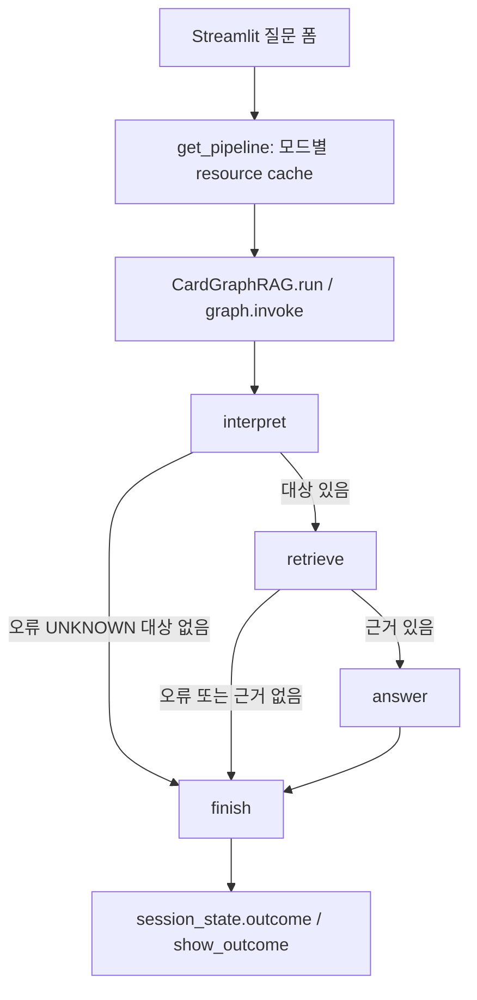
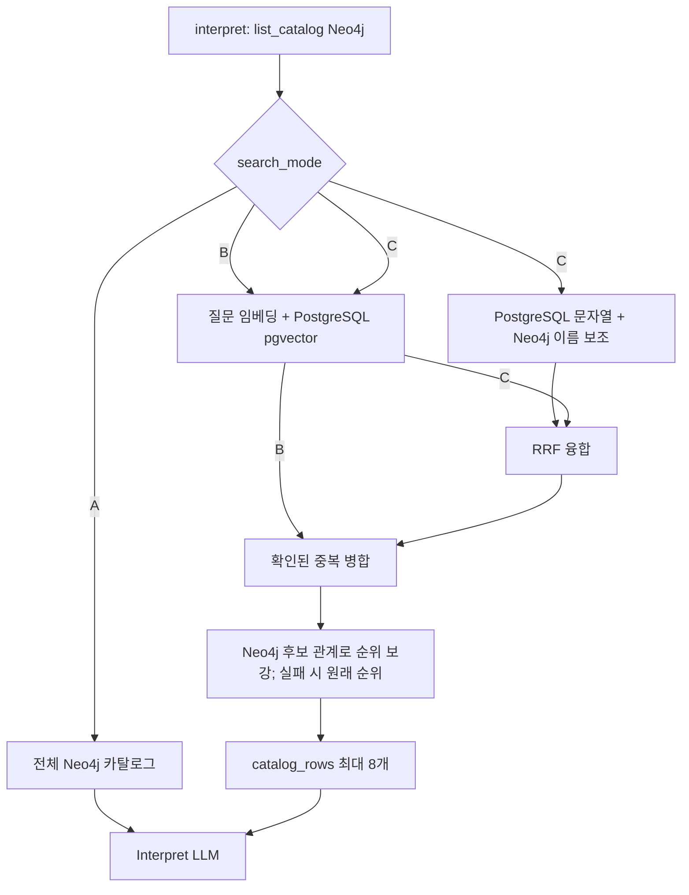
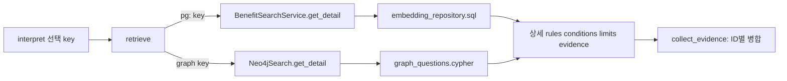
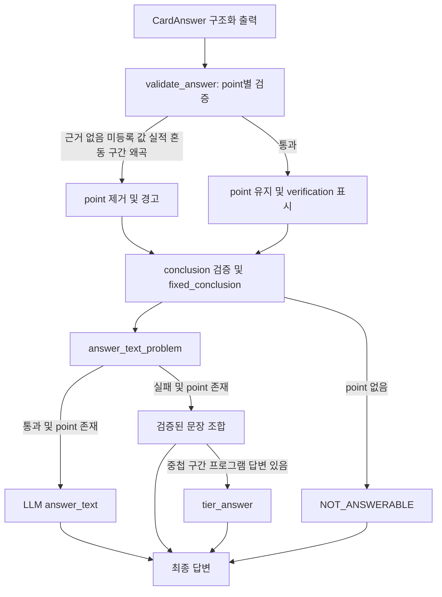
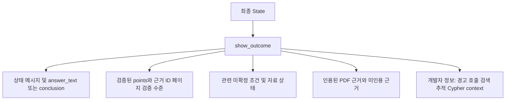

# 하나카드 GraphRAG 조회 및 답변 검증 로직 상세

## 목차

1. [분석 기준](#1-분석-기준)
2. [화면 진입과 전체 실행](#2-화면-진입과-전체-실행)
3. [질문 해석과 대상 선택](#3-질문-해석과-대상-선택)
4. [A/B/C 검색과 후보 순위](#4-abc-검색과-후보-순위)
5. [상세 조회와 원문 근거](#5-상세-조회와-원문-근거)
6. [미확정 조건과 제외 대상](#6-미확정-조건과-제외-대상)
7. [Answer 호출과 검증 입력](#7-answer-호출과-검증-입력)
8. [값과 금액 구간 검증](#8-값과-금액-구간-검증)
9. [답변 검증과 대체 분기](#9-답변-검증과-대체-분기)
10. [화면 표시·캐시·비용·오류](#10-화면-표시캐시비용오류)
11. [구현상 한계와 확인 필요](#11-구현상-한계와-확인-필요)

## 1. 분석 기준

- 기준 커밋 `a05466926f8d503be79797b835b65b3b1f2aed85`. 시작 시 앞선 작업에서 생성된 `CARD_DATA_REGISTRATION_VALIDATION_DETAIL.md`가 미추적 상태였다. 전역 Git ignore 접근 경고가 있었으나 소스 읽기에 영향은 없었다.
- 기준은 현재 작업 디렉터리의 Python, SQL mapper, Cypher다. 링크 줄 번호는 분석 시점 기준이며 저장소 루트가 아닌 문서 위치 기준 상대 링크다.
- PostgreSQL·Neo4j 연결, 화면 실행, 유료 API 호출 및 평가를 하지 않았다. 실제 행, 그래프 반영 상태, 모델 결과와 질문별 답변은 **미확인**이다. 아래 예는 코드 분기 설명이지 실측 결과가 아니다.
- 이 문서는 `db_pipeline_origin_search` 화면의 자동 실행을 중심으로 설명하며 개발 검증 모드의 차이를 따로 표시한다. SQL이나 그래프 정의가 존재하는 것은 실제 DB에 배포되었다는 증거가 아니다.

## 2. 화면 진입과 전체 실행

`streamlit_app.py`의 예시 선택은 질문 입력창만 채운다. 자동 실행은 폼의 질문과 검색 모드, 재실행 체크를 받아 질문을 strip하고, 빈 질문은 경고한다. 그렇지 않으면 `get_pipeline(search_mode)` → `CardGraphRAG.run(question)`을 호출하고 결과를 `st.session_state.outcome`에 보관한다 ([streamlit_app.py:211](../payment_card/db_pipeline_origin_search/streamlit_app.py#L211)). `get_pipeline`은 `st.cache_resource`로 모드별 자원을 재사용하며 Neo4j 연결, B/C용 검색 서비스, 두 LLM, 컴파일된 그래프를 구성한다. A도 Neo4j 연결을 만든다 ([streamlit_app.py:31](../payment_card/db_pipeline_origin_search/streamlit_app.py#L31)).

`_build`는 `START → interpret`, 조건부 `retrieve` 또는 `finish`, 조건부 `answer` 또는 `finish`, `answer → finish → END`를 컴파일한다. `CardState`의 `warnings`, `llm_calls`, `path`는 reducer로 누적되고 나머지 키는 노드 결과로 갱신된다 ([card_graphrag.py:222](../payment_card/db_pipeline_origin_search/card_graphrag.py#L222), [card_graphrag.py:972](../payment_card/db_pipeline_origin_search/card_graphrag.py#L972)). `request_id`, 시작 시각, 질문이 초기화되고 해석 결과 `intent`·`search_parameters`, 상세와 `evidence`, `context`, `answer`, `error`가 차례로 채워진다.

| 함수 | 호출 주체·입력 | 처리와 반환·실패 | 위치 |
|---|---|---|---|
| `get_pipeline` | 자동 화면의 검색 모드 | 모드별 Neo4j, 선택적 PostgreSQL 검색, LLM 및 `CardGraphRAG` 생성; 예외는 캐시되지 않음 | [streamlit_app.py:31](../payment_card/db_pipeline_origin_search/streamlit_app.py#L31) |
| `run` / `_initial_state` | 화면 질문 | UUID 일부, 시간과 빈 누적 목록을 만들어 `graph.invoke` 결과 반환 | [card_graphrag.py:988](../payment_card/db_pipeline_origin_search/card_graphrag.py#L988) |
| `interpret` | 그래프; 질문·검색 모드 | 카탈로그/후보 조회와 구조화 LLM 해석, ID 검증 및 검색 파라미터 반환 | [card_graphrag.py:1054](../payment_card/db_pipeline_origin_search/card_graphrag.py#L1054) |
| `retrieve` | 검증된 혜택 키·sections | Neo4j 상세·Evidence 조회 및 원문 조건의 미확정 항목 분류 | [card_graphrag.py](../../payment_card/db_pipeline_origin_search/card_graphrag.py) |
| `answer` | 상세·근거·질문 | 원문 조건을 포함한 context로 LLM 응답을 만들고 `validate_answer`, `transaction_tier_fallback`을 실행 | [card_graphrag.py](../../payment_card/db_pipeline_origin_search/card_graphrag.py) |
| `finish` | 각 종료 경로 | 답변이 없을 때 오류/답변 불가 안내를 만들고 사용량·경고 기록 | [card_graphrag.py:1216](../payment_card/db_pipeline_origin_search/card_graphrag.py#L1216) |

## 3. 질문 해석과 대상 선택

`interpret`는 빈 질문 또는 500자 초과를 막고 LLM이 없으면 `LLM_NOT_CONFIGURED`로 끝낸다. 먼저 `Neo4jSearch.list_catalog()`을 호출한다. 실패 시 A/C는 `NEO4J_FAILED`로 종료하며 B만 빈 그래프 카탈로그로 진행한다. B/C는 `catalog_rows`로 후보를 좁히며 예외는 `SEARCH_FAILED`다. 그 목록의 id·이름·카드·대상·결제 기준을 `Interpretation` 구조화 출력 LLM에 전달한다. LLM은 Cypher를 생성하지 않는다 ([card_graphrag.py:120](../payment_card/db_pipeline_origin_search/card_graphrag.py#L120), [card_graphrag.py:1054](../payment_card/db_pipeline_origin_search/card_graphrag.py#L1054)).

| ID | 검증과 분기 | 실패·통과 처리 | 근거 |
|---|---|---|---|
| I1 | LLM이 반환한 ID가 실제 카탈로그에 있는지 | 없는 ID 제거·경고, 중복 제거. `UNKNOWN`은 선택 전부 제거 | [card_graphrag.py:1096](../payment_card/db_pipeline_origin_search/card_graphrag.py#L1096) |
| I2 | 비교 유형인데 확인된 혜택이 2개 미만 | 경고만 남기고 선택이 있으면 계속 진행 | 동일 |
| I3 | `payment_amount`: 질문에 결제/이용/사용/쓰면/구매 정규식과 원화 토큰이 함께 있으면 첫 금액을 사용 | detail/condition에서 `payment_min_amounts`가 있는 선택만 남김. 전부 제외될 상황이면 원래 목록 유지; compare는 필터하지 않음 | [card_graphrag.py:520](../payment_card/db_pipeline_origin_search/card_graphrag.py#L520) |
| I4 | `sections`는 intent별 고정: 상세·비교 전체, 조건 rules/conditions/evidence, 한도 rules/conditions/limits/evidence, 원문 evidence만 | 대상이 없으면 `finish`; `ambiguity`는 최대 200자 | [card_graphrag.py:49](../payment_card/db_pipeline_origin_search/card_graphrag.py#L49) |

질문 해석 프롬프트는 목록에 있는 ID와 관련 혜택을 고르라고 요구하지만 관련성 자체를 Python이 의미적으로 증명하지는 않는다. A의 catalog에서 결제 기준은 그래프 규칙의 `SPEND_REQ` atom으로 수집된다. B/C의 그래프에 없는 후보는 `payment_min_amounts=[]`로 구성되므로 I3의 판정에 영향을 줄 수 있다 ([benefit_search_service.py:200](../payment_card/db_pipeline_origin_search/benefit_search_service.py#L200)).

## 4. A/B/C 검색과 후보 순위

이 분기는 화면의 `CardGraphRAG` 기준이다. `BenefitSearchService.search(mode='A')` 자체에는 SQL 키워드 경로가 있지만, 화면 A는 해당 서비스를 생성하거나 호출하지 않는다. B도 `list_catalog`과 `candidate_relations`를 시도하므로 항상 Neo4j 무호출은 아니다. B에서 최초 카탈로그 실패는 허용되고, 관계 보강 실패는 경고로 처리한다. B의 후보가 그래프에 없으면 PostgreSQL 상세를 이용할 수 있다 ([card_graphrag.py:263](../payment_card/db_pipeline_origin_search/card_graphrag.py#L263), [benefit_search_service.py:101](../payment_card/db_pipeline_origin_search/benefit_search_service.py#L101)).

| 단계 | 구현 | 근거 |
|---|---|---|
| 검색어 | 한글·영숫자 추출, 길이 2 이상, 지정 조사 제거와 고정 불용어 제거. 동의어 추정 없음 | [benefit_search_service.py:56](../payment_card/db_pipeline_origin_search/benefit_search_service.py#L56) |
| C 키워드 | `keyword_card_bnft`는 카드명·혜택명·`v_card_rule_target` 대상명; `keyword_common_bnft`는 공통/혜택/적용 카드명에서 문자열 일치 수. 그래프 이름 검색은 SQL 결과 ID와 맞을 때 점수 +1; 점수 0 제외 | [embedding_repository.sql:127](../payment_card/db_pipeline/embedding_repository.sql#L127), [benefit_search_service.py:152](../payment_card/db_pipeline_origin_search/benefit_search_service.py#L152) |
| B/C 벡터 | 질문을 임베딩하고 최근 성공/부분 성공 EMBED 실행 모델과 다르면 오류. 각 혜택 테이블에서 벡터가 있는 종료일 미경과 행 최대 20개씩, 코사인 거리 `<=>`, 유사도 `1-distance` 순 | [benefit_search_service.py:172](../payment_card/db_pipeline_origin_search/benefit_search_service.py#L172), [embedding_repository.sql:97](../payment_card/db_pipeline/embedding_repository.sql#L97) |
| C 결합 | 두 순위의 `1/(60+rank)` 합인 RRF, key 기준 결합; 서로 다른 척도의 점수 직접 합산 안 함 | [benefit_search_service.py:186](../payment_card/db_pipeline_origin_search/benefit_search_service.py#L186) |
| 중복·관계 | 기존 `BRAND_SERVICE`와 공통 후보가 같이 있으면 비교 결과 `SAME`인 ID 쌍만 기존 카드별 행을 제거. 관계 조회는 대상 낱말 일치 후보를 앞에, 제외 낱말 일치 후보를 뒤에 정렬. 적용 가능 여부를 확정하지 않음 | [benefit_search_service.py:80](../payment_card/db_pipeline_origin_search/benefit_search_service.py#L80), [benefit_search_service.py:121](../payment_card/db_pipeline_origin_search/benefit_search_service.py#L121) |
| 공통 적용 | 적용 카드 목록은 `card_common_bnft_apply`로 조회. 목록이 비면 `applied=False`와 경고이며 후보에서 자동 제거하지 않음 | [embedding_repository.sql:110](../payment_card/db_pipeline/embedding_repository.sql#L110) |

벡터 유사도는 후보 순위일 뿐 답변 사실의 검증값이 아니다. 위 SQL의 유효기간 조건은 종료일만 확인하며 시작일이나 승인 상태를 이 WHERE 절에서 검사한다고 가정하면 안 된다.

## 5. 상세 조회와 원문 근거

`catalog_rows`는 후보 ID가 그래프 카탈로그에 있으면 그래프 key를, 없으면 `pg:CARD_BNFT:owner:id` 또는 `pg:CARD_COMMON_BNFT:owner:id`를 사용한다. `retrieve`는 각 key에 따라 상세 엔진을 정하고 sections에 따라 규칙·조건·한도·근거를 읽는다. 상세가 없는 키는 경고 후 나머지를 계속한다. 조회 중 예외는 PostgreSQL 상세여도 현재 코드가 `NEO4J_FAILED`로 기록한다 ([card_graphrag.py:1128](../payment_card/db_pipeline_origin_search/card_graphrag.py#L1128)).

| 조회 | 실제 경로 | 결과·주의 |
|---|---|---|
| 그래프 카탈로그 | `dp_card_product` -`dp_has_benefit`→ `dp_card_bnft`; `dp_same_as`로 공통과 동일한 기존 행은 제외. 규칙 `dp_has_rule`, 대상 `dp_targets`, 조건 `dp_has_expr`→`dp_has_branch`→`dp_has_atom` | `common_catalog`는 `dp_card_common_bnft` -`dp_belongs_to`→ `dp_card_common` 및 선택적 `dp_has_common_benefit` 카드 관계. [graph_questions.cypher:20](../payment_card/db_pipeline_origin_search/graph_questions.cypher#L20) |
| 그래프 상세 | `benefit_context`, `benefit_rules`, `benefit_conditions`, `benefit_limits` | 조건은 카드/혜택/규칙 소유와 branch를 반환. 공통 혜택의 `benefit_rules`·`benefit_conditions` Cypher는 카드별 라벨 패턴이어서 빈 결과일 수 있음. [graph_questions.cypher:57](../payment_card/db_pipeline_origin_search/graph_questions.cypher#L57) |
| 그래프 근거 | `dp_supported_by`→`dp_card_source_evidence`→`dp_in_chunk`→`dp_card_doc_chunk`→`dp_on_page`→`dp_card_doc_page`→`dp_in_document`→`dp_card_doc` | 공통은 역방향 `dp_same_as` 기존 카드별 혜택 근거만 사용; 없으면 0건. [graph_questions.cypher:102](../payment_card/db_pipeline_origin_search/graph_questions.cypher#L102) |
| PostgreSQL 상세 | `card_bnft` + `card_product`; 또는 `card_common_bnft` + `card_common`/적용 카드 | 규칙 JSON의 `RETIRED` 제외, 조건 JSON의 branches/atoms를 펼침. [benefit_search_service.py:215](../payment_card/db_pipeline_origin_search/benefit_search_service.py#L215) |
| PostgreSQL 근거 | 카드별: `card_evidence_link` JOIN `card_source_evidence`. 공통: `card_common_doc` JOIN `card_extr_stg` JOIN 근거, staging 정규화 혜택명과 공통 혜택명 일치 | 공통 PostgreSQL 경로는 그래프의 `dp_same_as` 경로와 다르다. 이름 일치가 동일성의 완전한 증명인지는 별도 확인 필요. [embedding_repository.sql:179](../payment_card/db_pipeline/embedding_repository.sql#L179) |

Neo4j 실행은 `READ_ACCESS`와 `execute_read`, 파라미터화된 고정 Cypher를 사용한다 ([neo4j_search.py:148](../payment_card/db_pipeline_origin_search/neo4j_search.py#L148)). 다중 홉 템플릿도 있으나 자동 `retrieve`의 기본 호출은 아니다. `collect_evidence`는 ID별 인용·페이지·승인 상태와 혜택 ID/규칙 키 등을 합친다. 한도 질문은 `ev_subject_cd=BNFT`만 남긴다. 이 함수는 승인 상태를 표시하지만 승인 상태로 필터하지 않는다 ([card_graphrag.py:306](../payment_card/db_pipeline_origin_search/card_graphrag.py#L306)).

## 6. 미확정 조건과 제외 조건 원문

| 함수·시점 | 입력과 실제 조건 | 반환 및 영향 | 근거 |
|---|---|---|---|
| `benefit_context` / answer | 혜택의 `BNFT_EXCL`, `SPEND_EXCL` 조건 원문을 `exclusion_text` 및 구조화 conditions에 포함 | 실제 제외 조건은 Answer LLM 문맥에 남아 답변 생성에 사용된다. 질문 단어와 제외 토큰을 비교해 적용 여부를 자동 판정하지 않는다. | [card_graphrag.py](../../payment_card/db_pipeline_origin_search/card_graphrag.py) |
| `split_unresolved` / retrieve | 질문·intent·결제금액과 상세 조건. 질문 영향, 금액 구간, 상태별 분류 | 관련 CONDITION은 topic/open별로 혜택명과 근거를 병합하고 DATA·기타 항목을 구분한다. | [card_graphrag.py](../../payment_card/db_pipeline_origin_search/card_graphrag.py) |

답변 검증은 `validate_answer()`와 거래 금액 구간용 `transaction_tier_fallback()`이 담당한다. 혜택의 제외 조건 원문은 계속 보존되어 LLM에 전달되지만, 질문 토큰만으로 적용 제외 결론을 만들거나 기존 답변을 대체하지 않는다.

## 7. Answer 호출과 검증 입력

`after_retrieve`는 오류가 없고 병합 근거가 하나 이상일 때 answer로 간다. `benefit_context`는 source JSON에서 규칙 값·단위·대상, 조건의 OR branches와 AND atoms, 한도, 제외 문구 등을 뽑는다. `answer`는 질문 결제 금액, `rule_conflicts`, 관련 open conditions, 조건 원문과 근거 ID·페이지·상태·인용을 context에 넣는다. 공유 실적 문구의 다른 금액에는 `amount_note`를 붙인다 ([card_graphrag.py](../../payment_card/db_pipeline_origin_search/card_graphrag.py)).

LLM은 `CardAnswer` 구조화 출력 `answer_text`, `conclusion`, `points`(text, evidence_ids, benefit_id), `uncertain`, `cannot_answer_reason`을 반환한다. `_call_llm`은 JSON schema strict 설정으로 한 번 호출하며 파싱 오류면 `None`과 호출 기록을 돌려준다. 프롬프트는 근거만 사용하고 금액 구간·적용 조건을 보존하도록 지시하지만, 그 지시 자체가 검증은 아니다 ([card_graphrag.py:134](../payment_card/db_pipeline_origin_search/card_graphrag.py#L134), [card_graphrag.py:1030](../payment_card/db_pipeline_origin_search/card_graphrag.py#L1030)).

## 8. 값과 금액 구간 검증

### 공통 값 검사

| ID·함수 | 구체적 동작 | 한계·실패 |
|---|---|---|
| V1 `value_tokens` | 정규식으로 원/KRW, 만·천 단위 금액, `%`/퍼센트/프로, 회/번/매, 일·월·연/년 기간을 `(종류, 값, 기간)`으로 변환 | 지정 패턴에 없는 표기는 값으로 인식되지 않을 수 있음. [card_graphrag.py:500](../payment_card/db_pipeline_origin_search/card_graphrag.py#L500) |
| V2 `known_values` / `unknown_values` | 질문, 해당 혜택의 구조화 규칙·조건·한도 텍스트 및 범위 내 근거의 값을 수집. 종류와 값이 같고 양쪽 기간이 있을 때만 기간 일치 필요. 차이 표현이 있고 같은 문장 내 확인된 두 같은 단위 값의 차이면 허용. 단위 없는 숫자는 context JSON 또는 질문의 숫자 집합과 비교 | 모르는 값은 point 제거 또는 자연어 대체. 질문의 숫자도 알려진 값에 포함되며, 값 존재만으로 문장 의미를 증명하지 않음. [card_graphrag.py:601](../payment_card/db_pipeline_origin_search/card_graphrag.py#L601) |
| V3 `foreign_spend_in` | 전체 혜택의 `SPEND_REQ` 조건 원문에 적힌 금액 집합에서 해당 atom들의 `min_amt` 집합을 빼고, 문장에 그 금액이 있으면 반환 | 조회 데이터 기반이지만 전체 혜택 합집합 기준이다. 특정 혜택별 모든 실적 혼동을 잡는 보장은 없다. [card_graphrag.py:587](../payment_card/db_pipeline_origin_search/card_graphrag.py#L587) |
| V4 `verification_level` | 인용에 문장 값이 모두 있으면 `RAW_MATCH`; 값 없으면 `NOT_CHECKED`; 차이 계산이면 `CALCULATED`, 그 외 `STRUCTURED_ONLY` | 이름 그대로 값 검사이며 인용과 문장 의미 일치를 증명하지 않음. [card_graphrag.py:647](../payment_card/db_pipeline_origin_search/card_graphrag.py#L647) |

### 구간 대응과 미확정

`rule_conflicts`는 조회된 혜택의 규칙이 2개 이상이고 `rule_select`가 없을 때 규칙별 `SPEND_REQ` 최소·최대·basis와 지급값을 묶는다. 결제 금액이 있고 최소 이상, 최대 미만이며 basis가 null 또는 `TXN_AMT`일 때만 해당 구간으로 판단한다. 전월 실적 등 다른 basis는 결제 금액과 비교하지 않는다 ([card_graphrag.py:536](../payment_card/db_pipeline_origin_search/card_graphrag.py#L536)).

| 함수 | 호출·입력 | 구체적인 분기와 결과 | 범위 |
|---|---|---|---|
| `distorts_tier` | points, conclusion, answer_text, 원문 검사; 문장과 conflicts | 문장별 값 뒤의 `이상` 또는 `결제`를 기준으로 잡는다. 지급액을 기준처럼 쓰거나, 기준에 이어 나오는 지급값이 해당 최소 구간에 정확히 대응하지 않거나 결제금액에 적용되는 구간과 맞지 않으면 True. 기간이 붙은 값, 값 뒤 `구간` 표기는 별도 취급 | 조회된 구간에 기반하지만 순서·문장 분리·한국어 정규식에 의존. [card_graphrag.py:658](../payment_card/db_pipeline_origin_search/card_graphrag.py#L658) |
| `picks_single_tier` | points·conclusion·answer_text·uncertain | 결제금액에 해당하는 규칙이 2개 이상이고 지급액을 하나 이상 언급했으나 지급액 또는 `N원 이상` 기준으로 표시된 구간이 전체보다 적으면 혜택명 반환. benefit_id로 범위 제한 가능 | 모든 가능한 단정 표현을 의미 분석하지 않는다. [card_graphrag.py:690](../payment_card/db_pipeline_origin_search/card_graphrag.py#L690) |
| `tier_is_quoted` | `tier_answer` | 한 근거 인용에 해당 혜택의 모든 기준과 지급값 토큰이 있고 `distorts_tier`가 false여야 참 | 여러 인용에 흩어진 근거는 이 조건을 만족하지 못한다. [card_graphrag.py:711](../payment_card/db_pipeline_origin_search/card_graphrag.py#L711) |
| `tier_answer` | `fixed_conclusion` 및 자연어 대체 | 결제금액에 2개 이상 적용되는 충돌만 처리. 인용으로 확인된 구간을 조회값으로 표시하고, 인용 부족 혜택은 미확인이라고 쓰며 실제 지급액을 확정하지 않는 고정 문구 반환. 해당 충돌 없으면 None | 조회값과 고정 한국어 문구의 조합. [card_graphrag.py:722](../payment_card/db_pipeline_origin_search/card_graphrag.py#L722) |
| `fixed_conclusion` | `validate_answer`의 결론 검사 | 중첩 구간이 있고 일부만 선택·관계 왜곡·미확정 표현 누락이면 `tier_answer`로 교체. 다른 충돌에서도 미확정 표현이 없으면 선택 방식 미확정 안내를 결론에 추가 | `UNRESOLVED_WORDS`라는 고정 표현 패턴 사용. [card_graphrag.py:744](../payment_card/db_pipeline_origin_search/card_graphrag.py#L744) |

예를 들어 질문에 `1만원 결제`가 있고 조회된 두 구간이 모두 해당한다면, 하나의 지급액만 고르는 문장은 위 조건에 맞을 때 제거된다. 실제 구간과 지급액은 DB를 읽지 않았으므로 여기서 제시하지 않는다.

## 9. 답변 검증과 대체 분기

### `validate_answer` 세부 순서

호출은 `answer`가 `context`에 전체 unresolved와 topic을 추가하여 수행한다. 입력 근거를 ID 맵으로, 혜택을 ID 맵으로 만들고 질문과 context의 숫자·허용 값을 준비한다 ([card_graphrag.py:759](../payment_card/db_pipeline_origin_search/card_graphrag.py#L759)).

| ID | 시점과 조건 | 통과·실패 처리 |
|---|---|---|
| A1 | 빈 point | 무시. `STATUS_SENTENCE` 고정 정규식에 걸린 상태 문장은 points에서 빼고 `moved`로 이동 |
| A2 | 혜택 ID가 조회 목록에 없으면 null로 제거·경고. 근거 ID가 목록에 없으면 제거; benefit ID가 유효하면 해당 혜택 범위 밖 근거도 제거 | 남은 근거 ID가 없으면 point 제거·경고. **잘못된 benefit ID는 null이 되어 범위 제한이 완화된다** |
| A3 | `unknown_values`, `foreign_spend_in`, `distorts_tier`, `picks_single_tier` 순서 | 하나라도 문제면 point 제거·경고. 충돌 혜택 관련 문장에 `우선`, `중복`, `합산`, `하나만`, `함께 적용` 등 고정 `INVENTED_RULE` 표현이 있으면 제거 |
| A4 | 중첩 충돌 혜택에서 모든 지급값이 담긴 point가 없으면, 모든 지급값을 담은 혜택 범위 인용을 찾음 | 있으면 `tier_text` system point 추가, 없으면 경고. 이 보강의 조건은 `tier_is_quoted`와 동일하지 않다 |
| A5 | 결론의 미등록 값 검사 후 `fixed_conclusion`, 이어 `unbacked_status` | 알 수 없는 값이면 결론 비움. 조회되지 않은 미확정 주제를 말하면 결론 비움. 결론은 point와 같은 근거 ID 연결을 직접 요구하지 않는다 |
| A6 | LLM uncertain과 이동한 상태 문장 | 이미 시스템 미확정 주제와 겹치면 생략; 미등록 값이나 일부 구간 단정은 제외. 남은 문장은 내부 상태 코드를 고객용 문구로 치환 |
| A7 | 유효 points가 하나 이상이면 | 제거된 point가 있으면 `PARTIAL`, 아니면 `ANSWERED`; 없으면 `NOT_ANSWERABLE`과 이유 또는 `NO_GROUNDED_POINT`. 상태 문장을 이동한 것만으로 dropped가 증가하지 않는다 |
| A8 | points가 있을 때 `answer_text_problem` 검사 | 통과 시 원문 LLM 자연어 사용; 실패 시 conclusion과 검증 points를 조합. `tier_answer`가 있으면 그 프로그램 문구가 우선. points가 없으면 자연어를 내보내지 않음 |

### `answer_text_problem`의 실제 검사

호출 주체는 `validate_answer`; 입력은 자연어 전체, context, 질문, 전체 알려진 값과 숫자 집합이다. 빈 문자열 → 내부 상태 코드 또는 snake_case/실행 ID 패턴 → 미등록 값 → 다른 실적 금액 → 근거 없는 상태 문구 → 중첩 구간 일부 선택 또는 미확정 표현 누락 → 기준/지급 왜곡 → 구간이 같은 충돌 혜택을 가맹점·혜택에 따라 다르다고 하는 고정 표현 → 없는 규칙 적용 방식 표현의 순서로 첫 문제를 반환한다. 문제 없으면 `None`이다 ([card_graphrag.py:898](../payment_card/db_pipeline_origin_search/card_graphrag.py#L898)). `same_tiers`는 blocking 충돌의 `(min_amt, value)` 목록을 JSON으로 비교하며 의미 전체를 비교하지 않는다.

자연어에 쓴 모든 사실이 points에 의미상 포함되는지 Python이 문장별로 증명하지는 않는다. `answer_text_problem`은 위 열거된 형식·값·패턴 검사다. 따라서 `RAW_MATCH` 또는 자연어 검사 통과를 완전한 사실성·논리 검증으로 해석하면 안 된다. 한도 미조회는 프롬프트상 '한도 없음'이 아니라 미확인이지만, 일반적인 의미 추론 검증은 구현되어 있지 않다.

## 10. 화면 표시·캐시·비용·오류

`show_outcome`은 `answer_text`가 있으면 그것을, 없으면 conclusion을 표시한다. point별 근거와 `RAW_MATCH` 등 검증 수준, 인용된 원문·페이지·승인 상태, 미인용 근거를 보여준다. 내부 개발자 영역에는 후보·상세 엔진·Cypher·context·원본 데이터와 토큰 및 추정 비용이 있다 ([streamlit_app.py:111](../payment_card/db_pipeline_origin_search/streamlit_app.py#L111)).

- 자동 화면은 **직전** 결과의 질문과 모드가 같고 `error`가 없으며 강제 재실행을 선택하지 않으면 결과를 재표시하고 `reused=True`로 표시한다. API 결과의 영구 캐시나 여러 질문에 대한 일반 검색 캐시는 아니다. 위젯 rerun은 저장 결과를 읽는다.
- 개발 검증 모드는 `get_pipeline()` 기본 A를 사용한다. Interpret → 실행 예정 Cypher 표시 → 조회 → Answer를 버튼으로 진행한다. 질문 변경 또는 다시 시작 시 state를 비운다. `verify_retrieve`/`verify_answer`는 이미 실행한 단계를 재호출하지 않고, answer 전 `plan_key`가 질문·검색 조건과 다르면 `ValueError`다 ([verify_view.py:82](../payment_card/db_pipeline_origin_search/verify_view.py#L82), [card_graphrag.py:1001](../payment_card/db_pipeline_origin_search/card_graphrag.py#L1001)).
- 기본 모델은 `gpt-6-luna`, `reasoning_effort=low`, 출력 상한 interpret 600/answer 2000, timeout 60초, `max_retries=0`이다. 키가 없으면 LLM을 만들지 않는다. 실제 사용 모델은 환경변수로 바뀔 수 있다 ([card_graphrag.py:35](../payment_card/db_pipeline_origin_search/card_graphrag.py#L35), [card_graphrag.py:280](../payment_card/db_pipeline_origin_search/card_graphrag.py#L280)).
- 성공/파싱 실패 응답에서 input·output·cache_read·reasoning 토큰과 응답 모델을 기록한다. 추정 비용은 코드에 있는 모델 단가만 사용하고 미등록 모델이나 사용량 누락이면 None 및 경고다. 표시 합계는 None을 0으로 더하므로 실제보다 적을 수 있다. B/C의 질문 임베딩 호출은 `llm_calls`의 interpret/answer 비용 집계에 포함되지 않는다 ([card_graphrag.py:294](../payment_card/db_pipeline_origin_search/card_graphrag.py#L294), [benefit_search_service.py:172](../payment_card/db_pipeline_origin_search/benefit_search_service.py#L172)).
- LLM 호출 예외는 실패 호출 기록과 `LLM_FAILED`, 파싱 실패는 `ParsingError`. Neo4j 상세 예외는 `NEO4J_FAILED`, 후보 또는 제외 원본 조회 예외는 `SEARCH_FAILED`. 근거가 없으면 Answer LLM을 호출하지 않고 `NO_EVIDENCE`, 상세가 전혀 없으면 `NO_RESULT`다. 화면의 파이프라인 준비 예외는 일반적인 Neo4j 설정 안내만 표시한다 ([card_graphrag.py:1248](../payment_card/db_pipeline_origin_search/card_graphrag.py#L1248), [streamlit_app.py:211](../payment_card/db_pipeline_origin_search/streamlit_app.py#L211)).

## 11. 구현상 한계와 확인 필요

| 항목 | 코드에서 확인된 사실과 확인이 필요한 사항 |
|---|---|
| 실제 DB·그래프 | 접속하지 않아 테이블·인덱스·벡터 모델, `dp_` 노드/관계, 승인 상태 및 PostgreSQL과 Neo4j 동기화 여부 미확인. 코드의 읽기 경로와 실제 적재 상태를 구분해야 한다. |
| 근거 품질 | 인용과 값의 존재·연결을 검사하지만 모든 문장에 대해 의미적 entailment를 증명하지 않는다. `NOT_CHECKED`, `STRUCTURED_ONLY` 및 승인 상태에 주의해야 한다. |
| 고정 패턴 | `transit_exclusions`, `ETC`, `TXN_AMT`, 금액·실적·미확정·적용 방식의 정규식은 코드의 고정 규칙이다. 인식하지 못하는 표현과 잘못 일치하는 표현이 있을 수 있다. |
| 공통 근거 | Neo4j는 `dp_same_as` 기존 행을 통해, PostgreSQL은 문서와 staging의 혜택명 일치로 근거를 찾는다. 양 경로의 결과 동일성은 실제 데이터에서 확인 필요다. |
| 제외 조건 | 혜택의 제외 원문은 LLM context에 제공된다. 토큰 기반 강제 판정은 실행 경로에서 제거되었으며, 원문 자체의 정확성은 Evidence와 함께 검토해야 한다. |
| 등록 후보 상태 | 앞선 등록 분석에서 카드별 후보 SQL은 `SUCCEEDED` 필터가 없고 공통 후보 SQL에는 있다. 의도 및 부분 실행 후보 영향은 확인 필요이며 이 문서 작업에서 수정하지 않았다. |
| 질문 사례 | 화면에 놀이공원, 대중교통, 전월 실적, 1만원 결제, ONE PICK과 STYLE 비교 예시가 있다. 실제 실행하지 않았으므로 해당 질문의 답·근거·비용은 미확인이다. |
