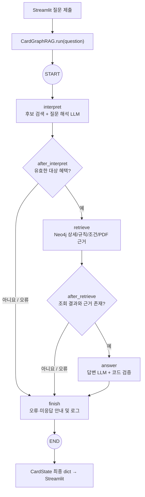

# 카드 혜택 GraphRAG — LangGraph 실행 구조 가이드

> 저장 권장 위치: `src/card_benefit/docs/guide/LANGGRAPH_CARD_GRAPHRAG_STRUCTURE_GUIDE.md`  
> 작성 기준: `encore-ai-campus/mle-02-p2-team3` GitHub `main`에 공개된 실제 소스(2026-11-06 확인). **로컬에만 존재하는 미커밋 변경이나 새 평가셋 작업은 반영되지 않았을 수 있으므로**, 로컬 파일과 비교하여 줄 번호·동작을 확인한다.  
> 범위: **사용자 질문을 처리하는 LangGraph 검색·답변 경로**. PDF 추출·PostgreSQL 등록·Neo4j 적재는 이 그래프의 실행 전 단계다.

## 0. 발표 전에 따라볼 실제 함수 링크

> 아래 링크는 **2026-11-07 확인한 GitHub 커밋 `359fffa`**의 소스 줄로 이동합니다. 발표 연습 시 소스 줄이 바뀌지 않도록 **커밋 고정 링크**를 사용했습니다. 로컬 작업 트리 또는 이후 `main` 수정과 다를 수 있습니다.

| 순서 | 클릭할 함수·위치 | 코드에서 볼 것 |
|---|---|---|
| 1. 화면 실행 | [`get_pipeline()`](https://github.com/encore-ai-campus/mle-02-p2-team3/blob/359fffae2c82abe2c91e02a5253ef5ee354dbcb0/src/card_benefit/payment_card/db_pipeline_origin_search/streamlit_app.py#L103-L124) · [`pipeline.run(question)`](https://github.com/encore-ai-campus/mle-02-p2-team3/blob/359fffae2c82abe2c91e02a5253ef5ee354dbcb0/src/card_benefit/payment_card/db_pipeline_origin_search/streamlit_app.py#L429-L439) | 질문 제출이 파이프라인을 어디에서 호출하는지 |
| 2. 실행 흐름 정의 | [`CardGraphRAG._build()`](https://github.com/encore-ai-campus/mle-02-p2-team3/blob/359fffae2c82abe2c91e02a5253ef5ee354dbcb0/src/card_benefit/payment_card/db_pipeline_origin_search/card_graphrag.py#L1982-L1998) | 4개 노드와 2개 분기 지점을 먼저 확인 |
| 3. 공유 상태 | [`CardState`](https://github.com/encore-ai-campus/mle-02-p2-team3/blob/359fffae2c82abe2c91e02a5253ef5ee354dbcb0/src/card_benefit/payment_card/db_pipeline_origin_search/card_graphrag.py#L289-L318) | 노드 사이에 전달되는 `question`, `evidence`, `answer`, `error` |
| 4. 실행 시작 | [`run()`](https://github.com/encore-ai-campus/mle-02-p2-team3/blob/359fffae2c82abe2c91e02a5253ef5ee354dbcb0/src/card_benefit/payment_card/db_pipeline_origin_search/card_graphrag.py#L2008-L2014) | `graph.invoke()`가 그래프 실행을 시작 |
| 5. 질문 해석 | [`interpret()`](https://github.com/encore-ai-campus/mle-02-p2-team3/blob/359fffae2c82abe2c91e02a5253ef5ee354dbcb0/src/card_benefit/payment_card/db_pipeline_origin_search/card_graphrag.py#L2083-L2109) · [`after_interpret()`](https://github.com/encore-ai-campus/mle-02-p2-team3/blob/359fffae2c82abe2c91e02a5253ef5ee354dbcb0/src/card_benefit/payment_card/db_pipeline_origin_search/card_graphrag.py#L2226-L2234) | 후보·의도 결정 후 계속 조회할지 분기 |
| 6. 데이터 조회 | [`retrieve()`](https://github.com/encore-ai-campus/mle-02-p2-team3/blob/359fffae2c82abe2c91e02a5253ef5ee354dbcb0/src/card_benefit/payment_card/db_pipeline_origin_search/card_graphrag.py#L2236-L2258) · [`after_retrieve()`](https://github.com/encore-ai-campus/mle-02-p2-team3/blob/359fffae2c82abe2c91e02a5253ef5ee354dbcb0/src/card_benefit/payment_card/db_pipeline_origin_search/card_graphrag.py#L2317-L2323) | Neo4j 혜택·PDF 근거 조회 후 답변 가능 여부 |
| 7. 답변·검증 | [`answer()`](https://github.com/encore-ai-campus/mle-02-p2-team3/blob/359fffae2c82abe2c91e02a5253ef5ee354dbcb0/src/card_benefit/payment_card/db_pipeline_origin_search/card_graphrag.py#L2325-L2355) · [`validate_answer()`](https://github.com/encore-ai-campus/mle-02-p2-team3/blob/359fffae2c82abe2c91e02a5253ef5ee354dbcb0/src/card_benefit/payment_card/db_pipeline_origin_search/card_graphrag.py#L1632-L1662) | LLM 답변을 만든 뒤 값과 근거 대조 |
| 8. 마무리 | [`finish()`](https://github.com/encore-ai-campus/mle-02-p2-team3/blob/359fffae2c82abe2c91e02a5253ef5ee354dbcb0/src/card_benefit/payment_card/db_pipeline_origin_search/card_graphrag.py#L2440-L2475) | 응답 또는 미응답 안내를 최종 State로 정리 |
| 추가 A. 후보 검색 | [`Neo4jBenefitSearch.search()`](https://github.com/encore-ai-campus/mle-02-p2-team3/blob/359fffae2c82abe2c91e02a5253ef5ee354dbcb0/src/card_benefit/payment_card/db_pipeline_origin_search/neo4j_hybrid_search.py#L90-L100) · [`catalog_rows()`](https://github.com/encore-ai-campus/mle-02-p2-team3/blob/359fffae2c82abe2c91e02a5253ef5ee354dbcb0/src/card_benefit/payment_card/db_pipeline_origin_search/neo4j_hybrid_search.py#L165-L175) | N 모드 키워드·벡터 기반 후보 구성 |
| 추가 B. 상세 조회 | [`Neo4jSearch.get_details()`](https://github.com/encore-ai-campus/mle-02-p2-team3/blob/359fffae2c82abe2c91e02a5253ef5ee354dbcb0/src/card_benefit/payment_card/db_pipeline_origin_search/neo4j_search.py#L473-L503) | 혜택 상세와 근거를 Cypher로 일괄 조회 |
| 추가 C. PostgreSQL 로그 | [`persist_app_logs()`](https://github.com/encore-ai-campus/mle-02-p2-team3/blob/359fffae2c82abe2c91e02a5253ef5ee354dbcb0/src/card_benefit/payment_card/db_pipeline_origin_search/execution_log.py#L404-L441) | Streamlit의 별도 경로에서 `app_log` 저장 |

**짧은 학습 순서:** `get_pipeline` → `_build` → `CardState` → `run` → `interpret` → `retrieve` → `answer` → `finish`. 처음부터 파일 전체를 읽기보다 위 함수의 **입력 State → 반환 dict → 다음 분기 조건**만 확인해도 실행 흐름을 설명하기 편합니다.

**링크 사용법:** 함수명을 클릭하면 GitHub 소스의 해당 행이 열립니다. VS Code의 로컬 코드로 따라갈 때는 파일에서 `Ctrl+F`로 함수명을 찾으세요. 아래 문서의 기존 ‘약 ○행’ 표기도 현재 확인한 위치로 수정했습니다.

---

## 1. 가장 먼저 알아야 할 실행 구조

현재 Streamlit 화면의 기본 검색 모드는 **N (Neo4j 단일 후보 검색)** 이다. `Streamlit → CardGraphRAG.run(question) → graph.invoke(initial_state) → CardState 반환 → 화면 출력` 순서로 작동한다.



**핵심:** 질문 해석(`interpret`)과 답변 생성(`answer`)만 LLM을 사용한다. `retrieve`는 정해진 Cypher와 프로그램 검증으로 검색하고, `finish`는 미답변 경로의 안내·최종 실행 기록을 만든다. 답변과 근거가 모두 확보된 정상 질문이라면 일반적으로 `interpret` + `answer`의 **LLM 2회 호출**이다. 연회비만 조회한 질문은 `answer`의 프로그램 응답 경로에서 두 번째 LLM 호출을 건너뛸 수 있다.

## 2. 실제 코드 진입점과 호출 관계

### 2.1 Streamlit 진입점

파일: `src/card_benefit/payment_card/db_pipeline_origin_search/streamlit_app.py`

- [`SEARCH_MODE = "N"`](https://github.com/encore-ai-campus/mle-02-p2-team3/blob/359fffae2c82abe2c91e02a5253ef5ee354dbcb0/src/card_benefit/payment_card/db_pipeline_origin_search/streamlit_app.py#L100): 사용자가 검색 모드를 선택하지 않고 N 모드로 검색한다.
- [`get_pipeline()`](https://github.com/encore-ai-campus/mle-02-p2-team3/blob/359fffae2c82abe2c91e02a5253ef5ee354dbcb0/src/card_benefit/payment_card/db_pipeline_origin_search/streamlit_app.py#L102-L124): `@st.cache_resource`를 이용해 Neo4j 연결·검색 어댑터·두 LLM·`CardGraphRAG` 객체를 생성/캐시한다.
- [질문 폼 제출](https://github.com/encore-ai-campus/mle-02-p2-team3/blob/359fffae2c82abe2c91e02a5253ef5ee354dbcb0/src/card_benefit/payment_card/db_pipeline_origin_search/streamlit_app.py#L385-L400) → [`pipeline.run(question)` 호출](https://github.com/encore-ai-campus/mle-02-p2-team3/blob/359fffae2c82abe2c91e02a5253ef5ee354dbcb0/src/card_benefit/payment_card/db_pipeline_origin_search/streamlit_app.py#L429-L439): 폼이 제출되면 파이프라인을 실행한다.
- 최종 [`CardState`](https://github.com/encore-ai-campus/mle-02-p2-team3/blob/359fffae2c82abe2c91e02a5253ef5ee354dbcb0/src/card_benefit/payment_card/db_pipeline_origin_search/card_graphrag.py#L289-L318)는 `st.session_state.outcome`에 보관되어 답변·근거·오류·실행 경로 등을 화면에 표시한다.
- Streamlit은 상호작용 때 스크립트를 위에서 아래로 다시 실행한다. **LangGraph가 스스로 실행되는 것이 아니라 질문 제출 처리에서 `run()`을 호출**한다. 같은 질문 재사용 분기가 있을 수도 있다.

```python
# streamlit_app.py의 구조를 발췌한 이해용 코드 (실제 코드는 로깅/예외 처리가 더 있음)
SEARCH_MODE = "N"

@st.cache_resource(show_spinner=False)
def get_pipeline(search_mode=SEARCH_MODE):
    search = connect()
    benefit_search = create_neo4j_benefit_search(search)
    return CardGraphRAG(search, *create_llms(),
                        benefit_search=benefit_search, search_mode=search_mode)

# 폼 제출 후
outcome = get_pipeline(SEARCH_MODE).run(question)
```

### 2.2 LangGraph 정의 지점

파일: `src/card_benefit/payment_card/db_pipeline_origin_search/card_graphrag.py`

- [`CardState`](https://github.com/encore-ai-campus/mle-02-p2-team3/blob/359fffae2c82abe2c91e02a5253ef5ee354dbcb0/src/card_benefit/payment_card/db_pipeline_origin_search/card_graphrag.py#L289-L318) — 289행: 실행 중 공유 상태(`TypedDict`)
- [`CardGraphRAG`](https://github.com/encore-ai-campus/mle-02-p2-team3/blob/359fffae2c82abe2c91e02a5253ef5ee354dbcb0/src/card_benefit/payment_card/db_pipeline_origin_search/card_graphrag.py#L1961) — 1961행: 파이프라인 클래스
- [`CardGraphRAG._build()`](https://github.com/encore-ai-campus/mle-02-p2-team3/blob/359fffae2c82abe2c91e02a5253ef5ee354dbcb0/src/card_benefit/payment_card/db_pipeline_origin_search/card_graphrag.py#L1982-L1998) — 1982행: 노드·Edge·조건부 분기 등록
- [`CardGraphRAG._initial_state()`](https://github.com/encore-ai-campus/mle-02-p2-team3/blob/359fffae2c82abe2c91e02a5253ef5ee354dbcb0/src/card_benefit/payment_card/db_pipeline_origin_search/card_graphrag.py#L2000-L2006) — 2000행: 초기 State 생성
- [`CardGraphRAG.run()`](https://github.com/encore-ai-campus/mle-02-p2-team3/blob/359fffae2c82abe2c91e02a5253ef5ee354dbcb0/src/card_benefit/payment_card/db_pipeline_origin_search/card_graphrag.py#L2008-L2014) — 2008행: `graph.invoke()` 실행
- [`interpret()`](https://github.com/encore-ai-campus/mle-02-p2-team3/blob/359fffae2c82abe2c91e02a5253ef5ee354dbcb0/src/card_benefit/payment_card/db_pipeline_origin_search/card_graphrag.py#L2083) / [`after_interpret()`](https://github.com/encore-ai-campus/mle-02-p2-team3/blob/359fffae2c82abe2c91e02a5253ef5ee354dbcb0/src/card_benefit/payment_card/db_pipeline_origin_search/card_graphrag.py#L2226) — 2083 / 2226행
- [`retrieve()`](https://github.com/encore-ai-campus/mle-02-p2-team3/blob/359fffae2c82abe2c91e02a5253ef5ee354dbcb0/src/card_benefit/payment_card/db_pipeline_origin_search/card_graphrag.py#L2236) / [`after_retrieve()`](https://github.com/encore-ai-campus/mle-02-p2-team3/blob/359fffae2c82abe2c91e02a5253ef5ee354dbcb0/src/card_benefit/payment_card/db_pipeline_origin_search/card_graphrag.py#L2317) — 2236 / 2317행
- [`answer()`](https://github.com/encore-ai-campus/mle-02-p2-team3/blob/359fffae2c82abe2c91e02a5253ef5ee354dbcb0/src/card_benefit/payment_card/db_pipeline_origin_search/card_graphrag.py#L2325) / [`finish()`](https://github.com/encore-ai-campus/mle-02-p2-team3/blob/359fffae2c82abe2c91e02a5253ef5ee354dbcb0/src/card_benefit/payment_card/db_pipeline_origin_search/card_graphrag.py#L2440) — 2325 / 2440행

```python
# card_graphrag.py — 실제 연결 형태
builder = StateGraph(CardState)
builder.add_node("interpret", self.interpret)
builder.add_node("retrieve", self.retrieve)
builder.add_node("answer", self.answer)
builder.add_node("finish", self.finish)
builder.add_edge(START, "interpret")
builder.add_conditional_edges("interpret", self.after_interpret, ["retrieve", "finish"])
builder.add_conditional_edges("retrieve", self.after_retrieve, ["answer", "finish"])
builder.add_edge("answer", "finish")
builder.add_edge("finish", END)
return builder.compile()
```

**Java 비교:** `_build()`는 작업 실행 그래프의 설정, `add_node`는 처리 서비스 등록, `after_*`는 `switch`/라우팅 조건, `graph.invoke()`는 설정된 흐름의 동기 실행으로 이해할 수 있다. 단, 노드가 직접 다음 노드를 호출하지 않고 **State 변경값을 반환하면 LangGraph 런타임이 다음 노드를 실행한다.**

## 3. CardState: 노드 간에 전달하는 데이터

`CardState`는 `TypedDict(total=False)`로 정의된 **일반 Python dict 형태의 공유 상태**이다. 실행 때 각 노드는 State 전체를 만들어 반환할 필요가 없고, 변경할 키만 담은 `dict`를 반환한다. LangGraph가 이전 State와 병합한다.

| 핵심 키 | 생성/수정 노드 | 의미 |
| --- | --- | --- |
| `question`, `request_id`, `started` | `_initial_state` | 질문, 요청 식별자, 시작 시각 |
| `catalog`, `intent` | `interpret` | 후보 목록, 질문 유형 |
| `search_parameters` | `interpret` | 검증된 혜택 키, 조회 섹션, 결제금액 등 |
| `candidate_search` | `interpret` | 검색 후보·엔진·순위 정보 |
| `retrieved_data`, `retrieval_trace` | `retrieve` | Neo4j 상세 원본과 조회 기록 |
| `evidence`, `statements` | `retrieve` | PDF 근거와 실행한 Cypher 식별자 |
| `open_conditions`, `unresolved` | `retrieve` | 답변에 영향을 주는 미확정 조건·전체 미확정 항목 |
| `context`, `answer` | `answer` | LLM에게 전달한 문맥, 검증을 거친 최종 답변 |
| `error` | 실행 노드 | 실패 단계 및 오류 코드 |
| `warnings`, `llm_calls`, `path` | 여러 노드 | **누적형 배열(reducer)** |

세 배열은 다음처럼 선언된다.

```python
warnings: Annotated[list[str], operator.add]
llm_calls: Annotated[list[dict], operator.add]
path: Annotated[list[str], operator.add]
```

즉 `interpret`가 `{"path": ["interpret"]}`, `retrieve`가 `{"path": ["retrieve"]}`를 반환하면 최종 `path`는 `['interpret', 'retrieve', ...]`처럼 **연결된다**. 일반 키(`intent` 등)는 새 값으로 갱신된다.

```python
# 이해를 위한 예시 (실제 DB·LLM 결과가 아님)
initial = {"question": "POINT II 한도는?", "warnings": [], "llm_calls": [], "path": []}
# interpret 노드가 반환하는 update 예시
update = {"intent": "BENEFIT_LIMIT", "path": ["interpret"],
          "search_parameters": {"benefit_keys": ["..."]}}
# LangGraph가 이전 state와 update를 합쳐 retrieve에 전달한다.
```

### state와 지역 변수의 차이

`interpret()` 내부 지역 변수 `catalog`는 다른 노드에 자동 전달되지 않는다. **반환 딕셔너리에 담긴 `catalog`, `search_parameters`만** 이후 노드가 읽는다. Java 기준으로는 노드별 메서드가 공유 DTO의 일부 필드를 갱신해 다음 단계에 넘기는 구조와 비슷하다.

## 4. 노드별 실제 실행 과정

### 4.1 [`interpret`](https://github.com/encore-ai-campus/mle-02-p2-team3/blob/359fffae2c82abe2c91e02a5253ef5ee354dbcb0/src/card_benefit/payment_card/db_pipeline_origin_search/card_graphrag.py#L2083-L2225): 대상 혜택과 질문 의도 선택

1. 질문 비어 있음/길이·LLM 설정을 확인한다.
2. [`Neo4jSearch.list_catalog()`](https://github.com/encore-ai-campus/mle-02-p2-team3/blob/359fffae2c82abe2c91e02a5253ef5ee354dbcb0/src/card_benefit/payment_card/db_pipeline_origin_search/neo4j_search.py#L426)로 실제 등록 혜택을 확인한다.
3. N 모드에서 [`Neo4jBenefitSearch.catalog_rows()`](https://github.com/encore-ai-campus/mle-02-p2-team3/blob/359fffae2c82abe2c91e02a5253ef5ee354dbcb0/src/card_benefit/payment_card/db_pipeline_origin_search/neo4j_hybrid_search.py#L165-L175)로 질문에 맞는 **후보를 Neo4j 기반 하이브리드 검색**으로 추린다.
4. `INTERPRET_PROMPT`와 [`Interpretation`](https://github.com/encore-ai-campus/mle-02-p2-team3/blob/359fffae2c82abe2c91e02a5253ef5ee354dbcb0/src/card_benefit/payment_card/db_pipeline_origin_search/card_graphrag.py#L168) Pydantic 출력 스키마로 **질문 해석 LLM**을 호출한다.
5. LLM이 선택한 `benefit_ids`를 **실제 카탈로그와 대조**해 존재하지 않는 ID를 제거한다.
6. 질문 유형(`intent`)에 따라 조회할 섹션을 결정하고 `search_parameters`에 담는다.

질문 유형은 `BENEFIT_DETAIL`, `BENEFIT_CONDITION`, `BENEFIT_LIMIT`, `BENEFIT_COMPARE`, `EVIDENCE_SEARCH`, `UNKNOWN`이다. **LLM이 Cypher를 생성하지 않는다.**

N 모드의 검색 후보 생성은 다음 파일이 맡는다.

- `neo4j_hybrid_search.py`: [`Neo4jBenefitSearch.search()`](https://github.com/encore-ai-campus/mle-02-p2-team3/blob/359fffae2c82abe2c91e02a5253ef5ee354dbcb0/src/card_benefit/payment_card/db_pipeline_origin_search/neo4j_hybrid_search.py#L90-L164) (90행), [`catalog_rows()`](https://github.com/encore-ai-campus/mle-02-p2-team3/blob/359fffae2c82abe2c91e02a5253ef5ee354dbcb0/src/card_benefit/payment_card/db_pipeline_origin_search/neo4j_hybrid_search.py#L165-L175) (165행)
- Neo4j 내부에서 키워드·이름·벡터 유사도, RRF 통합, 관계 기반 순위 보정, 공통혜택 중복 병합을 수행한다.
- `neo4j_search.py`: [`Neo4jSearch`](https://github.com/encore-ai-campus/mle-02-p2-team3/blob/359fffae2c82abe2c91e02a5253ef5ee354dbcb0/src/card_benefit/payment_card/db_pipeline_origin_search/neo4j_search.py#L386) 읽기 전용 조회 객체.
- **질문 임베딩을 만들기 위해 OpenAI API를 호출할 수 있다.** 이는 `interpret`/`answer`의 구조화 출력 LLM 2회와 성격이 다른 별도 호출이다. 모델/API 비용을 계산할 때 구분해야 한다.

### 4.2 [`after_interpret`](https://github.com/encore-ai-campus/mle-02-p2-team3/blob/359fffae2c82abe2c91e02a5253ef5ee354dbcb0/src/card_benefit/payment_card/db_pipeline_origin_search/card_graphrag.py#L2226-L2234): 조회할 수 있는가?

```python
if state.get("error") or state.get("intent") == "UNKNOWN":
    return "finish"
return "retrieve" if state["search_parameters"]["benefit_keys"] else "finish"
```

오류, `UNKNOWN`, 대상 혜택 없음 → `finish`. 대상 혜택이 있으면 → `retrieve`.

### 4.3 [`retrieve`](https://github.com/encore-ai-campus/mle-02-p2-team3/blob/359fffae2c82abe2c91e02a5253ef5ee354dbcb0/src/card_benefit/payment_card/db_pipeline_origin_search/card_graphrag.py#L2236-L2316): Neo4j 상세와 PDF 근거 수집

- `search_parameters.benefit_keys`와 `sections`로 **정해진 Cypher 템플릿**을 실행한다.
- 실제 코드에는 [`get_details()`](https://github.com/encore-ai-campus/mle-02-p2-team3/blob/359fffae2c82abe2c91e02a5253ef5ee354dbcb0/src/card_benefit/payment_card/db_pipeline_origin_search/neo4j_search.py#L473-L503) 일괄 조회(P3 배칭)가 있으면 이를 우선 사용하고, 없으면 [`get_detail()`](https://github.com/encore-ai-campus/mle-02-p2-team3/blob/359fffae2c82abe2c91e02a5253ef5ee354dbcb0/src/card_benefit/payment_card/db_pipeline_origin_search/neo4j_search.py#L518)을 사용한다.
- 혜택별 context, rules, conditions, limits, evidence를 가져온다. PDF 근거에는 evidence ID·문서·페이지·인용이 연결된다.
- [`collect_evidence()`](https://github.com/encore-ai-campus/mle-02-p2-team3/blob/359fffae2c82abe2c91e02a5253ef5ee354dbcb0/src/card_benefit/payment_card/db_pipeline_origin_search/card_graphrag.py#L430)는 여러 혜택의 근거를 evidence ID 기준으로 합친다.
- [`find_exclusions()`](https://github.com/encore-ai-campus/mle-02-p2-team3/blob/359fffae2c82abe2c91e02a5253ef5ee354dbcb0/src/card_benefit/payment_card/db_pipeline_origin_search/card_graphrag.py#L532)는 질문과 제외 조건을 대조한다.
- [`split_unresolved()`](https://github.com/encore-ai-campus/mle-02-p2-team3/blob/359fffae2c82abe2c91e02a5253ef5ee354dbcb0/src/card_benefit/payment_card/db_pipeline_origin_search/card_graphrag.py#L1252)는 불확실성을 **질문 영향 조건 / 자료 상태 / 그 외**로 분리한다.

**N 모드는 질문 응답용 혜택 검색을 Neo4j로 처리한다.** PostgreSQL은 이 그래프의 N 검색에서 원장 관리·사전 적재 경로이지, 일반 질문의 후보/상세를 매번 PostgreSQL에서 읽는 모드가 아니다. 단, `execution_log.py` 등 앱 로깅은 별도 경로를 통해 PostgreSQL에 쓸 수 있으므로 **애플리케이션 전체가 DB 쓰기 0이라는 뜻은 아니다.**

### 4.4 [`after_retrieve`](https://github.com/encore-ai-campus/mle-02-p2-team3/blob/359fffae2c82abe2c91e02a5253ef5ee354dbcb0/src/card_benefit/payment_card/db_pipeline_origin_search/card_graphrag.py#L2317-L2323): 답변할 근거가 있는가?

```python
return "answer" if not state.get("error") and state.get("evidence") else "finish"
```

조회 오류가 있거나 PDF 근거가 없으면 LLM 답변을 만들지 않고 `finish`로 간다.

### 4.5 [`answer`](https://github.com/encore-ai-campus/mle-02-p2-team3/blob/359fffae2c82abe2c91e02a5253ef5ee354dbcb0/src/card_benefit/payment_card/db_pipeline_origin_search/card_graphrag.py#L2325-L2439): 답변 작성 및 검증

1. 중복 혜택을 제거한다. 연회비만 있는 경우 [`fee_answer()`](https://github.com/encore-ai-campus/mle-02-p2-team3/blob/359fffae2c82abe2c91e02a5253ef5ee354dbcb0/src/card_benefit/payment_card/db_pipeline_origin_search/card_graphrag.py#L716)가 **프로그램에서** 연회비 문장을 만든다.
2. 그 외에는 [`benefit_context()`](https://github.com/encore-ai-campus/mle-02-p2-team3/blob/359fffae2c82abe2c91e02a5253ef5ee354dbcb0/src/card_benefit/payment_card/db_pipeline_origin_search/card_graphrag.py#L845)로 검색 결과를 답변용 `context`로 축약한다.
3. [`CardAnswer`](https://github.com/encore-ai-campus/mle-02-p2-team3/blob/359fffae2c82abe2c91e02a5253ef5ee354dbcb0/src/card_benefit/payment_card/db_pipeline_origin_search/card_graphrag.py#L182) 구조화 출력으로 답변 LLM을 호출한다.
4. [`validate_answer()`](https://github.com/encore-ai-campus/mle-02-p2-team3/blob/359fffae2c82abe2c91e02a5253ef5ee354dbcb0/src/card_benefit/payment_card/db_pipeline_origin_search/card_graphrag.py#L1632)가 근거 ID, 값, 구간 등 조회 결과와 답변을 대조한다.
5. [`enforce_exclusions()`](https://github.com/encore-ai-campus/mle-02-p2-team3/blob/359fffae2c82abe2c91e02a5253ef5ee354dbcb0/src/card_benefit/payment_card/db_pipeline_origin_search/card_graphrag.py#L572)가 제외 조건을 확인한다.
6. 통과한 내용과 경고를 `state.answer`, `state.warnings`로 반환한다.

중요한 helper:

- [`benefit_context()`](https://github.com/encore-ai-campus/mle-02-p2-team3/blob/359fffae2c82abe2c91e02a5253ef5ee354dbcb0/src/card_benefit/payment_card/db_pipeline_origin_search/card_graphrag.py#L845) (845행): Neo4j `source_json`을 읽어 규칙·조건·한도·구간별 한도 등을 문맥으로 만든다.
- [`limit_tier_view()`](https://github.com/encore-ai-campus/mle-02-p2-team3/blob/359fffae2c82abe2c91e02a5253ef5ee354dbcb0/src/card_benefit/payment_card/db_pipeline_origin_search/card_graphrag.py#L971) (971행): `item_data.limit_tiers`가 있을 때만 구조화된 구간별 한도를 읽는다.
- **현재 소스 차이:** 기존 가이드에 있던 `point2_shared_cap_policy()`는 확인한 커밋의 `card_graphrag.py`에 **존재하지 않음**. 이에 대한 설명을 현재 동작으로 단정하지 말 것. 구간 한도 처리는 [`extraction_limit_tier_view()`](https://github.com/encore-ai-campus/mle-02-p2-team3/blob/359fffae2c82abe2c91e02a5253ef5ee354dbcb0/src/card_benefit/payment_card/db_pipeline_origin_search/card_graphrag.py#L917) 및 [`limit_tier_view()`](https://github.com/encore-ai-campus/mle-02-p2-team3/blob/359fffae2c82abe2c91e02a5253ef5ee354dbcb0/src/card_benefit/payment_card/db_pipeline_origin_search/card_graphrag.py#L971)에서 다시 확인할 수 있음.
- [`validate_answer()`](https://github.com/encore-ai-campus/mle-02-p2-team3/blob/359fffae2c82abe2c91e02a5253ef5ee354dbcb0/src/card_benefit/payment_card/db_pipeline_origin_search/card_graphrag.py#L1632) (1632행): LLM이 만든 값·근거·불확실성을 검사한다.
- [`split_unresolved()`](https://github.com/encore-ai-campus/mle-02-p2-team3/blob/359fffae2c82abe2c91e02a5253ef5ee354dbcb0/src/card_benefit/payment_card/db_pipeline_origin_search/card_graphrag.py#L1252) (1252행): 규칙 미확정 정보가 질문에 영향을 주는지 분류한다.

**실무 사례 — 더 심플 하나카드:** `item_data={}`이고 Neo4j `source_json.item_data.limit_tiers`가 없으면 프로그램은 `30만~80만 미만 → 1만원`처럼 **근거가 연결된 구간 정보를 전달할 수 없다.** P0/P1/P2 코드를 수정해도 기존 DB 데이터가 보정·재적재되지 않으면 정답이 자동으로 복구되지 않는다. 데이터 손실과 코드 검증을 분리해서 봐야 한다.

### 4.6 [`finish`](https://github.com/encore-ai-campus/mle-02-p2-team3/blob/359fffae2c82abe2c91e02a5253ef5ee354dbcb0/src/card_benefit/payment_card/db_pipeline_origin_search/card_graphrag.py#L2440-L2475): 성공/실패 공통 마무리

모든 경로는 `finish`를 지난다.

- 이미 생성된 `answer`가 있으면 답변을 재생성하지 않는다.
- 답변이 없으면 `error`, `intent`, 대상/근거 유무에 따라 화면용 안내를 만든다.
- 경로(`path`), 토큰 사용량, 비용 추정, 경고, 전체 실행 시간 등을 기록한다.
- **주의:** `finish`가 API 비용을 저장한다는 의미의 DB write를 직접 수행한다는 뜻은 아니다. 실제 DB 로그 적재는 Streamlit의 별도 로깅 경로를 확인한다.

## 5. 정상·실패 흐름을 State로 따라가기

### 정상 예시: 전월 60만원 POINT II 통합 한도 질문

| 순서 | 노드 | State에서 주목할 내용 |
|---|---|---|
| 초기 | `_initial_state` | `question`, `request_id`, `path=[]` |
| 1 | `interpret` | `intent=BENEFIT_LIMIT`, `search_parameters.benefit_keys` |
| 2 | `retrieve` | `retrieved_data`, `evidence`, `retrieval_trace` |
| 3 | `answer` | `context.benefits`, `answer.answer_text`, `llm_calls` |
| 4 | `finish` | `path`, `answer.status`, 비용·시간 로그 |

예상 `path` 예시: `['interpret', 'retrieve', 'answer', 'finish']`. 실제 질문에서 위 키가 어떤 값이 되는지는 **실제 로그와 State를 확인**해야 한다.

### 실패 예시: 질문 해석에 실패하거나 대상 없음

`interpret → after_interpret → finish → END`로 이동한다. `retrieve`와 `answer`를 실행하지 않는다.

### 실패 예시: 검색은 했으나 PDF 근거가 없음

`interpret → retrieve → after_retrieve → finish → END`로 이동한다. 근거가 없는 내용을 LLM에 임의 생성시키지 않는 것이 목적이다.

## 6. Java 개발자가 보면 좋은 구조 비교

| Java 관점 | 현재 Python/LangGraph |
|---|---|
| Controller에서 Service 호출 | `streamlit_app.py`가 `CardGraphRAG.run()` 호출 |
| 서비스 처리 단계 | LangGraph의 각 Node 함수 |
| 공유 Request/Response DTO | `CardState(TypedDict)` |
| 조건부 분기 `switch` | `add_conditional_edges()` + `after_interpret`/`after_retrieve` |
| 공통 DTO에 단계별 값 갱신 | 노드가 `dict` update 반환 후 State 병합 |
| 값 검증/비즈니스 규칙 함수 | `validate_answer`, `rule_conflicts`, `limit_tier_view` |
| Repository / 쿼리 매퍼 | `Neo4jSearch`, 미리 정의된 Cypher |
| 요청별 최종 로깅 | `finish`, Streamlit/`execution_log.py` |

**차이점:** LangGraph에서 노드는 직접 `retrieve()`나 `answer()`를 호출하지 않는다. 노드와 조건부 엣지를 등록한 뒤 `graph.invoke()`가 State를 전달하면서 실행한다. 그래서 `CardState` 필드와 **어떤 노드가 어떤 키를 반환하는지**를 이해해야 디버깅이 된다.

## 7. 코드 분석·디버깅 순서

1. [`streamlit_app.py`의 N 모드·`get_pipeline()`](https://github.com/encore-ai-campus/mle-02-p2-team3/blob/359fffae2c82abe2c91e02a5253ef5ee354dbcb0/src/card_benefit/payment_card/db_pipeline_origin_search/streamlit_app.py#L100-L124)과 [질문 제출 경로](https://github.com/encore-ai-campus/mle-02-p2-team3/blob/359fffae2c82abe2c91e02a5253ef5ee354dbcb0/src/card_benefit/payment_card/db_pipeline_origin_search/streamlit_app.py#L385-L439)를 확인한다.
2. [`CardState`](https://github.com/encore-ai-campus/mle-02-p2-team3/blob/359fffae2c82abe2c91e02a5253ef5ee354dbcb0/src/card_benefit/payment_card/db_pipeline_origin_search/card_graphrag.py#L289-L318)와 [`_build()`](https://github.com/encore-ai-campus/mle-02-p2-team3/blob/359fffae2c82abe2c91e02a5253ef5ee354dbcb0/src/card_benefit/payment_card/db_pipeline_origin_search/card_graphrag.py#L1982-L1998)로 그래프 구조를 먼저 그린다.
3. [`run()`](https://github.com/encore-ai-campus/mle-02-p2-team3/blob/359fffae2c82abe2c91e02a5253ef5ee354dbcb0/src/card_benefit/payment_card/db_pipeline_origin_search/card_graphrag.py#L2008-L2014) → [`_initial_state()`](https://github.com/encore-ai-campus/mle-02-p2-team3/blob/359fffae2c82abe2c91e02a5253ef5ee354dbcb0/src/card_benefit/payment_card/db_pipeline_origin_search/card_graphrag.py#L2000-L2006) → `graph.invoke()`를 추적한다.
4. [`interpret()`](https://github.com/encore-ai-campus/mle-02-p2-team3/blob/359fffae2c82abe2c91e02a5253ef5ee354dbcb0/src/card_benefit/payment_card/db_pipeline_origin_search/card_graphrag.py#L2083-L2225)에서 `search_parameters`가 어떻게 만들어지는지 확인한다.
5. [`after_interpret()`](https://github.com/encore-ai-campus/mle-02-p2-team3/blob/359fffae2c82abe2c91e02a5253ef5ee354dbcb0/src/card_benefit/payment_card/db_pipeline_origin_search/card_graphrag.py#L2226-L2234)가 왜 `retrieve` 또는 `finish`를 선택하는지 확인한다.
6. [`retrieve()`](https://github.com/encore-ai-campus/mle-02-p2-team3/blob/359fffae2c82abe2c91e02a5253ef5ee354dbcb0/src/card_benefit/payment_card/db_pipeline_origin_search/card_graphrag.py#L2236-L2316)의 `retrieved_data`, `evidence`와 [Neo4j 상세 조회](https://github.com/encore-ai-campus/mle-02-p2-team3/blob/359fffae2c82abe2c91e02a5253ef5ee354dbcb0/src/card_benefit/payment_card/db_pipeline_origin_search/neo4j_search.py#L473-L503)의 `source_json`을 비교한다.
7. [`answer()`](https://github.com/encore-ai-campus/mle-02-p2-team3/blob/359fffae2c82abe2c91e02a5253ef5ee354dbcb0/src/card_benefit/payment_card/db_pipeline_origin_search/card_graphrag.py#L2325-L2439)의 `context`에 `limit_tiers`가 실렸는지 확인한다.
8. [`validate_answer()`](https://github.com/encore-ai-campus/mle-02-p2-team3/blob/359fffae2c82abe2c91e02a5253ef5ee354dbcb0/src/card_benefit/payment_card/db_pipeline_origin_search/card_graphrag.py#L1632)에서 답변이 거부·보정되는 이유를 확인한다.
9. [`finish()`](https://github.com/encore-ai-campus/mle-02-p2-team3/blob/359fffae2c82abe2c91e02a5253ef5ee354dbcb0/src/card_benefit/payment_card/db_pipeline_origin_search/card_graphrag.py#L2440-L2475)를 통해 최종 `answer`, `error`, `warnings`, `llm_calls`, `path`를 확인한다.

**브레이크포인트 추천(발표 전 연습):** [`run()`](https://github.com/encore-ai-campus/mle-02-p2-team3/blob/359fffae2c82abe2c91e02a5253ef5ee354dbcb0/src/card_benefit/payment_card/db_pipeline_origin_search/card_graphrag.py#L2008) → [`interpret()`](https://github.com/encore-ai-campus/mle-02-p2-team3/blob/359fffae2c82abe2c91e02a5253ef5ee354dbcb0/src/card_benefit/payment_card/db_pipeline_origin_search/card_graphrag.py#L2083) → [`retrieve()`](https://github.com/encore-ai-campus/mle-02-p2-team3/blob/359fffae2c82abe2c91e02a5253ef5ee354dbcb0/src/card_benefit/payment_card/db_pipeline_origin_search/card_graphrag.py#L2236) → [`answer()`](https://github.com/encore-ai-campus/mle-02-p2-team3/blob/359fffae2c82abe2c91e02a5253ef5ee354dbcb0/src/card_benefit/payment_card/db_pipeline_origin_search/card_graphrag.py#L2325) → [`finish()`](https://github.com/encore-ai-campus/mle-02-p2-team3/blob/359fffae2c82abe2c91e02a5253ef5ee354dbcb0/src/card_benefit/payment_card/db_pipeline_origin_search/card_graphrag.py#L2440). 실제 디버깅은 로컬 소스에서 이 함수 시작 부분에 중단점을 걸고 State를 관찰한다.

### 자주 혼동하는 세 가지

- **`StateGraph`와 Neo4j 그래프는 다른 그래프다.** LangGraph는 프로그램 실행 흐름, Neo4j는 카드·혜택·근거 데이터의 관계 그래프다.
- **N 모드와 LangGraph 노드 수는 무관하다.** N은 검색 엔진 경로, `interpret/retrieve/answer/finish`는 실행 단계다.
- **P0/P1/P2 수정과 기존 DB 데이터 보정은 다른 작업이다.** 새 코드가 `limit_tiers`를 지원해도 저장된 `item_data`가 비어 있으면 문맥에 실리지 않는다.

## 8. 참고 소스/기존 가이드

| 확인할 내용 | 파일 |
|---|---|
| Streamlit 진입·N 모드 | [`streamlit_app.py`](https://github.com/encore-ai-campus/mle-02-p2-team3/blob/359fffae2c82abe2c91e02a5253ef5ee354dbcb0/src/card_benefit/payment_card/db_pipeline_origin_search/streamlit_app.py#L100) |
| LangGraph State/Node/Edge | [`card_graphrag.py`](https://github.com/encore-ai-campus/mle-02-p2-team3/blob/359fffae2c82abe2c91e02a5253ef5ee354dbcb0/src/card_benefit/payment_card/db_pipeline_origin_search/card_graphrag.py#L1982) |
| N 모드 Neo4j 후보 검색 | [`neo4j_hybrid_search.py`](https://github.com/encore-ai-campus/mle-02-p2-team3/blob/359fffae2c82abe2c91e02a5253ef5ee354dbcb0/src/card_benefit/payment_card/db_pipeline_origin_search/neo4j_hybrid_search.py#L90) |
| Neo4j 상세 조회·Cypher | [`neo4j_search.py`](https://github.com/encore-ai-campus/mle-02-p2-team3/blob/359fffae2c82abe2c91e02a5253ef5ee354dbcb0/src/card_benefit/payment_card/db_pipeline_origin_search/neo4j_search.py#L473) |
| 저장·실행 로그 | [`execution_log.py`](https://github.com/encore-ai-campus/mle-02-p2-team3/blob/359fffae2c82abe2c91e02a5253ef5ee354dbcb0/src/card_benefit/payment_card/db_pipeline_origin_search/execution_log.py#L404) |
| 기존 조회·검증 심화 가이드 | `src/card_benefit/docs/guide/CARD_GRAPHRAG_QUERY_VALIDATION_DETAIL.md` |
| PostgreSQL·Neo4j 스키마 심화 | `src/card_benefit/docs/guide/SCHEMA_DEEP_DIVE_POSTGRESQL_NEO4J.md` |
| 카드 22/099 오류 원인 분석 | `src/card_benefit/docs/issue_analysis/20261106_more_simple_limit_tier_root_cause_and_fix.md` |

위 함수 링크는 **GitHub 커밋 `359fffa` 기준으로 위치를 확인해 고정한 링크**다. 따라서 클릭한 코드의 줄 번호는 유지되지만, 이후 `main` 및 로컬 수정 내용과는 다를 수 있다. 최신 로컬 파일에서는 같은 함수 이름으로 찾아 실제 동작을 대조한다.

---

**한 줄 요약:** `Streamlit`이 질문을 받으면 `interpret`가 후보와 의도를 선택하고, `retrieve`가 Neo4j와 PDF 근거를 모으고, `answer`가 근거 기반 답변을 만들고 검증하며, `finish`가 최종 상태를 반환한다. **핵심 디버깅 단위는 Node + CardState + 조건부 Edge**다.
