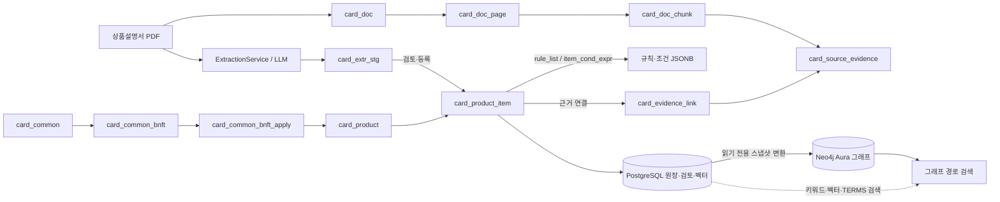

# GraphRAG PostgreSQL·Neo4j 스키마 심층 분석

> 상태: 1차 분석본. 2026-11-05 실제 운영 DB 조회 및 저장소 소스 확인 기준. 이 문서는 스키마 구조와 추출·적재 구현을 설명한다. 계속 조사 중인 항목은 본문에 표시한다. 데이터베이스·소스 파일은 읽기만 했다.

## 전체 구조 요약

PostgreSQL은 카드 및 문서 원장, 검토 상태, JSONB 규칙·조건과 임베딩을 보유한다. Neo4j는 그중 검색 경로에 필요한 항목·규칙·대상·조건·문서 근거를 노드와 방향 관계로 재구성한다. 두 DB가 자동으로 동기화되는 구조라고 단정할 근거는 확인되지 않았다.

## 조사 기준과 현황

- PostgreSQL은 프로젝트 연결 설정을 재사용해 읽기 전용 트랜잭션으로 조회했다. Neo4j Aura도 읽기 전용 트랜잭션으로 조회했다. 조회 시각은 2026-11-05이며, 수치는 조회 시점의 실제 데이터다.
- 현재 Neo4j는 노드 937개, 관계 1,297개다. PostgreSQL `db_pipeline`의 카드 상품은 10개다. 세부 개수와 라벨별 수는 아래 Neo4j 절에 정리했다.
- 기존 `src/card_benefit/docs/source_wiki/09_POSTGRESQL_NEO4J_STRUCTURE_COMPARISON.md`는 DB 직접 조회 결과가 아닌 정적 설명이다. `src/card_benefit/docs/POSTGRESQL_NEO4J_STRUCTURE_DATA_COMPARISON.md`의 2026-11-03 수치(200 노드/263 관계)는 과거 스냅샷으로 현재 값과 다르다.
- 실제 DDL·소스·DB 근거를 대조 중이다. 예시 데이터는 구조를 설명하는 데 필요한 제한된 필드만 기록하며, PDF 원문·`source_json` 본문은 출력하지 않는다.

## PostgreSQL 데이터 모델: 원장과 연결

### 상품과 상품 항목

`card_product`는 카드 상품 단위의 부모 레코드다. PK는 `card_id`, 상품 식별자 `product_cd`는 UNIQUE다. 실제 10개 상품이 있다. `card_product_item`은 상품에 속한 혜택·이용 조건·연회비 항목을 한 테이블에 저장한다. 복합 PK `(card_id, card_product_item_id)`는 항목 ID를 상품 범위에 종속시킨다. `(card_id,item_cd)`도 UNIQUE이므로 상품 안에서 항목 코드를 유일하게 유지한다.

실제 `item_type_cd` 분포는 `BENEFIT=34`, `TERMS=14`, `ANNUAL_FEE=3`이다. 모두 현재 `PENDING_REVIEW` 상태다. 따라서 `BENEFIT`와 `TERMS`는 별도 테이블이 아니라 항목 종류로 구별된다. 주요 데이터는 이름·설명·원문형 한도/조건 텍스트, `rule_list`, `item_cond_expr`, `relation_list`, 그리고 검토·검색 필드다. 복합 PK와 업무상 `card_id` 연결은 상품별 항목 소속을 명확하게 한다. 선택된 주요 테이블에서 물리 FK는 조회되지 않았으므로, 아래 연결은 키·등록 코드가 구현하는 논리 연결이며 DB FK 제약이 있다고 오해하면 안 된다.

`card_product_item`의 `item_cond_expr`, `rule_list`, `relation_list`는 JSONB 구조이고, 규칙의 대상·조건 정보를 담는다. 반면 `item_limit_txt` 등 서술형 혜택 설명도 유지된다. 이 혼합은 원문 문구와 일부 검색 가능한 정형 데이터를 함께 보존하지만, 모든 혜택 조건이 계산 가능한 컬럼으로 정규화되었다는 뜻은 아니다.

### 공통 혜택

`card_common`(공통 서비스)의 PK는 `card_common_id`, `common_cd`는 UNIQUE다. `card_common_bnft`(공통 혜택)는 `(card_common_id,card_common_bnft_id)` 복합 PK로 공통 서비스 아래에 소속되고, `(card_common_id,bnft_cd)`가 UNIQUE다. `card_common_bnft_apply`(공통 혜택 적용 상품)는 `(card_common_id,card_common_bnft_id,card_id)`를 PK로 갖고 어느 상품이 공통 혜택을 적용받는지 연결한다. 실제 공통 서비스 14개, 공통 혜택 82개, 적용 행 1개다. 이는 카드별 혜택 항목과 공통 서비스/혜택의 저장 경로가 별개임을 보여준다.

### 문서와 근거

`card_doc`는 PDF 문서 메타데이터(PK `card_doc_id`, 문서 코드·SHA-256 UNIQUE)를 보유한다. `card_doc_page`는 `(card_doc_id,page_no)` 페이지, `card_doc_chunk`는 `(card_doc_id,page_no,card_doc_chunk_id)` 청크를 식별한다. `card_source_evidence`는 같은 문서·페이지·청크 복합 키와 `evidence_id`로 추출된 근거 단위를 관리한다. `card_product_doc`와 `card_common_doc`는 각각 상품·공통 서비스와 문서를 연결하는 연결 테이블이다. `card_evidence_link`는 혜택/규칙/항목 같은 업무 대상을 실제 증거 레코드에 연결한다. 실제 조회에서 문서 30건, 페이지 86건, 청크 95건, 증거 2,959건, 근거 링크 250건을 확인했다. Neo4j에는 링크된 증거만 일부 적재되어 전체 증거 수와 그래프 증거 노드 수가 다르다.

### 검토 및 추출 상태

`card_extr_stg`는 추출 단계 결과를 보관하는 스테이징 테이블이고, `card_ai_run`·`card_ai_call`은 모델 실행/호출 이력을 남긴다. 현재 스테이징 686행, AI run 42행, call 122행이다. 운영 카드 항목 51건(BENEFIT·TERMS·ANNUAL_FEE)은 모두 `PENDING_REVIEW`다. 추출 후보와 승인된 서비스 데이터는 구분되어야 하며, 현재 상태에서 검색 결과가 검토 전 레코드를 포함하지 않는지 검색 경로별 확인이 필요하다.

### 실제 사례: 하나카드 JADE FIRST

실제 `card_id=20`은 `HANA_CREDIT_JADE_FIRST`다. `card_product_item`의 항목 `20261105_000092`는 `DISCOUNT` 유형 혜택이며 검토 상태는 `PENDING_REVIEW`다. 이 항목에는 규칙 2개(`bonus_additional_cap_discount`, `bonus_base_discount`)가 있고 각 규칙의 조회값은 50 `PERCENT`, 대상 수는 6이다. 혜택에 연결된 근거는 9개이며, 일부는 JADE FIRST 상품설명서 3페이지의 `card_source_evidence`를 가리킨다. 이 사례는 혜택 1건이 규칙 여러 건과 증거 여러 건을 가질 수 있음을 보여준다. 금액의 실제 계산 의미는 추가 소스 확인이 필요하다.

## Python 추출 MODEL → 검증 → 저장 흐름

### 공통 추출·정규화

`src/card_benefit/payment_card/db_pipeline/extraction_service.py`의 `ExtractionService.run`은 공통 추출 흐름을 수행한다. `normalize_benefit`은 모델 출력의 혜택 항목을 공통 형태로 맞추고, `build_rule`은 규칙을, `build_cond_expr`는 조건식을 만든다. 현재 확인한 공통 정규화 경로에서 카드 ID별 BENEFIT 변환 분기(`card_id == ...`)는 발견되지 않았다. 이는 조사한 모듈 기준의 사실이며 저장소 내 모든 실행 진입점을 뜻하지 않는다.

검증은 출력 스키마 및 필드 형태를 확인하지만, 이 검증만으로 복잡한 혜택 조건이 완전하게 실행 가능한 판정식임을 보장하지 않는다. 사람이 보정하는 자료는 별도의 JSON 패치로 관리된다. 예를 들어 `docs/identity_registry/benefit_patch/WOORI_CARD2_SIMPLE.json`, `WOORI_CARD2_DAILY.json`은 staging ID에 따른 데이터 보정이며, 카드별 Python 변환기와는 구별해야 한다.

### 카드사별 문서 입력과 TERMS 등록

`document_service.py`에는 하나카드 문서 manifest/hash/size 확인과 외부 PDF 입력 경로가 있다. 외부 PDF의 글리프 정리와 우리카드 문서 형식의 날짜 처리처럼 카드사 문서 입력 특화 처리는 확인됐다. 따라서 “카드사별 처리가 전혀 없다”고 할 수는 없지만, 확인된 처리는 문서 입력/문자 정리 수준이며 일반 BENEFIT 정규화가 카드별 코드로 분기된다는 증거는 없다.

TERMS는 `terms_register.py`와 `docs/identity_registry/terms/WOORI_CARD2_SIMPLE.json`, `WOORI_CARD2_DAILY.json`의 상품별 시드 데이터로 `card_product_item`에 등록된다. 새 상품은 공통 스키마로 저장할 수 있으나 문서 출처 등록, 상품 연결, 검토 및 필요한 경우 카드별 TERMS 시드·근거 정리는 필요하다. 새 카드의 조건 의미가 기존 데이터 계약으로 표현 불가하면 스키마/코드 확장이 필요할 수 있다(추정이며, 미지원 조건의 전체 목록은 추가 확인 필요).

### PostgreSQL 저장과 Neo4j 변환

`product_benefit_service.py`는 BENEFIT을 `card_product_item`으로 등록하고 `rule_list`, `item_cond_expr`, `relation_list` JSONB와 `card_evidence_link`를 기록한다. `neo4j_dry_run.py`는 PostgreSQL에서 `item_type_cd='BENEFIT'` 항목을 읽어 그래프 투영 구조를 만든다. 과거/비활성 `card_bnft` 테이블을 읽는 것이 아니라 `card_product_item`을 BENEFIT의 원본으로 사용하고 상품 항목 ID를 그래프 혜택 ID로 alias한다.

`neo4j_load_draft.py`는 속성 allowlist를 사용해 그래프 속성을 만들고 `source_json`도 원본 추적용으로 보유한다. 조건/규칙/문서/근거는 별도 노드와 관계로 분해된다. 벡터는 실제 소스 기준 PostgreSQL `vector(1536)`에 있고, Neo4j 노드 속성으로 적재하는 근거는 확인하지 못했다.

## Neo4j Aura 실제 스키마

### 노드 라벨과 개수

모든 노드는 공통 검색/식별 라벨 `dp_node`도 가지므로 `dp_node=937`은 추가 노드가 아니라 전체 노드 수다. 라벨별 개수는 중복 라벨 노드의 개수를 포함하는 라벨 집계다.

| 라벨 | 의미 | 개수 | PostgreSQL 대응 |
|---|---|---:|---|
| `dp_card_product` | 카드 상품 | 10 | `card_product` |
| `dp_card_product_item` | 상품 항목(BENEFIT·TERMS 등) | 51 | `card_product_item` |
| `dp_card_bnft` | 카드별 혜택 역할 | 34 | `card_product_item` 중 BENEFIT |
| `dp_card_common` | 공통 서비스 | 14 | `card_common` |
| `dp_card_common_bnft` | 공통 혜택 | 82 | `card_common_bnft` |
| `dp_bnft_rule` | 혜택 규칙 | 49 | `card_product_item.rule_list`의 규칙 |
| `dp_rule_target` | 규칙 적용 대상 | 103 | 규칙 JSONB의 target 목록 |
| `dp_cond_expr` | 조건식 | 49 | `item_cond_expr` 또는 규칙 조건 JSONB |
| `dp_cond_branch` | 조건 분기 | 50 | 조건식 분기 구조 |
| `dp_cond_atom` | 원자 조건 | 117 | 원자 조건 JSONB |
| `dp_card_doc` | 문서 | 30 | `card_doc` |
| `dp_card_doc_page` | 문서 페이지 | 86 | `card_doc_page` |
| `dp_card_doc_chunk` | 문서 청크 | 95 | `card_doc_chunk` |
| `dp_card_source_evidence` | 연결된 근거 | 201 | `card_source_evidence` 중 그래프에서 참조되는 근거 |

그래프의 `dp_card_bnft`와 `dp_card_product_item`은 BENEFIT 34개에 함께 붙는 두 라벨이다. 하나의 Neo4j 노드를 복제한 것이 아니다. 노드에 `dp_card_product_item` 기본 역할을 붙이고 BENEFIT에 한해 혜택 라벨을 추가하는 적재 방식이며, 구형 분리 테이블 구조와의 호환/검색 역할을 겸한다. 세부 속성 타입 및 모든 Node Key 속성의 전체표는 추가 확인 필요.

### 관계 타입·방향·건수

| 관계 | 시작 → 종료 | 건수 | 의미 / PostgreSQL 대응 |
|---|---|---:|---|
| `dp_has_benefit` | product → benefit/item | 34 | 상품의 혜택 항목; `card_product_item.card_id` |
| `dp_has_item` | product → item | 17 | 상품의 비혜택 항목; 같은 상품-항목 연결 |
| `dp_has_common_benefit` | product → common benefit | 1 | 공통 혜택 적용; `card_common_bnft_apply` |
| `dp_belongs_to` | common benefit → common service | 82 | 공통 혜택 소속; `card_common_bnft`의 공통 ID |
| `dp_same_as` | card benefit → common benefit | 1 | 카드별/공통 혜택 대응; apply/매핑 데이터 |
| `dp_has_rule` | benefit → rule | 49 | 혜택 규칙 분해; `rule_list` |
| `dp_targets` | rule → target | 235 | 규칙별 적용 대상; `target_list` |
| `dp_has_expr` | source → expression | 49 | 상품/혜택/규칙의 조건식; JSONB 조건 |
| `dp_has_branch` | expression → branch | 50 | 분기 구조 |
| `dp_has_atom` | branch → atom | 117 | AND/OR/제외 등 원자 조건 |
| `dp_supported_by` | 업무 노드 → evidence | 250 | 혜택·규칙·상품·항목 근거; `card_evidence_link` |
| `dp_in_chunk` | evidence → chunk | 201 | 근거가 나온 청크 |
| `dp_on_page` | chunk → page | 95 | 청크가 속한 페이지 |
| `dp_in_document` | page → document | 86 | 페이지가 속한 문서 |
| `dp_has_document` | product/common → document | 30 | 상품/공통 서비스의 문서 연결 테이블 |

`dp_targets`의 235는 관계 건수다. 규칙 1건당 대상 평균이나 1:N 카디널리티를 뜻하지 않는다. 방향은 그래프 탐색에서 경로를 명시하기 위한 모델이다. 특히 근거 추적은 업무 대상에서 `dp_supported_by`를 따라 evidence→chunk→page→document로 이동한다. 실제 개별 edge 예시 및 모든 관계별 시작·종료 라벨 조합은 추가 확인 필요.

관계 합계는 1,297이다. 주요 제약은 14개 NODE KEY와 공통 `dp_node.key` 유일성 제약 1개, 총 15개다. 실제 키 속성 전체와 속성 데이터 타입 표는 후속 조사에서 DDL 및 Aura 메타데이터와 대조해 보완한다.

## 정형화 수준의 1차 평가

### 확인된 사실

1. BENEFIT 추출/변환의 공통 경로가 있고, 이번에 확인한 핵심 정규화기에서 카드별 BENEFIT 코드 분기는 발견되지 않았다. 다만 문서 인입·문자 보정과 TERMS 시드/검토 패치는 카드 또는 상품별 입력을 가진다.
2. 혜택, 규칙, 대상, 조건식, 분기, 원자 조건, 근거 링크는 PostgreSQL JSONB 및 Neo4j 노드/관계로 일부 분리되어 있다. 조건 구조에는 `negate` 등 정형 필드가 실제 존재한다. 우리카드 DAILY 사례 `card_id=42`, 항목 `20261105_000180`의 `recurring_rate`에는 `SPEND_EXCL`, `BNFT_EXCL`, `negate=true`가 확인됐다.
3. 구조화된 조건과 함께 `rule_text`, 설명/한도 원문, `source_json` 같은 텍스트/원본 표현도 존재한다. Neo4j rule은 `value_num=50`, `value_unit_cd=PERCENT`, target 목록 등 일부 필드를 갖지만, 이것만으로 실제 할인 적용을 완전히 계산할 수 있다고 볼 수 없다.
4. 확인한 데이터에는 카드별 상품 항목 34 BENEFIT, 14 TERMS가 있고 전부 `PENDING_REVIEW`다. 그래프에는 해당 혜택 노드도 존재한다. Graph 질문 카탈로그는 상태를 반환하지만 승인 상태 필터가 없는 경로가 확인되어, 검토 상태가 검색 노출에 미치는 영향은 실제 실행 경로 기준 추가 확인 필요.
5. 상품 임베딩은 `card_product_item` 중 9/34 BENEFIT에, 공통 혜택 임베딩은 6/82에 존재했다. 모든 등록 혜택이 벡터 검색 가능한 상태는 아니다.

### 객관적 판단

스키마는 상품-혜택-규칙-대상-조건-문서 근거의 연결을 보존하고, 그래프 탐색과 SQL/벡터 검색을 함께 지원하는 데 적합한 요소를 갖춘다. 다만 실제 혜택 판정의 정형화 수준은 부분적이다. 일부 조건 종류, 금액 기준, 제외 플래그는 필드화되어 있지만, 상세 가맹점/결제 조건과 예외·한도 의미가 텍스트 또는 JSON 원문에 남는 사례가 있어 규칙 엔진이 직접 계산할 수 있는 완전한 도메인 모델이라고 단정할 수 없다. 이는 코드에서 계산 방식 키 일부를 제외하고 규칙 금액을 설명 데이터로 다루는 구현과도 부합한다.

새 카드가 기존 타입/조건 계약에 맞고 문서·상품·검토·근거 데이터를 제공하면 기존 스키마로 저장 가능하다. 카드별 공통 Python 변환기 수정이 항상 필요하다는 근거는 찾지 못했다. 반대로 새 카드가 새 조건 의미/분기 구조를 요구하면 기존 정규화 모델이 표현 가능한지 검증해야 한다. 신규 카드 전체 등록 절차와 신규 조건의 커버리지 매트릭스는 추가 확인 필요.

## 조사 중 / 추가 확인 필요

- 전체 PostgreSQL 테이블의 컬럼·타입·PK/FK/UNIQUE/CHECK/인덱스 전문과 주요 테이블 외의 DDL 대조.
- 각 Neo4j 라벨의 실제 속성명·Neo4j 타입·Node Key 속성, 관계별 전체 시작/끝 라벨 조합의 표.
- A/B/C 검색 모드별 실행 경로, 실제 SQL/Cypher 전문, 승인 상태 적용 위치.
- 실제 등록 카드의 사례 A(혜택→규칙→대상→조건→PDF) 및 사례 B(제외 조건→PDF)의 완전한 경로를 안전한 최소 결과로 확인하고 재현 가능한 읽기 전용 쿼리를 수록.
- 사례 C 카드 비교 조회, PostgreSQL 키와 Neo4j `dp_node.key` 대응 규칙 및 비즈니스 키 변환 표.
- 공통 혜택 관계와 실제 적용 행 간의 `dp_same_as` 매핑이 만들어지는 조건, 증거 2,959건 중 그래프 포함 201건의 적재 조건.
- 벡터 검색 SQL의 승인/유효 기간 필터와 상위 UI의 A/B/C 라우팅을 모든 진입점에서 대조.

## 소스 위치 인덱스

| 영역 | 프로젝트 경로 | 확인 포인트 |
|---|---|---|
| 추출/정규화 | `src/card_benefit/payment_card/db_pipeline/extraction_service.py` | `ExtractionService.run`, `normalize_benefit`, `build_rule`, `build_cond_expr` |
| 문서 입력 | `src/card_benefit/payment_card/db_pipeline/document_service.py` | manifest·외부 PDF·페이지 정리 |
| BENEFIT 저장 | `src/card_benefit/payment_card/db_pipeline/product_benefit_service.py` | 항목·규칙 JSONB·근거 링크 등록 |
| TERMS 등록 | `src/card_benefit/payment_card/db_pipeline/terms_register.py` | 상품 항목 등록과 evidence 연결 |
| 그래프 투영 | `src/card_benefit/payment_card/db_pipeline/neo4j_dry_run.py` | PostgreSQL→그래프 읽기/변환 |
| 그래프 적재 | `src/card_benefit/payment_card/db_pipeline/neo4j_load_draft.py` | 속성 allowlist·라벨·제약조건 |
| 벡터 조회 | `src/card_benefit/payment_card/db_pipeline/embedding_repository.sql` | PostgreSQL vector 검색 |
| 정적 구조 설명 | `src/card_benefit/docs/source_wiki/09_POSTGRESQL_NEO4J_STRUCTURE_COMPARISON.md` | DB 실측값으로 간주하지 않을 것 |

