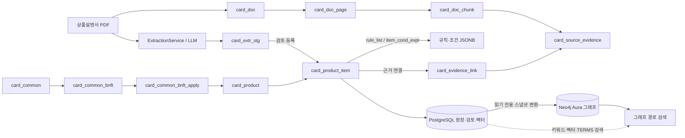
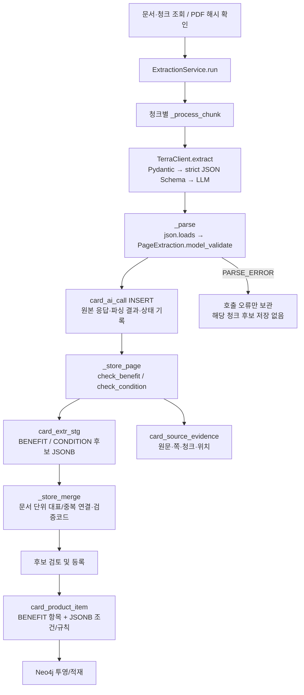

# GraphRAG PostgreSQL·Neo4j 스키마 심층 분석

> 상태: 1차 분석본. 2026-11-05 실제 운영 DB 조회 및 저장소 소스 확인 기준. 이 문서는 스키마 구조와 추출·적재 구현을 설명한다. 계속 조사 중인 항목은 본문에 표시한다. 데이터베이스·소스 파일은 읽기만 했다.

## 전체 구조 요약



PostgreSQL은 카드 및 문서 원장, 검토 상태, JSONB 규칙·조건과 임베딩을 보유한다. Neo4j는 그중 검색 경로에 필요한 항목·규칙·대상·조건·문서 근거를 노드와 방향 관계로 재구성한다. 두 DB가 자동으로 동기화되는 구조라고 단정할 근거는 확인되지 않았다.

## 조사 기준과 현황

- PostgreSQL은 프로젝트 연결 설정을 재사용해 읽기 전용 트랜잭션으로 조회했다. Neo4j Aura도 읽기 전용 트랜잭션으로 조회했다. 조회 시각은 2026-11-05이며, 수치는 조회 시점의 실제 데이터다.
- 현재 Neo4j는 노드 937개, 관계 1,297개다. PostgreSQL `db_pipeline`의 카드 상품은 10개다. 세부 개수와 라벨별 수는 아래 Neo4j 절에 정리했다.
- 기존 `src/card_benefit/docs/source_wiki/09_POSTGRESQL_NEO4J_STRUCTURE_COMPARISON.md`는 DB 직접 조회 결과가 아닌 정적 설명이다. `src/card_benefit/docs/POSTGRESQL_NEO4J_STRUCTURE_DATA_COMPARISON.md`의 2026-11-03 수치(200 노드/263 관계)는 과거 스냅샷으로 현재 값과 다르다.
- 실제 DDL·소스·DB 근거를 대조 중이다. 예시 데이터는 구조를 설명하는 데 필요한 제한된 필드만 기록하며, PDF 원문·`source_json` 본문은 출력하지 않는다.

## PostgreSQL 데이터 모델: 원장과 연결

### 상품과 상품 항목

`card_product`는 카드 상품 단위의 부모 레코드다. PK는 `card_id`, 상품 식별자 `product_cd`는 UNIQUE다. 실제 10개 상품이 있다. `card_product_item`은 상품에 속한 혜택·이용 조건·연회비 항목을 한 테이블에 저장한다. 복합 PK `(card_id, card_product_item_id)`는 항목 ID를 상품 범위에 종속시킨다. `(card_id,item_cd)`도 UNIQUE이므로 상품 안에서 항목 코드를 유일하게 유지한다.

실제 `item_type_cd` 분포는 `BENEFIT=34`, `TERMS=14`, `ANNUAL_FEE=3`이다. 모두 현재 `PENDING_REVIEW` 상태다. 따라서 `BENEFIT`와 `TERMS`는 별도 테이블이 아니라 항목 종류로 구별된다. 주요 데이터는 이름·설명·원문형 한도/조건 텍스트, `rule_list`, `item_cond_expr`, `relation_list`, 그리고 검토·검색 필드다. 복합 PK와 업무상 `card_id` 연결은 상품별 항목 소속을 명확하게 한다. 선택된 주요 테이블에서 물리 FK는 조회되지 않았으므로, 아래 연결은 키·등록 코드가 구현하는 논리 연결이며 DB FK 제약이 있다고 오해하면 안 된다.

`card_product_item`의 `item_cond_expr`, `rule_list`, `relation_list`는 JSONB 구조이고, 규칙의 대상·조건 정보를 담는다. 반면 `item_limit_txt` 등 서술형 혜택 설명도 유지된다. 이 혼합은 원문 문구와 일부 검색 가능한 정형 데이터를 함께 보존하지만, 모든 혜택 조건이 계산 가능한 컬럼으로 정규화되었다는 뜻은 아니다.

### 공통 혜택

`card_common`(공통 서비스)의 PK는 `card_common_id`, `common_cd`는 UNIQUE다. `card_common_bnft`(공통 혜택)는 `(card_common_id,card_common_bnft_id)` 복합 PK로 공통 서비스 아래에 소속되고, `(card_common_id,bnft_cd)`가 UNIQUE다. `card_common_bnft_apply`(공통 혜택 적용 상품)는 `(card_common_id,card_common_bnft_id,card_id)`를 PK로 갖고 어느 상품이 공통 혜택을 적용받는지 연결한다. 실제 공통 서비스 14개, 공통 혜택 82개, 적용 행 1개다. 이는 카드별 혜택 항목과 공통 서비스/혜택의 저장 경로가 별개임을 보여준다.

### 문서와 근거

`card_doc`는 PDF 문서 메타데이터(PK `card_doc_id`, 문서 코드·SHA-256 UNIQUE)를 보유한다. `card_doc_page`는 `(card_doc_id,page_no)` 페이지, `card_doc_chunk`는 `(card_doc_id,page_no,card_doc_chunk_id)` 청크를 식별한다. `card_source_evidence`는 같은 문서·페이지·청크 복합 키와 `evidence_id`로 추출된 근거 단위를 관리한다. `card_product_doc`와 `card_common_doc`는 각각 상품·공통 서비스와 문서를 연결하는 연결 테이블이다. `card_evidence_link`는 혜택/규칙/항목 같은 업무 대상을 실제 증거 레코드에 연결한다. 실제 조회에서 문서 30건, 페이지 86건, 청크 95건, 증거 2,959건, 근거 링크 250건을 확인했다. Neo4j에는 링크된 증거만 일부 적재되어 전체 증거 수와 그래프 증거 노드 수가 다르다.

### 검토 및 추출 상태

`card_extr_stg`는 추출 단계 결과를 보관하는 스테이징 테이블이고, `card_ai_run`·`card_ai_call`은 모델 실행/호출 이력을 남긴다. 현재 스테이징 686행, AI run 42행, call 122행이다. 운영 카드 항목 51건(BENEFIT·TERMS·ANNUAL_FEE)은 모두 `PENDING_REVIEW`다. 추출 후보와 승인된 서비스 데이터는 구분되어야 하며, 현재 상태에서 검색 결과가 검토 전 레코드를 포함하지 않는지 검색 경로별 확인이 필요하다.

### 실제 사례: 하나카드 JADE FIRST

실제 `card_id=20`은 `HANA_CREDIT_JADE_FIRST`다. `card_product_item`의 항목 `20261105_000092`는 `DISCOUNT` 유형 혜택이며 검토 상태는 `PENDING_REVIEW`다. 이 항목에는 규칙 2개(`bonus_additional_cap_discount`, `bonus_base_discount`)가 있고 각 규칙의 조회값은 50 `PERCENT`, 대상 수는 6이다. 혜택에 연결된 근거는 9개이며, 일부는 JADE FIRST 상품설명서 3페이지의 `card_source_evidence`를 가리킨다. 이 사례는 혜택 1건이 규칙 여러 건과 증거 여러 건을 가질 수 있음을 보여준다. 금액의 실제 계산 의미는 추가 소스 확인이 필요하다.

## Python 추출 MODEL → 검증 → 저장 흐름

### 추출 스키마부터 DB까지: 실제 소스 추적

> **이 장의 핵심:** 추출 스키마는 코드에 정의된 **Pydantic 클래스**다. 실행 시 그 클래스에서 LLM용 **JSON Schema**가 생성된다. **PostgreSQL의 테이블 스키마(DDL)**는 별도로 존재하며, DB에는 JSON Schema 정의가 아니라 **추출한 JSON 데이터(JSONB)**와 검증/등록 결과가 저장된다. 따라서 이 구조는 분석 불가능한 임의의 동적 스키마가 아니다.
>
> 검증 범위: 2026-11-05 팀 GitHub `main`의 Python/SQL 소스 및 Codex의 기존 운영 DB 조회 결과. 아래의 가상 JSON 예시는 구조를 이해하기 위한 것으로 실제 카드의 추출 원본이라고 주장하지 않는다. 운영 DB의 현재 제약조건 전문은 `pg_constraint` 조회로 별도 확인해야 한다.

#### 1) 네 가지 서로 다른 '스키마'를 구분하기

| 이름 | 정의/생성 위치 | 실제 역할 | DB 저장 여부 |
|---|---|---|---|
| **Pydantic 추출 MODEL** | `extraction_schema.py`의 `PageExtraction`, `BenefitItem`, `RuleItem` 등 | LLM에 요구할 필드, 타입, 허용 코드, 중첩 구조의 **고정된 Python 정의** | 정의 자체는 DB에 저장하지 않음 |
| **LLM 응답용 JSON Schema** | `terra_client.py`에서 `to_strict_json_schema(PageExtraction)` 실행 | 위 Python MODEL을 OpenAI 응답 형식으로 변환, `strict=True` 지정 | 정의 자체를 업무 DB에 등록하는 코드가 아님 |
| **추출 결과 JSON 데이터** | LLM 응답을 `_parse()`로 읽고 검증 | 페이지 응답 전체 또는 페이지에서 뽑은 BENEFIT/CONDITION 항목 | `card_ai_call.call_resp_json`, `card_extr_stg.stg_raw_item` 등의 **JSONB 값** |
| **PostgreSQL 저장 스키마** | DDL 및 변경 마이그레이션 | 테이블·PK·CHECK·JSONB 계약 함수로 **저장 형태** 검증 | 실제 DB 객체로 존재 |

Java로 비교하면 **Pydantic MODEL ≒ 추출용 DTO + Bean Validation**, `ExtractionService` ≒ Service, `ExtractionRepository` ≒ DAO, PostgreSQL DDL ≒ 테이블 및 제약조건이다. 다만 `model_validate()`는 DTO 형식 검증이고, **PDF 원문과 의미가 일치하는지 확인하는 별도 서비스 검증**을 대체하지 않는다.

**확인 소스:** [로컬 MODEL](../../payment_card/db_pipeline/extraction_schema.py#L23) / [GitHub MODEL](https://github.com/encore-ai-campus/mle-02-p2-team3/blob/main/src/card_benefit/payment_card/db_pipeline/extraction_schema.py#L23), [로컬 LLM 호출](../../payment_card/db_pipeline/terra_client.py#L82) / [GitHub LLM 호출](https://github.com/encore-ai-campus/mle-02-p2-team3/blob/main/src/card_benefit/payment_card/db_pipeline/terra_client.py#L82)

#### 2) LLM에게 어떤 JSON을 뽑으라고 정의했는가?

모든 페이지 추출은 `PageExtraction`을 최상위 타입으로 사용한다. 원문을 구조화하는 **모델 간 포함 관계**는 아래와 같다.

```text
PageExtraction                       ← 페이지 1쪽의 LLM 응답
├── page_no / page_role
├── product: ProductMention?         ← 상품 표기(원본 응답용)
├── benefits: BenefitItem[]
│   ├── targets: TargetItem[]        ← 가맹점·업종·서비스 대상
│   ├── rules: RuleItem[]            ← 할인율·금액 등 규칙
│   │   └── conditions: ConditionItem[]
│   ├── limits: LimitItem[]          ← 금액·횟수 한도
│   ├── conditions: ConditionItem[]  ← 혜택 전체 조건
│   ├── relations: RelationItem[]    ← 다른 혜택과의 관계
│   └── evidence: EvidenceQuote[]    ← 혜택/규칙/한도/관계 인용
├── card_conditions: ConditionItem[] ← 카드 공통 조건
└── unresolved: UnresolvedItem[]     ← 해석하지 못한 원문
ConditionItem
└── evidence: EvidenceQuote[]        ← 조건 자체의 원문 인용
```

| Python 클래스 | 필드(실제 소스명) | 분석 시 읽어야 할 의미 |
|---|---|---|
| `PageExtraction` | `page_no`, `page_role`, `product`, `benefits`, `card_conditions`, `unresolved` | 페이지/상품 정보, 추출 혜택 목록, 카드 공통 조건, 해석 보류 목록 |
| `BenefitItem` | `item_key`, `bnft_nm`, `bnft_type_cd`, `is_common_candidate`, `no_condition_stated`, `certainty`, `brand_txt`, `service_grade_txt`, `applicable_cards`, `selection_service_txt`, `excluded_cards`, `validity_period_txt`, `targets`, `rules`, `limits`, `conditions`, `relations`, `evidence`, `uncertainty_note` | 혜택 하나의 내용·분류·적용 범위·규칙·조건·원문 근거 |
| `RuleItem` | `rule_key`, `value_num`, `value_raw_txt`, `value_unit_cd`, `min_txn_amt`, `min_txn_raw_txt`, `conditions`, `limit_keys` | 규칙 식별자, 5% 등의 수치, 원문 표기, 건당 최소 결제금액, 규칙별 조건 |
| `TargetItem` | `target_type_cd`, `target_nm` | 적용 대상 종류/이름 |
| `ConditionItem` | `cond_key`, `cond_type_cd`, `cond_basis_cd`, `cond_min_amt`, `cond_max_amt_excl`, `negate_yn`, `excl_raw_txt`, `cond_raw_txt`, `scope`, `target_benefit_nms`, `evidence` | 실적/제외/이용 조건의 종류·금액 구간·부정 여부·적용 범위·근거 |
| `LimitItem` | `limit_key`, `period_cd`, `cap_unit_cd`, `limit_num`, `limit_raw_txt`, `shared_scope_txt`, `applies_to_benefit_nms` | 한도 주기·단위·숫자·원문 및 공유 범위 |
| `RelationItem` | `relation_key`, `rel_type_cd`, `to_benefit_nm`, `trigger_limit_key` | 서로 다른 혜택 간 관계 |
| `EvidenceQuote` | `quote_txt`, `supports`, `support_key`, `link_basis` | 인용 원문, 뒷받침하는 대상/키, 연결 근거 방식 |
| `ProductMention` | `product_nm`, `issuer`, `card_kind_cd`, `brand_txts`, `annual_fee_txt`, `issue_target_txt` | 페이지에 등장한 상품 정보(이 MODEL 자체로 상품 등록을 자동 확정하지 않음) |
| `UnresolvedItem` | `raw_txt`, `reason` | AI가 판단을 보류한 문구와 이유 |

`Literal`은 `cond_type_cd`, `value_unit_cd`, `bnft_type_cd` 등의 **허용 코드 목록**을 고정한다. 예를 들어 `CondType`은 `SPEND_REQ`, `SPEND_EXCL`, `BNFT_EXCL`, `USAGE_REQ`, `PAYMENT_METHOD`, `MERCHANT_RULE`, `GRACE`, `ETC`, `UNKNOWN` 중 하나다. `UNKNOWN`은 형식상 허용하지만 **업무적으로 검토가 필요할 수 있는 값**이다.

`ExtractionModel`은 Pydantic `BaseModel`을 상속하며 `extra="forbid"`로 정의 밖의 필드를 거부한다. `RuleItem`은 과거 응답의 `calc_method_cd`, `payout_unit_cd`를 `model_validator(mode="before")`에서 제거하는 호환 예외가 있다. `Decimal` 수치는 API 측 JSON Schema에 숫자로 노출되도록 `NumberValue`를 정의했다. **타입/필드 필수 여부는 실제 모델 선언과 생성된 strict 스키마를 각각 확인**해야 한다. `strict` 변환 과정에서는 nullable 필드의 JSON 표현이 Python의 기본값 처리 방식과 다르게 보일 수 있다.

**확인 소스:** [공통 타입·Literal (GitHub)](https://github.com/encore-ai-campus/mle-02-p2-team3/blob/main/src/card_benefit/payment_card/db_pipeline/extraction_schema.py#L23), [MODEL 계층 (GitHub)](https://github.com/encore-ai-campus/mle-02-p2-team3/blob/main/src/card_benefit/payment_card/db_pipeline/extraction_schema.py#L49), [페이지 최상위 타입 (GitHub)](https://github.com/encore-ai-campus/mle-02-p2-team3/blob/main/src/card_benefit/payment_card/db_pipeline/extraction_schema.py#L171)

#### 3) 실행 시 JSON Schema가 만들어진다는 뜻

```python
# terra_client.py의 핵심 부분(발췌)
text={
    "format": {
        "type": "json_schema",
        "name": "page_extraction",
        "strict": True,
        "schema": to_strict_json_schema(PageExtraction),
    }
}
```

이 코드는 **PDF마다 필드 구성을 새로 설계하는 코드가 아니다.** 소스에 고정된 `PageExtraction` 타입을 LLM API가 이해하는 JSON Schema 형식으로 직렬화한다. 프롬프트(`extraction_service.py`의 `PROMPT_TXT`)는 **무엇을 어떤 근거로 추출할지** 지시하고, JSON Schema는 **어떤 형식으로 응답할지** 제한한다. 둘은 별개다.

또한 API의 strict JSON 응답도 **정답 보장 기능이 아니다.** 적절한 필드와 자료형을 생성해도 원문 인용·수치·적용 대상이 틀릴 수 있어 다음 단계에서 다시 검증한다.

원하는 경우 **DB 변경 없이** 현재 Python 환경에서 실제 전송되는 JSON Schema를 정적 스냅샷 파일로 확인할 수 있다. 아래는 설명용 명령이며 이 문서를 작성하면서 실행한 것은 아니다.

```powershell
# 프로젝트 루트에서 실행; 해당 환경의 openai/pydantic 버전에 따라 출력이 달라질 수 있음
$env:PYTHONPATH = "src/card_benefit"
@'
import json
from openai.lib._pydantic import to_strict_json_schema
from payment_card.db_pipeline.extraction_schema import PageExtraction
print(json.dumps(to_strict_json_schema(PageExtraction), ensure_ascii=False, indent=2))
'@ | python > page_extraction_schema_snapshot.json
```

스냅샷을 확인할 때 `properties`, `$defs`, `required`, `type`, `enum`, `additionalProperties`를 읽으면 된다. 파일은 **LLM에 전달되는 계약을 관찰한 결과물**이지 별도의 두 번째 업무 스키마를 정의하는 원본이 아니다.

#### 4) `ExtractionService.run()` 실제 호출 순서: 실패와 저장까지



1. `run()`이 대상 상품·문서·AI 입력 청크를 조회하고 입력/재사용 조건을 확인한다. 문서 전체를 무조건 한 번에 보내는 것이 아니라 **청크별 페이지 입력**을 구성한다.
2. `_process_chunk()`가 입력 텍스트/페이지 이미지를 준비하고 `_call_llm()`을 호출한다.
3. `TerraClient.extract()`는 프롬프트 및 페이지 내용을 API로 보내고 `to_strict_json_schema(PageExtraction)`를 응답 형식으로 지정한다.
4. `_parse()`는 `json.loads(raw_text)` 뒤 `PageExtraction.model_validate(...)`를 호출한다. JSON 파싱 실패, Pydantic 검증 실패, 기대 페이지 번호 불일치면 `PARSE_ERROR`.
5. `_call_llm()`은 성공/실패와 무관하게 `card_ai_call`에 호출 기록을 저장한다. 성공 시 `call_resp_raw`에 원문 응답, `call_resp_json`에 **페이지 응답 전체 JSON**이 들어간다.
6. 검증된 페이지에 대해서만 `_store_page()`가 `BenefitItem`과 `ConditionItem`별로 `check_benefit()` / `check_condition()`을 수행한다.
7. `_store_item()`은 추출 항목 **하나씩** `card_extr_stg.stg_raw_item`에 `model_dump(mode="json")`를 저장한다. 따라서 `call_resp_json`은 페이지 전체, `stg_raw_item`은 개별 후보라는 차이가 있다.
8. 각 후보에서 찾은 인용은 `card_source_evidence`에 별도 행으로 저장되며 최초 상태는 `PENDING`이다. 위치를 못 찾은 인용도 NULL 위치로 남을 수 있다.
9. `_store_merge()`는 여러 청크/페이지의 중복 후보를 묶어 대표 행 연결과 `stg_sql_check_cd`를 업데이트한다. **등록용 정규화 JSON 전체를 중간 테이블에 영구 저장하는 것이 아니라 등록 시 재생성한다.**
10. 혜택 등록 서비스는 검토 결과가 허용하는 후보에 한해 `card_product_item` 및 `card_evidence_link`를 작성한다. 등록된 혜택 자체도 `PENDING_REVIEW`일 수 있다.

**트랜잭션 경계:** `card_ai_call`의 호출 기록은 별도 즉시 커밋된다. 페이지 후보 저장은 **청크별 트랜잭션**, 문서 통합은 **문서별 트랜잭션**이다. 따라서 후보 저장이 실패해도 LLM 호출 이력이 남을 수 있다.

**확인 소스:** [run (로컬)](../../payment_card/db_pipeline/extraction_service.py#L850) / [GitHub](https://github.com/encore-ai-campus/mle-02-p2-team3/blob/main/src/card_benefit/payment_card/db_pipeline/extraction_service.py#L850), [_process_chunk](https://github.com/encore-ai-campus/mle-02-p2-team3/blob/main/src/card_benefit/payment_card/db_pipeline/extraction_service.py#L1065), [_call_llm](https://github.com/encore-ai-campus/mle-02-p2-team3/blob/main/src/card_benefit/payment_card/db_pipeline/extraction_service.py#L1093), [_parse](https://github.com/encore-ai-campus/mle-02-p2-team3/blob/main/src/card_benefit/payment_card/db_pipeline/extraction_service.py#L1137), [_store_page / _store_item](https://github.com/encore-ai-campus/mle-02-p2-team3/blob/main/src/card_benefit/payment_card/db_pipeline/extraction_service.py#L1150), [_store_merge](https://github.com/encore-ai-campus/mle-02-p2-team3/blob/main/src/card_benefit/payment_card/db_pipeline/extraction_service.py#L1210)

#### 5) 검증은 세 층이며 서로 검사하는 것이 다르다

| 검증 층 | 실제 함수/구조 | 검사 대상 | 이 검증만으로 보장하지 않는 것 |
|---|---|---|---|
| **① 응답 구조 검증** | `PageExtraction.model_validate()` | 중첩 필드 구조, 타입, `Literal`, 누락/초과 필드 등 | 혜택 내용이 PDF에서 사실인지 |
| **② PDF 원문 검증** | `locate_evidence`, `check_values`, `check_benefit`, `check_condition`, `link_check` | 인용 위치, 원문 표기·숫자, 혜택/대상과 인용의 연결 | 사람이 보는 표 해석·복잡한 예외가 언제나 정확한지 |
| **③ DB 저장 계약** | `fn_valid_cond_expr`, `fn_valid_rule_list`, `fn_valid_target_list`, 각 테이블 `CHECK` | 저장 JSONB의 구조, 코드·범위·중복 키, PK/제약조건 | 타 테이블 PDF 원문과 값이 정말 일치하는지 |

원문 대조에서 `check_values()`는 다음과 같은 코드를 반환한다.

- `NO_EVIDENCE`: 근거 인용이 없음
- `QUOTE_NOT_FOUND`: 인용을 원문에서 찾지 못함
- `VALUE_NOT_IN_QUOTE`: 원문 표기나 기대 숫자가 인용에서 확인되지 않음
- `VALUE_PARSE_DIFF`: 숫자와 원문 표기의 파싱 결과가 다름
- `OK`: 해당 검사 통과

`link_check()`는 인용 연결이 `SAME_TEXT`이고 필요한 대상 이름이 확인될 때 `TEXT_CONFIRMED`, 그렇지 않으면 `NEEDS_REVIEW`를 준다. **숫자가 확인돼도 표의 어느 행·열에 속하는지 불명확하면 연결 검토가 남을 수 있다.** 문서 통합 시 `sql_check_code()`는 근거·계약·통합 충돌·연결 검토 여부를 `stg_sql_check_cd`로 요약한다(`CONTRACT_INVALID`, `MERGE_CONFLICT`, `SCOPE_UNRESOLVED`, `LINK_REVIEW` 등).

다음 네 상태는 **서로 같은 뜻이 아니다.** `card_ai_call.call_status`(API 응답/파싱 성공 여부), `card_extr_stg.stg_sql_check_cd`(추출 후보 검증 결과), `card_source_evidence.approval_status_cd`(개별 근거 승인 상태), `card_product_item.verification_status_cd`(등록 항목 검토 상태). 현재 운영 조회에서 BENEFIT/TERMS가 `PENDING_REVIEW`였다고 해서 추출 JSON 파싱이 실패했다는 뜻은 아니다.

**확인 소스:** [원문 위치·수치·연결 검증](https://github.com/encore-ai-campus/mle-02-p2-team3/blob/main/src/card_benefit/payment_card/db_pipeline/extraction_service.py#L284), [검증 코드 요약](https://github.com/encore-ai-campus/mle-02-p2-team3/blob/main/src/card_benefit/payment_card/db_pipeline/extraction_service.py#L531), [등록 검토 게이트](https://github.com/encore-ai-campus/mle-02-p2-team3/blob/main/src/card_benefit/payment_card/db_pipeline/product_benefit_service.py#L256)

#### 6) Pydantic 필드가 실제 어느 DB 컬럼으로 가는가?

| 추출/정규화 출발점 | 중간 저장 | 최종 등록/변환 | 중요한 구분 |
|---|---|---|---|
| `PageExtraction` 전체 | `card_ai_call.call_resp_json` **JSONB** | 직접 등록 항목이 아님 | 페이지 응답 원형을 호출 이력으로 보존 |
| `BenefitItem` 한 건 | `card_extr_stg.stg_raw_item` **JSONB** (`BENEFIT`) | 검토 후 `card_product_item` (`item_type_cd='BENEFIT'`) | 중간 JSON과 최종 JSON 계약이 다름 |
| `PageExtraction.card_conditions[]` 한 건 | `card_extr_stg.stg_raw_item` **JSONB** (`CONDITION`) | 적용 범위 판단 후 혜택/상품 조건 정규화에 반영될 수 있음 | 조건 후보와 최종 등록 항목은 1:1이 아님 |
| `EvidenceQuote.quote_txt`·`supports`·`support_key` | `card_source_evidence`의 원문·위치 및 후보 연결 | `card_evidence_link`로 등록 항목/규칙 등과 연결 | 근거는 텍스트 컬럼 하나에만 저장되는 것이 아님 |
| `BenefitItem.bnft_nm` / `bnft_type_cd` | 혜택 후보 JSON | `card_product_item.item_nm` / `item_subtype_cd` 등 등록 매핑 | 등록 서비스·SQL Mapper에서 실제 컬럼명 재확인 |
| `RuleItem.rule_key`·`value_num`·`value_unit_cd` | `stg_raw_item.rules[]` | `card_product_item.rule_list[]` **JSONB** | `build_rule()`이 등록용 JSON 구조 생성 |
| `TargetItem.target_type_cd`·`target_nm` | `stg_raw_item.targets[]` | `rule_list[].target_list[]` | `normalize_benefit()`이 대상 키/이름으로 매핑 |
| `ConditionItem.cond_*` / `negate_yn` | `stg_raw_item.conditions[]` 등 | `item_cond_expr.branches[].atoms[]` 또는 `rule_list[].cond_expr...` | `build_cond_expr()`이 branch/atom 계층 생성 |
| `LimitItem.limit_raw_txt` 등 | `stg_raw_item.limits[]` | 주로 `item_limit_txt` 원문 설명, 검토 보정 시 일부 `item_data` | 모든 한도 항목이 별도 정규화 테이블/계산식으로 옮겨지는 것은 아님 |
| `RelationItem` | `stg_raw_item.relations[]` | 해석·대상 식별 후 `relation_list` **JSONB** | 대상 혜택 미확정이면 검토 필요 |
| `ProductMention` | 호출 응답 원형 등 | 상품 등록 자체를 자동 확정하지 않음 | 별도 `card_product` 원장/등록 과정 존재 |

정규화 함수의 실제 동작은 다음과 같다.

```python
# extraction_service.py: build_cond_expr()의 핵심 구조(설명용 발췌)
{
    "expr_status_cd": "DRAFT",
    "branches": [{
        "branch_no": 1,
        "atoms": [{
            "atom_seq": 1,
            "atom_key": condition.cond_key,
            "negate_yn": condition.negate_yn,
            "cond_type_cd": condition.cond_type_cd,
            "cond_basis_cd": condition.cond_basis_cd,
            "cond_min_amt": condition.cond_min_amt,
            "cond_max_amt_excl": condition.cond_max_amt_excl,
            "excl_raw_txt": condition.excl_raw_txt,
            "cond_raw_txt": condition.cond_raw_txt,
            "cond_status_cd": "DRAFT",
        }],
    }],
}
```

이 단계에서는 **조건 목록을 하나의 branch에 원자 조건(AND)으로 배치**한다. 데이터 계약은 여러 branch(OR) 표현을 지원하지만, **LLM이 모든 OR 구조를 자동 추론해 완성한다고 읽어서는 안 된다.** `build_rule()`은 `min_txn_amt`가 있으면 건당 금액 조건 원자를 추가하고, 규칙별 적용 대상과 값을 `rule_list` 형태로 만든다.

**확인 소스:** [조건식 생성](https://github.com/encore-ai-campus/mle-02-p2-team3/blob/main/src/card_benefit/payment_card/db_pipeline/extraction_service.py#L428), [규칙 생성](https://github.com/encore-ai-campus/mle-02-p2-team3/blob/main/src/card_benefit/payment_card/db_pipeline/extraction_service.py#L473), [혜택 정규화](https://github.com/encore-ai-campus/mle-02-p2-team3/blob/main/src/card_benefit/payment_card/db_pipeline/extraction_service.py#L608), [최종 BENEFIT 등록](https://github.com/encore-ai-campus/mle-02-p2-team3/blob/main/src/card_benefit/payment_card/db_pipeline/product_benefit_service.py#L256)

#### 7) JSON Schema와 JSONB 실제 저장 형식: 작은 예제로 비교

다음 예시는 특정 카드 운영 데이터를 복사한 값이 아니라 **필드 대응을 설명하기 위한 부분 JSON**이다. `PageExtraction` 전체를 만족하는 완전한 LLM 응답 예시가 아니다.

**추출 응답의 `ConditionItem` 일부(중간 후보 JSONB에 포함):**

```json
{
  "cond_key": "C01",
  "cond_type_cd": "SPEND_REQ",
  "cond_basis_cd": "PREV_MONTH_SPEND",
  "cond_min_amt": 500000,
  "cond_raw_txt": "전월 이용실적 50만원 이상",
  "negate_yn": false
}
```

**`build_cond_expr()` 변환 후 최종 조건식 JSONB의 해당 부분:**

```json
{
  "expr_status_cd": "DRAFT",
  "branches": [
    {
      "branch_no": 1,
      "atoms": [
        {
          "atom_seq": 1,
          "atom_key": "C01",
          "negate_yn": false,
          "cond_type_cd": "SPEND_REQ",
          "cond_basis_cd": "PREV_MONTH_SPEND",
          "cond_min_amt": 500000,
          "cond_max_amt_excl": null,
          "excl_raw_txt": null,
          "cond_raw_txt": "전월 이용실적 50만원 이상",
          "cond_status_cd": "DRAFT"
        }
      ]
    }
  ]
}
```

같은 조건이라도 **Pydantic MODEL의 JSON 필드 구조**(`cond_key`, `scope`, `evidence` 등)와 **최종 등록용 JSONB**(`expr_status_cd`, `branches`, `atoms`, `atom_key` 등)는 일치하지 않는다. Python의 `build_cond_expr()`가 둘 사이를 변환한다.

이 때문에 **Pydantic MODEL과 DB 컬럼명만 기계적으로 1:1 대응시키면 설계를 잘못 이해하기 쉽다.** 변환 함수까지 봐야 데이터가 어디로 이동하고 어떤 항목이 사라지는지 분석할 수 있다.

#### 8) PostgreSQL이 검사하는 것은 어떤 '스키마'인가?

현재 `card_product_item`에는 `item_cond_expr`, `rule_list`, `relation_list`, `item_data`라는 **JSONB 컬럼**이 있다. 저장 JSONB의 내부 구조는 SQL 함수·CHECK로 제한한다. 주요 예는 다음과 같다.

| DB 객체 | 검사 내용 | 소스 |
|---|---|---|
| `fn_valid_cond_expr(jsonb)` | 조건식의 branches/atoms 형식과 제한 | [DDL 소스](https://github.com/encore-ai-campus/mle-02-p2-team3/blob/main/src/card_benefit/sql/db_pipeline_schemaV7_draft.sql#L70) |
| `fn_valid_target_list(jsonb)` | 규칙 적용 대상 목록 구조 | [DDL 소스](https://github.com/encore-ai-campus/mle-02-p2-team3/blob/main/src/card_benefit/sql/db_pipeline_schemaV7_draft.sql#L155) |
| `fn_valid_rule_list(jsonb,text)` | 규칙·조건/대상 JSON의 구조 계약 | [DDL 소스](https://github.com/encore-ai-campus/mle-02-p2-team3/blob/main/src/card_benefit/sql/db_pipeline_schemaV7_draft.sql#L196) |
| `fn_valid_relation_list(jsonb,text)` | 관계 목록, 중복/자기참조 등 | [DDL 소스](https://github.com/encore-ai-campus/mle-02-p2-team3/blob/main/src/card_benefit/sql/db_pipeline_schemaV7_draft.sql#L245) |
| `card_product_item_cond_ck` / `_rule_ck` / `_rel_ck` | `item_cond_expr`, `rule_list`, `relation_list`가 위 계약을 따르는지 | [항목 테이블 DDL](https://github.com/encore-ai-campus/mle-02-p2-team3/blob/main/src/card_benefit/sql/db_pipeline_card_product_item.sql#L74) |
| `fn_valid_item_data(...,'TERMS')` 관련 변경 | TERMS가 도입된 후 `item_data`의 TERMS_V1 구조 검사 | [TERMS 마이그레이션](https://github.com/encore-ai-campus/mle-02-p2-team3/blob/main/src/card_benefit/sql/db_pipeline_card_product_item_terms.sql#L12) |

**주의: DDL 파일 하나가 운영 DB의 최신 스키마 전체를 의미하지 않는다.** 예를 들어 초기 `db_pipeline_card_product_item.sql`에는 유형 CHECK가 `BENEFIT`와 `ANNUAL_FEE`로 작성되어 있지만, 후속 `db_pipeline_card_product_item_terms.sql`이 기존 유형 CHECK를 제거하고 `TERMS_V1` 검사 로직을 추가했다. 실제 운영에는 BENEFIT 34건, TERMS 14건, ANNUAL_FEE 3건이 존재한다(기존 Codex 운영 조회). **마이그레이션의 실행 여부와 현재 DB `pg_constraint`/함수 본문을 최종 기준으로 확인해야 한다.**

DB CHECK는 **동일 행의 JSON 구조·값 형식·정해진 논리 제약**을 검사할 뿐, 다른 테이블의 PDF 청크 내용과 인용 문자열이 완전히 일치하는지까지 자동 증명하지 못한다. TERMS 마이그레이션의 주석에도 원문과 청크 일치 여부는 등록 프로그램에서 확인한다고 명시돼 있다.

#### 9) TERMS는 BENEFIT과 같은 추출 경로라고 단정하면 안 된다

현재 확인된 우리카드 `TERMS`는 `terms_register.py`와 `docs/identity_registry/terms/WOORI_CARD2_SIMPLE.json`, `WOORI_CARD2_DAILY.json`의 **시드 데이터 및 검증·등록 절차**로 `card_product_item`에 들어간다. `PageExtraction.card_conditions`와 **TERMS 14건을 1:1로 직접 매핑하는 구조라고 간주하면 안 된다.**

- BENEFIT: `ExtractionService`의 추출 후보, 검증, 정규화와 `product_benefit_service.py`의 등록 경로를 중심으로 분석.
- TERMS: 실제 시드 JSON의 `TERMS_V1` 계약, `terms_register.py`, DDL 변경과 원문 근거 검증을 별도로 분석.
- 둘 다 최종 `card_product_item`에서 **항목 유형(item_type_cd)**으로 구분되지만, **입력 생성·검증·등록 진입점**은 다를 수 있다.

**확인 소스:** [TERMS 등록 서비스](https://github.com/encore-ai-campus/mle-02-p2-team3/blob/main/src/card_benefit/payment_card/db_pipeline/terms_register.py#L347), [TERMS DDL 변경](https://github.com/encore-ai-campus/mle-02-p2-team3/blob/main/src/card_benefit/sql/db_pipeline_card_product_item_terms.sql#L68)

#### 10) 저장 SQL과 실제 소스를 클릭해 읽는 순서

| 학습 순서 | 소스/위치 | 먼저 볼 내용 |
|---|---|---|
| ① MODEL 정의 | [로컬](../../payment_card/db_pipeline/extraction_schema.py#L49) · [GitHub](https://github.com/encore-ai-campus/mle-02-p2-team3/blob/main/src/card_benefit/payment_card/db_pipeline/extraction_schema.py#L49) | Pydantic 상속, Literal, 필드와 중첩 관계 |
| ② strict JSON Schema | [로컬](../../payment_card/db_pipeline/terra_client.py#L82) · [GitHub](https://github.com/encore-ai-campus/mle-02-p2-team3/blob/main/src/card_benefit/payment_card/db_pipeline/terra_client.py#L82) | 실제 LLM API로 보내는 구조 |
| ③ _parse() | [로컬](../../payment_card/db_pipeline/extraction_service.py#L1137) · [GitHub](https://github.com/encore-ai-campus/mle-02-p2-team3/blob/main/src/card_benefit/payment_card/db_pipeline/extraction_service.py#L1137) | PageExtraction.model_validate, 실패 처리 |
| ④ 원문 검증 | [로컬](../../payment_card/db_pipeline/extraction_service.py#L284) · [GitHub](https://github.com/encore-ai-campus/mle-02-p2-team3/blob/main/src/card_benefit/payment_card/db_pipeline/extraction_service.py#L284) | 위치·숫자·조건 연결 |
| ⑤ 중간 JSONB 저장 | [SQL Mapper](https://github.com/encore-ai-campus/mle-02-p2-team3/blob/main/src/card_benefit/payment_card/db_pipeline/extraction_repository.sql#L108) · [Service](https://github.com/encore-ai-campus/mle-02-p2-team3/blob/main/src/card_benefit/payment_card/db_pipeline/extraction_service.py#L1169) | `call_resp_json` vs `stg_raw_item` vs evidence |
| ⑥ 등록용 조건식 변환 | [GitHub](https://github.com/encore-ai-campus/mle-02-p2-team3/blob/main/src/card_benefit/payment_card/db_pipeline/extraction_service.py#L428) | ConditionItem → branches/atoms |
| ⑦ 최종 BENEFIT 저장 | [GitHub](https://github.com/encore-ai-campus/mle-02-p2-team3/blob/main/src/card_benefit/payment_card/db_pipeline/product_benefit_service.py#L336) | `Jsonb(bnft_cond)`, `Jsonb(rules)`, `Jsonb(relations)` |
| ⑧ DB CHECK | [로컬](../../sql/db_pipeline_card_product_item.sql#L112) · [GitHub](https://github.com/encore-ai-campus/mle-02-p2-team3/blob/main/src/card_benefit/sql/db_pipeline_card_product_item.sql#L112) | 저장 계약과 Pydantic 계약의 차이 |
| ⑨ TERMS 별도 경로 | [GitHub](https://github.com/encore-ai-campus/mle-02-p2-team3/blob/main/src/card_benefit/payment_card/db_pipeline/terms_register.py#L347) | 상품별 TERMS 시드·검증 |

**로컬 Markdown 링크 주의:** 위 상대 경로는 이 문서(`src/card_benefit/docs/guide/`)를 기준으로 계산했다. `#L행번호`는 GitHub에서는 해당 줄로 이동하지만, VS Code Preview에서는 설치된 확장/열기 동작에 따라 파일만 열리고 행 이동이 보장되지 않을 수 있다. 로컬 링크가 원하는 행으로 가지 않으면 GitHub 링크를 함께 사용한다.

**이 장의 결론:** `Pydantic MODEL(고정 소스)` → `strict JSON Schema(런타임 변환)` → `LLM 응답 JSON(페이지 전체)` → `Python 타입·원문 검증` → `중간 JSONB(개별 후보)` → `정규화 함수(등록용 데이터 계약)` → `PostgreSQL JSONB + CHECK` 순서다. **JSON Schema가 DB 테이블로 저장되는 게 아니며, DB CHECK가 PDF 의미의 정확성을 단독 보증하지도 않는다.**

---

### 공통 추출·정규화

`src/card_benefit/payment_card/db_pipeline/extraction_service.py`의 `ExtractionService.run`은 공통 추출 흐름을 수행한다. `normalize_benefit`은 모델 출력의 혜택 항목을 공통 형태로 맞추고, `build_rule`은 규칙을, `build_cond_expr`는 조건식을 만든다. 현재 확인한 공통 정규화 경로에서 카드 ID별 BENEFIT 변환 분기(`card_id == ...`)는 발견되지 않았다. 이는 조사한 모듈 기준의 사실이며 저장소 내 모든 실행 진입점을 뜻하지 않는다.

검증은 출력 스키마 및 필드 형태를 확인하지만, 이 검증만으로 복잡한 혜택 조건이 완전하게 실행 가능한 판정식임을 보장하지 않는다. 사람이 보정하는 자료는 별도의 JSON 패치로 관리된다. 예를 들어 `docs/identity_registry/benefit_patch/WOORI_CARD2_SIMPLE.json`, `WOORI_CARD2_DAILY.json`은 staging ID에 따른 데이터 보정이며, 카드별 Python 변환기와는 구별해야 한다.

### 카드사별 문서 입력과 TERMS 등록

`document_service.py`에는 하나카드 문서 manifest/hash/size 확인과 외부 PDF 입력 경로가 있다. 외부 PDF의 글리프 정리와 우리카드 문서 형식의 날짜 처리처럼 카드사 문서 입력 특화 처리는 확인됐다. 따라서 “카드사별 처리가 전혀 없다”고 할 수는 없지만, 확인된 처리는 문서 입력/문자 정리 수준이며 일반 BENEFIT 정규화가 카드별 코드로 분기된다는 증거는 없다.

TERMS는 `terms_register.py`와 `docs/identity_registry/terms/WOORI_CARD2_SIMPLE.json`, `WOORI_CARD2_DAILY.json`의 상품별 시드 데이터로 `card_product_item`에 등록된다. 새 상품은 공통 스키마로 저장할 수 있으나 문서 출처 등록, 상품 연결, 검토 및 필요한 경우 카드별 TERMS 시드·근거 정리는 필요하다. 새 카드의 조건 의미가 기존 데이터 계약으로 표현 불가하면 스키마/코드 확장이 필요할 수 있다(추정이며, 미지원 조건의 전체 목록은 추가 확인 필요).

### PostgreSQL 저장과 Neo4j 변환

`product_benefit_service.py`는 BENEFIT을 `card_product_item`으로 등록하고 `rule_list`, `item_cond_expr`, `relation_list` JSONB와 `card_evidence_link`를 기록한다. `neo4j_dry_run.py`는 PostgreSQL에서 `item_type_cd='BENEFIT'` 항목을 읽어 그래프 투영 구조를 만든다. 과거/비활성 `card_bnft` 테이블을 읽는 것이 아니라 `card_product_item`을 BENEFIT의 원본으로 사용하고 상품 항목 ID를 그래프 혜택 ID로 alias한다.

`neo4j_load_draft.py`는 속성 allowlist를 사용해 그래프 속성을 만들고 `source_json`도 원본 추적용으로 보유한다. 조건/규칙/문서/근거는 별도 노드와 관계로 분해된다. 벡터는 실제 소스 기준 PostgreSQL `vector(1536)`에 있고, Neo4j 노드 속성으로 적재하는 근거는 확인하지 못했다.

## Neo4j Aura 실제 스키마

### 노드 라벨과 개수

모든 노드는 공통 검색/식별 라벨 `dp_node`도 가지므로 `dp_node=937`은 추가 노드가 아니라 전체 노드 수다. 라벨별 개수는 중복 라벨 노드의 개수를 포함하는 라벨 집계다.

| 라벨 | 의미 | 개수 | PostgreSQL 대응 |
|---|---|---:|---|
| `dp_card_product` | 카드 상품 | 10 | `card_product` |
| `dp_card_product_item` | 상품 항목(BENEFIT·TERMS 등) | 51 | `card_product_item` |
| `dp_card_bnft` | 카드별 혜택 역할 | 34 | `card_product_item` 중 BENEFIT |
| `dp_card_common` | 공통 서비스 | 14 | `card_common` |
| `dp_card_common_bnft` | 공통 혜택 | 82 | `card_common_bnft` |
| `dp_bnft_rule` | 혜택 규칙 | 49 | `card_product_item.rule_list`의 규칙 |
| `dp_rule_target` | 규칙 적용 대상 | 103 | 규칙 JSONB의 target 목록 |
| `dp_cond_expr` | 조건식 | 49 | `item_cond_expr` 또는 규칙 조건 JSONB |
| `dp_cond_branch` | 조건 분기 | 50 | 조건식 분기 구조 |
| `dp_cond_atom` | 원자 조건 | 117 | 원자 조건 JSONB |
| `dp_card_doc` | 문서 | 30 | `card_doc` |
| `dp_card_doc_page` | 문서 페이지 | 86 | `card_doc_page` |
| `dp_card_doc_chunk` | 문서 청크 | 95 | `card_doc_chunk` |
| `dp_card_source_evidence` | 연결된 근거 | 201 | `card_source_evidence` 중 그래프에서 참조되는 근거 |

그래프의 `dp_card_bnft`와 `dp_card_product_item`은 BENEFIT 34개에 함께 붙는 두 라벨이다. 하나의 Neo4j 노드를 복제한 것이 아니다. 노드에 `dp_card_product_item` 기본 역할을 붙이고 BENEFIT에 한해 혜택 라벨을 추가하는 적재 방식이며, 구형 분리 테이블 구조와의 호환/검색 역할을 겸한다. 세부 속성 타입 및 모든 Node Key 속성의 전체표는 추가 확인 필요.

### 관계 타입·방향·건수

| 관계 | 시작 → 종료 | 건수 | 의미 / PostgreSQL 대응 |
|---|---|---:|---|
| `dp_has_benefit` | product → benefit/item | 34 | 상품의 혜택 항목; `card_product_item.card_id` |
| `dp_has_item` | product → item | 17 | 상품의 비혜택 항목; 같은 상품-항목 연결 |
| `dp_has_common_benefit` | product → common benefit | 1 | 공통 혜택 적용; `card_common_bnft_apply` |
| `dp_belongs_to` | common benefit → common service | 82 | 공통 혜택 소속; `card_common_bnft`의 공통 ID |
| `dp_same_as` | card benefit → common benefit | 1 | 카드별/공통 혜택 대응; apply/매핑 데이터 |
| `dp_has_rule` | benefit → rule | 49 | 혜택 규칙 분해; `rule_list` |
| `dp_targets` | rule → target | 235 | 규칙별 적용 대상; `target_list` |
| `dp_has_expr` | source → expression | 49 | 상품/혜택/규칙의 조건식; JSONB 조건 |
| `dp_has_branch` | expression → branch | 50 | 분기 구조 |
| `dp_has_atom` | branch → atom | 117 | AND/OR/제외 등 원자 조건 |
| `dp_supported_by` | 업무 노드 → evidence | 250 | 혜택·규칙·상품·항목 근거; `card_evidence_link` |
| `dp_in_chunk` | evidence → chunk | 201 | 근거가 나온 청크 |
| `dp_on_page` | chunk → page | 95 | 청크가 속한 페이지 |
| `dp_in_document` | page → document | 86 | 페이지가 속한 문서 |
| `dp_has_document` | product/common → document | 30 | 상품/공통 서비스의 문서 연결 테이블 |

`dp_targets`의 235는 관계 건수다. 규칙 1건당 대상 평균이나 1:N 카디널리티를 뜻하지 않는다. 방향은 그래프 탐색에서 경로를 명시하기 위한 모델이다. 특히 근거 추적은 업무 대상에서 `dp_supported_by`를 따라 evidence→chunk→page→document로 이동한다. 실제 개별 edge 예시 및 모든 관계별 시작·종료 라벨 조합은 추가 확인 필요.

관계 합계는 1,297이다. 주요 제약은 14개 NODE KEY와 공통 `dp_node.key` 유일성 제약 1개, 총 15개다. 실제 키 속성 전체와 속성 데이터 타입 표는 후속 조사에서 DDL 및 Aura 메타데이터와 대조해 보완한다.

## 정형화 수준의 1차 평가

### 확인된 사실

1. BENEFIT 추출/변환의 공통 경로가 있고, 이번에 확인한 핵심 정규화기에서 카드별 BENEFIT 코드 분기는 발견되지 않았다. 다만 문서 인입·문자 보정과 TERMS 시드/검토 패치는 카드 또는 상품별 입력을 가진다.
2. 혜택, 규칙, 대상, 조건식, 분기, 원자 조건, 근거 링크는 PostgreSQL JSONB 및 Neo4j 노드/관계로 일부 분리되어 있다. 조건 구조에는 `negate` 등 정형 필드가 실제 존재한다. 우리카드 DAILY 사례 `card_id=42`, 항목 `20261105_000180`의 `recurring_rate`에는 `SPEND_EXCL`, `BNFT_EXCL`, `negate=true`가 확인됐다.
3. 구조화된 조건과 함께 `rule_text`, 설명/한도 원문, `source_json` 같은 텍스트/원본 표현도 존재한다. Neo4j rule은 `value_num=50`, `value_unit_cd=PERCENT`, target 목록 등 일부 필드를 갖지만, 이것만으로 실제 할인 적용을 완전히 계산할 수 있다고 볼 수 없다.
4. 확인한 데이터에는 카드별 상품 항목 34 BENEFIT, 14 TERMS가 있고 전부 `PENDING_REVIEW`다. 그래프에는 해당 혜택 노드도 존재한다. Graph 질문 카탈로그는 상태를 반환하지만 승인 상태 필터가 없는 경로가 확인되어, 검토 상태가 검색 노출에 미치는 영향은 실제 실행 경로 기준 추가 확인 필요.
5. 상품 임베딩은 `card_product_item` 중 9/34 BENEFIT에, 공통 혜택 임베딩은 6/82에 존재했다. 모든 등록 혜택이 벡터 검색 가능한 상태는 아니다.

### 객관적 판단

스키마는 상품-혜택-규칙-대상-조건-문서 근거의 연결을 보존하고, 그래프 탐색과 SQL/벡터 검색을 함께 지원하는 데 적합한 요소를 갖춘다. 다만 실제 혜택 판정의 정형화 수준은 부분적이다. 일부 조건 종류, 금액 기준, 제외 플래그는 필드화되어 있지만, 상세 가맹점/결제 조건과 예외·한도 의미가 텍스트 또는 JSON 원문에 남는 사례가 있어 규칙 엔진이 직접 계산할 수 있는 완전한 도메인 모델이라고 단정할 수 없다. 이는 코드에서 계산 방식 키 일부를 제외하고 규칙 금액을 설명 데이터로 다루는 구현과도 부합한다.

새 카드가 기존 타입/조건 계약에 맞고 문서·상품·검토·근거 데이터를 제공하면 기존 스키마로 저장 가능하다. 카드별 공통 Python 변환기 수정이 항상 필요하다는 근거는 찾지 못했다. 반대로 새 카드가 새 조건 의미/분기 구조를 요구하면 기존 정규화 모델이 표현 가능한지 검증해야 한다. 신규 카드 전체 등록 절차와 신규 조건의 커버리지 매트릭스는 추가 확인 필요.

## 조사 중 / 추가 확인 필요

- 전체 PostgreSQL 테이블의 컬럼·타입·PK/FK/UNIQUE/CHECK/인덱스 전문과 주요 테이블 외의 DDL 대조.
- 각 Neo4j 라벨의 실제 속성명·Neo4j 타입·Node Key 속성, 관계별 전체 시작/끝 라벨 조합의 표.
- A/B/C 검색 모드별 실행 경로, 실제 SQL/Cypher 전문, 승인 상태 적용 위치.
- 실제 등록 카드의 사례 A(혜택→규칙→대상→조건→PDF) 및 사례 B(제외 조건→PDF)의 완전한 경로를 안전한 최소 결과로 확인하고 재현 가능한 읽기 전용 쿼리를 수록.
- 사례 C 카드 비교 조회, PostgreSQL 키와 Neo4j `dp_node.key` 대응 규칙 및 비즈니스 키 변환 표.
- 공통 혜택 관계와 실제 적용 행 간의 `dp_same_as` 매핑이 만들어지는 조건, 증거 2,959건 중 그래프 포함 201건의 적재 조건.
- 벡터 검색 SQL의 승인/유효 기간 필터와 상위 UI의 A/B/C 라우팅을 모든 진입점에서 대조.

## 소스 위치 인덱스

| 영역 | 프로젝트 경로 | 확인 포인트 |
|---|---|---|
| 추출/정규화 | `src/card_benefit/payment_card/db_pipeline/extraction_service.py` | `ExtractionService.run`, `normalize_benefit`, `build_rule`, `build_cond_expr` |
| 문서 입력 | `src/card_benefit/payment_card/db_pipeline/document_service.py` | manifest·외부 PDF·페이지 정리 |
| BENEFIT 저장 | `src/card_benefit/payment_card/db_pipeline/product_benefit_service.py` | 항목·규칙 JSONB·근거 링크 등록 |
| TERMS 등록 | `src/card_benefit/payment_card/db_pipeline/terms_register.py` | 상품 항목 등록과 evidence 연결 |
| 그래프 투영 | `src/card_benefit/payment_card/db_pipeline/neo4j_dry_run.py` | PostgreSQL→그래프 읽기/변환 |
| 그래프 적재 | `src/card_benefit/payment_card/db_pipeline/neo4j_load_draft.py` | 속성 allowlist·라벨·제약조건 |
| 벡터 조회 | `src/card_benefit/payment_card/db_pipeline/embedding_repository.sql` | PostgreSQL vector 검색 |
| 정적 구조 설명 | `src/card_benefit/docs/source_wiki/09_POSTGRESQL_NEO4J_STRUCTURE_COMPARISON.md` | DB 실측값으로 간주하지 않을 것 |


## 추출 MODEL 필드 계약 보충 (소스 확인, 2026-11-05)

아래 타입·기본값은 실행 환경의 Pydantic 모델을 직접 읽었다. 필수는 Python 입력 기준이다. 각 의미는 필드명·docstring 및 프롬프트가 뒷받침하는 범위이며, 세부 업무 정의가 없는 코드는 아래에 명시했다. 모든 항목은 먼저 응답 JSON에 남는다. 최종 경로는 등록 성공과 관계 해결을 전제로 하며, 클래스별 경로는 표 아래의 변환 규칙을 함께 읽는다.

[MODEL 로컬](../../payment_card/db_pipeline/extraction_schema.py#L49) · [GitHub](https://github.com/encore-ai-campus/mle-02-p2-team3/blob/main/src/card_benefit/payment_card/db_pipeline/extraction_schema.py#L49) · [프롬프트 로컬](../../payment_card/db_pipeline/extraction_service.py#L90) · [GitHub](https://github.com/encore-ai-campus/mle-02-p2-team3/blob/main/src/card_benefit/payment_card/db_pipeline/extraction_service.py#L90)

### PageExtraction — 확인 완료

저장 경로: 응답 전체 card_ai_call.call_resp_json; benefits/card_conditions는 각각 card_extr_stg.stg_raw_item

| 필드 | Python 타입 | 필수 / 기본값 | PDF 추출 의미 |
|---|---|---|---|
| `page_no` | `<class 'int'>` | 필수 | PDF 페이지 번호 |
| `page_role` | `Literal['SUMMARY', 'DETAIL', 'NOTICE', 'MIXED']` | 필수 | 페이지 역할 |
| `product` | `payment_card.db_pipeline.extraction_schema.ProductMention \| None` | 선택 / None | 페이지에서 언급된 상품 정보 |
| `benefits` | `list[payment_card.db_pipeline.extraction_schema.BenefitItem]` | 선택 / [] | 페이지 혜택 후보 목록 |
| `card_conditions` | `list[payment_card.db_pipeline.extraction_schema.ConditionItem]` | 선택 / [] | 카드 범위 조건 후보 |
| `unresolved` | `list[payment_card.db_pipeline.extraction_schema.UnresolvedItem]` | 선택 / [] | 판단을 보류한 문구 |

### ProductMention — 확인 완료

저장 경로: card_ai_call.call_resp_json.product (최종 상품 자동 등록 안 함)

| 필드 | Python 타입 | 필수 / 기본값 | PDF 추출 의미 |
|---|---|---|---|
| `product_nm` | `str \| None` | 선택 / None | 상품명 |
| `issuer` | `str \| None` | 선택 / None | 발행사 |
| `card_kind_cd` | `Optional[Literal['CREDIT', 'DEBIT']]` | 선택 / None | 카드 종류 |
| `brand_txts` | `list[str]` | 선택 / [] | 브랜드 원문 목록 |
| `annual_fee_txt` | `str \| None` | 선택 / None | 연회비 원문 |
| `issue_target_txt` | `str \| None` | 선택 / None | 발급 대상 원문 |

### BenefitItem — 확인 완료

저장 경로: card_extr_stg.stg_raw_item; 정규화 후 card_product_item 및 JSONB

| 필드 | Python 타입 | 필수 / 기본값 | PDF 추출 의미 |
|---|---|---|---|
| `item_key` | `<class 'str'>` | 필수 | 페이지 혜택 후보 키 |
| `bnft_nm` | `<class 'str'>` | 필수 | 혜택 내용에서 정한 혜택명 |
| `bnft_type_cd` | `Literal['DISCOUNT', 'CASHBACK', 'POINT', 'FEE_WAIVER', 'SERVICE', 'INSTALLMENT', 'ETC', 'UNKNOWN']` | 필수 | 혜택 유형 |
| `is_common_candidate` | `<class 'bool'>` | 선택 / False | 공통 혜택 후보 여부 |
| `no_condition_stated` | `<class 'bool'>` | 선택 / False | 조건 미기재 여부 |
| `certainty` | `Literal['HIGH', 'LOW']` | 필수 | 추출 판단 확실성 |
| `brand_txt` | `str \| None` | 선택 / None | 혜택별 브랜드 원문 |
| `service_grade_txt` | `str \| None` | 선택 / None | 서비스 등급 원문 |
| `applicable_cards` | `list[str]` | 선택 / [] | 대상 카드 원문 목록 |
| `selection_service_txt` | `str \| None` | 선택 / None | 선택 서비스 원문 |
| `excluded_cards` | `list[str]` | 선택 / [] | 제외 카드 원문 목록 |
| `validity_period_txt` | `str \| None` | 선택 / None | 제공 기간 원문 |
| `targets` | `list[payment_card.db_pipeline.extraction_schema.TargetItem]` | 선택 / [] | 대상 목록 |
| `rules` | `list[payment_card.db_pipeline.extraction_schema.RuleItem]` | 선택 / [] | 혜택 값 규칙 목록 |
| `limits` | `list[payment_card.db_pipeline.extraction_schema.LimitItem]` | 선택 / [] | 한도 목록 |
| `conditions` | `list[payment_card.db_pipeline.extraction_schema.ConditionItem]` | 선택 / [] | 적용 조건 목록 |
| `relations` | `list[payment_card.db_pipeline.extraction_schema.RelationItem]` | 선택 / [] | 혜택 간 관계 목록 |
| `evidence` | `list[payment_card.db_pipeline.extraction_schema.EvidenceQuote]` | 선택 / [] | 원문 근거 인용 목록 |
| `uncertainty_note` | `str \| None` | 선택 / None | 불확실성 설명 |

### TargetItem — 확인 완료

저장 경로: card_product_item.rule_list[].target_list[]

| 필드 | Python 타입 | 필수 / 기본값 | PDF 추출 의미 |
|---|---|---|---|
| `target_type_cd` | `Literal['MERCHANT', 'INDUSTRY', 'CHANNEL', 'SERVICE', 'UNKNOWN']` | 필수 | 대상 유형 |
| `target_nm` | `<class 'str'>` | 필수 | 원문에 등장한 가맹점·서비스 이름 |

### RuleItem — 확인 완료

저장 경로: card_product_item.rule_list[]; 원문은 staging/evidence

| 필드 | Python 타입 | 필수 / 기본값 | PDF 추출 의미 |
|---|---|---|---|
| `rule_key` | `<class 'str'>` | 필수 | 규칙 식별 키 |
| `value_num` | `Optional[Annotated[decimal.Decimal, WithJsonSchema(json_schema={'type': 'number'}, mode=None)]]` | 선택 / None | 원문에 표시된 수치 |
| `value_raw_txt` | `<class 'str'>` | 필수 | 혜택 값 원문 |
| `value_unit_cd` | `Optional[Literal['PERCENT', 'KRW', 'UNIMILE', 'MULTIPLIER', 'UNKNOWN']]` | 선택 / None | 원문 값의 단위 |
| `min_txn_amt` | `int \| None` | 선택 / None | 건당 최소 금액 |
| `min_txn_raw_txt` | `str \| None` | 선택 / None | 건당 최소 금액 원문 |
| `conditions` | `list[payment_card.db_pipeline.extraction_schema.ConditionItem]` | 선택 / [] | 적용 조건 목록 |
| `limit_keys` | `list[str]` | 선택 / [] | 연결 한도 키 목록 |

### LimitItem — 확인 완료

저장 경로: staging 및 근거; 최종 card_product_item.item_limit_txt 원문 (한도 풀 제거)

| 필드 | Python 타입 | 필수 / 기본값 | PDF 추출 의미 |
|---|---|---|---|
| `limit_key` | `<class 'str'>` | 필수 | 한도 식별 키 |
| `period_cd` | `Literal['TXN', 'DAY', 'MONTH', 'YEAR', 'UNKNOWN']` | 필수 | 한도 기간 |
| `cap_unit_cd` | `Literal['KRW', 'HANAMONEY', 'COUNT', 'UNKNOWN']` | 필수 | 한도 단위 |
| `limit_num` | `int \| None` | 선택 / None | 한도 수치 |
| `limit_raw_txt` | `<class 'str'>` | 필수 | 한도 원문 |
| `shared_scope_txt` | `str \| None` | 선택 / None | 원문에 명시된 공유 범위 |
| `applies_to_benefit_nms` | `list[str]` | 선택 / [] | 적용 혜택명 목록 |

### ConditionItem — 확인 완료

저장 경로: card_product_item.item_cond_expr 또는 rule_list[].cond_expr의 branches[].atoms[]

| 필드 | Python 타입 | 필수 / 기본값 | PDF 추출 의미 |
|---|---|---|---|
| `cond_key` | `<class 'str'>` | 필수 | 조건 식별 키 |
| `cond_type_cd` | `Literal['SPEND_REQ', 'SPEND_EXCL', 'BNFT_EXCL', 'USAGE_REQ', 'PAYMENT_METHOD', 'MERCHANT_RULE', 'GRACE', 'ETC', 'UNKNOWN']` | 필수 | 조건 유형 |
| `cond_basis_cd` | `Optional[Literal['PREV_MONTH_SPEND', 'PREV_YEAR_SPEND', 'TXN_AMT', 'MONTH_USAGE', 'ROLLING_MONTHS', 'UNKNOWN']]` | 선택 / None | 조건 기준 |
| `cond_min_amt` | `int \| None` | 선택 / None | 조건 금액 하한 |
| `cond_max_amt_excl` | `int \| None` | 선택 / None | 조건 금액 배타적 상한 |
| `negate_yn` | `<class 'bool'>` | 선택 / False | 조건 부정 여부 |
| `excl_raw_txt` | `str \| None` | 선택 / None | 제외 항목 원문 |
| `cond_raw_txt` | `<class 'str'>` | 필수 | 조건 원문 |
| `scope` | `Literal['ALL_BENEFITS', 'NAMED_BENEFITS', 'THIS_BENEFIT', 'UNKNOWN']` | 필수 | 조건 적용 범위 |
| `target_benefit_nms` | `list[str]` | 선택 / [] | 적용 대상 혜택명 목록 |
| `evidence` | `list[payment_card.db_pipeline.extraction_schema.EvidenceQuote]` | 필수 | 원문 근거 인용 목록 |

### RelationItem — 확인 완료

저장 경로: card_product_item.relation_list[] (대상 해결 시)

| 필드 | Python 타입 | 필수 / 기본값 | PDF 추출 의미 |
|---|---|---|---|
| `relation_key` | `<class 'str'>` | 필수 | 관계 식별 키 |
| `rel_type_cd` | `Literal['MUTUALLY_EXCLUSIVE', 'HIGHER_VALUE_WINS', 'FALLBACK_AFTER_CAP', 'OVERRIDES', 'UNKNOWN']` | 필수 | 관계 유형 |
| `to_benefit_nm` | `<class 'str'>` | 필수 | 대상 혜택명 |
| `trigger_limit_key` | `str \| None` | 선택 / None | 관계를 유발하는 한도 키 |

### EvidenceQuote — 확인 완료

저장 경로: card_source_evidence 및 card_evidence_link

| 필드 | Python 타입 | 필수 / 기본값 | PDF 추출 의미 |
|---|---|---|---|
| `quote_txt` | `<class 'str'>` | 필수 | 페이지 텍스트에서 복사한 원문 인용 |
| `supports` | `Literal['BNFT', 'RULE', 'LIMIT', 'COND', 'TARGET', 'REL', 'APPLICABILITY']` | 필수 | 인용이 뒷받침하는 대상 종류 |
| `support_key` | `str \| None` | 선택 / None | 대상 키 |
| `link_basis` | `Literal['SAME_TEXT', 'TABLE_IMAGE', 'NOT_SURE']` | 필수 | 값과 대상의 연결 근거 |

### UnresolvedItem — 확인 완료

저장 경로: card_ai_call.call_resp_json.unresolved

| 필드 | Python 타입 | 필수 / 기본값 | PDF 추출 의미 |
|---|---|---|---|
| `raw_txt` | `<class 'str'>` | 필수 | 해석 보류 원문 |
| `reason` | `<class 'str'>` | 필수 | 해석 보류 사유 |

### 코드 의미와 검증 범위

`BnftType`: DISCOUNT 할인, CASHBACK 캐시백, POINT 포인트, FEE_WAIVER 수수료 면제, SERVICE 서비스, INSTALLMENT 할부, ETC 기타, UNKNOWN 미확정. `ValueUnit`: PERCENT %, KRW 원, UNIMILE 유니마일, MULTIPLIER 배수, UNKNOWN 미확정. `LimitPeriod`: TXN 건, DAY 일, MONTH 월, YEAR 연, UNKNOWN 미확정. `LimitUnit`: KRW 원, HANAMONEY 하나머니, COUNT 횟수, UNKNOWN 미확정. `CondType`: SPEND_REQ 실적 요구, SPEND_EXCL 실적 제외, BNFT_EXCL 혜택 제외, USAGE_REQ 이용 요구, PAYMENT_METHOD 결제수단, MERCHANT_RULE 가맹점 규칙, GRACE 유예, ETC 기타, UNKNOWN 미확정. `CondBasis`: PREV_MONTH_SPEND 전월 실적, PREV_YEAR_SPEND 전년 실적, TXN_AMT 거래 금액, MONTH_USAGE 월 이용, ROLLING_MONTHS 연속 월, UNKNOWN 미확정. `TargetType`: MERCHANT 가맹점, INDUSTRY 업종, CHANNEL 채널, SERVICE 서비스, UNKNOWN 미확정. `RelType`: MUTUALLY_EXCLUSIVE 상호 배타, HIGHER_VALUE_WINS 높은 값 우선, FALLBACK_AFTER_CAP 한도 소진 후 대체, OVERRIDES 우선 적용, UNKNOWN 미확정. 이 이름 이상의 구체적 업무 판정 기준은 정의 불명확이다.

`PageRole`: SUMMARY 요약, DETAIL 상세, NOTICE 유의사항, MIXED 혼합. `Certainty`: HIGH 높음, LOW 낮음. `CondScope`: ALL_BENEFITS 전체 혜택, NAMED_BENEFITS 명시 혜택, THIS_BENEFIT 해당 혜택, UNKNOWN 미확정. `LinkBasis`: SAME_TEXT 같은 문장, TABLE_IMAGE 표 이미지, NOT_SURE 불확실. `EvidenceSubject`: BNFT 혜택, RULE 규칙, LIMIT 한도, COND 조건, TARGET 대상, REL 관계, APPLICABILITY 적용 대상·기간. `card_kind_cd`: CREDIT 신용, DEBIT 체크. 각 코드의 경계 사례는 정의 불명확이다.

프롬프트 1–18은 텍스트에서만 값을 추출하고 이미지는 표 연결 판단에 쓰며, 인용을 그대로 복사하고 금액·횟수를 정수로 기록하도록 지시한다. 특히 9번은 적용 정보와 APPLICABILITY, 10–11번은 규칙·한도별 키가 일치하는 인용, 13–15번은 설명 수치·비수치 혜택·한도 단위, 16–18번은 원문 대상명·조건별 근거·혜택명을 지시한다. 필드마다 독립된 설명이나 모든 Literal의 세부 정의를 제공하지는 않는다.

`extra="forbid"`는 미정의 필드를 거부하지만 `RuleItem._drop_legacy_keys`는 이전 `calc_method_cd`, `payout_unit_cd`를 검증 전에 제거한다. 타입 검증만으로 인용의 진실성이나 의미를 보장하지 않는다. `check_values`는 인용 위치, raw 포함, 숫자 파싱을 확인하고, `check_benefit`은 대상과 적용 정보도 확인한다. `contract_issues`는 키 형식·중복, UNKNOWN, 실적 기준, 제외 원문, 금액 범위를 추가 확인한다. scope, 대상 연결, 관계 등은 통합 단계에서 판단되며 모든 필드가 독립적으로 의미 검증되는 것은 아니다. [검증 로컬](../../payment_card/db_pipeline/extraction_service.py#L313) · [GitHub](https://github.com/encore-ai-campus/mle-02-p2-team3/blob/main/src/card_benefit/payment_card/db_pipeline/extraction_service.py#L313).

필드별 최종 변환: `bnft_nm`, `bnft_type_cd`는 혜택 컬럼으로, targets는 각 규칙의 `target_list`로, rules의 키·값·단위는 `rule_list`로 이동한다. 조건은 `branches[].atoms[]`로 재구성되고 `min_txn_amt`는 생성된 `MIN_` 조건으로 바뀐다. `scope`와 `target_benefit_nms`는 배포 대상 결정에 사용되며 atom에 그대로 들어가지 않는다. 한도는 구조화 풀 대신 원문으로 보존된다. `limit_keys`, 관계 트리거, certainty, uncertainty_note 등은 최종 JSONB에 그대로 복사된다고 가정할 수 없다. 적용 정보는 검토 및 근거에 사용된다. 상세 저장 여부는 등록 코드와 원본별로 확인해야 한다. [정규화 로컬](../../payment_card/db_pipeline/extraction_service.py#L428) · [GitHub](https://github.com/encore-ai-campus/mle-02-p2-team3/blob/main/src/card_benefit/payment_card/db_pipeline/extraction_service.py#L428).

### 실제 strict JSON Schema — 확인 완료

동일 가상환경의 `openai.lib._pydantic.to_strict_json_schema(PageExtraction)`를 외부 호출 없이 실행한 결과를 [분석용 JSON](PAGE_EXTRACTION_STRICT_JSON_SCHEMA.analysis.json)에 저장했다. strict 변환은 모든 객체의 필드를 `required`에 넣고 `additionalProperties: false`를 적용한다. 따라서 Python에서 생략 가능한 기본값 필드도 LLM 응답에서는 반드시 키를 내야 하며, nullable은 null을 허용할 뿐 생략을 뜻하지 않는다. `NumberValue`는 Python에서 Decimal이지만 JSON Schema에는 number다. 이 파일은 분석 산출물이며 실행 로직은 읽지 않는다. [API 구성 로컬](../../payment_card/db_pipeline/terra_client.py#L64) · [GitHub](https://github.com/encore-ai-campus/mle-02-p2-team3/blob/main/src/card_benefit/payment_card/db_pipeline/terra_client.py#L64).

## 추출부터 등록까지의 실행 흐름 보충

**확인 완료: 소스 정적 추적. 실제 DB 행·PDF·검색 결과의 일치 여부는 이번 분석에서 조회하지 않았다.** Java에 비유하면 `PageExtraction`은 입력 DTO, `ExtractionService`는 검증·조정 Service, repository/SQL mapper는 DAO, `card_extr_stg`는 검토 전 staging 테이블이다. DTO의 타입 통과와 RDB CHECK 통과는 업무 의미의 승인과 다르다.

1. `ExtractionService.run`은 문서·상품·청크를 조회하고 분리 규칙과 대상 페이지를 고르며 로컬 PDF를 확인한다. 지문이 일치하고 완전한 성공 이력이 있으면 재사용한다. 새 실행은 `card_ai_run`을 만든다. `build_input`은 전체 페이지면 150 DPI PNG와 텍스트를, 부분 청크면 대상 텍스트와 같은 페이지 유의사항 문맥을 구성한다. 프롬프트·텍스트·이미지 해시를 입력 식별에 쓴다. [로컬](../../payment_card/db_pipeline/extraction_service.py#L850) · [GitHub](https://github.com/encore-ai-campus/mle-02-p2-team3/blob/main/src/card_benefit/payment_card/db_pipeline/extraction_service.py#L850).
2. `TerraClient.extract`는 예산·사용량 불확실성을 확인하고 프롬프트, `PAGE n`, 텍스트 및 선택적 PNG를 Responses API에 보낸다. 응답 형식은 `PageExtraction`의 strict schema다. 반환은 `LlmResponse(raw_text, input_tokens, output_tokens)`다. 사용량이 불명이거나 호출 예외면 후속 호출을 막는다. [로컬](../../payment_card/db_pipeline/terra_client.py#L64) · [GitHub](https://github.com/encore-ai-campus/mle-02-p2-team3/blob/main/src/card_benefit/payment_card/db_pipeline/terra_client.py#L64).
3. `_call_llm`은 JSON 파싱과 `PageExtraction.model_validate`, 페이지 번호 일치 확인을 거친다. `card_ai_call`에는 입력 해시, 상태, 원문 응답, 성공 시 모델 직렬화 JSON, 토큰, 지연, 오류 유형을 저장한다. 호출 오류는 FAILED, JSON·모델·페이지 번호 오류는 PARSE_ERROR다. **순서 주의:** 원문·숫자 대조는 이 행 저장 후 `_store_page`에서 실행된다. [로컬](../../payment_card/db_pipeline/extraction_service.py#L1093) · [GitHub](https://github.com/encore-ai-campus/mle-02-p2-team3/blob/main/src/card_benefit/payment_card/db_pipeline/extraction_service.py#L1093).
4. `_store_page`는 혜택과 카드 조건을 각각 검사하고 `_store_item`에서 항목별 `stg_raw_item`과 근거 행을 저장한다. 인용 위치를 찾지 못해도 근거 행은 위치 NULL로 남는다. 청크 하나가 트랜잭션 단위이며 SQL 오류 시 그 청크 저장이 롤백된다. 호출 이력은 별도로 이미 커밋된다. 값 검증은 원문 존재와 파싱 비교이고, 연결 검증은 표 이미지 등을 검토 대상으로 둔다. [로컬](../../payment_card/db_pipeline/extraction_service.py#L1150) · [GitHub](https://github.com/encore-ai-campus/mle-02-p2-team3/blob/main/src/card_benefit/payment_card/db_pipeline/extraction_service.py#L1150).
5. 모든 청크 성공 시 `merge_pages`는 공백 제거·소문자 혜택명으로 그룹화하고 상세 페이지를 우선한다. 규칙 값이나 한도가 다르면 충돌을 남긴다. `normalize_benefit`은 대상·규칙·조건·관계를 등록 계약으로 바꾸고 미해결 관계와 계약 오류를 판정한다. `_store_merge`는 대표·중복 관계와 검사 결과를 문서 단위 트랜잭션으로 갱신한다. 통합 실패 시 앞서 저장한 페이지 원본은 남는다. 등록 시 `normalize_stored_run`이 저장 원본에서 다시 정규화한다. [로컬](../../payment_card/db_pipeline/extraction_service.py#L568) · [GitHub](https://github.com/encore-ai-campus/mle-02-p2-team3/blob/main/src/card_benefit/payment_card/db_pipeline/extraction_service.py#L568).
6. 별도 `ProductBenefitService.register_run`은 후보·보정·관계·근거를 확인하고 `card_product_item` BENEFIT와 `card_evidence_link`를 등록한다. 규칙이 없거나 근거가 부족한 경우 검토로 돌린다. 규칙과 조건은 JSONB, 규칙·한도 인용은 텍스트로 남으며 필요 시 검토 보정이 `item_data`에 남는다. 후보별 격리된 트랜잭션과 실패 처리를 코드에서 확인할 것. TERMS는 `terms_register.py`와 제품별 seed JSON의 별도 등록 경로이며 `card_conditions`를 TERMS로 자동 1:1 등록하지 않는다. [BENEFIT 로컬](../../payment_card/db_pipeline/product_benefit_service.py#L182) · [GitHub](https://github.com/encore-ai-campus/mle-02-p2-team3/blob/main/src/card_benefit/payment_card/db_pipeline/product_benefit_service.py#L182) · [TERMS 로컬](../../payment_card/db_pipeline/terms_register.py#L347) · [GitHub](https://github.com/encore-ai-campus/mle-02-p2-team3/blob/main/src/card_benefit/payment_card/db_pipeline/terms_register.py#L347).

**설명용 가상 예시, 실제 DB 조회값 아님:** PDF 텍스트가 `A 10% 할인`이고 규칙 `R1`의 `value_raw_txt`가 `10%`라면 추출 원본은 `{"rule_key":"R1","value_num":10,"value_raw_txt":"10%","value_unit_cd":"PERCENT","conditions":[],"limit_keys":[]}`와 근거 인용을 가진다. 정규화된 `rule_list` 항목은 `{"rule_key":"R1","cond_expr":null,"target_list":[],"value_num":10,"value_unit_cd":"PERCENT","rule_status_cd":"DRAFT"}` 형태다. `value_raw_txt`와 인용은 rule JSONB에 복사되지 않고 staging·근거 및 규칙 텍스트에서 추적한다. 실제 행은 다른 필드·검토 보정을 포함할 수 있다. 이 예시는 계산 결과나 등록 성공을 주장하지 않는다.

## PostgreSQL → Neo4j 변환 보충

**확인 완료: 소스 정적 추적. 추가 확인 필요: 현재 DB의 전체 건수·키, 실제 PDF 의미와 검색 결과.** 그래프 추출 스키마를 LLM에 보내는 호출은 이 경로에 없다. `load_snapshot`이 PostgreSQL을 `REPEATABLE READ READ ONLY`로 읽고 `build(snapshot)`이 Python에서 `Preview.node`와 `Preview.edge`를 생성한다. `TerraClient`의 schema는 페이지 추출용이다. [매핑 로컬](../../payment_card/db_pipeline/neo4j_dry_run.py#L133) · [GitHub](https://github.com/encore-ai-campus/mle-02-p2-team3/blob/main/src/card_benefit/payment_card/db_pipeline/neo4j_dry_run.py#L133) · [적재 로컬](../../payment_card/db_pipeline/neo4j_load_draft.py#L86) · [GitHub](https://github.com/encore-ai-campus/mle-02-p2-team3/blob/main/src/card_benefit/payment_card/db_pipeline/neo4j_load_draft.py#L86).

| 원천 | 변환과 관계 결정 |
|---|---|
| `card_product`, `card_doc`, `card_doc_page`, `card_doc_chunk` | 각각 동명 `dp_` 노드; 상품/공통 문서 연결은 `has_document`, 페이지→문서 `in_document`, 청크→페이지 `on_page` |
| `card_product_item` BENEFIT의 `item_cond_expr`, `rule_list`, `relation_list` 등 | `dp_card_bnft`에 `dp_card_product_item` 라벨 추가; 상품→혜택 `has_benefit`. `rule_list[]`는 `dp_bnft_rule`과 `has_rule`, `target_list[]`는 공유 `dp_rule_target`과 `targets`. 상품·혜택·규칙 조건식은 `dp_cond_expr`→`dp_cond_branch`→`dp_cond_atom` |
| BENEFIT 외 `card_product_item`의 `item_data` 등 | `dp_card_product_item`, 상품→항목 `has_item`; TERMS도 이 경로 |
| `card_source_evidence`, `card_evidence_link` | 연결된 근거만 `dp_card_source_evidence`; `ev_subject_cd`가 CARD/BNFT/RULE/ITEM/REL인 경우 Python이 출발 노드를 선택해 `supported_by`, 근거→청크 `in_chunk` |
| `card_common`, `card_common_bnft`, `card_common_doc`, `card_common_bnft_apply` | 공통 노드, `belongs_to`, `has_document`, `has_common_benefit`; 비교 결과 `SAME`만 `same_as` |

노드 식별 속성은 상품 `card_id`, 혜택 `(card_id, card_bnft_id)`, 상품 항목 `(card_id, card_product_item_id)`, 공통 `(card_common_id)`, 공통 혜택 `(card_common_id, card_common_bnft_id)`, 문서 `(card_doc_id)`, 페이지 `(card_doc_id,page_no)`, 청크 `(card_doc_id,page_no,card_doc_chunk_id)`, 근거 `(evidence_id)`, 규칙 `(card_id,card_bnft_id,rule_key)`, 대상 `(target_type_cd,target_key)`, 조건식 `(expr_key)`, 분기 `(expr_key,branch_no)`, atom `(expr_key,branch_no,atom_key)`다. `expr_key`는 소유자 유형과 키에서 만든다. 내부 노드 key는 라벨과 키 조각의 JSON 배열이다. 관계는 유형·양 끝 key·원천 데이터로 만든 key를 SHA-256하여 MERGE한다. [키 정의 로컬](../../payment_card/db_pipeline/neo4j_dry_run.py#L52) · [GitHub](https://github.com/encore-ai-campus/mle-02-p2-team3/blob/main/src/card_benefit/payment_card/db_pipeline/neo4j_dry_run.py#L52).

**문제 발견: 모든 원천 관계가 별도 그래프 edge로 변환되는 것은 아니다.** 혜택 간 `relation_list`는 혜택 `source_json`에 남고 혜택 간 edge를 만들지 않는다. REL 근거는 relation_key 존재를 확인한 뒤 혜택에 연결한다. 연결되지 않은 evidence는 제외하고 ID를 보고하며, 공통 혜택의 직접 근거도 별도 목록으로 보고한다. `SAME` 이외 비교 결과에는 `same_as`가 없다. 검색 텍스트와 임베딩은 스냅샷에서 제거된다. 따라서 그래프 탐색만으로 원천의 모든 관계를 동등하게 횡단한다고 볼 수 없다. [관계 처리 로컬](../../payment_card/db_pipeline/neo4j_dry_run.py#L350) · [GitHub](https://github.com/encore-ai-campus/mle-02-p2-team3/blob/main/src/card_benefit/payment_card/db_pipeline/neo4j_dry_run.py#L350).

`expected_counts`는 선택된 원천과 JSON 조각으로 예상 건수를 계산하고 `build`는 끝점·건수 및 규칙/조건식 `source_json`을 대조한다. 적재는 허용 라벨·관계만 사용하고 Neo4j 트랜잭션에서 MERGE 후 전체 key 집합을 대조한다. 이는 선택된 투영의 구조적 일관성 검사다. PDF에서 값이 해당 혜택에 속하는지, 제외·한도·기간이 올바른지, 검색이 그 의미를 보존하는지는 별도의 원문·검토·검색 결과 대조가 필요하다. 건수 일치는 의미 정확성의 증거가 아니다. 이번에는 실제 PDF→추출 응답→등록 행→그래프→검색 결과의 동일 혜택 1건을 끝까지 조회하지 않았으므로 **추가 확인 필요**로 남긴다.


## 실제 BENEFIT 1건 추적 (2026-11-05, 읽기 전용)

**부분 확인 완료; PDF 파일 직접 검증은 추가 확인 필요.** 대상은 `card_id=42`, `card_product_item_id=20261105_000179`, `고정소비 영역 5% 청구할인`이다. PostgreSQL과 Neo4j를 각각 조회했다. 이 결과는 같은 시각의 원자적 양 DB 스냅샷은 아니다. 입력 PDF 메타데이터는 문서 `20261105_000048`, 파일명 `woori_all/credit/상품안내장_카드의정석2 DAILY_260602.pdf`, SHA-256 `54fc35e144559f631a55931f968ef150f9ef5320527460b98cae6c12e9968d26`, 페이지 2다. 로컬 파일을 찾지 못했고 저장소 객체 조회는 404, DB `doc_source_url`은 NULL이었다. 따라서 아래 인용은 **DB에 저장된 PDF 추출 텍스트 및 근거**이며, 이 PDF 바이너리의 해당 페이지를 직접 열어 확인한 결과는 아니다. 참고로 [우리카드 공개 상품 안내](https://m.wooricard.com/ai-data/cardDetail_standard2Daily.html)는 별도 현재 웹 자료이며 해당 PDF의 동일 해시를 증명하지 않는다.

재현 SQL (읽기 전용; 값은 위 식별자에 고정):

```sql
SELECT item_nm, item_subtype_cd, item_cond_expr, rule_list, relation_list,
       item_data, verification_status_cd, item_rule_txt, item_limit_txt
FROM db_pipeline.card_product_item
WHERE card_id=42 AND card_product_item_id='20261105_000179';

SELECT l.ev_subject_cd,l.rule_key,l.relation_key,e.evidence_id,e.quote_txt,
       e.start_pos,e.end_pos,s.card_extr_stg_id,s.card_ai_run_id,s.call_seq,
       s.stg_raw_item,s.stg_sql_check_cd,s.stg_status,
       e.card_doc_id,e.page_no,e.card_doc_chunk_id
FROM db_pipeline.card_evidence_link l
JOIN db_pipeline.card_source_evidence e USING(card_doc_id,page_no,card_doc_chunk_id,evidence_id)
LEFT JOIN db_pipeline.card_extr_stg s ON s.card_extr_stg_id=e.card_extr_stg_id
WHERE l.card_id=42 AND l.card_product_item_id='20261105_000179';

SELECT call_status,call_resp_json FROM db_pipeline.card_ai_call
WHERE card_ai_run_id='20261105_000046' AND card_doc_id='20261105_000048'
  AND page_no=2 AND card_doc_chunk_id='20261105_000191' AND call_seq=1;
SELECT chunk_raw_txt FROM db_pipeline.card_doc_chunk
WHERE card_doc_id='20261105_000048' AND page_no=2 AND card_doc_chunk_id='20261105_000191';
```

DB 텍스트에는 고정소비 5%, 전월실적 50만원 이상, 매출 건당 3만원 이상과 다이소 예외, 특별할인 한도 초과 시 다음 결제부터 기본할인 제공이라는 문구가 있다. 표의 고정소비 월 한도는 전월 실적 50만~100만원 미만 3,000원, 100만~200만원 미만 6,000원, 200만원 이상 12,000원이고 통합 한도는 각각 8,000원·11,000원·17,000원으로 저장돼 있다. 이 표의 시각적 행·열 연결은 PDF 원본을 직접 보지 못해 확정하지 않는다.

`call_status=SUCCEEDED`, `page_role=MIXED`; `call_resp_json.benefits`의 해당 객체는 `card_extr_stg_id=20261105_000659`의 `stg_raw_item`과 JSON 값으로 동일했다. 원본에는 `fixed_rate_50`, `fixed_rate_100`, `fixed_rate_200` 세 규칙이 각각 `value_num="5"`, `value_unit_cd=PERCENT`와 전월 실적 구간 조건을 갖고, 한도 6개와 `fixed_fallback` 관계 1개가 있다. `stg_sql_check_cd=LINK_REVIEW`, `stg_status=PENDING_REVIEW`다. 대표 근거 `20261105_002804`는 `고정소비 영역 5% 청구할인`, 위치 11–25; 규칙 근거 `20261105_002805`는 `고정소비 영역 5%`. 표 연결 검토 판정과 PDF 원본 시각 대조는 별개다. [검증 로컬](../../payment_card/db_pipeline/extraction_service.py#L313) · [GitHub](https://github.com/encore-ai-campus/mle-02-p2-team3/blob/main/src/card_benefit/payment_card/db_pipeline/extraction_service.py#L313).

최종 BENEFIT는 `verification_status_cd=PENDING_REVIEW`이고 `item_data.review_patch`에 승인 보정 `BP-20261105-0004`가 기록되어 있다. 원본 3개 규칙이 그대로 등록된 것이 아니라 대상별 9개 규칙 `food.dine`, `food.delivery`, `grocery.online`, `grocery.offline`, `grocery.daiso`, `transit.taxi`, `transit.kakaot`, `transit.fuel`, `telecom`으로 분리되었고 모두 5 PERCENT다. 예를 들어 `grocery.daiso`는 건당 최소금액 조건이 없고 다른 규칙에는 해당 조건이 붙는다. `item_cond_expr`에는 `fixed_spend`(PREV_MONTH_SPEND, 500000), `special_grace`(GRACE), `spend_exclusions`(SPEND_EXCL) 세 atom이 있다. 한도 구간은 `item_data.limit_tiers`와 `item_limit_txt`로 보존된다. 이 차이는 자동 정규화만으로 설명하지 말고 보정 이력과 함께 해석해야 한다. [보정 파일 로컬](../identity_registry/benefit_patch/WOORI_CARD2_DAILY.json) · [GitHub](https://github.com/encore-ai-campus/mle-02-p2-team3/blob/main/src/card_benefit/docs/identity_registry/benefit_patch/WOORI_CARD2_DAILY.json#L1) · [등록 로컬](../../payment_card/db_pipeline/product_benefit_service.py#L256) · [GitHub](https://github.com/encore-ai-campus/mle-02-p2-team3/blob/main/src/card_benefit/payment_card/db_pipeline/product_benefit_service.py#L256).

최종 `relation_list`는 모두 대상 `20261105_000178`, `rel_priority=null`인 `fixed_fallback/FALLBACK_AFTER_CAP`, `special_over_basic/OVERRIDES`, `special_basic_exclusive/MUTUALLY_EXCLUSIVE`다. 관계 근거 `20261105_002814`는 한도 초과 후 기본할인 문구, `20261105_003032`는 특별할인 중복 불가·우선 적용 문구이며 후자는 두 관계에 연결된다. 원본 추출에는 첫 관계만 있었고 나머지는 검토 보정으로 추가되었다.

아래 Cypher를 적재 전 운영 Aura에서 READ 세션으로 실행했다.

```cypher
MATCH (b:dp_card_bnft {card_id:42,card_bnft_id:'20261105_000179'})
RETURN labels(b), properties(b);
MATCH (b:dp_card_bnft {card_id:42,card_bnft_id:'20261105_000179'})-[r]-(n)
RETURN type(r), labels(n), properties(r), properties(n);
MATCH (b:dp_card_bnft {card_id:42,card_bnft_id:'20261105_000179'})-[:dp_has_rule]->(r)-[e]->(n)
RETURN properties(r), type(e), labels(n), properties(n);
```

혜택 노드 `source_json`의 `rule_list`, `bnft_cond_expr`, `relation_list`는 각 PostgreSQL JSONB와 값으로 동일했고 `dp_has_rule` 9개가 있었다. 혜택 노드의 직접 관계는 상품 연결 1, 조건식 1, 규칙 9, 근거 15개였으며, 혜택 간 edge는 없었다. `value_unit_cd`와 조건 상세 등은 독립 스칼라가 아닌 `source_json`에서 읽는 경우가 있다. 원본 한도/조건과 등록본의 변환 결과 전체가 PDF 의미에 맞는지까지 이 건수 비교로 보장하지 않는다.

기존 GraphRAG `candidate_relations`는 이름과 달리 혜택 간 `relation_list`가 아니라 대상·제외 조건을 읽는다. 실제 읽기 전용 `get_detail` 결과는 규칙 9개와 근거 24개를 반환했고, `benefit_context`에는 `relation_list`가 없었다. 따라서 이 경로의 답변 문맥과 후보 보정은 해당 3개 관계를 구조화된 혜택 간 관계로 사용하지 않는다. 관계 근거 인용은 evidence로 전달될 수 있으므로 문구가 전혀 전달되지 않는다고 단정할 수는 없다. [검색 Cypher 로컬](../../payment_card/db_pipeline_origin_search/graph_questions.cypher#L57) · [GitHub](https://github.com/encore-ai-campus/mle-02-p2-team3/blob/main/src/card_benefit/payment_card/db_pipeline_origin_search/graph_questions.cypher#L57) · [답변 문맥 로컬](../../payment_card/db_pipeline_origin_search/card_graphrag.py#L699) · [GitHub](https://github.com/encore-ai-campus/mle-02-p2-team3/blob/main/src/card_benefit/payment_card/db_pipeline_origin_search/card_graphrag.py#L699).

**후속 소스 변경:** `dp_related_to` 투영과 명시적 검색을 추가하는 작업을 진행했다. 위 Aura 관찰은 그 변경을 운영에 적재하기 전의 실제 상태다. PDF 원본 직접 확인과 적재 후 관계 조회는 여전히 추가 확인 필요다.


### 혜택 간 관계 보완 — 소스 변경 및 dry-run (운영 미적재)

**확인 완료:** 2026-11-05 읽기 전용 조회에서 관계를 보유한 BENEFIT는 2건, 원천 `relation_list` 항목은 총 6건이고 대상은 모두 같은 카드의 BENEFIT `20261105_000178`로 존재했다. `rel_priority`는 6건 모두 NULL이다. 관계 보유자 `20261105_000179`의 키는 `fixed_fallback`, `special_basic_exclusive`, `special_over_basic`, `20261105_000180`의 키는 `recurring_fallback`, `special_basic_exclusive`, `special_over_basic`다. 각각의 유형은 앞의 사례 표기와 같이 FALLBACK_AFTER_CAP·MUTUALLY_EXCLUSIVE·OVERRIDES다.

```sql
SELECT p.card_id,p.card_product_item_id,p.item_nm,r.value AS relation,
       t.card_product_item_id IS NOT NULL AS target_exists
FROM db_pipeline.card_product_item p
CROSS JOIN LATERAL jsonb_array_elements(coalesce(p.relation_list,'[]'::jsonb)) r(value)
LEFT JOIN db_pipeline.card_product_item t
  ON t.card_id=p.card_id AND t.item_type_cd='BENEFIT'
 AND t.card_product_item_id=r.value->>'to_bnft_id'
WHERE p.item_type_cd='BENEFIT'
ORDER BY p.card_id,p.card_product_item_id,r.value->>'relation_key';
```

변경된 `build`는 모든 혜택 노드를 만든 뒤 원본 → 대상 `dp_related_to`를 만들고, 같은 카드에 대상이 없으면 `GraphValidationError`로 중단한다. 관계 원본 JSON과 `relation_key`, `rel_type_cd`, `to_bnft_id`, NULL이 아닌 `rel_priority`를 저장한다. Neo4j에서 NULL은 속성 부재로 표현되며 원본 `source_json`의 null은 유지된다. 이 관계는 공통 혜택 동일성을 뜻하는 `dp_same_as`와 별개다. 관계 키는 기존 방식대로 유형·양 끝점·원본 JSON의 해시이므로 동일 스냅샷을 재생성하면 같다. 원본 관계 내용이 나중에 바뀌면 키도 바뀌며 기존 loader는 삭제하지 않으므로 사후 key 검증에 걸릴 수 있다. 변경·삭제 이력을 운영에 반영하는 절차는 별도 설계가 필요하다.

실제 스냅샷 dry-run과 적재 전 Aura 읽기 대조: 예상 노드 937, 예상 관계 1,303, 이 중 `dp_related_to` 6. 노드 누락·추가·변경 0, 관계 누락 6(모두 신규 유형), 기존 관계 추가·변경 0이다. 이 검증은 실제 적재 또는 적재 후 재실행 검증이 아니다. `neo4j_validate.compare_graph`는 새 관계도 유형·양 끝점·원본 JSON 및 key로 대조하며, 적재 전에는 6건 누락으로 실패하는 것이 정상이다.

신규 `Neo4jSearch.benefit_relations(key)`는 명시적 요청에서만 새 edge를 읽는다. 기존 후보 순위, `get_detail`과 답변 문맥은 바꾸지 않았다. 실제 답변에 구조화된 관계를 반영하려면 해당 조회를 `get_detail`/retrieve에 연결하고 `benefit_context`에 전달하며 대상과 근거 해석·답변 테스트를 추가해야 한다. 현재 Aura에는 Edge가 없어서 실제 신규 조회 결과는 적재 후에만 검증할 수 있다.

```cypher
MATCH (b:dp_card_bnft {key:$key})-[r:dp_related_to]->(target:dp_card_bnft)
RETURN b.key AS source_key, target.key AS target_key,
       target.card_bnft_id AS target_id, target.name AS target_name,
       r.relation_key AS relation_key, r.rel_type_cd AS rel_type_cd,
       r.rel_priority AS rel_priority, r.source_json AS source_json;
```

추가 누락 확인: 이 BENEFIT의 `item_data.limit_tiers` 및 `review_patch`는 현재 BENEFIT 스냅샷 SELECT에 포함되지 않아 혜택 노드 `source_json`에는 없다. 한도 텍스트 `item_limit_txt`는 `limit_text`로 전해진다. 이는 관계 보완과 별개의 투영 제한이며, 실제 업무 판단에 필요한 구조화 한도를 그래프에서 조회할 수 있는지는 추가 검토가 필요하다.


운영 적용 재시도에서는 `dp_related_to`에만 관계 속성을 적용하도록 수정한 뒤 사전 비교가 통과했지만, 쓰기 트랜잭션 내부의 적용 후 기존 상태 전체 비교가 불일치를 감지하여 예외로 롤백했다. 불일치의 정확한 필드와 원인은 아직 확인되지 않았다. 독립 읽기 전용 사후 조회에서는 노드 937개, 관계 1,297개, 기존 노드·관계 속성 변화 0개, 신규 관계 0개를 확인했다. PostgreSQL 기준 신규 관계 6개는 여전히 미적재이며 동일 입력에서 생성한 관계 키는 안정적이었다. 원인 분석과 적재 전용 검증 개선은 별도 작업으로 남긴다. `relation_list` 변경 시 기존 관계 키가 남는 문제도 기존에 기록한 별도 개선 항목이다.

