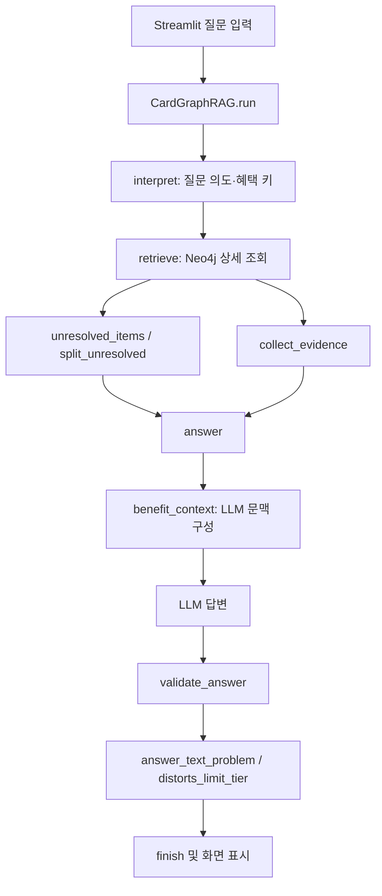

# 더 심플 하나카드 22/099 구간별 월 할인 한도 오답 — 원인과 수정

- 작성일: 2026-11-06
- 범위: 실제 데이터 흐름 분석 및 BENEFIT_LIMIT 검증 개선
- DB 변경, Neo4j 재적재, 유료 LLM 재호출, Streamlit 배포, Commit/Push: 수행하지 않음
- 관련 문서: [P0·P1 구현 결과](20261106_graphrag_p0_p1_implementation_result.md), [데이터 손실 수정 계획](20261106_graphrag_data_loss_fix_plan.md), [PostgreSQL·Neo4j 매핑 감사](20261106_postgresql_neo4j_mapping_query_audit.md), [tier.value NULL TypeError 분석](20261106_tier_value_none_typeerror.md), [DB 복원·보정 사전 검증](20261106_db_restore_and_correction_final_preflight.md)

> 이 문서는 실제 저장값, 앞선 읽기 전용 조사 결과, 코드에서 도출한 동작을 구분한다. 이번 테스트는 로컬 fixture/mock이며 실제 DB나 LLM을 사용하지 않았다.

## 1. 이슈 개요

사용자 질문은 다음과 같다.

> 더 심플 하나카드의 월납 요금 할인 한도는 지난달 이용액 구간에 따라 어떻게 달라져?

수정 전 로컬 Streamlit 화면에 표시된 실제 답변은 다음과 같았다.

> 월 할인 한도는 10,000원과 15,000원으로 확인되지만, 지난달 이용액 구간별 적용 한도는 미확정입니다.

공식 상품설명서에서 확인된 기대 내용은 다음과 같다.

- 전월 실적 30만원 이상 80만원 미만: 월 할인 한도 10,000원
- 전월 실적 80만원 이상: 월 할인 한도 15,000원
- 최초 등록 실적 유예는 별도 조건

오답의 직접적인 표면 원인은 금액 자체가 아니라 **한도 금액과 전월 실적 구간의 연결이 검색 문맥에서 사라졌다는 것**이다. 10,000원·15,000원과 30만원·80만원은 각각 조회됐지만, 프로그램이 소비할 `item_data.limit_tiers`가 기존 PostgreSQL 행과 현재 Neo4j 노드에 없었다. 이어서 GraphRAG는 규칙의 지급액 미확정(TIER_OPEN)을 월 한도 질문의 불확실성으로 취급했고, 구조화된 한도 관계가 없을 때도 LLM이 “구간별 한도는 미확정”이라고 말하는 것을 별도 검증 없이 받아들였다.

## 2. 오류 발생 환경

- 질문은 사용자가 로컬 Streamlit `http://localhost:8501/`에서 직접 실행했다. 이번 문서 작성 과정에서는 Chrome Computer Use나 브라우저 자동화를 사용하지 않았다.
- 이전 환경 확인에서 8501 포트 프로세스는 PID 3652였고, 프로젝트의 `streamlit_app.py`를 `python -m streamlit run`으로 실행 중이었다. **사용자가 오답을 실행했을 당시** 앱 시작 시각은 14:47:11, 당시 `card_graphrag.py` 수정 시각은 14:40:43으로 확인됐다. 이 시각 비교는 그 시점 코드에만 해당하며, 이 문서에 설명한 현재 패치가 프로세스 메모리에 로드됐다는 뜻은 아니다. 이번 패치 후 앱 재시작 또는 UI 재질문은 하지 않았다.
- 동작 흐름: [streamlit_app.py:385](../../payment_card/db_pipeline_origin_search/streamlit_app.py#L385)에서 질문을 받고, [streamlit_app.py:423](../../payment_card/db_pipeline_origin_search/streamlit_app.py#L423)에서 `pipeline.run(question)`을 호출한다. N 모드는 Neo4j 검색이다.
- P0 이전에는 NULL 지급액을 `float(None)`으로 바꾸면서 `TypeError`가 발생했다. P0는 NULL과 0을 구분해 예외를 막았다. 그 결과 요청은 끝까지 진행됐지만, 구간 한도 관계 문제는 남아 부정확한 답변이 생성됐다.

## 3. 재현 질문 및 증상

| 구분 | 내용 |
|---|---|
| 질문 | 더 심플 하나카드의 월납 요금 할인 한도는 지난달 이용액 구간에 따라 어떻게 달라져? |
| 수정 전 답변 | 월 할인 한도 10,000원·15,000원은 확인되나 실적 구간별 적용 한도는 미확정 |
| 공식 설명서 기준 | 30만원 이상~80만원 미만은 월 10,000원, 80만원 이상은 월 15,000원 |
| 왜 오답인가 | 확인 가능한 구간별 연결을 답에 제공하지 않았으며, 저장 구조 부재와 지급액 불확실성을 혼동했다. |

POINT II(카드 23/100)의 “전월 실적 60만원 → 특별·추가 적립 통합 월 한도 20,000원”은 별도의 프로그램 파생 정책과 기존 경계값 테스트로 정상 처리됐다. 이는 더 심플의 22/099 구간을 데이터에서 추론할 수 있다는 뜻은 아니다. 두 카드는 서로 다른 정책이다.

## 4. 실제 오류 로그와 Traceback

P0 적용 전 기존 Traceback은 `tier_token()`의 `float(tier["value"])`에 `None`이 들어가며 발생했다. 해당 수정 전후 분석은 [tier.value NULL TypeError 분석](20261106_tier_value_none_typeerror.md)에 기록되어 있다. 직접 원인은 `value_num = NULL`이며, 할인 지급액이 고정 금액이 아닌 규칙도 NULL로 정상 표현될 수 있다.

이번 답변은 TypeError 화면이 아니라 사용자가 제시한 정상 완료 응답이다. 이번 단계에서 별도 app_log 행이나 새 Traceback을 조회하지 않았으므로 실행 ID, app_log ID, 당시 응답 객체 전문은 확인하지 않은 값으로 남긴다.

## 5. 전체 실행 흐름 및 호출 관계



1. Streamlit은 질문 폼 제출 뒤 `get_pipeline(...).run(question)`을 호출한다([streamlit_app.py:385–426](../../payment_card/db_pipeline_origin_search/streamlit_app.py#L385)).
2. LangGraph 구조는 `START → interpret → retrieve 또는 finish → answer 또는 finish → finish → END`이다([card_graphrag.py:1703–1750](../../payment_card/db_pipeline_origin_search/card_graphrag.py#L1703)).
3. `interpret()`가 Neo4j 카탈로그에서 혜택 키를 정하고, `retrieve()`가 N 모드에서 `Neo4jSearch.get_details()`/`get_detail()`을 호출한다([card_graphrag.py:1935](../../payment_card/db_pipeline_origin_search/card_graphrag.py#L1935), [neo4j_search.py:339](../../payment_card/db_pipeline_origin_search/neo4j_search.py#L339), [neo4j_search.py:376](../../payment_card/db_pipeline_origin_search/neo4j_search.py#L376)). 상세 결과는 `context`, `rules`, `conditions`, `limits`, `evidence`를 가진 Python dict다. `source_json`은 `neo4j_search.source()`에서 JSON 객체로 풀린다([neo4j_search.py:194](../../payment_card/db_pipeline_origin_search/neo4j_search.py#L194)).
4. `retrieve()`는 PDF 근거를 합친 뒤 `split_unresolved()`를 호출한다. 여기서 `rule_selection_open()`이 대상이 겹치는 여러 규칙을 TIER_OPEN 데이터로 표시하고, `affects_question()`이 해당 조건을 이번 질문에 보낼지 판단한다([card_graphrag.py:933](../../payment_card/db_pipeline_origin_search/card_graphrag.py#L933), [card_graphrag.py:947](../../payment_card/db_pipeline_origin_search/card_graphrag.py#L947), [card_graphrag.py:1001](../../payment_card/db_pipeline_origin_search/card_graphrag.py#L1001), [card_graphrag.py:1013](../../payment_card/db_pipeline_origin_search/card_graphrag.py#L1013)).
5. `answer()`가 `benefit_context()`로 상세 결과를 답변용 필드만 가진 dict로 변환하고, `benefit_context()`는 `source_json.item_data`에서 `limit_tier_view()`를 호출한다([card_graphrag.py:770](../../payment_card/db_pipeline_origin_search/card_graphrag.py#L770), [card_graphrag.py:798](../../payment_card/db_pipeline_origin_search/card_graphrag.py#L798), [card_graphrag.py:2021](../../payment_card/db_pipeline_origin_search/card_graphrag.py#L2021)). 유효한 구조가 없으면 `limit_tiers` 키 자체를 문맥에 추가하지 않는다. 그래서 LLM에는 자유 문장 `limits=[{"text": item_limit_txt}]`는 들어가지만, 구간별 한도 매핑은 없다.
6. LLM 응답은 `validate_answer()`로 검증된다([card_graphrag.py:1382](../../payment_card/db_pipeline_origin_search/card_graphrag.py#L1382)). 기존 `distorts_limit_tier()`는 구조화된 한도 구간이 있을 때 그 짝을 검사하고, 구간 정보가 없는 혜택은 판단하지 않는다([card_graphrag.py:1252](../../payment_card/db_pipeline_origin_search/card_graphrag.py#L1252)). 기존에는 두 금액이 원문에 존재하면 “구간별 연결은 미확정”이라는 답이 값 검증을 통과할 수 있었다.

## 6. 직접적인 오류 발생 코드

P0 이전의 직접 오류는 개념적으로 다음 한 줄이었다.

```python
return UNIT_KINDS.get(tier["unit"]), float(tier["value"])
```

`r1/r2/r3.value_num`이 NULL인 더 심플 자료에서 `float(None)`이 발생했다. P0에서는 `tier_token()`이 숫자와 알려진 단위를 함께 확인하고, 값이 없으면 `None`을 돌려주도록 바뀌었다. 0은 숫자 0으로 유지한다. 관련 구현은 [card_graphrag.py:1124 부근](../../payment_card/db_pipeline_origin_search/card_graphrag.py#L1124)에 있다.

한도 구간 관련 핵심은 다음과 같다.

```python
# benefit_context
tiers = limit_tier_view(benefit.get("item_data"))
extra_limits = {"limit_tiers": tiers} if tiers else {}
...
"limits": limits, **extra_limits
```

`limit_tier_view()`는 `item_data.limit_tiers`가 dict이고 구간별 `min_amt` 및 cap amount가 있을 때만 값을 반환한다. 기존 22/099에는 이 자료가 없으므로 한도 문맥은 사실상 원문 한도 문자열뿐이었다.

이번 수정은 `affects_question()`에 BENEFIT_LIMIT 전용 예외를 두고, 로그 문장을 구조 상태에 따라 검사하는 `limit_tier_answer_problem()`을 추가했다. 검증 전에 답변 포인트에서 혜택 ID를 확인하므로 해당 혜택에 한도 구조가 있을 때 미확정 문장을 정상 포인트로 남기지 않는다.

## 7. PostgreSQL 규칙 데이터 전달 구조

### 7.1 기존 저장값

앞선 실제 읽기 전용 SELECT 결과는 다음과 같다.

| 항목 | 실제 값/상태 |
|---|---|
| 테이블 | `db_pipeline.card_product_item` |
| PK | `(card_id, card_product_item_id)` |
| 카드/행 | `card_id=22`, `card_product_item_id='20261105_000099'` |
| `item_data` | `{}` |
| `item_limit_txt` | `10,000원 / 15,000원 / ※ 횟수 제한 없이 월 할인 한도 내에서 합산 할인` |
| `rule_list` | r1, r2, r3 세 규칙. r1/r2는 `SPEND_REQ`, `PREV_MONTH_SPEND`; r3는 `ETC` |
| `value_num` | r1/r2/r3 모두 NULL |
| `item_data.limits` | 없음 |
| `item_data.rule_limits` | 없음 |
| `item_data.limit_tiers` | 없음 |

규칙 조건은 다음과 같다.

| 규칙 | 조건 | 지급값 | 해석 |
|---|---|---:|---|
| r1 | 전월 실적 300,000원 이상, 800,000원 미만 | NULL | 구간 기준은 있음. 고정 지급액이 아니라 월 한도 규칙이라 `value_num`은 별도 의미의 지급값이며 한도와 같지 않음 |
| r2 | 전월 실적 800,000원 이상, 상한 없음 | NULL | 최상위 실적 구간 |
| r3 | 월납 승인 금액이 할인 한도보다 적을 경우 | NULL | 별도 ETC 적용 조건. 실적 구간이 아님 |

재현용 읽기 전용 SQL:

```sql
BEGIN READ ONLY;
SELECT card_id, card_product_item_id, item_type_cd, item_nm,
       item_data, item_cond_expr, rule_list, item_rule_txt, item_limit_txt
FROM db_pipeline.card_product_item
WHERE card_id = 22
  AND card_product_item_id = '20261105_000099';
ROLLBACK;
```

**정보 손실 지점:** 추출·보정 원본에는 `limits`(10,000원, 15,000원)와 `rule_limits`(r1→l1, r2→l2)가 각각 있었고, 조건 인용 002685/002686도 r1/r2의 구간 매핑에 사용될 수 있었다. P1 fixture와 보정 미리보기에서 이를 재구성하면 `limit_tiers`의 두 구간이 만들어진다. 그러나 역사적 PostgreSQL 등록 행 `20261105_000099`는 `item_data={}`로 저장돼 있어 이 연결이 운영 행에 반영되지 않았다. 스테이징 원본값은 테스트 fixture [fixtures_limit_struct.json](../../payment_card/tests/fixtures_limit_struct.json)에 보존돼 있다. 현재 이슈 시점의 live staging 행을 다시 SELECT한 것은 아니며, 스테이징 내용은 저장 fixture와 기존 P1 조사 결과를 근거로 한다.

| 정보 | 등록 전 fixture/추출 보정 데이터 | 기존 PostgreSQL 행 |
|---|---|---|
| 한도 금액 | l1 10,000원, l2 15,000원 및 원문 인용 ID | `item_limit_txt`의 숫자 두 개로만 보존 |
| 한도-규칙 연결 | r1→l1, r2→l2, r3→l1/l2 | 구조 연결 없음 |
| 조건-근거 관계 | r1/c1→002685, r2/c2→002686, r3/c3→002687 | 기존 링크에는 조건 인용 연결이 빠짐 |
| 구조화 구간 | 30만~80만원→10,000원, 80만원 이상→15,000원 | 없음 (`item_data={}`) |

## 8. Neo4j 실제 데이터 분석

앞선 읽기 전용 Neo4j 상세 조회에서 실제 혜택 노드 key는 `['card_bnft',22,'20261105_000099']`였다. 노드에는 `dp_node`, `dp_card_bnft`, `dp_card_product_item` 라벨이 붙어 있었다. `source_json`에는 원본 item 식별자, 이름, 규칙·조건 및 `item_limit_txt`와 같은 기존 원천 데이터가 있으나 `item_data` 속성 자체가 없었고, 따라서 `source_json.item_data.limit_tiers`도 없었다.

Neo4j에 존재했던 정보와 없던 구조는 구분해야 한다.

| 그래프 정보 | 상태 |
|---|---|
| 혜택 노드의 30만/80만원 실적 조건 | r1/r2 조건 노드·표현식에 존재 |
| `limit_text` | 존재. `item_limit_txt`의 한도 문구를 보유 |
| 규칙 `value_num` | r1/r2/r3 모두 NULL |
| 10,000원·15,000원 원문 근거 | 혜택 수준 근거 002681/002682로 존재 |
| 한도와 실적 구간 관계 | `item_data.limit_tiers` 누락으로 없음 |
| 구간과 금액을 같이 인용한 조건 근거 | 기존 혜택 근거 연결에 없음. 조건 인용 002685/002686을 연결하는 RULE/COND 관계도 기존 행에 없음 |

읽기 전용 혜택 노드 조회 예시:

```cypher
MATCH (b:dp_node:dp_card_bnft:dp_card_product_item)
WHERE b.key = '["card_bnft",22,"20261105_000099"]'
RETURN b.key AS key, labels(b) AS labels, b.source_json AS source_json,
       b.limit_text AS limit_text;
```

규칙과 조건 조회 예시(현재 `graph_questions.cypher`의 `benefit_rules`, `benefit_conditions` 구조를 단순화한 읽기 전용 형태):

```cypher
MATCH (b:dp_card_bnft {key:'["card_bnft",22,"20261105_000099"]'})
OPTIONAL MATCH (b)-[:dp_has_rule]->(r:dp_bnft_rule)
OPTIONAL MATCH (r)-[:dp_has_expr]->(:dp_cond_expr)
      -[:dp_has_branch]->(:dp_cond_branch)-[:dp_has_atom]->(a:dp_cond_atom)
RETURN r.rule_key AS rule_key, r.value_num AS value_num,
       r.value_unit_cd AS value_unit_cd, collect(properties(a)) AS atoms
ORDER BY rule_key;
```

공식 질의 정의는 [graph_questions.cypher:95](../../payment_card/db_pipeline_origin_search/graph_questions.cypher#L95)부터 규칙/조건, [graph_questions.cypher:118](../../payment_card/db_pipeline_origin_search/graph_questions.cypher#L118)부터 한도·근거 조회를 참조한다. 기존 적재 결함은 `neo4j_dry_run.py` BENEFIT SELECT에서 `item_data`를 빠뜨려 그래프에 구조를 올리지 못했던 것이며, P2 코드에는 `item_data` 적재 필드가 추가됐다. 다만 기존 PG 행을 보정하지 않았고 Neo4j도 재적재하지 않았으므로 **현재 라이브 데이터가 수정됐다고 보아서는 안 된다.**

## 9. 실제 Python 소스 실행 흐름

| 순서 | 함수·위치 | 입력 → 처리 → 출력 |
|---:|---|---|
| 1 | `CardGraphRAG.retrieve()` [1935행](../../payment_card/db_pipeline_origin_search/card_graphrag.py#L1935) | `interpret`가 고른 Neo4j 혜택 key와 질문 intent를 받음. `Neo4jSearch.get_details()`를 호출해 상세 dict를 만들고 `collect_evidence()`, `split_unresolved()` 결과를 State에 기록 |
| 2 | `rule_selection_open()` [933행](../../payment_card/db_pipeline_origin_search/card_graphrag.py#L933) | 같은 혜택의 규칙이 2개 이상이고 target이 비었거나 서로 겹치면 적용 규칙이 불명확하다고 판단. 이는 규칙/지급액 선택 여부이며 월 한도 관계와는 별도 축 |
| 3 | `unresolved_items()` [947행](../../payment_card/db_pipeline_origin_search/card_graphrag.py#L947) | `rule_selection_open()`이면 `topic=TIER_NAME`, `text=TIER_OPEN`인 CONDITION을 생성. 추가로 규칙 조건·미승인 초기 유예 등도 분류 |
| 4 | `affects_question()` [1001행](../../payment_card/db_pipeline_origin_search/card_graphrag.py#L1001) | 수정 전에는 item의 intent/단어에 맞거나 질문의 금액이 규칙에 나타나면 TIER_OPEN을 질문 관련 조건으로 보낼 수 있었음. 수정 후 BENEFIT_LIMIT + TIER_NAME 조합은 `False`로 반환 |
| 5 | `split_unresolved()` [1013행](../../payment_card/db_pipeline_origin_search/card_graphrag.py#L1013) | 질문 관련 CONDITIONS, DATA 고지, 그 외 unresolved를 분리. 수정 후 지급액 선택 TIER_OPEN은 BENEFIT_LIMIT의 `open_conditions`로 가지 않음. `rule_selection_open()`과 `unresolved_items()`는 데이터의 상태를 개발자/내부 진단용으로 계속 유지 |
| 6 | `benefit_context()` [770행](../../payment_card/db_pipeline_origin_search/card_graphrag.py#L770), `limit_tier_view()` [798행](../../payment_card/db_pipeline_origin_search/card_graphrag.py#L798) | `source_json`을 디코딩하고 규칙·한도·조건을 답변용 context로 좁힘. `item_data.limit_tiers`가 있으면 `min_amt/max_amt/cap/shared` 배열을 보냄. 없으면 자유 텍스트 한도만 유지하며 구간-한도 연결을 새로 만들지 않음 |
| 7 | `distorts_limit_tier()` [1252행](../../payment_card/db_pipeline_origin_search/card_graphrag.py#L1252) | 답변에 구간과 cap 짝이 구조화 구간과 반대인지 검사. 구조가 없으면 판단 대상이 없어 기존에는 추정 pair도 통과 가능 |
| 8 | `validate_answer()` [1382행](../../payment_card/db_pipeline_origin_search/card_graphrag.py#L1382) 및 `answer_text_problem()` [1633행](../../payment_card/db_pipeline_origin_search/card_graphrag.py#L1633) | 문장별 혜택 참조·근거·값·구간을 검증하고 자연어 `answer_text`가 통과하지 않으면 검증된 포인트로 재구성 |

### TIER_OPEN과 월 한도 질문

`rule_selection_open()` 그 자체를 끄지 않았다. 규칙 적용 방식이 불분명하다는 원래 데이터 상태는 그대로 계산한다. 다만 이것을 “월 한도 구간 관계도 불명확하다”로 취급하지 않도록 `affects_question()`에서 질문 의도별 노출을 분리했다. 한도 구조가 존재하면 `limit_tiers`가 별도 근거로 월 한도 답을 검증한다. 구조가 없으면 구간별 금액 pair를 단정하지 못하게 한다.

### `None`의 이유

`rule.value`/`rule.unit`은 지급액 확인용 필드다. 정률·승인액만큼 할인처럼 고정된 지급액이 아닌 규칙에서는 NULL이 정상일 수 있다. 월 누적 상한인 10,000원/15,000원은 `item_limit_txt`와 `limits`의 사실이지 `value_num`의 사실이 아니다. `None`을 0으로 바꾸거나 월 한도를 규칙 지급액으로 대입해서는 안 된다.

## 10. 근본 원인 구분

### A. 데이터 추출·등록 과정의 정보 손실

- **확인된 사실:** P1 fixture의 `stg_raw_item` 계열 추출·보정 원본에는 각 한도 원문과 `rule_key→limit_key` 정보가 있었다. 실제 등록 결과 `card_product_item.item_data`는 `{}`였다. 조건-근거 002685/002686은 등록된 RULE/COND 링크로 이어지지 않았다.
- **코드 지점:** `extraction_service.py`의 `limit_struct()`/`limit_tiers_from_extraction()` 및 `product_benefit_service.py`의 `_register()`/`_links()`([extraction_service.py:482](../../payment_card/db_pipeline/extraction_service.py#L482), [product_benefit_service.py:257](../../payment_card/db_pipeline/product_benefit_service.py#L257), [product_benefit_service.py:503](../../payment_card/db_pipeline/product_benefit_service.py#L503)). P1은 신규 등록 시 원천 구조를 `item_data`에 보존하고 조건 인용 링크를 연결하도록 구현됐다.
- **영향:** 기존 22/099 행은 신규 등록 로직 변경만으로 바뀌지 않는다. 기존 행은 `UNCHANGED`로 건너뛰기 때문에 별도 승인된 보정 필요.

### B. PostgreSQL → Neo4j 구조 적재 누락

- **확인된 사실:** 기존 PG `item_data={}`였고, 기존 Neo4j 혜택 `source_json`에서도 `item_data`가 없었다. PG의 `item_limit_txt`와 rule/condition 원문은 그래프에서 따로 보였으나 cap과 spend tier의 명시적 연결은 없었다.
- **코드 지점:** 당시 `neo4j_dry_run.py` BENEFIT SELECT의 `item_data` 컬럼 누락. P2에서 선택 컬럼, 원천 컬럼 비교, `benefit_context()` 전달, `distorts_limit_tier()` 검증을 추가했다.
- **영향/상태:** PG 보정 후 재적재되어야 실제 그래프가 이 구조를 받는다. 이 문서 작성 시점에 PG 수정과 Neo4j 재적재는 아직 하지 않았다.

### C. GraphRAG 질문 유형별 불확실성과 답변 검증

- **확인된 코드 결함:** TIER_OPEN을 BENEFIT_LIMIT에도 동일하게 노출할 수 있었고, `limit_tiers`가 없는 때에는 “미확정” 응답이나 구간-금액 pair를 제한하는 한도 검사가 없었다.
- **이번 수정:** BENEFIT_LIMIT 질문에서는 TIER_NAME의 지급액 선택 불확실성을 `open_conditions`에서 제외한다. 구조화된 limit tiers가 있으면 “구간별 한도 미확정” 답을 버리고, 구조가 없을 때는 구간 하한+한도 금액 pair를 만들어 답하는 문장을 버린다. 반면 원문 한도 두 개를 별도로 나열하고 연결은 미확정이라고 밝히는 답은 허용한다.
- **의도적으로 유지한 안전장치:** 다른 intent에서 TIER_OPEN은 계속 질문 관련성을 평가받는다. 구조가 없는 혜택에 임의의 연결을 생성하지 않는다. 지급액 NULL은 여전히 미확정으로 두며 0으로 변환하지 않는다.

## 11. 수정 전후와 해결 단계

| 단계 | 파일/주요 함수 | 해결한 문제 | 현 상태 |
|---|---|---|---|
| P0 | `card_graphrag.py`: `tier_token`, `tier_label`, `distorts_tier`, `validate_answer` 및 관련 호출부 | NULL 지급값 TypeError 방지, 실제 0과 NULL 구별, 구간 기준 유지 | 코드 및 테스트 반영 |
| P1 | `extraction_service.py`, `product_benefit_service.py` | 신규 등록에 `limits`, `rule_limits`, 조건 근거 보존; 확인 가능한 것만 `limit_tiers` 생성 | 신규 등록 코드 반영; 기존 22/099 데이터는 미보정 |
| P2 | `neo4j_dry_run.py`, 데이터 검증 코드, `card_graphrag.py`의 `benefit_context`/`limit_tier_view`/`distorts_limit_tier` | 그래프에 `item_data` 전달, 구조화 한도 문맥·pair 검사 | 코드 반영; 현재 운영 Neo4j 재적재 미실행 |
| 이번 수정 | `card_graphrag.py`: `affects_question`, `limit_tier_answer_problem`, `_unstructured_limit_pair_claim`, `validate_answer`, `answer_text_problem` | TIER_OPEN과 한도 매핑 불확실성 분리; 구조 존재 시 “미확정” 거부, 구조 부재 시 임의 pair 거부 | 코드와 단위 테스트 반영 |
| 기존 데이터 보정 | PG 22/099 item_data/근거 링크 보정 | 기존 행에서 매핑을 실제로 복구 | **미실행, 사용자 승인 필요** |
| 그래프 재적재 | PG 변경분 `source_json.item_data` Neo4j 반영 | N 모드 검색 결과에 구조 제공 | **미실행, 별도 백업·복원 승인 후 필요** |

### 이번 패치의 코드 전후

**질문 영향 판정 전:** TIER_NAME 상태는 일반 조건처럼 `item["intents"]` 및 `item["words"]`에 질문이 맞으면 `open_conditions`에 포함될 수 있었다.

```python
if intent in item["intents"] or re.search(item["words"], question):
    return True
```

**질문 영향 판정 후:** 지급액/규칙 선택 TIER_OPEN은 BENEFIT_LIMIT 질문의 한도 매핑 근거가 아니므로 별도로 제외한다. 다른 intent의 규칙 미확정 판정은 계속 기존 경로로 간다.

```python
if item.get("topic") == TIER_NAME and intent == "BENEFIT_LIMIT":
    return False
```

**한도 검증 전:** `distorts_limit_tier()`는 구조화 tiers가 없을 때 관계에 대해 `False`를 반환했다. 두 값이 각각 원문 숫자이면 `unknown_values()`도 차단하지 않아, 구간별 “미확정” 응답도 그대로 통과할 수 있었다.

**한도 검증 후:** `limit_tier_answer_problem()`([1607행](../../payment_card/db_pipeline_origin_search/card_graphrag.py#L1607))이 답변 대상 혜택의 구조 상태를 먼저 본다. 구조가 있으면 구간별 미확정 문장을 문제로 반환한다. 구조가 없으면 `_unstructured_limit_pair_claim()`([1592행](../../payment_card/db_pipeline_origin_search/card_graphrag.py#L1592))이 한도/할인/적립 문장 안의 실적 경계 숫자와 별도 금액 숫자를 찾아 pair 단정을 차단한다. 최소 실적 경계 숫자와 최대 실적 경계 숫자는 모두 경계로 인식해, 경계 두 개만 있는 미확정 안내를 오탐하지 않도록 했다. `validate_answer()`의 개별 point와 `answer_text_problem()`의 자연어 전체에 동일 판정을 적용한다.

### 수정 전후 예시

**구조화 한도가 없는 현재 기존 데이터:**

```json
{
  "limits": [
    {"text": "10,000원 / 15,000원 / ※ 횟수 제한 없이 월 할인 한도 내에서 합산 할인"}
  ]
  // item_data.limit_tiers 없음
}
```

이때 “30만원 이상이면 10,000원, 80만원 이상이면 15,000원”이라고 생성하면 검증 실패다. 두 숫자만 따로 안내하며 관계는 확인할 수 없다고 말하는 것은 허용한다.

**보정 미리보기에서 도출된 구간 구조(실제 DB 저장값 아님):**

```json
{
  "limit_tiers": {
    "basis_cd": "PREV_MONTH_SPEND",
    "tiers": [
      {"rule_key": "r1", "min_amt": 300000, "max_amt_excl": 800000,
       "cap": {"amount": 10000, "evidence_ids": ["20261105_002681", "20261105_002685"]}},
      {"rule_key": "r2", "min_amt": 800000, "max_amt_excl": null,
       "cap": {"amount": 15000, "evidence_ids": ["20261105_002682", "20261105_002686"]}}
    ]
  }
}
```

실제 스키마에는 `own.caps`와 `tiers`가 분리되어 있고, 위는 관계를 읽기 쉽게 줄인 예시다. 002681/82는 cap 인용, 002685/86은 조건 인용이다. 이 구조가 DB에 반영된 것으로 표현하지 않는다.

## 12. 재현 및 검증 방법

### 읽기 전용 데이터 확인

SQL은 7.1절을 사용한다. Neo4j는 8절 Cypher 두 개를 사용한다. 운영 데이터는 수정하지 않는다.

### 단위 테스트

실행 위치: `src/card_benefit`

```powershell
..\..\.venv\Scripts\python.exe -m pytest -q -p no:cacheprovider --tb=short `
  payment_card/tests/test_p2_limit_tiers.py `
  payment_card/tests/test_tier_null_payout.py `
  -k "not LiveSimpleMonthlyTests"
```

결과: **42 passed, 1 deselected** (2026-11-06). P2 전체 단위 항목과 NULL 지급 회귀를 포함한다. LiveSimpleMonthlyTests는 실제 Neo4j 읽기 전용 통합 테스트여서 이번 실행에서는 제외했다.

```powershell
..\..\.venv\Scripts\python.exe -m pytest -q -p no:cacheprovider --tb=short `
  payment_card/tests/test_card_graphrag.py `
  -k "tier_payout_uncertainty or limit_intent_keeps_conditions_for_unresolved_items or same_tier_issue_is_merged_for_payment_question or tier_issue_is_not_shown_for_count_limit_question"
```

결과: **4 passed, 163 deselected**. BENEFIT_LIMIT에서 TIER_OPEN을 노출하지 않되, 다른 불확실성 테스트는 선택적으로 유지되는지 확인했다.

```powershell
..\..\.venv\Scripts\python.exe -m pytest -q -p no:cacheprovider --tb=short `
  payment_card/tests/test_limit_struct.py `
  -k "cumulative_bonus_caps_are_not_turned_into_exclusive_tiers"
```

결과: **1 passed, 13 deselected**. 카드 20/092의 누적형 한도가 상호 배타 구간으로 바뀌지 않는 기존 안전장치를 확인했다.

신규 회귀 테스트는 [test_p2_limit_tiers.py:300](../../payment_card/tests/test_p2_limit_tiers.py#L300) 이후에 있다.

1. 구조화된 22/099 월 한도에 맞는 정상 답변이 통과한다.
2. 구조가 있는데 구간 한도가 “미확정”이라는 답은 해당 포인트에서 제외된다.
3. 구조가 없을 때 80만원 구간에 임의의 10,000원을 연결한 문장은 실패하고, 두 한도를 별도로 말하며 매핑이 미확정이라고 밝히는 문장은 통과한다.
4. P0 NULL 지급액 예외 테스트가 유지된다.
5. 카드 23/100 경계 선택 및 PROGRAM_DERIVED 구간이 계속 검증되는 P2 테스트를 실행했다.
6. 카드 20/092 누적 구조 테스트를 실행했다.
7. BENEFIT_DETAIL/CONDITION 등 다른 질문 의도의 기존 규칙 불확실성 테스트를 실행했다.

**테스트 데이터:** 새 검증 테스트는 stub context와 추출 fixture를 쓴다. 실제 PostgreSQL/Neo4j 테스트가 아니고 유료 LLM도 호출하지 않았다. 사용자가 제시한 Streamlit 답변은 실제 UI 실행 결과지만, 코드 수정 후 UI 재질문은 아직 하지 않았다.

테스트 검증 중 관련 파일을 한 번에 포함한 광범위 실행은 통합/환경 의존 항목이 오래 대기하고 일부 실패 표시가 나온 상태에서 중단했다. 종료 요약을 얻지 못했으므로 통과·실패 건수로 보고하지 않는다. 위 세 독립 실행 결과만 확정 결과로 기록한다.

## 13. 미확인 사항 및 추가 조사 항목

- 기존 PostgreSQL 행 `22/099`의 `item_data`와 RULE/COND 링크 보정은 미실행이다.
- Neo4j 운영 데이터 재적재는 미실행이다. 따라서 수정 코드가 기존 라이브 데이터를 보정했다고 볼 수 없다.
- PostgreSQL과 Neo4j 백업·격리 복원 검증은 완료되지 않았다. 사전 조건은 [DB 복원·보정 사전 검증](20261106_db_restore_and_correction_final_preflight.md)을 참조한다.
- 수정 코드를 로컬 Streamlit 프로세스에서 다시 실행해 질문을 재현하지 않았다. 현재 실행 앱이 패치된 모듈을 메모리에 올렸는지도 이번 turn에서 재확인하지 않았다.
- 카드 22/099와 비슷하게 원문 cap 숫자 및 실적 구간은 있으나 `rule_limits`/`limit_tiers` 연결이 빠진 다른 기존 카드가 있는지 전체 점검이 필요하다.
- 공식 PDF의 페이지 번호 및 현재 live evidence 노드의 `start_pos/end_pos`를 이번 작업에서 다시 조회하지 않았다. 이 문서는 사용자 제공 정답과 기존 evidence ID/fixture 분석에 근거한다.

## 14. 분석 결론

근본 데이터 문제는 실적 구간 조건과 월 한도 금액이 각각 있었지만 기존 DB/그래프에 두 대상을 묶는 구조가 없었다는 점이다. 기존 오답은 여기에 답변 계층에서 지급액 불확실성(TIER_OPEN)을 월 한도 질문에도 노출하고, 매핑이 없는 구간별 한도 pair를 검증하지 못한 문제가 더해져 발생했다.

이번 코드 변경은 질문 유형별 불확실성 노출과 구조 유무별 답변 검증만 보강한다. 값이나 구간을 하드코딩하지 않는다. 정상 답변이 기대대로 나오려면 별도 승인 후 PostgreSQL 22/099를 보정하고, 변경사항을 Neo4j에 반영한 다음, 백업 검증된 환경에서 실제 Streamlit 질문을 다시 확인해야 한다. 그 전까지 운영 데이터 기준 최종 정답 매핑은 앱이 조회한 값으로 확인되지 않은 상태다.
