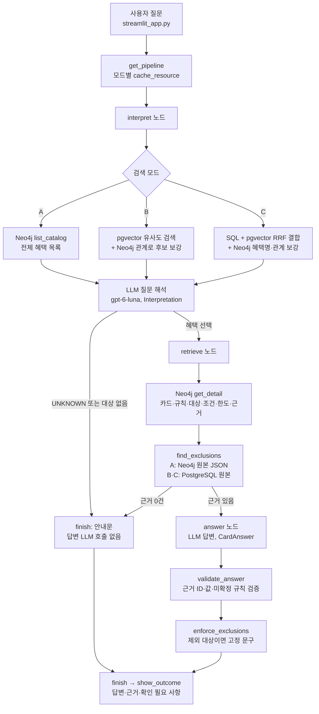
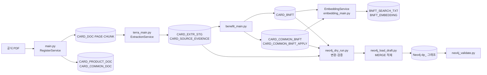

# 하나카드 GraphRAG 개발 인수인계 (2026-11-03)

이 문서만 읽고 다음 개발을 이어갈 수 있도록 작성했다. 작업 트리의 소스, 개발 DB·Neo4j의 읽기 전용 조회, 당일 실행 로그를 대조했다. 작성 중 소스·DB·그래프는 변경하지 않았고 테스트도 다시 돌리지 않았다.

상태 표기는 **완료**, **부분 완료**, **미완료**로 구분한다. 함수의 줄 번호는 작업 트리(커밋되지 않은 답변 수정 포함) 기준이다.

## 목차

1. 현재 상태 요약
2. 시스템 구성과 실행 흐름
3. 오늘 개발한 소스
4. DB 변경과 데이터 현황
5. 검색과 LLM 구현
6. 테스트와 검증 결과
7. 남은 문제
8. 다음 작업 체크리스트
9. 실행과 재현 방법
10. Git 작업 상태

---

## 1. 현재 상태 요약

| 영역 | 상태 | 내용 |
|---|---|---|
| PostgreSQL 임베딩 컬럼·저장 | 완료 | 개발 Supabase 적용. 혜택 5건, 공통 혜택 1건 임베딩 |
| 문서 등록 2경로, 상품·공통 혜택 등록 | 완료 | ROLLBACK 시험으로 검증. 실제 추출 전 구간은 미검증 |
| Neo4j `dp_` 그래프 | 완료 | 노드 124, 관계 196, PostgreSQL과 차이 0 |
| A/B/C 검색과 Neo4j 연동 | 완료 | 현재 등록 데이터 범위 |
| 자연어 답변 | 부분 완료 | 구현과 표본 검증 완료. 전체 회귀 평가 미실시, 커밋 안 됨 |
| 공통 혜택 PDF 근거 직접 연결 | 미완료 | 테이블 설계 검토 중, DB 미적용 |
| 기존 Visa `CARD_BNFT` 행 이관 | 미완료 | 이관안 SQL만 있음. 미실행 |

**가장 먼저 할 일:** 자연어 답변 수정 5개 파일이 아직 커밋되지 않았다(10절). Streamlit에서 질문별 답변을 확인한 뒤 커밋 여부를 정한다.

---

## 2. 시스템 구성과 실행 흐름

### 2-1. 구성 요소

| 구성 | 위치·방식 | 역할 |
|---|---|---|
| PostgreSQL | Supabase, 스키마 `db_pipeline` | 원본 데이터, 조건, 근거, 임베딩 |
| pgvector | `extensions` 스키마 0.8.2 | 혜택 의미 검색. 벡터는 PostgreSQL에만 있음 |
| Neo4j | Aura `6ac1f0f8`, 5.27 Enterprise | `dp_` 관계 탐색 그래프 |
| 임베딩 | `text-embedding-3-small`, 1536차원 | 혜택 검색 텍스트와 질문 임베딩 |
| LLM | `gpt-6-luna` | 질문 해석, 답변 생성 |
| 화면 | Streamlit + LangGraph | 로컬 개발 화면 |

**혜택 저장 구조**

- 개별 카드 혜택: `CARD_BNFT` (`RULE_LIST`, `BNFT_COND_EXPR` JSONB)
- 공통서비스 혜택: `CARD_COMMON_BNFT`. 카드 적용은 `CARD_COMMON_BNFT_APPLY`로만 표현하며 `CARD_BNFT`로 복제하지 않음
- 문서 경로
  - 상품: `CARD_DOC → CARD_PRODUCT_DOC → CARD_PRODUCT`
  - 공통: `CARD_DOC → CARD_COMMON_DOC → CARD_COMMON`
- `CARD_DOC.CARD_ID`는 현재 구조에 없음

### 2-2. 질문 처리 흐름



### 2-3. 데이터 적재 흐름



---

## 3. 오늘 개발한 소스

경로는 `src/card_benefit/payment_card/` 기준이다. 커밋 열의 `451089e`는 해당 커밋에 포함됐다는 뜻이고, **미커밋**은 그 위에 수정이 더 있다는 뜻이다.

### 3-1. 등록·임베딩 (`db_pipeline/`)

| 파일 | 구분 | 역할 | 주요 함수·클래스 | 호출 관계 | 상태 | 커밋 |
|---|---|---|---|---|---|---|
| `benefit_search_text.py` | 신규 | B안 검색 텍스트 생성 | `build_card_bnft_text`, `build_common_bnft_text`, `excluded_tokens`, `exclusion_tokens` | `embedding_service`, `card_graphrag`, `benefit_search_service`에서 호출 | 완료 | 451089e |
| `embedding_service.py` | 신규 | 텍스트·벡터 저장, 재시도, 실행 이력 | `EmbeddingService.sync`, `embed_new`, `OpenAIEmbedder`, `EmbeddingRepository`, `vector_literal` | 등록 서비스, `embedding_main`, 검색 | 완료 | 451089e |
| `embedding_main.py` | 신규 | 일괄 처리 CLI | `main`, `parse_args` | `EmbeddingService` | 완료 | 451089e |
| `embedding_repository.sql` | 신규 | 텍스트·벡터 갱신, 벡터·문자열 검색, 상세 조회 SQL | 명명 SQL | `EmbeddingRepository` | 완료 | 451089e |
| `product_benefit_service.py` | 신규 | 상품 혜택을 `CARD_BNFT`로 등록 | `ProductBenefitService.register_run` | `benefit_main`, `CommonBenefitRepository` | 완료 | 451089e |
| `benefit_main.py` | 신규 | 혜택 등록·동일성 판정 CLI | `main` (`product`, `common`, `brand-compare`) | 등록 서비스들 | 완료 | 451089e |
| `common_benefit_service.py` | 수정 | 공통 혜택 등록, 카드 적용 판단, 동일성 판정 | `CommonBenefitService.ensure_common`, `link_doc`, `register_run`, `apply_run`, `compare_brand_benefits`, `compare_brand_bnft`, `benefit_code` | `register_service`, `benefit_main`, `neo4j_dry_run`, 검색 | 완료 | 451089e |
| `common_benefit_repository.sql` | 수정 | 공통 등록·적용·정합성·동일성 비교 SQL | `brand_bnft_compare`, `common_integrity_errors` 등 | 위 서비스 | 완료 | 451089e |
| `register_service.py` | 수정 | 문서 등록과 상품·공통 연결 | `RegisterService.register`, `_link`, `ProductDocLink`, `CommonDocLink` | `main.py` | 완료 | 451089e |
| `main.py` | 수정 | 문서 등록 CLI. `--card-id`, `--common-cd` 추가 | `main`, `links` | `RegisterService` | 완료 | 451089e |
| `document_repository.py`, `.sql` | 수정 | 상품 연결 저장 | `card_exists`, `link_product_doc` | `RegisterService` | 완료 | 451089e |

### 3-2. Neo4j (`db_pipeline/`)

| 파일 | 구분 | 역할 | 주요 함수·클래스 | 상태 | 커밋 |
|---|---|---|---|---|---|
| `neo4j_dry_run.py` | 전면 수정 | 전체 상품 변환, 원천 건수 계산, 오류 수집 | `load_snapshot`, `build`, `expected_counts`, `Preview`, `PK_FIELDS`, `GraphValidationError` | 완료 | 451089e |
| `neo4j_load_draft.py` | 전면 수정 | 제약 생성과 MERGE 적재 | `prepare_schema`, `prepare`, `write_transaction`, `node_properties`, `main` | 완료 | 451089e |
| `neo4j_validate.py` | 수정 | PostgreSQL 대조 | `run`, `compare_graph`, `graph_ok` | 완료 | 451089e |
| `neo4j_validation.cypher`, `.sql` | 수정 | 대조용 읽기 전용 조회 | `orphan_nodes`, `common_applies`, `rule_targets` 등 | 완료 | 451089e |

### 3-3. 검색·답변 (`db_pipeline_origin_search/`)

| 파일 | 구분 | 역할 | 주요 함수·클래스 | 호출 관계 | 상태 | 커밋 |
|---|---|---|---|---|---|---|
| `benefit_search_service.py` | 신규 | SQL·벡터·RRF·관계 보강, 중복 제거 | `BenefitSearchService.search`, `catalog_rows`, `get_detail`, `merge_duplicates`, `search_terms` | `card_graphrag`, `search_eval` | 완료 | 451089e |
| `search_eval.py` | 신규 | 계층별 검색·최종 답변 평가 | `evaluate`, `evaluate_answers`, `score_answer`, `CASES`, `REQUIRED_QUESTIONS` | 검색 서비스, `CardGraphRAG` | 부분 완료 (7절 11번) | 451089e |
| `graph_questions.cypher` | 수정 | `dp_` 조회, 1·2·3홉 | `catalog`, `common_catalog`, `candidate_relations`, `common_benefit_evidence`, `hop*` | `neo4j_search` | 완료 | 451089e |
| `neo4j_search.py` | 수정 | 읽기 전용 Neo4j 조회 | `Neo4jSearch.list_catalog`, `get_detail`, `candidate_relations`, `hop`, `is_common_key` | `card_graphrag`, 검색 서비스 | 완료 | 451089e |
| `card_graphrag.py` | 수정 | LangGraph 질문 처리, 답변 검증 | `CardGraphRAG`(`interpret:822`, `retrieve:896`, `answer:942`, `finish:976`), `validate_answer:564`, `find_exclusions:295`, `enforce_exclusions:323`, `answer_text_problem:677`, `customer_text:672`, `find_unresolved:387` | Streamlit, 평가 | 부분 완료 | **미커밋** |
| `streamlit_app.py` | 수정 | 화면, 검색 모드, 호출 정보 | `get_pipeline:30`, `show_generation:56`, `show_outcome:79`, `show_evidence:49` | `card_graphrag`, `verify_view` | 부분 완료 | **미커밋** |
| `README.md` | 수정 | 검색 모드 설명 | | | 완료 | 451089e |

`verify_view.py`는 변경하지 않았다.

### 3-4. SQL (`src/card_benefit/sql/`)

| 파일 | 구분 | DB 적용 여부 |
|---|---|---|
| `db_pipeline_migration_v7_bnft_embedding_precheck.sql` | 신규 | 읽기 전용 점검, 실행함 |
| `db_pipeline_migration_v7_bnft_embedding.sql` | 신규 | **적용함** |
| `db_pipeline_migration_v7_bnft_embedding_rollback.sql` | 신규 | 미실행 |
| `db_pipeline_proposal_common_evidence_link.sql` | 신규 | **미적용 제안** |
| `db_pipeline_proposal_brand_service_bnft_transfer.sql` | 신규 | **미적용 제안**. ROLLBACK 시험만 수행 |

`db_pipeline_schemaV7_draft.sql`, `.dbml`은 수정하지 않았다. 공통서비스 4개 테이블이 없으며, DB 구조의 기준은 최신 백업과 실제 DB다.

### 3-5. 테스트

| 파일 | 구분 | 내용 | 커밋 |
|---|---|---|---|
| `tests/test_benefit_embedding.py` | 신규 | 검색 텍스트, 임베딩, 상품 등록, 검색, 동일성, 제외 판정 | 451089e + **미커밋 수정** |
| `tests/test_answer_text.py` | 신규 | 자연어 답변 검증 8건 | **미추적** |
| `tests/test_live_registration.py` | 신규 | 개발 DB ROLLBACK 시험 2건 (`RUN_DB_INTEGRATION=1`) | 451089e |
| `tests/test_common_benefit.py` | 재작성 | 공통 혜택 등록·적용 | 451089e |
| `tests/test_card_graphrag.py` | 수정 | 문구·스키마 기대값 | 451089e + **미커밋 수정** |
| `tests/test_neo4j_origin_search.py` | 수정 | `dp_`, 1·2·3홉 실제 조회 | 451089e |
| `db_pipeline/test_neo4j_dry_run.py`, `test_neo4j_load_draft.py`, `test_neo4j_validate.py` | 재작성·수정 | 변환·적재·대조 | 451089e |
| `tests/test_db_pipeline.py`, `test_payment_card.py`, `test_rule_pool_sql.py` | 수정 | mapper 목록, `dp_` 표기 | 451089e |

---

## 4. DB 변경과 데이터 현황

### 4-1. PostgreSQL

**실제 적용한 변경** (2026-11-03, 개발 Supabase)

```sql
ALTER TABLE db_pipeline.card_bnft
    ADD COLUMN IF NOT EXISTS bnft_search_txt text,
    ADD COLUMN IF NOT EXISTS bnft_embedding extensions.vector(1536);

ALTER TABLE db_pipeline.card_common_bnft
    ADD COLUMN IF NOT EXISTS bnft_search_txt text,
    ADD COLUMN IF NOT EXISTS bnft_embedding extensions.vector(1536);

INSERT INTO db_pipeline.common_cd (common_code_grp_id, common_cd, common_cd_nm, common_cd_desc, create_user_id, update_user_id)
VALUES ('RUN_STAGE', 'EMBED', '임베딩', '혜택 검색 텍스트 임베딩 생성 실행', 'SYSTEM', 'SYSTEM')
ON CONFLICT ON CONSTRAINT pk_common_cd DO NOTHING;
```

전체 스크립트는 `db_pipeline_migration_v7_bnft_embedding.sql`이다. 벡터 인덱스는 만들지 않았다. 임베딩 모델과 오류는 새 컬럼 없이 `CARD_AI_RUN`(`RUN_STAGE=EMBED`)에 기록한다.

**기존 데이터 보존**

`CARD_BNFT` 17개 원본 컬럼의 해시는 작업 전후 모두 `235d3c28fc1597099b1526782d227708`이다. 마지막 대조는 평가 종료 후다.

**실제로 추가된 데이터**

| 테이블 | 내용 |
|---|---|
| `CARD_COMMON` | `VISA_SIGNATURE` (Visa Signature, VISA, SIGNATURE) 1건 |
| `CARD_COMMON_DOC` | 공통서비스 ↔ 문서 `20261102_000004` 1건 |
| `CARD_COMMON_BNFT` | `20261103_000001` Visa 컨시어지, 서비스 구분 `COMMON` 1건 |
| `CARD_COMMON_BNFT_APPLY` | JADE Classic(`card_id=5`) 1건 |
| `CARD_AI_RUN` | EMBED 실행 `20261103_000004`, `20261103_000005` |
| 혜택 검색 텍스트·벡터 | `CARD_BNFT` 5건, `CARD_COMMON_BNFT` 1건 |

샘플 시험 데이터는 ROLLBACK되어 남아 있지 않다. 시퀀스 번호만 소비됐다.

**현재 건수** (문서 작성 시 읽기 전용 조회)

| 테이블 | 건수 | 테이블 | 건수 |
|---|---:|---|---:|
| `card_product` | 2 | `card_common` | 1 |
| `card_product_doc` | 3 | `card_common_doc` | 1 |
| `card_doc` | 3 | `card_common_bnft` | 1 |
| `card_doc_page` | 10 | `card_common_bnft_apply` | 1 |
| `card_doc_chunk` | 10 | `card_source_evidence` | 35 |
| `card_bnft` | 5 (LOCAL 4, BRAND_SERVICE 1) | `card_evidence_link` | 57 |
| `card_extr_stg` | 9 | `card_ai_run` | 4 |

정합성 게이트 `v_card_integrity_issue`는 `evidence_not_approved` 35건뿐이다. 근거 승인이 아직 없다는 뜻이다.

**원문 근거 구조**

```text
CARD_SOURCE_EVIDENCE (PK evidence_id)
  ├─ card_doc_id, page_no, card_doc_chunk_id → CARD_DOC_CHUNK → CARD_DOC_PAGE → CARD_DOC
  └─ card_extr_stg_id → CARD_EXTR_STG

CARD_EVIDENCE_LINK (PK card_id, ev_link_id)
  주체 ev_subject_cd: CARD / BNFT / RULE / REL
  항목 ev_item_cd:    SELF / COND / TARGET
```

현재 연결 57건의 구성: BNFT·SELF 28, BNFT·COND 9, CARD·SELF 6, CARD·COND 3, RULE·SELF 6, RULE·COND 5.

`CARD_EVIDENCE_LINK`는 `card_id`가 PK의 일부이고 주체에 공통 혜택이 없다. 또 `evidence_subject_orphan` 게이트가 `card_bnft_id`를 `CARD_BNFT`에서 찾으므로 공통 혜택을 담을 수 없다.

**Visa 기존 행**

| 항목 | 값 |
|---|---|
| 기존 행 | `CARD_BNFT` `card_id=5`, `20261102_000008` (`BRAND_SERVICE`) |
| 공통 행 | `CARD_COMMON_BNFT` `20261103_000001` |
| `BNFT_CD` | 양쪽 동일. `sha256('HANA_VS002' + NUL + 'VISA_SIGNATURE_CONCIERGE')` 전체 일치로 복원 |
| 동일성 판정 | `SAME` (코드, 이름·유형, 문서, 브랜드·등급, 적용 카드, 기간, 내용, 근거) |
| 처리 | 기존 행 삭제·이관 안 함. 양쪽 모두 존재 |
| 백업 | `src/data/backup/pre_common_transfer_20261103.json` |

### 4-2. Neo4j

**`df_`에서 `dp_`로 변경**

| 구분 | 이전 | 현재 |
|---|---|---|
| 접두사 | `df_` | `dp_` (팀원 프로젝트는 `fp_`) |
| 네임스페이스 | `namespace` 속성, `df_one_pick_style` | 사용 안 함 |
| 공통 라벨 | `df_node` | `dp_node` |
| 식별 | `(namespace, key)` 단일 제약 | PostgreSQL PK 기준 라벨별 NODE KEY |
| 대상 | `card_id=2`, 문서 1건 고정 | 현재 등록된 전체 상품 |
| 건수 검증 | 고정값 98/165 | `expected_counts`로 원천에서 계산 |

**삭제한 제약:** `df_node_key` (`df_node(namespace, key)`). 삭제 전에 `df_node` 전용임과 노드 0건을 확인했고, 이후 해당 정리 코드는 소스에서 제거했다.

**`fp_` 데이터:** 변경하지 않았다. 현재 `fp_` 노드는 0건이며 조회 건수만 보고한다. 전체 DB 삭제 구문을 쓰지 않았고 적재 코드에 삭제 구문이 없다.

**현재 제약 14개** (각 제약이 같은 이름의 RANGE 인덱스를 소유)

| 제약 | 유형 | 속성 |
|---|---|---|
| `dp_node_key` | UNIQUE | `key` |
| `dp_card_product_pk` | NODE KEY | `card_id` |
| `dp_card_bnft_pk` | NODE KEY | `card_id, card_bnft_id` |
| `dp_bnft_rule_pk` | NODE KEY | `card_id, card_bnft_id, rule_key` |
| `dp_rule_target_pk` | NODE KEY | `target_type_cd, target_key` |
| `dp_card_common_pk` | NODE KEY | `card_common_id` |
| `dp_card_common_bnft_pk` | NODE KEY | `card_common_id, card_common_bnft_id` |
| `dp_card_doc_pk` | NODE KEY | `card_doc_id` |
| `dp_card_doc_page_pk` | NODE KEY | `card_doc_id, page_no` |
| `dp_card_doc_chunk_pk` | NODE KEY | `card_doc_id, page_no, card_doc_chunk_id` |
| `dp_card_source_evidence_pk` | NODE KEY | `evidence_id` |
| `dp_cond_expr_pk` | NODE KEY | `expr_key` |
| `dp_cond_branch_pk` | NODE KEY | `expr_key, branch_no` |
| `dp_cond_atom_pk` | NODE KEY | `expr_key, branch_no, atom_key` |

기본 LOOKUP 인덱스 `index_1b9dcc97`, `index_460996c0`은 변경하지 않았다.

**노드 매핑** (전체 노드에 `dp_node` 라벨 추가, 임베딩·검색 텍스트는 옮기지 않음)

| Label | 원천 | 건수 |
|---|---|---:|
| `dp_card_product` | `CARD_PRODUCT` | 2 |
| `dp_card_bnft` | `CARD_BNFT` | 5 |
| `dp_bnft_rule` | `CARD_BNFT.RULE_LIST[]` | 6 |
| `dp_rule_target` | `RULE_LIST[].TARGET_LIST[]`. 카드 간 공유 | 19 |
| `dp_cond_expr` | 조건 JSONB (카드·혜택·규칙) | 8 |
| `dp_cond_branch` | 조건식 `branches[]` (OR) | 9 |
| `dp_cond_atom` | 분기 `atoms[]` (AND, NOT) | 15 |
| `dp_card_common` | `CARD_COMMON` | 1 |
| `dp_card_common_bnft` | `CARD_COMMON_BNFT` | 1 |
| `dp_card_doc` | `CARD_DOC` | 3 |
| `dp_card_doc_page` | `CARD_DOC_PAGE` | 10 |
| `dp_card_doc_chunk` | `CARD_DOC_CHUNK` | 10 |
| `dp_card_source_evidence` | `CARD_SOURCE_EVIDENCE` | 35 |
| **합계** | | **124** |

원본 행은 노드의 `source_json`에 그대로 보존한다. 조건 노드 구조는 OR/AND/NOT 조회에 쓰이고 있어 유지했다.

**관계 매핑** (연결 테이블은 노드로 만들지 않음)

| Type | 방향 | 원천 | 건수 |
|---|---|---|---:|
| `dp_has_benefit` | 상품 → 혜택 | `CARD_BNFT.CARD_ID` | 5 |
| `dp_has_rule` | 혜택 → 규칙 | `RULE_LIST` | 6 |
| `dp_targets` | 규칙 → 대상 | `TARGET_LIST` | 34 |
| `dp_has_expr` | 카드·혜택·규칙 → 조건식 | 조건 JSONB | 8 |
| `dp_has_branch` | 조건식 → 분기 | `branches` | 9 |
| `dp_has_atom` | 분기 → 조건 | `atoms` | 15 |
| `dp_has_document` | 상품·공통서비스 → 문서 | `CARD_PRODUCT_DOC` 3 + `CARD_COMMON_DOC` 1 | 4 |
| `dp_has_common_benefit` | 상품 → 공통 혜택 | `CARD_COMMON_BNFT_APPLY` | 1 |
| `dp_belongs_to` | 공통 혜택 → 공통서비스 | `CARD_COMMON_BNFT.CARD_COMMON_ID` | 1 |
| `dp_same_as` | 기존 혜택 → 공통 혜택 | 동일성 판정 `SAME`일 때만 생성 | 1 |
| `dp_supported_by` | 카드·혜택·규칙 → 근거 | `CARD_EVIDENCE_LINK` | 57 |
| `dp_in_chunk` | 근거 → 청크 | `CARD_SOURCE_EVIDENCE` | 35 |
| `dp_on_page` | 청크 → 페이지 | `CARD_DOC_CHUNK` | 10 |
| `dp_in_document` | 페이지 → 문서 | `CARD_DOC_PAGE` | 10 |
| **합계** | | | **196** |

`dp_card_common_bnft`에는 `dp_supported_by`가 **없다**. 공통 혜택 근거는 `dp_same_as`를 거쳐 기존 행의 연결만 읽는다.

**적재와 재적재**

```powershell
.\.venv\Scripts\python.exe -m payment_card.db_pipeline.neo4j_load_draft
.\.venv\Scripts\python.exe -m payment_card.db_pipeline.neo4j_load_draft --apply --confirm APPROVED_DP_HANA_CARD
.\.venv\Scripts\python.exe -m payment_card.db_pipeline.neo4j_validate
```

- MERGE만 쓰므로 재실행해도 중복되지 않는다. 2회 적재 후 124/196을 확인했다.
- 원천에서 사라진 `dp_` 노드가 있으면 자동 삭제하지 않고 적재를 중단한다.
- `NEO4J_DATABASE`가 `6ac1f0f8`이 아니면 쓰기를 거부한다.

**1·2·3홉 조회** (실제 관계 이동 횟수는 `length(path)`로 확인. Neo4j Browser에 그대로 실행 가능)

정식 조회문은 `graph_questions.cypher`의 `hop*`에 있고, 코드에서는 `Neo4jSearch.hop(이름, 파라미터)`로 호출한다. 아래는 시각화용으로 경로를 반환하는 형태다.

```cypher
// 1홉: 카드 → 혜택. 결과 4건
MATCH path = (c:dp_card_product)-[:dp_has_benefit]->(b:dp_card_bnft)
WHERE c.product_nm CONTAINS 'ONE PICK STYLE'
RETURN path;

// 2홉: 카드 → 혜택 → 규칙. 결과 6건
MATCH path = (c:dp_card_product)-[:dp_has_benefit]->(b:dp_card_bnft)-[:dp_has_rule]->(r:dp_bnft_rule)
WHERE c.product_nm CONTAINS 'ONE PICK STYLE'
RETURN path;

// 2홉: 카드 → 공통 혜택 → 공통서비스. 결과 1건
MATCH path = (c:dp_card_product)-[:dp_has_common_benefit]->(b:dp_card_common_bnft)-[:dp_belongs_to]->(s:dp_card_common)
WHERE c.product_nm CONTAINS 'JADE Classic'
RETURN path;

// 3홉: 카드 → 혜택 → 규칙 → 적용 대상. 결과 34건
MATCH path = (c:dp_card_product)-[:dp_has_benefit]->(b:dp_card_bnft)-[:dp_has_rule]->(r:dp_bnft_rule)-[:dp_targets]->(t:dp_rule_target)
WHERE c.product_nm CONTAINS 'ONE PICK STYLE'
RETURN path;

// 3홉: 카드 → 공통 혜택 → 공통서비스 → 문서. 결과 1건
MATCH path = (c:dp_card_product)-[:dp_has_common_benefit]->(b:dp_card_common_bnft)-[:dp_belongs_to]->(s:dp_card_common)-[:dp_has_document]->(d:dp_card_doc)
WHERE c.product_nm CONTAINS 'JADE Classic'
RETURN path;

// 3홉 역방향: 이용처 → 규칙 → 혜택 → 카드. 경로 2개(규칙 2건), 혜택 1건
MATCH path = (t:dp_rule_target)<-[:dp_targets]-(r:dp_bnft_rule)<-[:dp_has_rule]-(b:dp_card_bnft)<-[:dp_has_benefit]-(c:dp_card_product)
WHERE t.target_nm = 'GS25'
RETURN path;

// 근거 경로: 혜택 → 근거 → 청크 → 페이지 → 문서
MATCH path = (b:dp_card_bnft)-[:dp_supported_by]->(:dp_card_source_evidence)-[:dp_in_chunk]->(:dp_card_doc_chunk)-[:dp_on_page]->(:dp_card_doc_page)-[:dp_in_document]->(:dp_card_doc)
WHERE b.name = 'ONE MORE 놀이공원 현장할인'
RETURN path;
```

PostgreSQL 대조 (같은 건수 4, 6, 34 확인):

```sql
SELECT count(*) FROM db_pipeline.card_bnft b JOIN db_pipeline.card_product p USING (card_id) WHERE p.product_nm LIKE '%ONE PICK STYLE%';
SELECT count(*) FROM db_pipeline.v_card_rule r JOIN db_pipeline.card_product p USING (card_id) WHERE p.product_nm LIKE '%ONE PICK STYLE%';
SELECT count(*) FROM db_pipeline.v_card_rule_target t JOIN db_pipeline.card_product p USING (card_id) WHERE p.product_nm LIKE '%ONE PICK STYLE%';
```

---

## 5. 검색과 LLM 구현

### 5-1. 모드별 동작

| 단계 | A 기존 검색 | B 임베딩 검색 | C 하이브리드 |
|---|---|---|---|
| 후보 선정 | Neo4j `list_catalog` 전체 혜택 | pgvector 코사인 유사도 상위 8건 | SQL 문자열 + pgvector를 RRF(k=60) 결합, 상위 8건 |
| 후보 보강 | 없음 | Neo4j `candidate_relations`로 대상·제외 표시, 순서 조정 | Neo4j 혜택명 점수 + 관계 보강 |
| 대상 선택 | LLM이 후보에서 혜택 ID 선택 | 동일 | 동일 |
| 관계 탐색 | Neo4j `get_detail` | Neo4j. 그래프에 없으면 `pg:` 키로 PostgreSQL | 동일 |
| 제외 검증 | 그래프 `source_json`으로 판정 (`neo4j_source_json`) | PostgreSQL 원본 재조회 (`postgresql`) | 동일 |
| 답변 생성 | 공통 경로 | 공통 경로 | 공통 경로 |
| PostgreSQL 접속 | 안 함 | 함 | 함 |
| Neo4j 장애 시 | 오류 종료 | 카탈로그 없이 진행 가능 | 오류 종료 |

- 평가의 `SQL` 계층은 화면의 A 모드와 다르다. LLM 없이 문자열 검색만 측정한 값이다.
- 유사도는 후보 선정에만 쓴다. 적용 여부 판단에 쓰지 않는다.
- 공통 혜택의 카드 적용은 `CARD_COMMON_BNFT_APPLY`로만 판단한다.
- 카드명은 임베딩 텍스트에 넣지 않고 `CARD_PRODUCT.PRODUCT_NM` 문자열 검색으로 찾는다.
- 기존 Visa 행은 `SAME`일 때만 공통 혜택으로 합친다. A는 `dp_same_as`로, B·C는 `merge_duplicates`로 처리한다.

### 5-2. LLM

| 항목 | 질문 해석 | 답변 생성 |
|---|---|---|
| 호출 위치 | `CardGraphRAG.interpret` → `_call_llm` | `CardGraphRAG.answer` → `_call_llm` |
| 프롬프트 | `INTERPRET_PROMPT` | `ANSWER_PROMPT` |
| 출력 스키마 | `Interpretation` | `CardAnswer` (`answer_text`, `conclusion`, `points`, `uncertain`, `cannot_answer_reason`) |
| 출력 상한 | 600 | 2000 |

공통 설정은 `gpt-6-luna`(환경변수 `CARD_SEARCH_MODEL`로 변경 가능), reasoning effort `low`, 제한 시간 60초, 재시도 0회, `with_structured_output(method="json_schema", strict=True)`이다. LLM은 Cypher를 만들지 않으며, 목록에 없는 혜택 ID는 Python이 버린다.

**자연어 답변 개선** (미커밋)

- 원인: 답변이 결론과 근거 문장으로 나뉘어 화면에 나열됐고, 프로그램 고정 문구에 내부 코드가 있었다. LLM은 그전에도 실제 호출되고 있었다.
- `CardAnswer.answer_text`를 추가했다. 추가 호출 없이 같은 답변 호출에서 받는다.
- `DRAFT`, `PENDING_REVIEW` 등은 고객 문장에서 자연어로 바꾼다(`customer_text`). 개발자 정보에는 원래 값을 유지한다.

**답변 문장 출처 (`answer_source`)**

| 값 | 조건 | 표시 내용 |
|---|---|---|
| `llm` | `answer_text_problem` 통과 | LLM 문장 그대로 |
| `validated_sentences` | 없는 값, 내부 코드·ID, 미확정 구간 단정, 없는 적용 방식, 빈 문장 | 결론 + 근거 확인 문장 (중복 제거) |
| `program_exclusion` | 질문 낱말이 제외 문구에 있음 | 프로그램 고정 문구 + 원문 근거 |
| `none` | 근거 문장 0건 또는 LLM 미호출 경로 | 안내문만 |

**LLM을 호출하지 않는 경로**

- 빈 질문, 500자 초과, API 키 없음, Neo4j·검색 실패
- `UNKNOWN` 또는 대상 혜택 없음 (답변 LLM 미호출)
- 근거 0건 (답변 LLM 미호출)

**캐시와 재실행**

| 구분 | 동작 |
|---|---|
| LLM 응답 캐시 | 없음 |
| `st.cache_resource` | 모드별 파이프라인(드라이버, LLM 객체)만 재사용 |
| 같은 질문 재실행 | 같은 질문·같은 모드·오류 없음이면 API를 호출하지 않고 이전 결과 표시. "같은 질문도 다시 실행"으로 해제 |
| 위젯 재실행 | `session_state` 값만 다시 그림 |
| OpenAI 프롬프트 캐시 | 입력 토큰 할인뿐이며 응답은 새로 생성. `cached_tokens`로 확인 |
| fallback | 다른 모델로 전환 없음 |

화면의 **답변 생성 정보 (API 호출·캐시)**에서 모델, 입력·캐시·출력 토큰, 소요 시간, 재표시 여부, 문장 출처를 볼 수 있다. 다만 **이 화면 요소는 브라우저에서 직접 확인하지 않았다.**

**호출량과 비용**

| 항목 | 값 |
|---|---|
| 39건 평가 | 질문 해석 39회 + 답변 30회 = LLM 69회, 코드 추정 비용 $0.02293, 질문당 평균 14.5초 |
| 임베딩 저장 | 실행 2회 (5건, 1건) |
| 검색 평가 임베딩 | 1차 54회, 2차 81회 |
| 표본 재현 실행 | 합산하지 않음 |
| 임베딩 비용 | 코드에 계산 기능 없음. 미집계 |

비용은 토큰과 `MODEL_PRICES`로 계산한 추정치이며 OpenAI 청구 내역과 대조하지 않았다.

---

## 6. 테스트와 검증 결과

### 6-1. 실행 기록

| 실행 | 범위 | 결과 | 시점 |
|---|---|---|---|
| 기준선 | 카드 단위 테스트 | 334 통과, 13 건너뜀, subtests 30 | 작업 시작 |
| 단위 테스트 최종 | `payment_card/tests` + `payment_card/db_pipeline` | **390 통과, 18 건너뜀, subtests 30** (11.05초) | 답변 수정 후 |
| Neo4j 연동 최종 | `test_neo4j_origin_search`, `test_card_graphrag`, `test_answer_text` | **140 통과** (51.02초) | 답변 수정 후 |
| 개발 DB 등록 시험 | `test_live_registration` 포함 3개 파일 | 134 통과 | **답변 수정 전** |
| `neo4j_validate` | 전체 대조 | `ok: true` | **답변 수정 전**. 답변 수정은 그래프와 무관 |

단위 테스트 18 건너뜀은 실제 연동 환경변수가 없을 때 제외되는 테스트다. 최종 Neo4j 연동 140건은 일부 파일만 대상이며 390건과 별개다.

### 6-2. PostgreSQL ↔ Neo4j 정합성

| 항목 | PostgreSQL | Neo4j | 결과 |
|---|---:|---:|---|
| 노드 | 124 (계산) | 124 | 일치 |
| 관계 | 196 (계산) | 196 | 일치 |
| 키·`source_json`·끝점 차이 | | | 0건 |
| 조건 구조 | 15 | 15 | 일치 |
| 근거 연결 | 57 | 57 | 일치 |
| 공통 적용 | 1 | 1 | 일치 |
| 규칙 대상 | 34 | 34 | 일치 |
| 고립·고아 노드 | | | 0건 |
| 범위 밖 노드·관계 | | | 0건 |
| 1·2·3홉 | 4 / 6 / 34 | 4 / 6 / 34 | 일치, `length(path)` 1 / 2 / 3 |

공통서비스 2홉·3홉은 JADE Classic에서 각 1건이고, ONE PICK STYLE에는 공통 혜택 연결이 없다.

### 6-3. 검색 계층 비교 (108행 = 27문항 × 4계층)

채점 19문항, 제외 질문 4문항, 데이터 없는 질문 4문항이다.

| 계층 | 엔진 | Top-1 | Top-3 | Top-5 | MRR | 제외 Top-1 오탐 | 제외 식별 | 평균 응답 |
|---|---|---:|---:|---:|---:|---:|---:|---:|
| SQL | sql | 94.7% | 94.7% | 94.7% | 0.947 | 2 | 0 | 1.8초 |
| PGVECTOR | pgvector | 89.5% | 100% | 100% | 0.947 | 3 | 0 | 3.2초 |
| HYBRID | sql, pgvector | 100% | 100% | 100% | 1.000 | 3 | 0 | 4.8초 |
| HYBRID_NEO4J | 위 + Neo4j 혜택명·관계 | 100% | 100% | 100% | 1.000 | **0** | **4** | 6.0초 |

- Top-1 실패: SQL은 "메가커피 자주 가는데 쓸만한 카드", PGVECTOR는 "올리브영 혜택"과 "서점에서 혜택 받는 카드"(각 2위)
- Neo4j는 정답 순위를 올리지 않았고, 제외 대상을 뒤로 보내고 식별하는 역할을 했다. 제외 대상은 후보 Top-5에는 남아 있다.
- 혜택이 5건뿐이라 Top-5는 의미가 없고, Top-1도 일반 성능으로 볼 수 없다.
- 응답 시간은 EU 리전 Supabase와 Aura 왕복을 포함한다.

### 6-4. LLM 답변 평가 (39건, C 모드, **자연어 답변 개선 전**)

| 묶음 | 결과 |
|---|---|
| 필수 질문 + 변형 12건 | 정답 8, 제외 정답 2, 대상 불명 거절 2 |
| 기존 27문항 | 정답 18, 제외 판정 1 + 미추천 3, 오답 1, 데이터 없음 거절 4 |

- 자동 채점은 혜택 선택, 답변 상태, 제외 판정만 본다. 문장 의미는 검증하지 않는다.
- 호출 오류는 0건, 제외 대상을 적용 가능하다고 답한 경우는 0건이다.
- 결과 원본 JSON은 세션 임시 폴더에 있었고 저장소에 없다. 위 표가 기록이다.

### 6-5. 자연어 답변 개선 후 재검증

대상 6건: 전월 실적 대중교통(A, C), 1만원 결제 캐시백, 고속버스, Visa 컨시어지, GS25 추천. 6건 모두 실제 LLM으로 실행했다. 마지막 수정 후에는 다시 실행했지만 출력은 "1만원" 1건만 확인했고, 나머지 5건은 직전 수정 시점의 출력을 확인했다.

### 6-6. 검증 구분

**검증 완료**

- 그래프 적재, 재적재 중복 없음, PostgreSQL 정합성
- 신규 문서 2경로, 재등록 중복 없음, 샘플 공통·상품 혜택 등록과 실제 임베딩 저장 (ROLLBACK)
- 적용 조건 없는 카드의 자동 연결 차단
- 이관안 근거 3건 보존 (ROLLBACK)
- Streamlit 서버 기동 (`/_stcore/health` = ok, 임시 포트 8599)

**미검증**

- 자연어 답변 개선 후 39건 전체
- 브라우저에서의 새 화면 요소, B·C 모드 화면 조작
- 실제 Terra 추출부터 혜택 등록까지 이어지는 전 구간
- 공통 혜택 2건 이상, 카드 3종 이상의 그래프 동작
- OpenAI 청구액과 비용 추정 대조
- 답변 문장의 의미 일치

---

## 7. 남은 문제

소스와 DB로 다시 확인한 상태다.

| # | 문제 | 상태 | 확인 내용 | 관련 위치 |
|---|---|---|---|---|
| 1 | `CARD_SOURCE_EVIDENCE`, `CARD_EVIDENCE_LINK` 구조·관계 추가 검토 | 미완료 | 4-1 구조 참고. 근거 원본과 연결이 분리돼 있고, 연결은 카드 소속 주체만 지원 | `db_pipeline/embedding_repository.sql`, `common_benefit_service.py` |
| 2 | 공통 혜택 근거 연결 신규 테이블 설계 | 미완료 | **이름 정정 필요.** 저장소 제안의 실제 이름은 `card_common_evidence_link`이고 `CARD_COMMON_BNFT_EVIDENCE_LINK`는 소스에 없다. 두 이름 모두 DB에 없음 | `sql/db_pipeline_proposal_common_evidence_link.sql` |
| 3 | 공통 혜택 직접 PDF 근거 연결 | 미완료 | `dp_card_common_bnft`의 `dp_supported_by` 0건. Neo4j는 `dp_same_as` 경로만, PostgreSQL 대체 경로는 혜택명 일치(`select_common_bnft_evidence`)에 의존 | `graph_questions.cypher`의 `common_benefit_evidence` |
| 4 | PDF 문서명 출력 | 미완료 | Neo4j 조회는 `document`를 반환하지만 `collect_evidence`와 `CardGraphRAG.answer`의 근거 항목이 문서명을 빼고, `show_evidence`도 쪽수만 표시 | `card_graphrag.py`, `streamlit_app.py` |
| 5 | 후속 질문의 대화 문맥 | 미완료 | 질문이 단건으로 처리됨. "이 혜택의..."는 `NO_TARGET` 안내로 종료 | `card_graphrag.py`, `streamlit_app.py` |
| 6 | 제외 대상 질문의 답변 표현 | 부분 완료 | LLM이 혜택을 고르면 제외 문구가 나오고 근거도 표시됨. 고르지 못한 "시외버스 혜택", "KTX 할인 카드", "SRT 탈 때 캐시백"은 사유 없이 답변 불가 | `find_exclusions`, `enforce_exclusions` |
| 7 | JADE Classic 공통서비스 질문 분류 | 미완료 | 후보 1위는 Visa 컨시어지(유사도 0.321)였으나 `interpret`가 `UNKNOWN`으로 종료. 분류 이유는 미확인 | `INTERPRET_PROMPT` |
| 8 | 자연어 답변 변경 후 전체 회귀 | 미완료 | 표본 6건만 재확인 | `search_eval.py` |
| 9 | 놀이공원 '1인 1매 적용 범위 미확정' 문구 | 부분 완료 | **원인 확인됨. LLM 생성이 아니다.** 아래 참고. 문구를 유지할지는 판단 필요 | `card_graphrag.py:58-60`, `:398` |
| 10 | Streamlit 추가 사용자 테스트 | 미완료 | 사용자가 개선 전 화면만 확인했고, 개선 후 화면은 미확인 | `streamlit_app.py` |
| 11 | 평가 결과에 `answer_text` 미기록 | 미완료 | `evaluate_answers`가 `conclusion`, `points`만 저장. 자연어 답변을 평가하려면 추가 필요 | `search_eval.py` |
| 12 | `answer_text` 의미 검증 부재 | 미완료 | 값과 내부 코드만 검증. 문장별 근거 ID는 `points`에만 있음. 한 차례 "최초"가 빠진 사례를 프롬프트로 완화했으나 재발 방지를 보장하지 않음 | `answer_text_problem` |
| 13 | 기존 Visa `CARD_BNFT` 행 이관 | 미완료 | `SAME`이고 시험은 통과했으나 미실행. 근거 연결 테이블이 선행 조건 | `sql/db_pipeline_proposal_brand_service_bnft_transfer.sql` |
| 14 | V7 설계 파일과 실제 DB 불일치 | 미완료 | V7 SQL·DBML에 공통 4개 테이블, 임베딩 컬럼 없음. `test_v7_sql_files.py`가 `card_common_` 부재를 검사 | `src/card_benefit/sql/` |
| 15 | 이전 표기 잔존 | 미완료 | `neo4j_isolated_test.py`(과거 V7 도구, `df_v7_test`)와 이전 이력 문서에 `df_` 잔존. `test_neo4j_origin_search.py`의 `df_`는 금지어 검사 | `sql/tools/v7_verification/` |

**9번 상세**

- 고정 문구: `UNRESOLVED_ATOMS["amusement_per_person"]` = "1인 1매가 적용되는 범위는 아직 확정되지 않았습니다."
- 발생 경로: `find_unresolved`(`card_graphrag.py:387`)가 조회된 조건 노드의 `key_name`을 이 표와 대조해 붙인다.
- 원천 데이터: `CARD_BNFT` 놀이공원 혜택의 `BNFT_COND_EXPR` 조건 `atom_key=amusement_per_person`, 유형 `ETC`, 원문 "1인 1매"
- 원문 근거: `20261101_000052` (1쪽) "50% 현장할인 (1인 1매)"
- 놀이공원 혜택의 조건을 조회하면 질문과 무관하게 표시된다. `transit_exclusions`도 같은 방식이다.
- 원문의 1인 1매 표기는 사실이고, 미확정인 것은 정형 해석이다. 적용 단위가 명확하다고 판단하면 문구를 제거하고 그렇지 않으면 유지한다. **값을 임의로 확정하지 않는다.**

---

## 8. 다음 작업 체크리스트

우선순위 순서다. 먼저 10절의 미커밋 파일 처리를 결정한다.

- [ ] **1. Streamlit 실제 질문별 답변 검증**
  - 소스: `db_pipeline_origin_search/streamlit_app.py`, `card_graphrag.py`
  - 검증: A·B·C 각각 6-4의 필수 질문 실행. 답변 문장, 근거 쪽수, 확인 필요 사항, **답변 생성 정보** 표시 확인. 기대 금액과 조건을 PDF로 대조
- [ ] **2. 잘못되거나 불필요한 미확정 문구 수정**
  - 소스: `card_graphrag.py`의 `UNRESOLVED_ATOMS`, `find_unresolved`, `ANSWER_PROMPT`
  - 검증: "1인 1매", 대중교통 제외 범위가 질문과 무관하게 표시되는지 확인. 근거 없이 미확정을 제거하지 않음. `test_card_graphrag.py` 기대값 갱신
- [ ] **3. 원문 근거 테이블 설계 최종 결정**
  - 소스: `sql/db_pipeline_proposal_common_evidence_link.sql`, 7절 1·2번
  - 결정: 테이블명(`card_common_evidence_link` 또는 `card_common_bnft_evidence_link`), 규칙·항목 단위 연결 필요 여부, 물리 FK 없음 유지. 공통 혜택은 카드 소속이 아니므로 기존 테이블 확장보다 별도 N:M 관계가 제안 방향
  - 검증: `CARD_EVIDENCE_LINK`의 기존 제약·게이트 영향 없음을 확인
- [ ] **4. 공통 혜택 근거 연결 테이블 추가 및 데이터 마이그레이션**
  - 소스: 위 제안 SQL, `sql/db_pipeline_proposal_brand_service_bnft_transfer.sql`
  - 검증: 사전 점검, 롤백 SQL, 변경 전 백업. `brand-compare`가 `SAME`인 행만 대상. 근거 3건 보존과 `BNFT_CD` 대응 확인. `REVIEW`는 자동 이관 금지
- [ ] **5. 관련 Python 등록·조회 프로그램 수정**
  - 소스: `common_benefit_service.py`(`_register_candidate`), `common_benefit_repository.sql`, `embedding_repository.sql`(`select_common_bnft_evidence`), `card_graphrag.py`, `streamlit_app.py`, `neo4j_validate.py`
  - 검증: 공통 혜택 등록 시 근거 연결 저장, 재등록 중복 없음. 함께 처리할 항목: 문서명 표시(7절 4번), `answer_text` 평가 기록(11번), JADE 분류(7번), 제외 답변(6번)
- [ ] **6. Neo4j 그래프 재적재 및 정합성 확인**
  - 소스: `neo4j_dry_run.py`(`load_snapshot`, `build`, `expected_counts`), `neo4j_load_draft.py`(`REL_TYPES`), `neo4j_validation.cypher`, `graph_questions.cypher`(`common_benefit_evidence`)
  - 주의: 기존 행 이관으로 노드가 사라지면 로더가 적재를 중단한다. 자동 삭제가 없으므로 `dp_` 범위의 정리 절차를 별도 승인받는다. `fp_`는 건드리지 않음
  - 검증: 예상 건수 재계산, 재적재 중복 없음, `neo4j_validate` `ok: true`, 공통 혜택 근거가 직접 조회되는지 확인
- [ ] **7. 전체 회귀 테스트**
  - 소스: `search_eval.py`, `tests/`, `db_pipeline/test_neo4j_*.py`
  - 검증: 9-5절 전체 명령. 39건 답변 재평가 시 `answer_text`까지 검토. 결과 JSON을 보관 위치에 저장
- [ ] **8. 발표용 GraphRAG 구조·실행 결과 정리**
  - 소스: 이 문서 2·4·6절, `src/card_benefit/docs/`
  - 검증: 수치는 최종 회귀 결과로 갱신. 표본이 작다는 한계와 Neo4j가 관계·조건 제공 역할임을 명시

---

## 9. 실행과 재현 방법

### 9-1. 시작

프로젝트 루트: `D:\Bootcamp\vscode\workspace\mle-02-p2-team3`

다른 PC에서는 실제 위치로 바꾼다. 모든 명령은 **프로젝트 루트**에서 실행한다. 일부 프로그램이 `.env`를 현재 폴더에서 읽기 때문이다.

```powershell
cd D:\Bootcamp\vscode\workspace\mle-02-p2-team3
.\.venv\Scripts\Activate.ps1
$env:PYTHONUTF8 = "1"
$env:PYTHONPATH = "$PWD\src\card_benefit;$PWD\src"
```

`.venv`가 없으면 `uv sync`로 만든다. 활성화하지 않아도 아래처럼 `.\.venv\Scripts\python.exe`로 실행할 수 있다.

### 9-2. 환경변수

설정 위치는 프로젝트 루트의 `.env`다. Git에서 제외되며, 값은 이 문서에 기록하지 않는다.

| 이름 | 용도 | 필수 |
|---|---|---|
| `DB_URL` | PostgreSQL (`common/database_manager.py`, psycopg) | 필수 |
| `NEO4J_URI`, `NEO4J_USERNAME`, `NEO4J_PASSWORD`, `NEO4J_DATABASE` | Neo4j (`common/neo4j_connection.py`) | 필수 |
| `OPENAI_API_KEY` | LLM, 임베딩 | 필수 |
| `CARD_SEARCH_MODEL` | LLM 변경. 기본 `gpt-6-luna` | 선택 |
| `CARD_EMBEDDING_MODEL` | 임베딩 변경. 기본 `text-embedding-3-small` | 선택 |
| `CARD_SEARCH_LOG_LEVEL`, `DB_QUERY_LOG` | 로그 | 선택 |
| `CARD_STORAGE_SUPABASE_URL`, `CARD_STORAGE_SUPABASE_SECRET_KEY`, `CARD_STORAGE_BUCKET` | PDF Storage | 해당 기능만 |

`NEO4J_DATABASE`는 적재 시 `6ac1f0f8`이어야 한다.

### 9-3. Streamlit

```powershell
.\.venv\Scripts\python.exe -m streamlit run src/card_benefit/payment_card/db_pipeline_origin_search/streamlit_app.py --server.address 127.0.0.1
```

접속 주소: `http://127.0.0.1:8501`

**질문 실행**을 누를 때만 유료 API가 호출된다. 소스를 고친 뒤에는 앱을 다시 시작한다. **개발 검증** 실행 모드는 A 경로로 동작한다.

### 9-4. 등록·임베딩·평가·Neo4j 명령

```powershell
# 임베딩: 기본은 dry-run
.\.venv\Scripts\python.exe -m payment_card.db_pipeline.embedding_main
.\.venv\Scripts\python.exe -m payment_card.db_pipeline.embedding_main --apply

# 기존 BRAND_SERVICE 행 동일성 판정(읽기 전용)
.\.venv\Scripts\python.exe -m payment_card.db_pipeline.benefit_main brand-compare --apply

# 검색 계층 평가. 질문 임베딩 호출. 약 5분 이상
.\.venv\Scripts\python.exe -m payment_card.db_pipeline_origin_search.search_eval --out tmp\search_eval.json

# 최종 답변 평가. 유료 LLM 호출 약 70회. 약 10분 이상
.\.venv\Scripts\python.exe -m payment_card.db_pipeline_origin_search.search_eval --answers --out tmp\answers.json

# Neo4j 사전 확인, 정합성 검증
.\.venv\Scripts\python.exe -m payment_card.db_pipeline.neo4j_load_draft
.\.venv\Scripts\python.exe -m payment_card.db_pipeline.neo4j_validate
```

`benefit_main`의 `--apply`는 `brand-compare`에서 쓰기를 뜻하지 않고 DB 접속을 허용하는 플래그다. `product`, `common`에서는 실제 등록이다.

### 9-5. 테스트

```powershell
# 단위 테스트
.\.venv\Scripts\python.exe -m pytest src/card_benefit/payment_card/tests src/card_benefit/payment_card/db_pipeline -q

# 실제 Neo4j 읽기 포함
$env:RUN_NEO4J_INTEGRATION = "1"
.\.venv\Scripts\python.exe -m pytest src/card_benefit/payment_card/tests/test_neo4j_origin_search.py src/card_benefit/payment_card/tests/test_card_graphrag.py src/card_benefit/payment_card/tests/test_answer_text.py -q

# 개발 DB 등록 시험. 변경은 ROLLBACK, 실제 임베딩 호출. 시퀀스 번호 소비
$env:RUN_DB_INTEGRATION = "1"
.\.venv\Scripts\python.exe -m pytest src/card_benefit/payment_card/tests/test_live_registration.py -q

# 연동 테스트 끄기
Remove-Item Env:RUN_NEO4J_INTEGRATION, Env:RUN_DB_INTEGRATION
```

오늘 단위 테스트는 Git Bash에서 `DB_URL`, `OPENAI_API_KEY`, `NEO4J_*`를 빈 값으로 지정해 실행했다. 연동 테스트는 환경변수로 켤 때만 동작한다.

`run_offline_tests.py`에는 카드 테스트가 포함되어 있지 않다.

---

## 10. Git 작업 상태

작성 시점 기준 (이 문서 추가 전).

| 항목 | 값 |
|---|---|
| 브랜치 | `main` |
| HEAD | `451089e` 변경 내역 반영 |
| 원격 | `origin/main`과 같음, ahead/behind 없음. `git fetch --dry-run`에서 `main` 변경 없음 |
| 원격 신규 브랜치 | `docs/card-benefit-ppt-v4`, `docs/hana-card-pdf-review`가 있으나 로컬로 가져오지 않음 |

**`451089e` 이후 미커밋 파일 (자연어 답변 수정)**

| 상태 | 파일 |
|---|---|
| 수정 | `src/card_benefit/payment_card/db_pipeline_origin_search/card_graphrag.py` |
| 수정 | `src/card_benefit/payment_card/db_pipeline_origin_search/streamlit_app.py` |
| 수정 | `src/card_benefit/payment_card/tests/test_benefit_embedding.py` |
| 수정 | `src/card_benefit/payment_card/tests/test_card_graphrag.py` |
| 미추적 | `src/card_benefit/payment_card/tests/test_answer_text.py` |
| 미추적 | 이 문서 |

**중요:** 위 파일을 커밋하기 전에는 다른 PC에 자연어 답변 개선이 없다. `451089e`만 받으면 Streamlit은 개선 전 답변을 표시한다. 학원에서 이어 가려면 먼저 이 변경을 옮겨야 한다.

**최근 커밋**

| 커밋 | 시각 | 작성 계정 | 내용 |
|---|---|---|---|
| `451089e` | 2026-11-03 06:47 | darkping1980 | 임베딩·등록·검색·`dp_` 그래프 작업 42개 파일 (추가 3,875, 삭제 754) |
| `fd60058` | 2026-11-03 05:26 | darkping1980 | 최신 DB 백업 추가 |
| `122d507` | 2026-11-02 23:37 | darkping1980 | 전일 변경 내역 |

`451089e`는 Claude Code가 만든 커밋이 아니다. Claude Code는 Commit과 Push를 실행하지 않았다.
