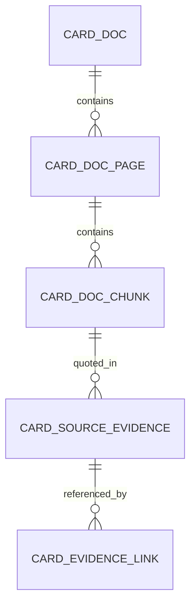

# [변경안 / 미적용] CARD_SOURCE_EVIDENCE 문서·페이지·청크 PK 승계

- 작성일: 2026-11-03
- 대상: 3팀 하나카드 GraphRAG, PostgreSQL `db_pipeline`
- 상태: **설계 검토안 — DB 미적용 / 소스 미수정 / 데이터 미이관**
- 기준: `src/data/backup/db_pipeline-postgres-202611030524.sql` (2026-11-03 05:24 백업). 실제 실행 전 개발 DB에서 재확인 필요.
- 목적: PDF 원문 근거가 어느 **문서 → 페이지 → 청크**에 종속되는지 ERD에서 식별 관계로 명확하게 표현. 기존 근거 연결의 단독 `EVIDENCE_ID` 접근은 보존한다.

## 1. 현재 구조와 변경 이유

현재 백업 DDL의 PK:
- `CARD_DOC`: `(CARD_DOC_ID)`
- `CARD_DOC_PAGE`: `(CARD_DOC_ID, PAGE_NO)`
- `CARD_DOC_CHUNK`: `(CARD_DOC_ID, PAGE_NO, CARD_DOC_CHUNK_ID)`
- `CARD_SOURCE_EVIDENCE`: `(EVIDENCE_ID)`

`CARD_SOURCE_EVIDENCE`는 이미 `CARD_DOC_ID`, `PAGE_NO`, `CARD_DOC_CHUNK_ID`를 **NOT NULL**로 보유한다. 그러나 이 컬럼들이 PK에 없어서 ERD에서 청크와 근거의 식별 관계가 드러나지 않는다.



> 위 관계는 논리 ERD의 방향과 다중성을 나타낸다. 실제 물리 FK가 설치되었다는 뜻이 아니다. CARD_EVIDENCE_LINK는 카드/혜택/규칙이 원문 근거를 재사용하는 매핑 테이블이므로 이번 변경 대상에서 제외한다.

## 2. 제안 PK

| 컬럼 | 자료형 | 변경 후 역할 | 비고 |
|---|---|---|---|
| `CARD_DOC_ID` | varchar(20) | PK 1 | 문서 PK 승계 |
| `PAGE_NO` | smallint | PK 2 | 페이지 PK 승계 |
| `CARD_DOC_CHUNK_ID` | varchar(20) | PK 3 | 청크 PK 승계 |
| `EVIDENCE_ID` | varchar(20) | PK 4 + 별도 UNIQUE | 자체 근거 식별자. 기존 단독 조회/연결 유지 |
| `CARD_EXTR_STG_ID` | varchar(20) | 일반 컬럼, NULL 허용 | 선택적 추출 이력. 전체 스테이징 PK의 승계가 아니므로 PK에 넣지 않음 |
| `QUOTE_TXT` | text | 기존 유지 | 원문 인용 문장 |
| `START_POS`, `END_POS` | integer | 기존 유지 | 인용 위치 |
| `APPROVAL_STATUS_CD` | varchar(20) | 기존 유지 | 승인 상태 |

**변경 후 PK**: `(CARD_DOC_ID, PAGE_NO, CARD_DOC_CHUNK_ID, EVIDENCE_ID)`

**반드시 유지할 단독 유일성**: `UNIQUE (EVIDENCE_ID)`. 기존 `CARD_EVIDENCE_LINK.EVIDENCE_ID` 및 공통 혜택 근거 연결 제안이 `EVIDENCE_ID`만으로 원문을 참조할 수 있어야 한다.

`CARD_EXTR_STG_ID`는 NULL 가능하며, `CARD_EXTR_STG`의 원래 복합 PK 전체를 승계하지 않는다. 따라서 이번 구조는 **청크 → 근거**의 승계이며, **추출 스테이징 → 근거**의 식별 관계로 바꾸는 것은 아니다.

## 3. 적용 전 필수 확인 SQL (읽기 전용)

다음 결과를 먼저 확인한다. 아래 DDL은 실행 지시가 아니며 승인 후 별도로 적용한다.

```sql
-- 3-1. 현재 제약과 PK 컬럼 확인
SELECT c.conname, c.contype, pg_get_constraintdef(c.oid) AS definition
FROM pg_constraint c
WHERE c.conrelid = 'db_pipeline.card_source_evidence'::regclass
ORDER BY c.conname;

-- 3-2. 이 테이블의 기존 PK를 참조하는 물리 FK 확인: 있으면 제약 변경 전에 별도 영향 분석
SELECT c.conrelid::regclass AS child_table, c.conname,
       pg_get_constraintdef(c.oid) AS definition
FROM pg_constraint c
WHERE c.contype = 'f'
  AND c.confrelid = 'db_pipeline.card_source_evidence'::regclass;

-- 3-3. 논리적 부모 청크와 불일치하는 원문 근거. 정상 목표: 0행
SELECT e.evidence_id, e.card_doc_id, e.page_no, e.card_doc_chunk_id
FROM db_pipeline.card_source_evidence e
LEFT JOIN db_pipeline.card_doc_chunk ch
  ON ch.card_doc_id = e.card_doc_id
 AND ch.page_no = e.page_no
 AND ch.card_doc_chunk_id = e.card_doc_chunk_id
WHERE ch.card_doc_chunk_id IS NULL;

-- 3-4. EVIDENCE_ID 중복. 현행 단독 PK이므로 정상 목표: 0행
SELECT evidence_id, COUNT(*) AS cnt
FROM db_pipeline.card_source_evidence
GROUP BY evidence_id
HAVING COUNT(*) > 1;

-- 3-5. 근거 연결 대상이 없는 행. 정상 목표: 0행
SELECT l.card_id, l.ev_link_id, l.evidence_id
FROM db_pipeline.card_evidence_link l
LEFT JOIN db_pipeline.card_source_evidence e
  ON e.evidence_id = l.evidence_id
WHERE e.evidence_id IS NULL;

-- 3-6. 변경 전 건수 기록
SELECT COUNT(*) AS evidence_count FROM db_pipeline.card_source_evidence;
```

## 4. 제안 DDL (실행하지 않음)

사전 확인과 관련 프로그램의 `ON CONFLICT` 사용 방식 검토 후, 별도 개발 DB 트랜잭션으로 실행한다. 신규 컬럼 추가나 근거 데이터 UPDATE/INSERT는 필요 없다. **키 제약만 변경**한다.

```sql
-- [PROPOSAL ONLY / NOT APPLIED]
BEGIN;
SET LOCAL lock_timeout = '5s';

-- 기존 PK가 사라져도 EVIDENCE_ID 단독 접근의 유일성이 유지되도록 먼저 추가
ALTER TABLE db_pipeline.card_source_evidence
  ADD CONSTRAINT card_source_evidence_evidence_id_key UNIQUE (evidence_id);

-- PK를 청크 상위 키 승계 형식으로 변경
ALTER TABLE db_pipeline.card_source_evidence
  DROP CONSTRAINT card_source_evidence_pkey;

ALTER TABLE db_pipeline.card_source_evidence
  ADD CONSTRAINT card_source_evidence_pkey
  PRIMARY KEY (card_doc_id, page_no, card_doc_chunk_id, evidence_id);

COMMIT;
```

**주의:** 물리 FK가 기존 PK 제약을 참조하고 있으면 `DROP CONSTRAINT`가 거부될 수 있다. 이때 `CASCADE`로 강제 삭제하지 말고, 참조 관계를 먼저 분석하여 이 변경안 자체를 재검토한다. 변경 중 데이터 변경은 없지만 PK 재생성 시 잠금과 인덱스 재구축이 발생할 수 있다. 기존 데이터가 같아도 API 또는 SQL의 `ON CONFLICT ON CONSTRAINT card_source_evidence_pkey`는 새 복합 키 의미로 달라지므로 사전 코드 검색이 필요하다.

## 5. 적용 후 검증 SQL

```sql
-- 변경한 PK와 EVIDENCE_ID 단독 UNIQUE가 둘 다 있는지 확인
SELECT conname, contype, pg_get_constraintdef(oid)
FROM pg_constraint
WHERE conrelid = 'db_pipeline.card_source_evidence'::regclass
  AND conname IN (
    'card_source_evidence_pkey',
    'card_source_evidence_evidence_id_key'
  )
ORDER BY conname;

-- 같은 원문을 공유하는 여러 링크가 여전히 EVIDENCE_ID 단독 JOIN으로 조회되는지
SELECT l.card_id, l.ev_link_id, l.card_bnft_id, l.evidence_id,
       e.card_doc_id, e.page_no, e.card_doc_chunk_id, e.quote_txt
FROM db_pipeline.card_evidence_link l
JOIN db_pipeline.card_source_evidence e
  ON e.evidence_id = l.evidence_id
ORDER BY l.card_id, l.ev_link_id
LIMIT 20;

-- 사전 기록한 원문 근거 총건수와 같은지 확인
SELECT COUNT(*) AS evidence_count FROM db_pipeline.card_source_evidence;
```

## 6. 되돌리기 DDL (실행하지 않음)

**단, 적용 후 새로운 FK나 종속 객체가 추가되지 않았는지 먼저 확인**한다.

```sql
-- [ROLLBACK PROPOSAL ONLY / NOT APPLIED]
BEGIN;
SET LOCAL lock_timeout = '5s';

ALTER TABLE db_pipeline.card_source_evidence
  DROP CONSTRAINT card_source_evidence_pkey;

ALTER TABLE db_pipeline.card_source_evidence
  ADD CONSTRAINT card_source_evidence_pkey PRIMARY KEY (evidence_id);

ALTER TABLE db_pipeline.card_source_evidence
  DROP CONSTRAINT card_source_evidence_evidence_id_key;

COMMIT;
```

## 7. 영향 범위와 다음 작업

- **기존 데이터**: `CARD_SOURCE_EVIDENCE`의 컬럼과 행은 수정하지 않음. 원문 인용 `EVIDENCE_ID` 값, 승인 상태, 문서/페이지/청크 위치는 그대로 유지.
- **현재 근거 매핑**: `CARD_EVIDENCE_LINK`의 기존 PK `(CARD_ID, EV_LINK_ID)` 및 `EVIDENCE_ID` 조회는 변경하지 않음. **혜택, 규칙, 카드 자체의 근거 3종류** 모두 보존.
- **공통 혜택 근거**: 별도 제안 `db_pipeline_proposal_common_evidence_link.sql`의 `card_common_evidence_link`는 **아직 미적용**. 이 문서의 PK 변경과 독립적으로 검토한다. 신규 테이블 이름을 확정한 것으로 간주하지 않는다.
- **SQL/Python**: `EVIDENCE_ID` 단독 조회, `INSERT`, `UPSERT`, `ON CONFLICT`, 제약 이름에 의존한 코드, 정합성 뷰와 테스트를 점검해야 한다. 특히 기존 PK 제약 이름을 목표로 한 `ON CONFLICT ON CONSTRAINT`는 위험.
- **Neo4j**: `dp_` 노드 식별자 구성과 적재·조회가 `EVIDENCE_ID` 단독인지 확인. 단독 UNIQUE를 유지하면 기존 식별자를 유지할 수 있지만, 재적재/통합 테스트로 검증해야 한다.
- **ERD**: `CARD_DOC → CARD_DOC_PAGE → CARD_DOC_CHUNK → CARD_SOURCE_EVIDENCE`를 식별 관계로 표시. 물리 FK를 추가할지는 별도 정책 결정.
- **검증**: 근거 총건수, 오펀 청크·원문 링크 0건, 기존 혜택·규칙·카드 근거 조회, Streamlit PDF 인용 결과가 변경 전과 같은지 확인.

### 결정 상태

- [x] 설계안 문서화: 문서·페이지·청크 PK 승계 + 자체 `EVIDENCE_ID` + 단독 UNIQUE
- [ ] 실제 PostgreSQL 스키마·참조 제약 재확인
- [ ] 업무/프로그램 영향 검토 및 변경 승인
- [ ] 개발 DB 마이그레이션 실행
- [ ] SQL/Python/Neo4j/ERD 반영 및 회귀 테스트

> 이 문서는 **추가 변경 제안**이다. 실제 PostgreSQL DDL 실행, 데이터 이관, 소스 수정, Neo4j 갱신을 수행하지 않는다.
